<p align="center">
  
</p>

<p align="center">
  <a href="LICENSE"></a>
  <a href="https://www.npmjs.com/package/dsh-awesome-hud"></a>
  <a href="https://www.npmjs.com/package/dsh-awesome-hud"></a>
</p>

<p align="center">
  <a href="README.md"></a>
  <a href="README_en.md"></a>
</p>

# dsh-awesome-hud

为 DeepSeek Harness Web / 桌面端的聊天页加一块悬浮 HUD 面板：会话状态、上下文占用与一键压缩、Git 变更、子代理、任务与 MCP 启停，一屏看全。

> 点击会话页右上角的「HUD面板」开合面板。面板与官方右侧栏、[dsh-better-sidebar](https://github.com/omdsh-dev/DSH-better-sidebar) 右侧栏互斥协作：侧栏展开时面板临时让位，不遮挡也不额外挤压正文。

---

## 📑 目录

点击跳转到对应章节。

- [🖼️ 界面效果](#️-界面效果)
- [✨ 功能总览](#-功能总览)
- [🧩 模块与页面](#-模块与页面)
- [⚙️ HUD 设置与面板行为](#️-hud-设置与面板行为)
- [🚀 快速开始](#-快速开始)
- [⚙️ 兼容性](#️-兼容性)
- [🔧 技术栈](#-技术栈)
- [🧪 开发与测试](#-开发与测试)
- [🔗 关联插件](#-关联插件)
- [⬆️ 升级说明（v0.11.x → v0.21.5）](#️-升级说明v011x--v0215)
- [📄 许可证](#-许可证)

---

## 🖼️ HUD面板

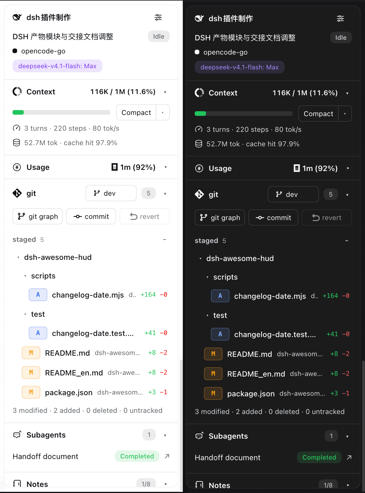

---

## ✨ 功能总览

| 模块 | 你能看到 / 能做什么 |
| --- | --- |
| 会话 | 工作区与会话名称、运行状态、模型与思考等级标签；菜单里重命名、置顶、分支、归档、复制。 |
| 上下文 | 占用率与进度条、会话统计与 Token 用量；一键压缩，或派子代理写交接文档。 |
| 用量 | DeepSeek 余额、OpenCode Go 额度、Codex 额度；折叠后在标题展示其中一项。 |
| 产物 | 本会话及其子会话写出的文档 / 表格 / 演示 / 图片，以及本会话交付的文件；点击预览，右键加入聊天或复制路径。 |
| Git | 分支与变更数量、暂存与未暂存分组、diff、commit（含 AI 生成提交信息）、git graph。 |
| 任务 | 会话任务清单与完成状态，随任务变化实时刷新。 |
| 子代理任务 | 当前会话的子代理层级与状态，点击在右侧栏打开该子代理会话。 |
| 计划清单 | plan 模式产出的计划与三种状态，点击查看计划全文。 |
| 便笺 | 按工作区共享的多条便笺，支持图片、拖动排序、导入与发送到聊天输入框。 |
| 待办 | 按工作区共享的待办清单，勾选、编辑、拖动排序、清空已完成。 |
| MCP | 已接入的 MCP 服务与全局启停开关。 |

面板另提供：**模块折叠与置顶**、**卡片 / 边栏两种面板样式**、**左 / 右两种展开位置**、**内置使用说明页与更新日志页**。

---

## 🧩 模块与页面

### 会话模块

显示工作区名称、会话名称、会话状态，以及合并成一个标签的模型名与思考等级（按等级着色）。两个名称都可以点击，在鼠标位置打开操作菜单：

- **工作区菜单**：重命名、在文件管理器中显示、复制路径；
- **会话菜单**：置顶 / 取消置顶、重命名、分支会话、复制会话 ID、复制会话名称、归档会话；
- **重命名**：名称原位变为输入框，Enter 保存、Esc 取消、点其他位置也会保存。


### 上下文模块

标题右侧是「当前占用 / 最大上下文（占用率）」，进度条用颜色表示占用率；底部两行分别是会话统计（轮数、步数、tok/s）与 Token 用量（总量、缓存命中）。鼠标悬浮在进度条上会切换成分段样式，分段表示 System prompt、Tool definitions 与 Messages；悬浮两行可看完整明细。

- **压缩**：会话空闲时可点，任务进行中置灰；
- **交接**：点「压缩」右侧的下拉菜单，子代理会把交接文档写进工作区的 `docs/handoff/` 目录，进度在「子代理任务」模块里可见。

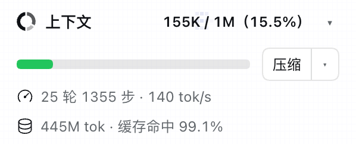

### 用量模块

- **DeepSeek 余额**：始终展示，没有数据时显示 `—`；
- **OpenCode 用量**：OpenCode Go 三个窗口的用量百分比；
- **Codex 额度**：已订阅时显示 5 小时与每周额度，未订阅时显示免费额度；
- **点击跳转**：点余额或百分比打开对应的设置页；
- **折叠后信息**：折叠后可在标题右侧展示余额或其中一项额度，展示内容随设置切换。

前三项由两个关联插件提供：[dsh-account-usage](https://github.com/Ycet/dsh-account-usage)（余额与 OpenCode 用量）、[dsh-codex-subscription](https://github.com/WSL043/dsh-codex-subscription)（Codex 额度）；未安装或未启用时对应行不展示，设置项置灰并给出原因。

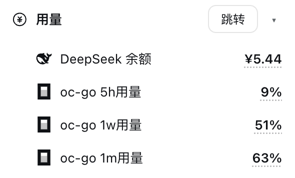

### 产物模块

列出本会话及其子会话（子代理）**用 `write` / `edit` 写出的**文档、表格、演示与图片，以及本会话用官方 `present` 交付的文件，按最后一次改动排序，最多 10 个文件，默认先显示 3 个、可展开查看全部；没有产物时模块整体不展示。只认这两类 durable 证据：重启 DSH 后列表仍能重建，也不会把同工作区其它会话、或你自己手改的文件算进来（终端命令直接生成的文件不再自动收录）。交付路径必须落在会话工作区内，工作区外的路径不列入，因为右侧栏预览按会话工作区解析。子代理的产物取它日志里的 `write` / `edit` 记录（fork 子代理只算它自己写出的部分，不重复父会话的历史），路径换算到主会话工作区，工作区之外的（例如 worktree 里的）不收录。**分支会话**继续显示分支之前的产物：DSH 不记录分支的来源，插件用「继承前缀里 `job` 事件的 `owner` + 边界事件时间」认出源会话，从而沿用它的子代理产物。

- **悬停路径**：鼠标在文件行上停留 0.5 秒显示完整相对路径；
- **点击打开**：在右侧栏打开文件内容；
- **右键菜单**：添加至聊天（以 `@` 引用加入聊天输入框）、在文件夹显示、复制文件名称 / 相对路径 / 绝对路径。

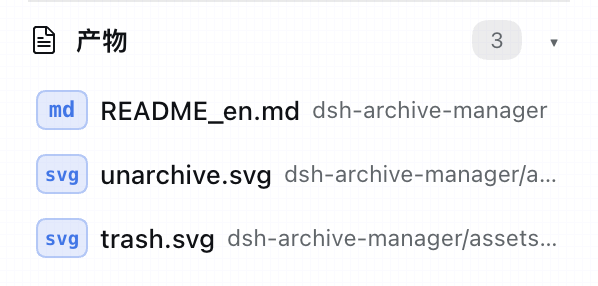

### Git 模块

标题右侧是当前分支与变更文件数量；变更文件分「已暂存」与「未暂存」两组，组名右侧是文件数量，支持列表与文件树两种查看方式，文件行最左是状态字母、随后是文件名与灰色相对目录，最右是 `+新增 / -删除` 行数。

- **分支按钮**：切换已有分支或新建分支并自动切换；
- **初始化仓库**：工作区不是仓库时按钮变成这一项，点击即可建仓，并同时写入 `.gitignore`；
- **悬停操作**：暂存区文件可移出暂存区，变更区文件可撤销或添加至暂存区（文件夹行对整棵子树批量执行）；
- **右键菜单**：暂存 / 撤销 / 加入仓库根的 `.gitignore`；
- **diff**：左键点击文件在右侧栏打开 diff；
- **revert**：撤销全部未暂存变更（未跟踪文件一并删除），操作前需要二次确认。

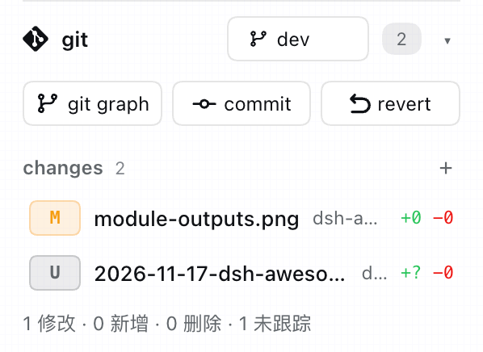

#### graph 页面

点模块里的「git graph」打开提交列表，分页加载（每页最多 80 条，滚动到底部继续加载）；当前分支为蓝底白字，其他分支为灰底黑字。右键点击提交可复制短哈希 / 全哈希 / 提交标题，或从此处创建分支、合并至当前分支，以及 soft / mixed / hard reset。

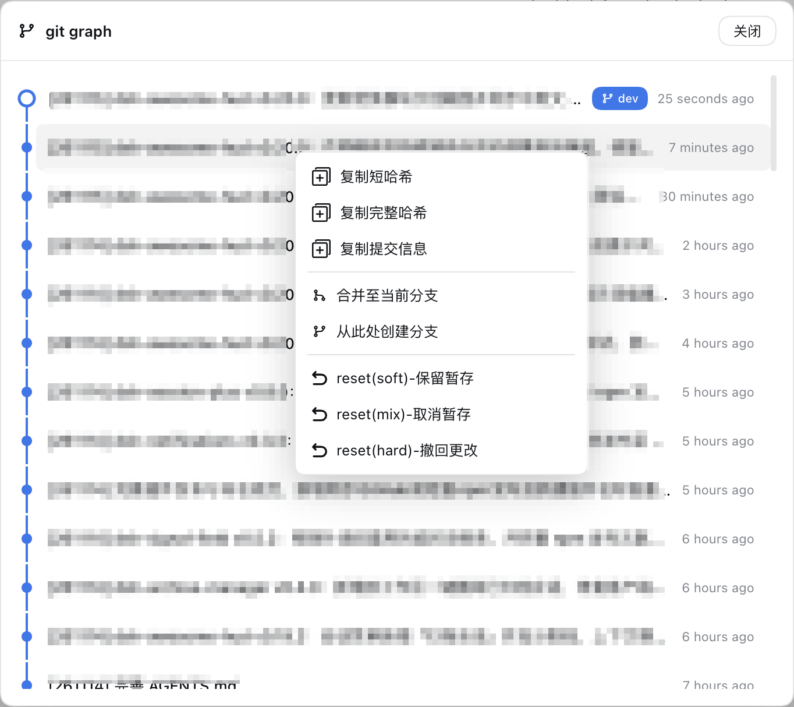

#### commit 页面

点「commit」提交暂存区；「AI generate」按提交规范生成提交信息，生成依据是「提示词 + 暂存区变更」，默认提示词里含日期与版本规范，可在弹窗顶部展开后修改并保存。没有暂存文件时按钮仍可打开弹窗，此时 commit 与 AI generate 置灰。

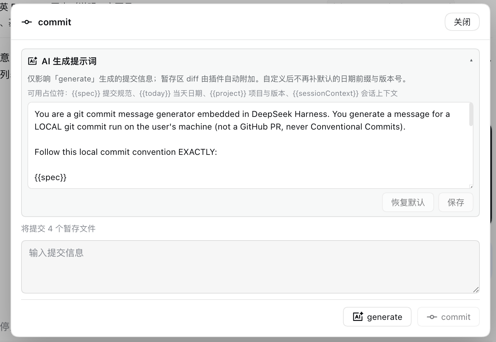

### 任务模块

显示会话的任务清单与完成状态，进行中的任务带旋转图标，已完成的任务收在列表下方、可展开查看；底部给出已完成、进行中与待处理的数量，任务变化时列表自动刷新。没有任务时模块不展示。

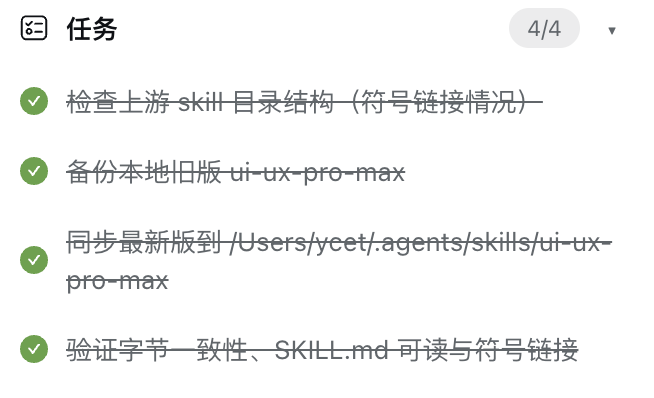

### 子代理任务模块

显示当前会话的全部子代理，按层级缩进，执行中为黄色、已完成为绿色；超过 3 个时先显示 3 个。点击条目在右侧栏打开该子代理会话，主会话保持打开。没有子代理时模块不展示。

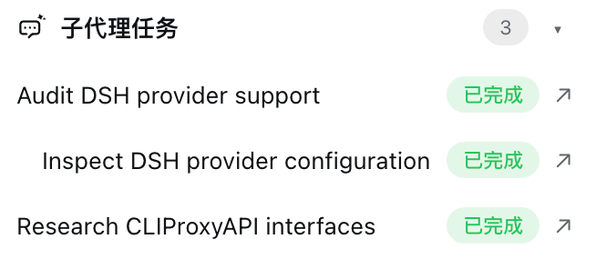

### 计划清单模块

显示 plan 模式产出的计划：待审批为黄色、已执行为绿色、已废弃为灰色并带删除线，底部是三种状态的数量，超过 3 个时先显示 3 个。点任意一行查看计划全文（按 Markdown 渲染）。

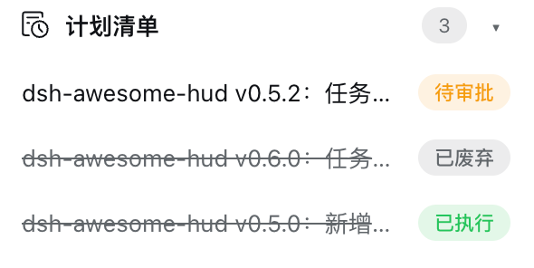

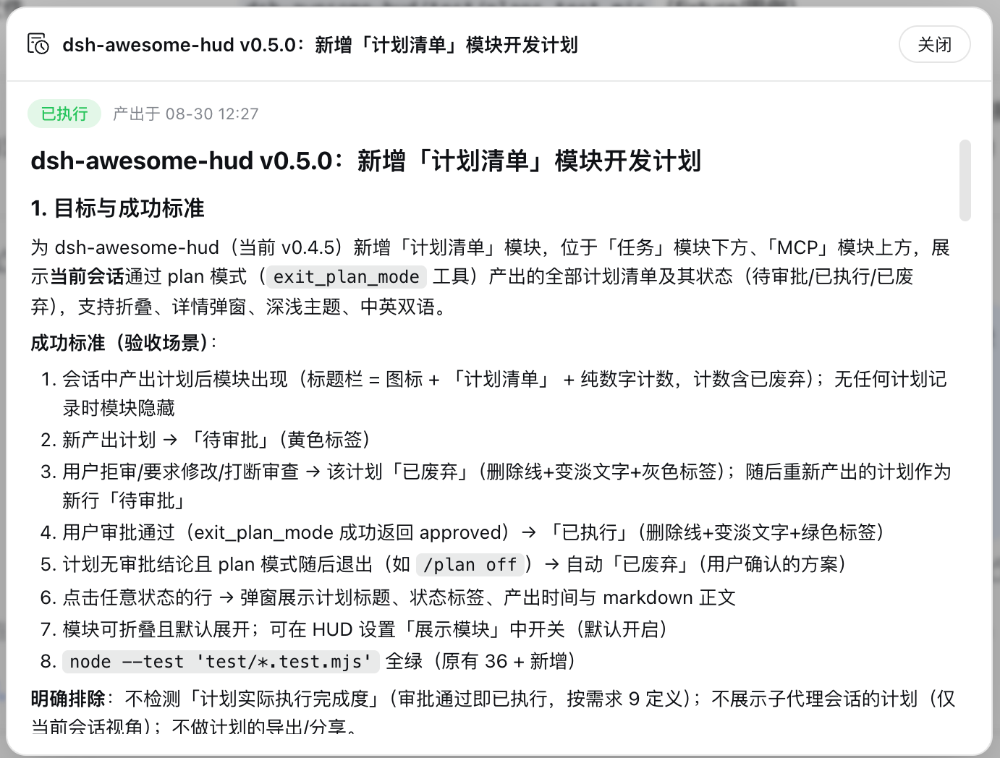

### 便笺模块

多条便笺按工作区共享（同一工作区目录下的会话共用同一组），每条单独保存标题与文字，字数不限、图片最多 20 张。

- **列表**：便笺条列表展示全部便笺，点击进入编辑，鼠标悬停显示删除按钮；
- **拖动排序**：按住便笺条左侧的拖动条调整顺序；
- **新建**：「添加便笺」新建空白便笺并进入编辑；「从聊天创建」用输入框的文字与图片新建便笺；
- **删除**：删除时按钮换成取消与确认，点确认才删除；「删除全部便笺」同样需要确认；
- **编辑视图**：默认在模块内展开，点返回按钮回到列表；可改标题（为空时自动编号）、粘贴图片并按缩略图拖动排序、拖动底部手柄调整高度（所有便笺共用同一高度）；
- **与聊天互通**：「从聊天导入」先清空便笺再写入输入框内容；「添加至聊天」先清空输入框再写入便笺内容（图片按便笺顺序加入）；「清空」需要二次确认；
- **弹窗编辑**：在设置里开启后，点便笺条在弹窗中编辑，模块保持列表视图。

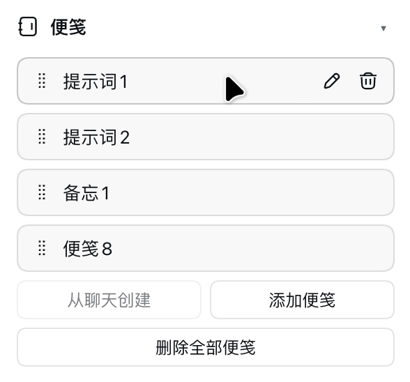

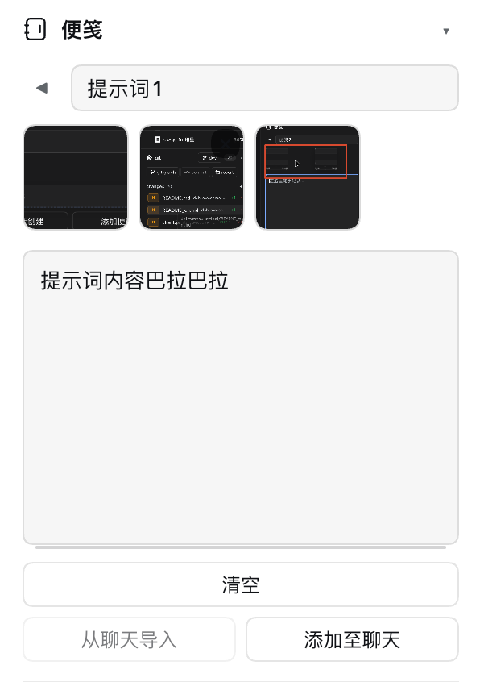

### 待办模块

按工作区共享的待办清单：勾选条目即标记完成、取消勾选即恢复；在输入框输入内容按 Enter 新增，点条目文字可编辑，删除时需要确认；拖动行左侧手柄调整顺序；「清空已完成」需要二次确认。标题显示已完成数量，已完成的待办收在下方、可展开查看。

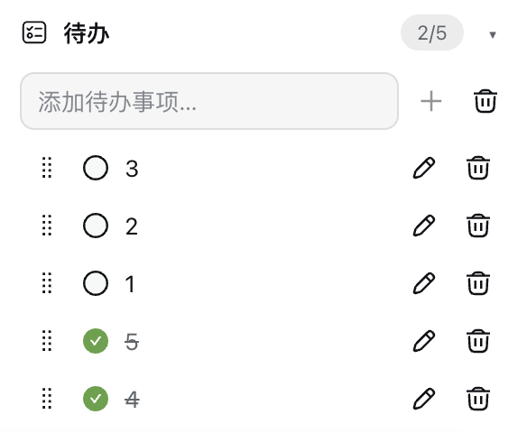

### MCP 模块

列出已接入的 MCP 服务与全局启停状态，点开关立即启停、不需要刷新页面；改动只影响目标服务，部分环境需要重启 DSH 后才生效。

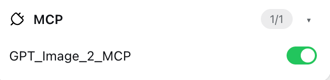

---

## ⚙️ HUD 设置与面板行为

点会话模块右上角的齿轮打开设置，弹窗顶部是三个标签：**「HUD 设置」/「使用说明」/「更新日志」**（「使用说明」是内置上手指南，按模块分节、每节给小标题与逐条说明；「更新日志」按版本分组记录改动，左栏当前版本号右侧带「最新」标签）。

- **左栏**：勾选模块控制显隐、拖动手柄排序（从上到下就是面板顺序）、卡片的图钉可置顶该模块（同时只允许一个）；
- **右栏**：五张卡片——HUD 面板通用设置（面板样式：卡片 / 边栏，默认卡片；展开位置：左 / 右；两处默认开合）、上下文、用量、git 变更、便笺；
- **保存**：有改动时「保存设置」可点，关闭与 Esc 都不保存；左下角「恢复默认」在鼠标位置弹出重置选项；
- **置灰原因**：设置项不可用时置灰，说明文字用红色写明原因。

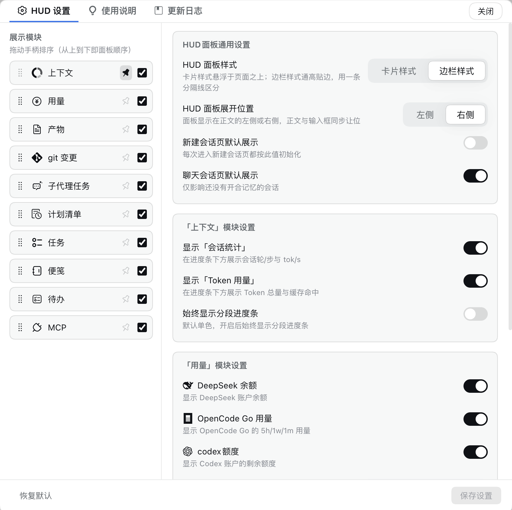

面板行为：

- **开合记忆**：开合状态按会话保存，新建会话页默认收起，默认值可在设置里修改；
- **折叠**：点模块标题折叠或展开，会话与上下文模块不能折叠，折叠状态按会话保存；
- **置顶**：置顶模块固定在「会话」下方，最高 40vh、超出在固定区内滚动、标题行照常吸附；
- **侧栏协作**：右侧栏展开期间面板临时隐藏，侧栏关闭后自动恢复。

---

## 🚀 快速开始

**方式一：从 npm 安装（推荐，支持插件页一键更新）**

```bash
# 1. 安装（无需 git；本机需有 pnpm，dsh plugin 会调用它）
dsh plugin --profile web add dsh-awesome-hud@0.21.5

# 2. 重启 DSH Web 服务并刷新页面
```

> [!NOTE]
> 从 npm 安装的副本可以在插件页直接升级：打开「插件 → 已安装」，有新版本时卡片显示「可更新」，详情页提供「更新到」。从 GitHub tag 或 Release 压缩包安装的副本不支持页内更新，需要先卸载再重新安装。

**方式二：从 GitHub 远程安装（tag 固定；无 npm 账号时可用，不支持页内一键更新）**

```bash
# 1. 安装（锁定版本 tag，要求本机 git 可访问 GitHub）
dsh plugin --profile web add "github:Ycet/dsh-awesome-hud#v0.21.5"

# 2. 重启 DSH Web 服务并刷新页面
```

**方式三：从本地源码安装（开发）**

```bash
# 1. 安装（将 <absolute-path-to-plugin> 替换为本地源码目录绝对路径）
dsh plugin --profile web add "dsh-awesome-hud@link:<absolute-path-to-plugin>"

# 2. 重启 DSH Web 服务并刷新页面
```

**方式四：从 Release 资产安装（tarball，无需 git、无需 npm 账号）**

```bash
# 1. 安装（可直接用 Release 资产 URL，也可先下载 .tgz 再传本地路径）
dsh plugin --profile web add "https://github.com/Ycet/dsh-awesome-hud/releases/download/v0.21.5/dsh-awesome-hud-0.21.5.tgz"

# 2. 重启 DSH Web 服务并刷新页面
```

安装完成后，聊天页右上角（「打开工作区」按钮左侧）出现「HUD面板」按钮，点击即可开合。**每个会话各自记住自己的开合状态**；新建会话页例外，每次进入都从收起状态开始，并在右上角提供独立的悬浮按钮。

### 桌面端安装（macOS）

先完全退出 DeepSeek Harness，再用桌面应用自带的 CLI 安装；不要用旧 Web CLI 管理 `desktop` profile：

```bash
# 从 npm 安装（推荐）
"/Applications/DeepSeek Harness.app/Contents/Resources/runtime/cli/bin/dsh" plugin --profile desktop add dsh-awesome-hud@0.21.5

# 从本地源码安装（开发）
"/Applications/DeepSeek Harness.app/Contents/Resources/runtime/cli/bin/dsh" plugin --profile desktop add "dsh-awesome-hud@link:<absolute-path-to-plugin>"
```

### 数据存放

便笺文字、待办、折叠、面板设置与开合记忆保存在当前浏览器或桌面应用的 `localStorage`；**便笺图片**以原图存在同一来源的 **IndexedDB**。安装插件不会自动搬运 Web 浏览器中的这些数据；模型与登录凭据由 DSH 管理。

---

## ⚙️ 兼容性

| 项目 | 版本 / 说明 |
| --- | --- |
| DeepSeek Harness | `engines.dsh: >=0.2.1-rc.2`；macOS 桌面端 `0.2.2-rc.2` 及以上实测通过，保留旧 Web 接口兜底 |
| 平台 | macOS 已验证；Windows / Linux 依赖相同的 git 命令行为，理论兼容 |
| 主题 | 跟随深浅主题（使用 `--dsw-alias-*` 主题 token） |
| 语言 | 简体中文 / English，跟随 DSH locale |
| 图标 | `package.json` 顶层 `icon`（包内 `icon.png`，448×448，≤256 KiB） |
| 数据作用域 | 「便笺」「待办」按工作区目录共享；无 `cwd` 的会话降级为会话级隔离；折叠与开合记忆按会话保存 |
| 子代理会话 | 使用官方 `subagentchat` 资源在右侧栏打开；旧版没有该接口时给出失败提示，不替换主会话 |
| 计划清单数据源 | 会话日志里的 `exit_plan_mode`（`tool/call` / `tool/result` / `plan/mode`）；上游审批语义变化时需复查状态推导 |
| 关联插件 | [dsh-account-usage](https://github.com/Ycet/dsh-account-usage)、[dsh-codex-subscription](https://github.com/WSL043/dsh-codex-subscription)、[dsh-better-sidebar](https://github.com/omdsh-dev/DSH-better-sidebar)（`0.32.0` 起协同） |

桌面端兼容性验收记录见 [docs/desktop-compatibility-0.14.7.md](docs/desktop-compatibility-0.14.7.md)。

---

## 🔧 技术栈

| 类别 | 内容 |
| --- | --- |
| Host 侧 | Node.js ESM、`ctx.webServer` 前缀路由、`ctx.settings`、`ctx.subagents` / `ctx.agents`、`ctx.commands`（压缩）、`ctx.subprocess`、`ctx.llm`（AI 生成提交信息） |
| Client 侧 | ModuleLoader bundle、React（`react.createElement`）、Cordis Slots（`conversation.session.header.utilities` / `shell.overlay`）、CSS 主题变量；不新增 slot |
| 数据来源 | 会话投影（`sessions` / `workspaces` / `modelDirectories`）+ 自有 host API（git / MCP / 子代理 / 计划 / 压缩 / 交接）+ dsh-account-usage 路由（缺失时回退官方账户服务） |
| 测试 | `node --test`（git 解析、MCP、状态推导、计划推导、设置收敛、信任围栏、界面接线等，位于 `test/`） |

---

## 🧪 开发与测试

```bash
# 语法检查
node --check lib/index.js && node --check lib/client.js

# 全量用例（会先校验并自动对齐「更新日志」最新版本的日期）
npm test

# 只校验 / 手动修正最新版本日期
npm run changelog:date -- --check
npm run changelog:date
```

「更新日志」最新版本的日期由 `scripts/changelog-date.mjs` 把关：该版本改过（`lib/client.js`、`lib/index.js`、`package.json` 有未提交改动）时取写入日期，工作树干净时取这三个文件最后一次提交的日期；不一致就改成修改日期，已发布版本的历史日期不动（`package.json` 升了版本但还没补更新日志条目时跳过）。`npm test` 的 `pretest` 会先自动对齐。

当前基线：**748 tests / 745 pass / 0 fail / 3 skipped**。

```
dsh-awesome-hud/
├── lib/index.js      # Host：路由、git / MCP / 子代理 / 压缩 / 交接 / 设置读写
├── lib/settings.js   # 设置模型与收敛（序号、置顶、面板、便笺、git）
├── lib/client.js     # Client：面板、模块、设置弹窗、说明页、更新日志页
├── assets/icons/     # 面板与菜单图标（宿主资产路由）
├── cordis.patch.yml  # 插件声明与默认配置
└── test/             # node --test 回归
```

---

## 🔗 关联插件

| 插件 | 作用 |
| --- | --- |
| [dsh-account-usage](https://github.com/Ycet/dsh-account-usage) | 提供 DeepSeek 余额与 OpenCode Go 用量（缺失时回退 DSH 官方账户服务） |
| [dsh-codex-subscription](https://github.com/WSL043/dsh-codex-subscription) | 提供 Codex 额度（5 小时 / 每周 / 免费额度） |
| [dsh-better-sidebar](https://github.com/omdsh-dev/DSH-better-sidebar) | 右侧栏协同：面板与侧栏互斥，git 变更文件的 diff 可回退到其工作树标签页 |

---

## ⬆️ 升级说明（v0.11.x → v0.21.5）

<details>
<summary>按版本查看各版本改动要点</summary>

**v0.21.5：「产物」收录本会话交付的文件**：官方 `present` 工具声明的交付文件（`files[].path`，绝对路径或工作区相对路径）现在也列入产物列表，与 `write` / `edit` 共用同一套工作区归一、扩展名白名单、去重与排序规则；证据仍然是 durable 的 `tool/call` 事件，重启 DSH 后照样重建。工作区外的交付路径不列入，因为右侧栏的文件预览按会话工作区解析、打不开。基线：748 tests / 745 pass / 0 fail / 3 skipped。

**v0.21.4：MCP 启停开关与 HUD 设置右栏统一、git diff 定位修复**：① 「MCP」模块每行的启停开关不再使用自绘的绿色胶囊，改为与 HUD 设置右栏同一个开关组件：官方 `Switch` 可用时直接渲染官方组件，缺失时回退到同几何、同主题 token 的本地实现（开态轨道用品牌色、滑块随主题取前景色，尺寸从 30×18 变为 36×20）；点击行为不变，仍是先置灰自身、请求成功后再用返回快照刷新整块，早到的旧轮询响应照旧丢弃。② 旧的自定义开关样式（`.hud-switch` 与 `data-on` 状态）已删除，面板里只保留一套开关样式，避免两处再走样。新增 `test/mcp-switch.test.mjs` 把关「MCP 行渲染同一个开关组件、禁用态不触发、官方组件优先、旧样式不再出现」。③ **修复 git 变更行左键打开错误 diff**：以前按 basename 兜底匹配每轮摘要，点 `dsh-awesome-hud/package.json` 会打开 `dsh-archive-manager/package.json` 的同名条目；现在只按精确路径或「仓库根路径 → 会话 cwd 路径」的路径边界匹配，同名文件不再串台。同时官方「第 N 轮改动」review 从「只看最新一轮」改为逐轮向前查找，文件在本会话前几轮改过也能打开官方 diff，不再一律回退到 dsh-better-sidebar；没有 better-sidebar 时，官方也没有「工作树任意文件」的 diff 页面，就打开该文件的官方文件预览（不再是红色提示）。④ **「产物」只列本会话与子代理写出的文件**：不再读取 DSH 的「每轮改动摘要」——它其实是整仓工作树的轮初/轮末 diff，同工作区里别的会话（或你自己）在同一时间窗改过的文件会被算进本会话产物（实测 `b086d5e7` 的产物列表混进了另两个插件的 README）。现在唯一证据是 durable 的 `write` / `edit` 工具调用，重启后仍可重建；代价是终端命令（脚本、构建）直接生成的文件不再自动出现。基线：745 tests / 742 pass / 0 fail / 3 skipped。

**v0.21.3：产物收录子会话文件、更新日志左栏「最新」标签**：① 「产物」模块的文件范围从「本会话」扩展到「本会话及其子会话（子代理）」：子代理写出的文档、表格、演示与图片同样列入列表，证据取子代理日志里 durable 的 `write` / `edit` 工具调用（DSH 重启后仍可重建，仍不扫描工作区），路径统一换算到主会话工作区——运行在 worktree 等主工作区之外的子代理产物不收录；主会话与子会话的条目按改动时间统一倒序，同一路径只出现一次，10 个上限与存在性检查预算在合并后共享；子代理日志损坏、子代理服务缺失或读取失败都只影响子会话那部分，主会话产物照常返回。② **分支会话不再丢产物**：DSH 的分支不记录来源 id（官方注释为 fork 没有 durable 来源关系），但分支日志的前缀是源会话事件的逐字拷贝——插件按「前缀里 `job` 等事件的 `owner` 出现次数」排出候选，再用「继承前缀最后一条事件的时间与类型必须一致」校验认出源会话；认出后，源会话的子代理产物（如「交接」写的文档）一并列出，继承轮次的改动在源会话仍存活时从其每轮摘要补回。校验不通过时宁可只列本会话证据，也不猜。③ 更新日志页左栏的当前版本号右侧新增「最新 / Current」标签，与右栏版本卡片标题上的徽标复用同一套样式；该行处于高亮态时徽标底色加深一档，避免与行底色重合。④ 子代理目录同时取自会话日志里 durable 的 `subagent/catalog` 事件，子代理服务不可用时仍能收录直接子代理的产物；说明页「HUD 面板」「产物」两节同步文案。新增产物子会话与分支延续用例（合并与去重、跨工作区换算、上限与 stat 预算、冷读观察释放、服务缺失降级、分支来源识别与边界校验）。基线：736 tests / 733 pass / 0 fail / 3 skipped。

**v0.21.2：思考等级合并标签、按会话折叠、子代理与产物归属修复**：① 会话模块的模型名与思考等级合并为**一个标签**（如 `deepseek-v4.1-flash：Max`）：最低启用档灰色、最高档紫色、其余档位与默认档蓝色，未设置等级显示 `Default`，关闭思考或模型没有思考档位时只显示灰色模型名（旧的灰底等级胶囊与 `resolveEffortLabel` 已移除）。② HUD 各模块的折叠/展开状态改为**按会话保存**（localStorage 新键 `dsh-awesome-hud:folds:v2`，最多保留最近 200 个会话，旧全局键读取时清理、不迁移）：新建会话页与刚创建的会话默认展开上下文、任务、子代理任务、计划清单与产物，默认折叠用量、git、便笺、待办与 MCP；新建会话页上的手动改动用内存态保存、由在该页创建的会话继承，重新进入新建会话页时恢复默认。③ 修复 git 变更树点击目录/文件后行内按钮不隐藏：可见性从 `:focus-within` 改为鼠标悬浮或键盘可见焦点（`:has(:focus-visible)`），鼠标点击不再触发，Tab 聚焦时按钮仍可用。④ 子代理任务改为在右侧栏**当前分栏**以标签页打开（移除 `preferNewPane: true`），不再多开一列；同一子代理已打开时切到已有标签。⑤ 「产物」改为严格会话级：只取 DSH 每轮改动摘要与本会话 `write` / `edit` 写出的路径（durable 事件，重启 DSH 后仍可重建），不再扫描工作区——同工作区其它会话的产物、以及你自己编辑过的文件都不会混入；终端命令生成的文件不再自动收录。⑥ 说明页「HUD 面板」「上下文」「git」三节文案同步；新增 `test/session-model-badge`、`test/git-hover-actions`、`test/subagent-open`、`test/folds-session` 四组用例，并把产物用例改写为会话可归因口径。⑦ **初始化仓库时创建或补全 `.gitignore`**：工作区没有该文件就按通用模板新建（与右键「add to .gitignore」同一份模板），已有文件只追加缺失的通用项、原有规则与换行风格保持不动，且**写入失败不影响建仓成功**（接口回 `gitignore.mode=failed` 并在界面给一条红色提示）；已是仓库的幂等分支不碰该文件；同时 Git 模块改为**进入会话页立即占位**——快照未到时标题行不摆分支/初始化按钮、正文提示「正在加载 git 状态…」，数据到达后自动切换，切换会话不再整块迟到。⑧ **上下文模块新增「交接」**：「压缩」改为拆分按钮（文字区 │ 1px 分割线 │ 下拉图标），点文字区仍是压缩，点下拉图标在按钮下方弹出圆角菜单，选「交接」即在当前会话派一个 **fork 子代理**（沿用当前会话模型、继承会话已完成轮次的日志）把交接文档写到工作区 `docs/handoff/`，提示词内置（用户给定原文 + 末尾一句「用会话主要语言书写」），子代理以 `delivery=caller` **静默结束、不向主会话投递消息**，进度在「子代理任务」模块可见；无存活 agent / 无 fork 提供者 / 并发或深度超限分别返回 404 / 503 / 409 并给可读提示，会话运行中「压缩」与「交接」一起置灰。⑨ **任一模块都可置顶**：HUD 设置左栏每张卡片的名称与复选框之间新增图钉按钮（DSH 官方置顶 / 取消置顶图标），置顶即把该模块移到排序首位并在面板里固定显示在「会话」模块下方——最高 **40vh**、超出在固定区内滚动、标题行照常吸附；同时只允许一个模块置顶（其它图钉置灰），置顶卡锁定首位不可拖；未保存取消置顶回原位、保存后取消留在首位可继续手动排序、取消勾选被置顶模块自动取消置顶、「恢复默认设置」一并清空置顶；旧设置项「上下文模块位置固定」已移除，升级前开启过的用户读侧迁移为「上下文置顶」。新增 `test/module-pin`、`test/handoff`、`test/git-init-gitignore` 三组用例，并把原 `test/context-pin` 改写为通用的模块置顶用例。⑩ **AI 生成提交信息不再读取当前会话上下文**：生成输入只有 commit 弹窗里的提示词与暂存区 diff，项目名与版本仍取自 `package.json`；默认提示词删掉会话上下文段落，「对话里指定的备注」也不再作为依据，`{{sessionContext}}` 从可用占位符列表移除（旧自定义提示词里残留的该占位符仍替换为空串，不会漏进提示词正文），弹窗的占位符说明、提示词说明、二次确认提示与说明页 git 一节同步改写；`sessionId` 仍作为路由元数据随请求发出，但宿主不再读取会话事件。新增用例把关「生成函数内不出现 sessions 与上下文提取」以及「旧提示词的占位符被清空」。基线：727 tests / 724 pass / 0 fail / 3 skipped。

**v0.21.1：便笺弹窗与图片拖动修复、git 提交与忽略优化**：① 便笺内容编辑弹窗（以及便笺确认弹窗、HUD 设置弹窗、git graph 弹窗）改为「在遮罩上按下并在遮罩上松开」才关闭：在便笺标题或正文输入框里按下拖动选中文字、指针移到弹窗外再松手，不再误关弹窗（旧实现只看 click 的 target，而浏览器会把这种点击派发到按下与松开目标的共同祖先＝遮罩）。② 便笺图片拖动排序松手后直接落位——落位那一帧给缩略图栏加 `data-settling` 临时关闭 transform 过渡，被拖图片与其余让位图片都停在拖动预览的位置，不再左右抽动；拖动过程中的让位动画保持不变。③ 工作区没有变更文件时「commit」按钮不再置灰，仍可点击打开 commit 弹窗：弹窗内的「AI generate」与「commit」按钮按暂存状态置灰，统计行换成「暂存区没有可提交的变更」，用户可以照常查看、修改与保存 AI 生成提示词（提示词区域仍默认折叠）。④ AI 生成提交信息改为**沿用项目当前版本号**：默认提示词把日期（YYMMDD）与「版本号取项目版本文件里记录的当前版本号、不要递增」直接写进正文，可在弹窗里直接改写；生成后宿主把日期前缀同步为当天、把版本号校正为项目当前版本（模型自作主张升版会被拉回，不再有「版本未递增」重试与告警）；编辑保存自定义提示词后完全按用户提示词生成（不再补日期前缀、不再校正版本号）；`{{today}}`、`{{project}}`、`{{spec}}`、`{{sessionContext}}` 四个占位符继续由宿主注入，但自定义提示词下 `{{project}}`/`{{sessionContext}}` 只提供事实与上下文（旧版会注入「版本号必须严格大于当前版本」「备注仍须符合严格递增规则」等内置规则，导致用户的版本规则被盖掉），并在 system 末尾追加「本提示词是唯一规则来源，提示词内部冲突时以靠后的说明为准」，让末尾追加的规则真正生效；默认模板路径的注入文本保持原样。另外 commit 弹窗也支持点遮罩关闭——与其它弹窗同一套安全判定，在输入框里拖选文字后移出弹窗松手不会误关。⑤ git 模块的「git graph / commit / revert」三个按钮改为等宽三等分、共同铺满模块内容宽（与便笺按钮行对齐）；分支按钮改为固定 88px，分支名过长以省略号截断，不再随分支名伸缩。⑥ 变更文件与文件树文件夹的右键菜单新增「添加至 .gitignore」（图标为 `assets/icons/ignore.svg`）：写入当前仓库根的 `.gitignore`（没有则按通用模板新建：`.DS_Store`、`Thumbs.db`、`desktop.ini`、`.codegraph`、`node_modules/` 与 npm/yarn 调试日志），规则以 `/路径` 锚定仓库根、目录以 `/路径/` 忽略整棵子树，重复规则不重复写盘；只追加规则、不改动暂存区（不执行 `git rm --cached`），被跟踪或已暂存的文件只写规则并额外提示需要手动取消跟踪。文件夹右键菜单同时补齐「添加至暂存区 / 撤销更改 / 移出暂存区」。⑦ 未跟踪文件的状态徽章由没有边框的裸「?」改为与其它状态同款的「U」胶囊——原来的 `data-kind="?"` 属性选择器在 CSS 里非法，样式一直没生效。⑧ 说明页「git」一节补充未跟踪状态字母 U、右键加入 .gitignore、无暂存文件也能打开 commit 弹窗三条要点，并改写提示词一节；更新日志页新增本版本条目。新增 `test/note-dialog-dismiss.test.mjs`、`test/note-image-settle.test.mjs`、`test/git-commit-empty.test.mjs`、`test/git-layout.test.mjs`、`test/gitignore.test.mjs` 与 `test/git-ignore-ui.test.mjs`，并更新 git 菜单、状态徽章、设置弹窗关闭、说明页与更新日志相关用例。基线：673 tests / 670 pass / 0 fail / 3 skipped。

**v0.21.0：便笺弹窗编辑、分范围恢复默认、更新日志上限与官方下拉样式**：① 新增「HUD 设置 → 便笺」的「在弹窗页面中进行便笺内容编辑」开关（默认关闭）；开启后点击便笺条（整条可点，拖动条与删除按钮除外）在弹窗中编辑，便笺模块保持便笺条列表视图，「添加便笺」「从聊天创建」新建后同样直接打开弹窗；弹窗布局与内联编辑视图一致（可编辑标题、图片区、固定高度内容输入框、清空 / 从聊天导入 / 添加至聊天），点右上角关闭按钮或弹窗外侧关闭，改动照常即时保存；弹窗随 HUD 面板关闭或切换工作区一并关闭。② 「恢复默认设置」不再一键复位：点击后在鼠标位置弹出三项菜单——恢复所有设置 / 恢复 hud 模块启用状态、排序（左栏）/ 恢复 hud 模块功能设置（右栏：HUD 面板通用设置与上下文、用量、git 变更、便笺模块设置）；范围已是默认的项置灰，三项都只改草稿，仍需点「保存设置」落盘（便笺与待办内容、Git commit 的 AI 生成提示词不受影响）。③ 更新日志页最多展示最新 20 个版本，更旧的版本记录从数据源删除，测试强制数量上限与首条版本号。④ 「用量模块折叠后展示信息」由原生下拉框改为与 DSH 官方一致的下拉菜单：触发器 36px 高、官方材质浮层与圆角、条目 34px、选中项右侧对勾、不可用选项置灰不可选，浮层改为本插件实现（层级高于设置弹窗，避免被弹窗遮挡），外观按官方 token 与尺寸复刻。⑤ 设置结构与兼容：`note` 段新增 `popupEdit`（默认 false，白名单收敛、坏数据回 false，旧 profile 无需迁移），旧宿主未重启时以「重启 DSH 后生效」提示。新增 `test/note-popup.test.mjs`、`test/settings-reset-menu.test.mjs`、`test/settings-dropdown.test.mjs`，并更新设置、便笺、更新日志与说明页相关用例。⑥ Git 变更文件支持悬浮操作（暂存区移出、变更区撤销/暂存，带蒙层），右键菜单图标同步改为减号/加号；新增「git变更」设置卡片与文件树查看方式（设置随 profile 持久化，重开面板/重启后仍保持），文件夹行可批量操作；移除暂存区的撤销说明文案。⑦ 产物文件行新增蓝色后缀名标签；右键菜单支持添加至聊天、在文件夹显示、复制文件名/相对路径/绝对路径。⑧ HUD 面板滚动时模块标题吸附在会话/上下文固定区下方，完全滑出后消失；卡片与边栏样式都保留模块分隔线。⑨ 更新日志的版本目录与卡片标题显示该版本更新时间。⑩ 设置 `git` 段新增 `view`（默认 list）；旧宿主未重启时以「重启 DSH 后生效」提示。新增 `test/git-tree.test.mjs`、`test/git-batch.test.mjs`、`test/outputs-host.test.mjs`、`test/settings-git.test.mjs`，并扩充产物、更新日志与设置用例。修复：① 「用量模块折叠后展示信息」下拉改为本地浮层，不再被设置弹窗遮挡；② 「从聊天创建」在弹窗与内联编辑视图中都不再丢失输入框里的图片。基线：640 tests / 637 pass / 0 fail / 3 skipped。

**v0.20.1：交互精简、用量折叠展示与设置页优化**：① 待办拖动改为「松手即按最后预览提交」——拖到首位/末位后指针移出待办模块（甚至移到聊天正文）再松手也能生效；按住拖动到列表外时按指针位置继续更新落点；按 Esc 取消拖动则恢复原位。② 同样的「松手提交最后预览 + Esc 取消」语义统一到便笺条拖动与设置弹窗的模块排序。③ 修复边栏样式下会话页切到「轨迹 / 统计」时输入框被二次收窄：边栏样式不再给输入框浮层座位额外写 300px margin（座位本身已停在分隔线处），左右侧面板一致，间距与卡片样式对齐。④ 便笺模块标题右侧新增「当前条数/上限」计数（如 3/5），空列表不显示，增删后实时更新。⑤ 待办与便笺移除编辑按钮：点击待办文字 / 便笺标题即进入编辑。⑥ 待办与便笺的单条删除改为行内二次确认：删除按钮换成取消（叉号）与确认（红色对勾）按钮，点击确认后才删除；点击行外或按 Esc 取消。⑦ 便笺自动编号改为「当前列表里便笺n / Note n 的最大编号 + 1」，删除最大编号后会复用该编号（例如列表有便笺8时新建为便笺9；删掉便笺8后新建为便笺3）。⑧ 便笺上限允许调到低于部分工作区现有条数：保存照常生效，超限工作区已有便笺保留，但不能再新建便笺。⑨ 用量模块彻底移除「跳转」按钮及其设置项；新增「用量模块折叠后展示信息」下拉菜单（无（默认） / DeepSeek余额 / opencode go 5小时额度 / opencode go 周额度 / opencode go 月额度 / codex 5小时额度 / codex 周额度），折叠后在标题右侧展示「图标 + 标签 + 括号数值」，数值加粗；对应数据不可用时选项置灰，Codex 未订阅时降级展示免费额度。⑩ 设置页移除「取消」按钮；「保存设置」的置灰态与可保存态样式明显区分。⑪ Git commit 的 AI 生成逻辑调整：上下文依据为「提示词 + 暂存区变更 + 当前会话最近轮次」，按「提示词 = 暂存区变更 ＞ 会话上下文」加权；会话上下文改为按轮次（最近 3 轮）提取，只用于理解意图，不再声明优先于 diff；用户明确指定的备注仍会作为修改内容采纳，但不再豁免日期前缀与版本号校验。⑫ 新增「更新日志」页（见上文「使用说明 → 更新日志页」）：客户端常量 + 中英字典键，纯展示、不发请求；图标新增宿主资产 `assets/icons/changelog.svg` 并加入资产白名单，旧宿主未重启时以客户端内联同一 SVG 兜底，刷新即可看到图标。⑬ HUD 设置里所有**置灰设置项**的原因小字改为红字（错误色），未置灰行保持次要灰；「用量」两行的原因区分「需安装并启用插件」与「已启用但未配置/未登录」，codex 侧新增 `missing` 判定。⑭ 未启用 `dsh-account-usage` 时不展示 OpenCode Go 额度行、未启用 `dsh-codex-subscription` 时不展示 codex 额度行，对应设置项置灰且不可点击。⑮ 说明页「HUD 面板」的「设置」分组补充更新日志入口与红字原因两条要点，并修正卡片数量（四张）。新增 `test/changelog-page.test.mjs`、`test/changelog-ste.test.mjs`，更新 `settings-guide`、`settings-dialog-layout`、`usage-visibility`、`codex-transport` 等用例。基线：580 tests / 577 pass / 0 fail / 3 skipped。

**v0.20.0：新增「HUD 面板样式」（卡片样式 / 边栏样式，默认卡片样式）**：① 「HUD 设置 → HUD面板通用设置」在「HUD 面板展开位置」**上方**新增「HUD 面板样式」一行，用官方分段控件在**卡片样式 / 边栏样式**之间切换；默认**卡片样式**，升级后外观与 0.19.2 完全一致（不需要迁移任何 profile）。② **卡片样式**沿用原设计：圆角悬浮卡片、与窗口边缘 8px 间距、高度上限为输入框底部、页面滚动条停在窗口最右缘。③ **边栏样式**不再用圆角卡片与页面区分：面板转为**通高贴边**（顶部自会话页眉下沿起、底部到窗口底部、外侧不留边距；新建会话页从右上角按钮那一行下沿起，不会在面板上方留空隙），透明底、无圆角、无外描边，只在朝向会话正文的一侧画一条 1px 分隔线（`--dsw-alias-border-l2`，深浅主题自适应）；面板内部各模块之间的分隔线保持原有浅色，但左右各**缩进 14px**，不再从头切到尾；模块内容、交互与宽度（300px）完全不变。④ 边栏样式下正文与输入框仍让位 300px，但不再把滚动容器补回窗口右缘——页面滚动条改停在内容区右缘、紧贴分隔线，避免面板贴边后压住滚动条；切回卡片样式即恢复原行为。⑤ 样式随「确认」立即生效并写入 profile 设置（`panel.style`），跨刷新/重启保持；旧宿主（响应无 `style` 字段）沿用浏览器镜像，不会把用户选择打回默认。⑥ 「使用说明」页「HUD 面板」一节新增面板样式要点并同步修正相关句子；中英 README 同步更新（不新增截图）。⑦ 新增 `test/panel-style.test.mjs` 覆盖 schema 默认值、收敛/白名单、镜像与旧宿主兼容、两种样式的几何与顶部起算（含新建会话页）、滚动条补偿、CSS 变体、设置行顺序与说明页文案。⑧ 修正新建会话页边栏样式的顶部起点：该页没有会话页眉，原先沿用卡片样式的 52px 基线，会在面板上方留下一条空隙；现在改为从右上角按钮那一行（悬浮「HUD面板」入口所在行）的下沿起算，既无空隙也不遮挡入口。⑨ 「产物」模块的文件行改为向右缩进（与模块标题文字对齐），并在鼠标于文件行上停留 0.5 秒后，在鼠标位置显示该文件的完整相对路径（与 git 变更文件行共用同一套路径提示样式）。⑩ git 模块的变更文件行改为与「产物」一致的两段式展示：最左保留变更状态字母，文件名在前、右侧是灰色相对目录小字，最右保留 `+新增 / -删除` 行数（目录为空时仍保留弹性占位，加减行数继续靠右）。⑪ Git commit 弹窗顶部新增默认折叠的「AI 生成提示词」区域：展开后展示内置默认提示词，可编辑并保存，保存后「generate」按新提示词生成；支持恢复默认；模板占位符 `{{spec}}`、`{{today}}`、`{{project}}`、`{{sessionContext}}` 由宿主注入，暂存区 diff 仍自动附加；**自定义提示词会完整接管生成指令并跳过默认的日期前缀与版本号校验**（默认提示词保留原有保障），生成指令已全部移入可编辑模板、用户消息只携带 diff；提示词保存在 profile 设置（`commitPrompt`），跨重启有效，旧宿主则仅本次运行有效；新增 `test/commit-prompt.test.mjs` 覆盖模板渲染、收敛、schema 默认值、生成链路接线、自定义/默认两条生成路径与弹窗交互（折叠/回填/保存/恢复/失败提示）。⑫ 便笺模块改为**多条便笺**：便笺条列表（拖动排序 / 悬停编辑与删除 / 空态）、两行功能按钮（从聊天创建 / 添加便笺 / 删除全部便笺）、便笺内容编辑视图（返回 / 可改标题 / 图片拖动排序 / 共用高度 / 清空 / 导入 / 添加至聊天）；旧单便笺自动迁移为「便笺1」；HUD 设置新增「便笺」卡片（条数上限 5–20，默认 5，数字步进器），超限新建只 toast，调低上限导致工作区超限时整次保存被拒绝并指出工作区。⑬ 「产物」模块数据源扩展：在 DSH 每轮 `workspaceChanges` 摘要之外，**扫描工作区**按最后修改时间收录 16 种扩展名的文件，因此**终端命令**（python / npm / 编译器…）产生的改动也会出现；筛选基准是会话创建时间，**重启 DSH 后列表仍保留**（不再依赖 Host 进程内缓存）。同时修复 HUD 设置页「确认」按钮的保存问题：底部按钮改为**「保存设置」**，本次打开设置页后**未改动时置灰**；便笺上限校验只在本次真的调整了上限时执行（之前任何保存都会被已有便笺条数误拦截，导致既不能保存也不能关闭弹窗）。「上下文」「用量」两组设置行补充简短说明文案；便笺拖动时被拖动项移动到落点展示「站位」，图片拖动结束后不再误触大图预览；便笺覆盖确认（添加至聊天 / 从聊天导入）改用红色危险按钮。基线：562 tests / 559 pass / 0 fail / 3 skipped。

**v0.19.2：修复「产物」模块排序不生效、无产物时隐藏并默认移到「git」上方，提交信息确认提示改为红字**：① 现象：在「HUD 设置」左栏把「产物」拖到 `git` 以外的位置，点「确认」后弹窗里的草稿顺序是对的，但 HUD 面板里的「产物」仍停在 `git` 下方，排序看起来完全没生效。② 原因：v0.19.1 为避免旧 profile 把新模块排到末尾，在宿主与客户端的 `normalizeModuleOrder` 末尾都执行了一次「按锚点落位」（`outputs` 紧跟 `git`）；这段逻辑对**每次**读写都生效，于是用户手动拖走的位置在写侧、读侧与渲染时被连续拉回。③ 修复：把锚点语义收窄为「只补齐旧配置里缺失的键」——遍历缺失键时直接插到锚点之后，**已经出现在保存顺序里的键一律保持原位**；宿主 `lib/settings.js` 的 `applyModuleAnchors` 改为内部函数 `insertAtAnchor`（不再导出），客户端同名函数同步修改。④ 兼容性：旧 profile（顺序里还没有 `outputs`）仍然插在 `git` 之后，无需手动重排；把「产物」拖到首位、中间或末尾都不会再被改写，归一化保持幂等。⑤ 另外，Git commit 页点击「生成」后的确认提示（将调用官方 Flash 模型、不使用当前会话模型）由灰色次要文字改为红色（`--dsw-alias-state-error-primary`，浅色与深色主题均自适应），与右侧红色「确认？」按钮一致。⑥ 新增 `test/module-order.test.mjs` 回归（三个位置的原样保留、写侧 `sanitizeOrderPatch`、读侧 `normalizeSettings`、旧配置迁移仍按锚点、客户端与宿主同规则），并在 `test/git-client-flow.test.mjs` 补上红字断言。⑦ 「产物」模块改为**空列表时整体隐藏**（与子代理 / 任务 / 计划清单一致），有符合格式的文件后才出现在面板里；默认位置从「git」下方移到「git」**上方**，旧 profile 的顺序迁移同样插在 `git` 之前，之后仍可在 HUD 设置里把它拖到任意位置（已经保存过顺序的 profile 会保留原位置，点设置里的「恢复默认」即可采用新的默认顺序）。⑧ 「产物」「计划清单」「子代理任务」三个列表共用一套折叠交互：默认只显示前 3 条，超过时在第 3 条下方给出「展开其余 n 个…」（分别对应文件 / 计划 / 子代理），展开后最后一条下方给出「收起」，点击即可收起；⑨ 单次最多展示的数量由 24 个下调为 **10 个**（宿主 `OUTPUT_LIMIT` 与客户端默认值同步），截断提示同步显示「仅展示最近改动的 10 个文件」。⑩ 「任务」与「待办」两个模块把已完成的条目统一移到列表最下方并默认折叠：点「展开已完成任务 / 展开已完成待办」查看，展开后末行下方给「收起」；任务组内保持原有先后（先完成的在上、后完成的在下），待办的拖动只在未完成区段内重排、已完成条目固定组在末尾。⑪ 「HUD 设置 →「上下文」模块设置」里「始终显示分段进度条」移到「上下文模块位置固定」上方，卡片内顺序变为会话统计 → Token 用量 → 分段进度条 → 位置固定。⑫ 会话名称菜单最下方新增「归档会话」（走官方 `uiWorkspace.archiveSession`），与上面的复制类操作之间加一条分割线；已归档的会话或缺少该能力时该项置灰并给出原因。⑬ 上下文模块支持折叠：点标题行任意处或右侧箭头折叠，折叠后只保留标题与占用率，再点一次展开；折叠状态与其它模块共用一份 `localStorage` 记录，「上下文模块位置固定」生效时同样可折叠。测试基线：499 tests / 496 pass / 0 fail / 3 skipped。

**v0.19.1：新增「产物 / Outputs」模块**：① 面板新增第 10 个模块「产物」（英文 `Outputs`），**默认位于「git」下方**：汇总当前会话**所有轮次**改动过的文件（数据来自 DSH 官方 `workspaceChanges` 的每轮摘要），只保留**工作区内、仍存在、扩展名在白名单内**的条目——`html` / `md` / `pdf` / `docx` / `csv` / `xlsx` / `pptx` / `cd` / `clark` / `jpg` / `jpeg` / `png` / `gif` / `webp` / `svg`（大小写不敏感，共 16 种）。② 排序按**最后一次改动**倒序、同轮按路径字母序；**最多展示 24 个**，超出时列表底部提示「仅展示最近改动的 24 个文件」。③ 每行显示**文件名（主）+ 目录（灰字小字）**；点击在**官方右侧栏**打开该文件内容（地址按 DSH 的 `dsh-resource://file/session/<id>/<路径>` 语法逐段编码，因此同一文件不会重复开 tab）。④ 降级明确：旧 DSH 缺少 `workspaceChanges` 或 `sidebarRight` 时，模块显示「当前 DSH 不支持读取本会话改动」而不是报错；点击打开失败给 toast；「无改动记录」与「能力不可用」是**两种不同空态**。⑤ 刷新与其它模块一致：面板打开期间每 5 秒轮询、切会话立即重拉；折叠状态随 `localStorage` 持久化；新建会话页不展示该模块（设置卡片显示为只读）。⑥ 旧 profile 的顺序在归一化时会把新模块**插到 `git` 之后**，其它缺失键仍按原规则追加，不必手动重排。⑦ 新增 `test/outputs-module.test.mjs` 十条回归（白名单与大小写、跨轮次并集与去重、24 条截断与排序、存在性检查与次数上限、坏事件容错、地址编码、宿主 schema/命令白名单/图标资产、客户端接线与说明页第 12 节、组件渲染与两种空态、点击打开的成功与失败分支），并更新 `module-order`、`workspace-scope`、`settings-guide`、`settings-refresh`。中英文 README 与内置「使用说明」页同步更新。测试基线：497 tests / 494 pass / 0 fail / 3 skipped。

**v0.19.0：便笺模块支持图片与从聊天导入、取消字数上限，按钮固定两行**：① **便笺取消 5000 字上限**，底部也不再显示字数；输入框可直接**粘贴图片**（`image/*`，最多 20 张，字节上限沿用宿主的会话内附件校验）：缩略图在输入框上方横向滚动、点击看大图（Esc / 遮罩 / 关闭按钮退出）、悬浮右上角出现移除按钮；图片以**原图**写入 IndexedDB（按工作区键一条记录），文字仍存 `localStorage`，因此同一工作区共享、重启 DSH 后仍在；IndexedDB 不可用时降级为内存并提示。② 新增**「从聊天导入」**按钮（位于「添加至聊天」左侧）：**先清空便笺**里的文字与图片（旧原图一并释放并删除 IndexedDB 记录），**再写入**当前会话/新建会话页输入框里的文字与图片；便笺非空时先确认，非图片附件跳过并提示，输入框内容不清除；输入框里没有文字或图片时该按钮置灰，源为空时只提示、不清空便笺。③ **「添加至聊天」同为两段式**：**先清空会话输入框**（文字与全部旧图片，逐个 `removeAttachment` 并 `releaseDraftAttachments`，释放预览 URL 与上传），**再写入**便笺文字并按便笺顺序加入图片；输入框非空时先弹确认，为空则直接写入，成功后焦点回到输入框，便笺内容保留；清空后写入失败不回滚（保持已清空 + 已写入部分并提示）。④ 便笺按钮固定两行——「清空」独占上一行，「从聊天导入 / 添加至聊天」下一行各占一半宽度（中英文界面布局一致）；输入框里没有文字或图片时「从聊天导入」置灰。⑤ 便笺图片与便笺文字都会随 profile / 浏览器来源持久化。⑥ 新增 `test/note-images.test.mjs`、`test/note-transfer.test.mjs`、`test/note-overwrite.test.mjs`、`test/note-input-plain.test.mjs` 四组回归（便笺图片粘贴/上限/IndexedDB/降级/清空/灯箱、双向搬运「先清空再写入」的调用顺序与失败降级、便笺覆盖的两段式与存储失败分支、便笺输入框只收纯文本与图片），并更新 `panel-settings`、`settings-dialog-layout`、`settings-guide`、`settings-persistence`、`settings-refresh`、`note-clear`、`turn-navigation-layout`、`desktop-compat` 等相关用例。中英文 README 与「使用说明」页同步更新。测试基线：484 tests / 481 pass / 0 fail / 3 skipped。
**v0.18.7：待办文字铺满整行、标题热区、菜单细节与「上下文模块位置固定」**：① 待办条目的编辑 / 删除按钮此前即使隐藏也**保留约 60px 占位**（约占整行 1/4），多字待办被迫提前换行。现在两个按钮改为**绝对定位浮层**：文字独占整行宽度，悬浮 / 键盘聚焦时浮层出现在行右端，并以行底色实底铺满按钮区（底色抽成 `--hud-todo-bg` 变量，卡片与浮层严格同色），左侧再挂 16px 渐隐伪元素、让文字在按钮之前就淡出——先前只给容器一条 14px 渐变，淡出区正好落在第一个图标下方，看起来像文字压着按钮；文字不会被硬切、也不会因为悬浮而重新换行；拖动中的行不显示浮层；触屏等无 hover 环境按钮常显，同时给文字加 60px 右侧避让，避免常显按钮盖字。② **会话名称**的悬浮 / 点击热区从「只有文字宽」改为**整行宽度**（右侧 Running 状态胶囊、置顶图钉与工作区行的右侧齿轮仍占位，高度不变，超长标题照旧省略）；工作区名称本就是整行热区，补回归断言防止被改回。③ 英文界面会话菜单的「复制名称」项改为 **`Copy Session Name`**，与上一项 `Copy Session ID` 的大小写一致（中文「复制会话名称」不变，其余菜单项不动）。④ 工作区菜单在「在 Finder 中显示」与「复制工作区路径」之间补一条**分割线**（复用会话菜单同款 `.hud-git-menu-divider`：1px、12% 灰、左右内缩 4px），复制类操作自成一组的观感与英文会话菜单一致。⑤ 「HUD 设置 →「上下文」模块设置」新增**「上下文模块位置固定」**开关（默认关闭）：开启后在 HUD 面板上下滚动时，上下文模块与会话模块一样固定住——面板把上下文模块移出滚动容器、渲染在会话模块正下方（与会话模块同属固定头区，不依赖 sticky），滚动区只承载其余模块；固定区 `flex:none` 不参与收缩（否则面板内容撑满时会被压扁、统计行被裁掉），仅用 `max-height:55vh` + 内部滚动兜住矮窗口，矮窗口下不会把下方滚动区压没。为避免「开了没反应」，该开关**只在上下文是模块排序首位时可开启**（按设置弹窗里的排序与模块开关草稿实时判定：排在前面的模块被隐藏时会跳过；上下文自身被隐藏时给出「已隐藏，无需固定」），否则置灰并在行内说明原因；已存的值不会被改写，把排序拖回首位后自动生效。⑥ 「HUD 设置」左栏拖动排序：把模块拖到首位 / 末位时，若松手前指针已经滑出列表（甚至滑出弹窗），旧实现收不到 `drop`、模块会弹回原位；现在拖动期间在 document 捕获阶段接管 `dragover` / `drop`，落点按指针相对列表的位置钳制（列表上方 → 首位、下方 → 末位），并在 `dragend` 时用最后一次预览兜底提交；「恢复默认」改走独立的 `cancelDrag`，不会把拖动的半成品顺序写进草稿。⑦ 设置结构：`context.pinned` 写入既有 `context` 段（host schema、收敛函数与写侧白名单同步扩充），旧数据缺字段按 `false` 处理，升级后面板观感不变；`pinned` 关闭时面板 DOM 与 0.18.6 完全一致。新增 `test/context-pin.test.mjs` 十条回归（设置模型与 host schema、`contextPinState` 三种判定、弹窗置灰与草稿接线、固定区位置与滚动区去重、限高内滚样式、中英文案齐全、新建会话页不固定），并更新 `test/todo-item-card.test.mjs`（浮层 + 遮罩 + 触屏避让）、`test/session-title-menu.test.mjs`（整行热区与英文文案）、`test/workspace-title-menu.test.mjs`（复制项前分割线）、`test/status-settings.test.mjs`／`test/settings-persistence.test.mjs`／`test/settings-dialog-layout.test.mjs`（`pinned` 默认值与开关数量）。中英文 README 同步更新。测试基线：452 tests / 449 pass / 0 fail / 3 skipped。

**v0.18.6：待办悬浮按钮拖动后滞留、拖动手柄热区过小**：① 待办条目的编辑 / 删除按钮此前用 `:focus-within` 控制显隐——用鼠标抓住最左侧手柄拖动时，手柄在拖动期间获得了焦点，松手后焦点仍留在该行，于是鼠标已经移开按钮也不会消失（要等下一次点击别处才隐藏，看起来像「延迟一段时间」）。现在改为 `:has(:focus-visible)`：只有**键盘聚焦**才触发显示，鼠标拖动 / 点击完全交给悬浮样式，松手移开即刻隐藏；悬浮显示与无 hover 环境常显的规则不变。② 拖动手柄的可拖动热区从固定 24px 高扩展到**整行高度**（`align-self:stretch` + 上下等量负外边距与内边距，视觉不变），多行文本的待办也能在手柄这一列的任意高度直接拖起。③ 说明页「待办模块」的拖动要点同步注明热区覆盖整行；`test/todo-item-card.test.mjs` 增加热区断言并改为校验新选择器（同时反向断言不再出现 `:focus-within`）。中英文 README 同步更新。测试基线：438 tests / 435 pass / 0 fail / 3 skipped。

**v0.18.5：HUD 设置弹窗新增「使用说明」标签页**：① 弹窗顶部改为**两个标签**——「HUD 设置」与「使用说明」（选中项品牌色下划线，右上角「关闭」按钮不变；两个标签各带图标——「HUD 设置」用 `assets/icons/settings-outline.svg` 的描边齿轮、「使用说明」用 `assets/icons/hint.svg` 的提示图标，宿主资产白名单同步放行，升级后需重启 DSH 才会加载），两者随时可切换；每次打开都默认停在「HUD 设置」，未确认的设置草稿在切换标签后不会丢失，**弹窗高度也不会因为切到说明页而变化**。② 说明页采用**左目录 + 右内容**（左侧目录与右侧小节标题只用文字、不配图标）：左侧 240px 目录与设置页左栏同宽（切标签时分割线不跳位），点击跳到对应小节、右侧滚动时目录自动高亮；说明页按**模块分节**，共 11 节：HUD 面板、会话、上下文、用量、git、子代理任务、任务、计划清单、MCP、便笺、待办，每节内部按「展示 / 功能」分组（「HUD 面板」一节另含「设置」分组）、每个要点只写一两句：面板一节覆盖打开/关闭、左右位置、新建会话页差异与设置弹窗的三个卡片；其余每节先列模块展示的信息，再分功能点列出可操作项（含依赖与限制，例如用量行需要对应插件、工作区不是 git 仓库时提供「初始化仓库」、便笺与待办按工作区共享）；说明页与设置页共用同一个高度容器，切换标签时弹窗高度不变（窗口缩放时也与设置页同步）。③ 说明页是**纯客户端增量**，不改宿主、不改设置结构，也不发任何请求；底部「恢复默认 / 取消 / 确认」在说明页同样常驻（无改动时「恢复默认」置灰），点击遮罩、`Esc`、「关闭」与「取消」的关闭语义不变。④ 文案中英双语，与设置页共用同一份 i18n 字典，英文环境自动显示英文。新增 `test/settings-guide.test.mjs` 十二条回归（标签行与默认页、随时切换、11 节/分组与大纲一致，且只有面板一节带设置分组、说明页不渲染图标而标签带提示图标、草稿保留、切换标签弹窗高度不变、底部栏常驻、目录高亮纯函数边界、中英字典齐全、样式与接线、宿主资产白名单），并更新 `test/settings-dialog-layout.test.mjs` 的运行时与 `test/module-order.test.mjs` 的弹窗可达名断言。⑤ 待办条目改为**卡片式**（描边 + 浅底 + 10px 圆角，与 HUD 设置里的模块卡片同款，行距 6px），**编辑 / 删除按钮默认隐藏，悬浮或键盘聚焦该行时才出现**（隐藏时保留占位，避免文字在悬浮时重新换行；无 hover 环境始终显示），拖动兜底间距同步改为 6px 并新增 `test/todo-item-card.test.mjs` 三条回归。⑥ 顺带把「上下文」模块三行的垂直间距调匀：进度条行底部留白由 8px 收到 2px、两行统计/用量的行距由 1px 提到 3px，进度条、会话统计、Token 用量三行视觉间距都约 11px（原先「上大下小」），并在 `test/context-cache.test.mjs` 增加一条间距回归。中英文 README 同步更新。测试基线：437 tests / 434 pass / 0 fail / 3 skipped。

**v0.18.4：修复新建会话页的 HUD 设置把模块误显示为关闭**：① 「HUD 设置」左栏此前读取的是**按当前页面过滤后**的模块状态，而新建会话页本就不渲染「上下文 / 子代理任务 / 任务 / 计划清单」——于是这四项在该页的设置里显示成**未勾选**，此时点「确认」还会把它们的全局开关真的写成关闭（会话页里这些模块就消失了）。现在设置弹窗一律读取**真实保存的模块开关**，与所在页面无关。② 同时按你的要求：新建会话页不展示的那几个模块在左栏**保持真实状态（通常为启用）**、**置灰并不可点击**，悬浮显示原因「新建会话页不展示该模块，开关在会话页修改」，避免把「本页看不到」误当成「已关闭」，也不会在本页误改全局开关。③ 已确认过的真实关闭状态照原样显示（只置灰，不改值），模块顺序仍可拖动。新增回归：`test/settings-refresh.test.mjs` 断言新建会话页也会拿到完整模块开关并标明只读项、会话页无只读项；`test/settings-dialog-layout.test.mjs` 断言锁定卡片置灰不可点、保持启用状态、确认时原样提交。中英文 README 同步更新。测试基线：421 tests / 418 pass / 0 fail / 3 skipped。

**v0.18.3：修复面板重新挂载后设置回退**：① 面板在切页面（会话页 ↔ 新建会话页）、手动关开面板、开合官方右侧栏时都会**重新挂载**；旧实现把「页面加载时读到的那份设置」整页缓存并复用，重挂后会把这期间的改动回退掉——表现为「刚关掉的『跳转』按钮又出现」「面板位置从左侧回到右侧」。现在重挂时**每次都重新读取宿主设置**，只用「最近一次成功读/写」的快照渲染首帧（既不闪旧值，也不会回退）。② 同一份首帧种子也让模块勾选、上下文设置、模块顺序在重挂后立即保持最新，不再出现一帧旧状态。③ 对旧宿主（`usage` 里没有 `showJump`）做缺键兼容：重启宿主前也会保留本次运行内对「跳转」按钮的选择。④ 读取设置失败时不再把已确认的设置重置为默认值（保留最近一次成功快照）。新增 `test/settings-refresh.test.mjs` 五条回归（重挂后重新读取、写入后首帧即新值、宿主权威值覆盖、旧宿主缺键兼容、写入失败不污染快照），在旧实现上其中四条必失败。中英文 README 同步更新。测试基线：418 tests / 415 pass / 0 fail / 3 skipped。

**v0.18.2：HUD 设置左右分栏、面板可放左侧与用量跳转开关**：① 「HUD 设置」改为**左右分栏**——左栏是模块启停与拖动排序（列宽固定、不跟随滚动），右栏是模块的具体设置，中间以 1px 分割线分开；弹窗宽度放宽到 760px，高度随窗口自适应并压缩卡片间距，保证 9 张模块卡片全部露出，内容过多时只滚动右栏。② 右栏改为三个**卡片式分区**：「HUD面板通用设置」、「「上下文」模块设置」、「「用量」模块设置」，启停项统一改用 DSH 官方 `Switch` 样式（`@deepseek-ai/dsh-client-ui-primitives`，缺失时回退等价本地样式），「卡片样式/边栏样式」与「左侧/右侧」都使用官方分段控件。③ 新增**HUD 面板展开位置**设置（单一全局项，默认右侧）：选左侧时面板贴会话区左缘 8px，正文与输入框**镜像向右让位**，滚动条仍在窗口最右缘，窄窗口下左侧会话列表的遮罩抽屉展开期间面板临时隐藏。④ 新增「新建会话页默认展示」「聊天会话页默认展示」两项，只影响还没有开合记忆的页面/会话，已有记忆永不覆盖。⑤ 「用量」设置新增**展示「跳转」按钮**（默认启用），并让三项用量数据恒列出——未安装 dsh-account-usage / dsh-codex-subscription 或未配置、未登录时对应项置灰并给出行内原因。⑥ 面板位置与默认开合在 localStorage 保留首帧镜像，宿主设置为权威值；旧宿主（无 `panel` 设置）时面板项仍可用但提示重启 DSH 后再持久化。中英文 README 同步更新。测试基线：413 tests / 410 pass / 0 fail / 3 skipped。

**v0.18.1：工作区/会话标题悬浮菜单与内联改名**：① 「会话」模块的**工作区名称**改为可交互区域：鼠标悬浮显示灰色背景，点击在鼠标位置打开菜单（重命名工作区、在 Finder/资源管理器中显示、复制工作区路径），菜单在面板滚动或窗口缩放时保持原位，点击外部或按 `Esc` 关闭。② **会话名称**同样改为悬浮可点击：菜单包含置顶/取消置顶（按当前状态切换文案与图标）、重命名、分支会话、复制会话 ID、复制会话名称；置顶后名称右侧显示小图钉，分支会话与官方一致不跳转当前页并以 toast 提示。③ 两处**重命名改为原位内联输入**：点击「重命名」后名称位置变为输入框并全选文本，**失焦即提交**（Enter 提交、Esc 取消，空白或未改动不发请求），不再展示取消/确认按钮；改名失败退回原名并提示，工作区改名会同步到官方侧栏（同名冲突给出明确提示）。④ 新建会话页**不再展示会话标题与状态徽标**，工作区标题菜单在该页照常可用。⑤ 图标使用 DSH 官方图标（`@deepseek-ai/dsh-client-ui-primitives`），不新增资产；能力缺失（未注册工作区、宿主不支持原生打开、客户端服务缺失）时菜单照常开、对应项置灰并给出原因。中英文 README 同步更新。测试基线：387 tests / 384 pass / 0 fail / 3 skipped。

**v0.18.0：上下文模块重做与上下文设置**：① 模块名改为「上下文」，标题右侧按「当前占用 / 最大上下文（占用率）」展示（如 `199K / 1M（19.9%）`）。② 进度条默认单色，悬浮时切换为 System prompt / Tool definitions / Messages 三段式并弹出 breakdown 提示（石青/紫/蓝）；进度条外层悬停判定区扩大到 18px，视觉仍为 8px。③ 底部改为「会话统计」「Token 用量」两行，使用 DSH 官方 gauge/database 图标（内联 SVG，不依赖新增 host 资产路由），悬浮分别显示完整统计/用量提示。④ HUD 设置新增「上下文设置」卡片：始终显示分段进度条、显示会话统计、显示 Token 用量；设置随 profile 持久化。中英文 README 同步更新。测试基线：364 tests / 361 pass / 0 fail / 3 skipped。

**v0.17.2：交互细节修复（提交信息确认、拖动预览与会话重命名）**：① **git commit 弹窗的「确认？」按钮图标现在与文字一起变红**：此前 `Icon` 组件把颜色写在内联样式里，覆盖了 `.hud-btn-ai-confirm .hud-icon{color:inherit}`，导致文字红、图标仍为默认色；现在给该图标传 `color: "inherit"`，确认态整体呈红色。② **HUD 设置弹窗与「待办」模块拖动时不再出现两个重叠的拖动项**：此前 `setDragImage` 把整张卡片/整行作为浏览器原生拖拽幽灵，幽灵跟随鼠标并与列表内的虚线占位叠加；现在用 1x1 透明 GIF 替换原生快照，只保留列表内的占位与让位动画，拖动语义不变。③ **「会话」模块重命名改为点击名称本身**：移除名称右侧铅笔按钮；鼠标悬浮名称时显示灰色背景，点击进入编辑态（输入框 + 取消/确认），Enter 提交、Esc 取消；空白页无会话时名称按钮禁用。中英文 README 同步更新。测试基线：357 tests / 354 pass / 0 fail / 3 skipped。

**v0.17.1：修复 OpenCode 路由下 AI 生成提交信息失败**：HUD git 模块的「generate」直接调用 `ctx.llm.stream`，但未传当前会话 `sessionId`；OpenCode 适配器依赖该字段注入 `x-opencode-session` 请求头，缺失时网关返回 `400 MissingSessionID`（普通对话请求由 agent loop 自动携带，故只有 HUD 的自定义生成调用受影响）。现在生成请求会携带会话 id，并新增回归断言校验 `llm.stream` 收到 `sessionId`。测试基线不变：351 tests / 348 pass / 0 fail / 3 skipped。

**v0.17.0：git 变更文件交互、HUD 滚动条与设置弹窗**：① **HUD 面板内部上下滑动时不再展示滚动条**：移除「滚动时显示、停止后渐隐」的 `data-scrolling` / `data-fading` 逻辑，面板 body 固定 `scrollbar-width:none`，WebKit 滚动条宽度与高度均为 0。② **文件行悬停 0.5 秒**后在鼠标位置显示该文件完整路径的 HUD 提示：自定义固定定位提示，不依赖原生 `title` 的不可控延时，也不会被 5 秒一次的 git 轮询重渲染打断；靠近视口底/右缘时自动翻转到上方、收窄宽度。git graph 提交记录的悬停提示也统一为 0.5 秒，并且在提交标题下方额外展示该提交的分支/标签（与提交行上的标签同一套数据与配色）。③ **左键点击变更文件**改为在右侧栏打开 diff：优先官方「第 N 轮改动」review 页（与交付物卡片同一页面），Host 新增 `git/changes-review` 路由从最新一条 `workspace/changes` 事件和 `workspaceChanges.summary` 中解析序号、轮号与文件下标，客户端用 `ctx.sidebarRight.openResource` 选中该文件；该文件不在最新一轮摘要、官方 review 不可用或右侧栏缺失时，回退到 better-sidebar 的工作树 diff tab（staged 组看暂存侧、changes 组看未暂存侧，未跟踪/预登记文件走全文件新增兜底）。**右键**（或键盘 Shift+F10 / 菜单键）仍打开原来的 `add to stage` / `revert` 选项菜单。回退需要安装并启用 `dsh-better-sidebar`；两条路径都不可用时给出中英文 toast。新增 `test/git-file-actions.test.mjs` 七项回归（滚动条、左右键、0.5 秒悬停提示、diff seed、缺失侧栏、失败提示、官方 review 坐标）。④ **「HUD 设置」由菜单改为弹窗**：会话模块右上角齿轮不再展开设置菜单，而是打开居中弹窗；选项与旧菜单完全一致（模块显隐、拖动排序、用量模块内容），但改为**每个模块一张卡片的单列列表**（从上到下即 HUD 面板顺序），「用量模块内容」单独一张卡片，底部「恢复默认 / 取消 / 确认」固定在弹窗外壳；拖动时通过 transform 实时预览排序结果（其余卡片让位滑动），松手后才写入草稿、拖到列表外则保持原顺序；弹窗经 portal 挂到 `body`，不受 HUD 面板滚动容器裁剪，支持遮罩点击、右上角「关闭」、「取消」与 `Esc` 关闭（均等同取消），打开时焦点进入弹窗、Tab 在弹窗内循环、关闭后焦点回到齿轮。`test/module-order.test.mjs` 的设置相关用例同步改为弹窗结构断言，并新增关闭方式、焦点循环与拖动预览落点/插入顺序断言。⑤ **「待办」拖动排序加入同样的排斥预览**：拖动手柄时其余待办条目按真实行高实时让位滑动，被拖动条目以半透明虚线占位显示在目标位置，松手前即可看到最终顺序；落盘当帧临时关闭过渡，避免二次回跳；拖到列表外松手保持原顺序，顺序未变化时不写入存储。新增 `test/todo-drag.test.mjs` 三项回归（可变行高落点、预览位移、客户端接线），git graph 悬停提示增加分支/标签的回归并入 `test/git-file-actions.test.mjs`。测试基线：351 tests / 348 pass / 0 fail / 3 skipped。

**v0.16.1：修复 DSH 0.2.2-rc.2 升级后的两处回归**：① **面板展开后正文/输入框不再左移、与面板重叠**。DSH 0.2.2-rc.2 在 `[data-conversation-scroll]` 与正文容器之间插入了新的包装层（实测为 `div.QwyHXq_layer` + `div[data-slot="conversation.hero.frame"]`），而 HUD 旧实现用 `scrollEl.parentElement` 当正文容器，于是「加 `margin-right: 300px` 让位」写到了包装层上——滚动容器的右缘补偿照常生效，但正文容器本身没有收窄，表现为正文与输入框都不左移、压在面板下方。现在改为向上找最近的 `[data-conversation-content]`：新版命中真正的正文容器（中间隔几层都不影响），旧版结果与原来一致（向后兼容），宿主若改名则退回 `parentElement` 保持既有行为；节点重建后的重新反查走同一函数。② **点击用量数字跳转「设置 → 账号与余额」不再误报失败**。这一版从三处收紧了这条跳转：**(a) 首选官方命令，绕开 DOM 菜单**——设置面板由官方的 `settings.open` 命令拥有，HUD 现在先通过 `ctx.shortcuts` 的注册表 `invoke("settings.open", …)` 直接打开设置（能力探测，宿主没有该内部入口时静默降级），不再依赖「账号按钮 → 菜单项」的异步挂载时序。**(b) 其次才走账号菜单，且遍历全部 `[role="menu"]`**——桌面端会话右键菜单、模型选择菜单也带该属性，旧实现 `document.querySelector('[role="menu"]')` 只取第一个，命中残留的会话菜单后找不到「设置」，等到超时便弹出截图里的「无法打开账户设置 (settings-menu)」；现在逐个菜单查找，并在点开账号菜单前先派发 Escape 清掉残留菜单。菜单项与分区文字统一做归一化（移除 aria-hidden 子树、零宽字符与内部连续空白，并从尾部剥离 ⌥⌘⇧⌃ 快捷键记号），避免「设置⌥⌘,」这类快捷键字形导致精确匹配失败。**(c) 旧 Web 兜底只认可访问名**——`aria-haspopup="dialog"` 的按钮在页面上有很多（上下文用量、统计药丸等），旧实现取第一个会点开无关浮层；现在只接受可访问名为「设置 / Settings」的按钮。另外若目标分区已处于激活态（`aria-current="true"`）则跳过点击，避免宿主把已打开的设置对话框关掉；等待超时的报错会带上「卡在哪一步」（settings-menu / settings-dialog / account-section / settings-trigger-missing），便于定位。新增 `test/desktop-compat.test.mjs` 两项回归（残留会话菜单存在时仍命中账号菜单；`settings.open` 命令路径与菜单兜底），以及 `test/layout-push.test.mjs` 两项正文容器回归（新版/旧版/改名三种形态）。

**v0.16.0：HUD 设置菜单支持模块拖动排序，并新增「恢复默认」与点击外部关闭**：① 设置菜单「展示模块」区域每项最左侧新增**拖动排序手柄**（复用「待办」模块的点阵拖动手柄图形与同一套 `draggable` + `dragover` / `drop` 交互），按住手柄上下拖动即可调整模块在 HUD 面板中的展示顺序；顺序是**全局设置**（写入 host settings 的 `order` 字段，跨会话、跨浏览器随 profile 同步），只影响先后、不影响可见性。面板渲染由原先写死的 JSX 顺序改为按 `order` 映射渲染（`MODULE_RENDERERS` 渲染表 + `normalizeModuleOrder`），读侧一律把顺序收敛成「完整排列」，因此残缺、含未知键或重复键的坏数据都不会让某个模块漏渲染；老版本设置没有该字段时自动回落为默认顺序。② 菜单底部左侧新增**「恢复默认」**按钮，当勾选、用量行或排序与默认不同时激活，点击把三者一并恢复默认（仍需点「确认」写入）。③ 除「取消」「确认」外，**点击菜单以外区域也会关闭菜单**（捕获阶段 `pointerdown` + 命中测试，不吞掉菜单内部点击；点齿轮按钮仍正常开合；拖动排序走 HTML5 drag 事件、不产生 pointerdown，不会误关闭）。改动涉及 host 侧 `lib/settings.js`（`DEFAULT_MODULE_ORDER` / `normalizeModuleOrder` / `sanitizeOrderPatch` / `isDefaultSettings`）与 `lib/index.js`（settings schema 的 `order` 字段、GET/POST 响应与进程内降级）。新增 `test/module-order.test.mjs` 十项回归（含 host 与客户端收敛规则一致性、渲染表覆盖全部模块键、面板 body 不再写死顺序）。

**v0.15.16：修复「轨迹」「统计」页面输入框与 HUD 面板重叠**：官方 `conversation` 组件对常规对话视图与「输入框浮层」视图采用了不同的排布——常规视图的输入框座位（`[data-composer-seat]`）是文档流内的 `position: sticky` 元素，宽度受滚动容器的 `padding-right` 约束，HUD 的让位天然生效；而「轨迹」「统计」等视图的根节点带 `data-conversation-composer-overlay`，宿主的规则把座位改成 `position: absolute; left: 0; right: var(--dsh-scrollbar-width); bottom: 0`。绝对定位元素按 **padding box** 解析，滚动容器的 `padding-right` 对它完全无效，于是座位宽度仍是「窗口宽 − 滚动条」，而 HUD 又把滚动容器的右缘补回窗口最右缘——输入框横跨到面板下方，右半截被面板压住。现在只在检测到该浮层视图时，给输入框座位补写 `margin-right: 300px`（绝对定位同时指定 left/right 时 margin 参与宽度计算）；**不覆写宿主自己的 `right`**，保留其滚动条补偿；常规对话视图（无该属性）一律不动，避免与 sticky 布局叠加造成双重收窄。切换「对话 / 轨迹 / 统计」页签时属性增删会触发重新对账，切回常规视图即撤销该收窄；沿用既有的「首次改写前原值 + 按归属还原」机制，收起面板后座位恢复宿主原值。新增 `test/layout-push.test.mjs` 的浮层/常规两种视图、写入幂等、切回撤销与宿主原值还原回归。

**v0.15.15：「用量」模块不再依赖 dsh-account-usage 才显示**：此前模块可见性由「DeepSeek / OpenCode / Codex 任一可用」决定，关闭或卸载 dsh-account-usage 后整块模块与设置项一起消失。现在模块恒定展示（仍可在 HUD 设置中关闭）；DeepSeek 余额行始终渲染——优先使用 dsh-account-usage 的余额路由，未安装/未启用（路由 404 或未配置 token）时回退到 DSH 官方账户服务（新增 host 路由 `usage/account`，30 秒缓存；需要已登录 DeepSeek 账号），无数据时显示 `—`；**点击余额数值始终打开「设置 → 账号与余额」**，未安装 dsh-account-usage 时页面没有注入的页签，跳转会静默停留在官方账户页而不再报错。OpenCode Go 三个窗口行只在 dsh-account-usage 数据可用时渲染（无数据时不显示、不可点击）；Codex 额度行行为不变。新增 host 余额归一/缓存测试，以及客户端渲染、兜底轮询、缺页签跳转回归。

**v0.15.14：适配「用量」模块跳转官方「账号与余额」设置页**：`dsh-account-usage` v0.3.0 起把 deepseek / opencode go 页签嵌进官方「账号与余额」（英文 Account）设置分区，不再单独注册「账户」分区；HUD 旧逻辑只精确匹配「账户」，点击余额/用量数字后等待超时，提示「无法打开账户设置」。现在分区匹配同时接受「账号与余额」/「账户」/「Account」，进入后按点击目标切换到 deepseek 或 opencode go 页签：点 DeepSeek 余额数字 → 账号与余额页的 deepseek 页签；点 oc-go 5h / 1w / 1m 百分比 → opencode go 页签。官方页面不可用（未登录/旧版 DSH）时仍回退到插件自带的「账户」分区；Codex 额度的跳转行为不变。补充 `test/desktop-compat.test.mjs` 的中英文分区、回退与优先级回归，并更新数值悬停提示文案。

**v0.15.13：HUD 面板展开时页面滚动条回到窗口最右缘**：此前让位只给会话正文容器加 `margin-right`，而滚动条是该容器内部滚动元素（`[data-conversation-scroll]`）自己的，于是被一起挤到 HUD 面板左缘（会话页与新建会话页都如此）。现在让位时同时把滚动容器向右补回面板宽度（`margin-right: -300px`）并用等量 `padding-right: 300px` 守住内容宽度：滚动条回到窗口最右缘、在面板右侧 8px 留白内可见，正文与输入框的位置、宽度不变；正文容器的既有变量与测量未改动，会话页右缘的「轮次导航」指示条仍按正文右缘定位（保持原位置）。滚动容器的补写同样纳入节点重建后的对账与「按归属还原」机制。补充 `test/layout-push.test.mjs` 的滚动容器写入/还原与位置回归。

**v0.15.12：补齐新建会话页关闭右侧栏瞬间悬浮入口闪位的回归测试与文档**：该修复的代码已随 v0.15.11 的提交进入（与并行的正文让位修复共用同一工作区）——入口在右侧栏展开期间隐藏，收起动画期间也不再采用「旧面板左缘」的测量值定位，因此关闭侧栏后入口直接回到打开前的位置。本版补充 `test/new-session-entry.test.mjs` 的行为回归（展开、关闭过渡全程保持原位，整个开合过程都不会把入口放到面板位置）与源码结构断言，并在「新建会话页」「互斥协作」说明中写明入口恢复行为。

**v0.15.11：修复打开再关闭右侧栏后会话正文右侧残留一条没有内容的空白带**：面板为给正文让位会写四条内联属性（`margin-right` 与 `--dsh-awesome-hud-column-width`、`--dsh-chat-content-width`、`--dsh-composer-card-max-width`）。此前这四条在**挂载瞬间读「当前值」当原值**，只要有一次卸载没跑完（宿主重建会话正文节点、右侧栏开合动画中途重新挂载），快照就会把插件自己写进去的 `300px` 认成原值，此后每次卸载都写回 `300px`，表现为正文一直偏左、右侧留一条空白带，只有手动收起 HUD 面板才恢复。现在原值改由模块级 `WeakMap` 只在**首次改写前**记录一次并跨挂载保留，卸载时只还原「当前值仍等于我们写入值」的属性，宿主或其它插件改过的一律不动；同时补两处触发：DOM 变动（debounce 到一帧）时重新反查正文节点并补写预留，避免宿主重建节点后预留凭空消失；挂载后 350ms / 900ms 各复查一次，避免在右侧栏收起动画尚未结束时把偏窄的测量值当成最终值。推挤公式、只收窄正文容器等既有边界不变。新增 `test/layout-push.test.mjs` 四条回归。

**v0.15.10：新建会话页在右侧栏展开时不再展示「HUD面板」悬浮入口**：此前右侧栏展开时，该页的悬浮入口会左移到侧栏左缘并呈「已收起」外观；现在任意右侧栏（官方右侧栏或 better-sidebar）展开期间直接不渲染该入口，与「侧栏展开时 HUD 派生隐藏」保持一致，避免按钮悬在侧栏边缘造成误点；关闭侧栏后入口自动恢复，并保持该页此前的开合记忆。会话页页眉按钮、面板定位与其余模块逻辑不变。补充侧栏互斥行为与源码结构回归测试。

**v0.15.9：信任围栏改由官方 `connection` 服务判定**：HUD host 侧 `isTrustedRequest` 此前读 `ctx.get("webRuntime")?.trustedHosts`，而 DSH 从未提供过 `webRuntime` 服务——非回环 Host 下受信列表永远取不到，表现为用 `--host` + `--trusted-host` 远程访问时，HUD 的 `/api/*` 路由一律 403（本地回环不受影响，所以长期未被发现）。现在优先调用官方 Host `connection` 服务的 `requestRejection(request)`（一次判完回环 / 绑定地址 / `trustedHosts` / `sec-fetch-site` / Origin，并要求请求携带已认证的浏览器 Peer），服务缺失时退回本地判定，受信来源改为 `connection.trustedHosts` 或 `webStartup.trustedHosts`。另补 `engines.dsh: >=0.2.1-rc.2`，让 DSH 0.2.2 的插件兼容性门禁对本事生效。新增 `test/trust.test.mjs` 两条回归（官方判定优先、回退读官方受信来源）。


**v0.15.8：修复 MCP 模块启停的状态回退与误改其他服务**：此前 HUD 自行用「托管块」整段重写 profile 的 `cordis.patch.yml`，且写盘后不等宿主重载，导致两类问题：① 开关点击后宿主 loader 仍是旧状态，页面 5 秒轮询把开关回滚成切换前；② DSH 的设置持久化用 yaml 文档在文件末尾（`# <<<` 注释之前）追加新行，这些行被夹进托管块内部，旧写入逻辑整段重建时会连同删除——实测一次切换就删掉了 `dsh-connect-workbuddy` 约 16 KB 配置，多个待生效状态累积后还会出现「点 A、B 也跟着变」。现在启停改为委托 DSH 官方插件管理器 `pluginManager.setPluginEnabled`：按行编辑 YAML（保留注释、与设置持久化共用 `package.json` 文件锁）、返回前完成 HMR reconcile，HUD 再依据重读的 loader 快照返回权威状态；旧托管块的两行注释标记在首次启停时自动清理（只删注释、保留块内全部行）。客户端轮询增加启停序号守卫，丢弃切换前发出的旧响应，避免旧状态晚到覆盖新开关。补充 `test/mcp-toggle.test.mjs` 的 host 回归、`test/mcp.test.mjs` 标记清理用例与客户端旧轮询回滚回归，并更新桌面端集成测试；host 侧改动需重启 DeepSeek Harness 生效。

**v0.15.7：修复计划清单在「要求修改」后误显示「已执行」**：DSH 0.2.1-rc.5 起，计划审查卡片上的「要求修改」只是关闭评审、回到输入框，`exit_plan_mode` 不再抛错，而是以**成功结果** `{ approved: false }` 返回、计划模式仍然生效。HUD 此前把「有结果且非错误」一律当作审批通过，导致该计划在「计划清单」模块里显示为绿色「已执行」。现在成功结果还要按文案区分：含 `Plan approved` 判为审批通过；含 `dismissed the plan review` 判为关闭审查（已废弃）。若后续版本改词导致文案无法识别，则用「该结果之后、下一次审查调用之前是否退出 plan 模式」兜底；旧日志没有 `plan/mode` 事件时沿用原有口径。拒审/要求修改的错误结果、无审批结论后 `/plan off` 的自动废弃等既有判定不变。补充 `test/plans.test.mjs` 五项回归，并更新 `test/plan-runtime.test.mjs` 的真实 DSH 运行时用例（设置 `DSH_TEST_INSTALL_ROOT` 后运行）。

**v0.15.6：修正新建会话页 HUD 入口与聊天会话页位置不一致**：新建页的悬浮入口此前固定紧贴右侧栏展开按钮左侧 8px；装有 better-sidebar 时，它在该页把「底部面板」切换按钮以兜底形式放到同一位置，槽位被 HUD 占用后兜底按钮退到 HUD 左侧，顺序变成「底部面板按钮 → HUD → 右侧栏按钮」，与聊天页「HUD → 底部面板按钮 → 右侧栏按钮」相反。现在计算入口位置时识别同排的兜底按钮（`[data-dsh-dock-fallback]`）并预留它的宽度与间距，让新建页入口稳定排在右侧按钮簇最左侧，两页的按钮顺序与间距一致；未安装 better-sidebar 或该页渲染了会话页眉时行为不变。同时修正了本次问题的两个触发场景：首帧定位改到 layout 阶段（绘制前校正），并在兜底按钮挂载前就按 better-sidebar 服务是否激活预留同尺寸槽位（挂载后再用真实宽度校正）——刚进入新建页、以及打开再关闭右侧栏后，入口与该按钮都不再短暂重叠。补充 `test/new-session-entry.test.mjs` 的位置预留回归测试。

**v0.15.5：修复 revert 的两类静默问题并补全提示**：① `git add -N` 预登记（intent-to-add，porcelain 显示为 ` A`）的新文件，此前被当成已跟踪文件执行 `git restore`，导致工作区文件内容被清空且文件保留——现在先 `git reset` 取消预登记，再按未跟踪文件删除，并回归验证文件确实消失；② 未跟踪目录条目（嵌套仓库/子模块，porcelain 形如 `?? dir/`）此前 `git clean -f` 删不掉却仍返回成功、提示「已撤销」——现在改用 `git clean -fd` 并校验撤销结果，全部无法撤销时返回明确错误，部分成功时跳过这些条目并把清单回传给界面显示警告；③ 提示语补全：revert 全部确认框会说明「暂存区中的 N 个文件不会被撤销」，staged 组展示常驻说明「已暂存文件不会被 revert 撤销」，结果提示区分「已撤销 + 暂存保留」，单文件确认对 intent-to-add 与「暂存区已有内容」给出专门文案。暂存区文件不在 revert 范围内的既有边界保持不变，host 快照新增 `intentToAdd` 标记供界面区分。新增 `test/git-revert-safety.test.mjs` 真实 git 回归与客户端确认/提示链路测试。

**v0.15.4：更换插件管理页图标**：DSH 插件管理页中本插件的卡片图标与「包含的组件」行图标（此前为默认图标）替换为鲸鱼 HUD 图标，来源为 `00_assets/plugin-icons/dsh-awesome-hud/whale-hud-icon-mcp-1k.png`，按 DSH 图标规范无损缩放为 448×448 PNG（约 210 KB，≤256 KiB 上限，白色圆角底 + 透明外角），并在 `package.json` 中以顶层 `icon` 声明；README 顶部同步展示 96px 图标，中英文文档与版本号更新为 0.15.4。HUD 面板内部图标、host 代码与数据行为均未改动。

**v0.15.3：修复右侧栏与 HUD 面板重叠及正文空白占位**：新建会话页先展开 HUD、再打开右侧栏、然后发送首条消息时，此前会同时出现「HUD 浮在右侧栏之上」与「正文右侧约 300px 空白」两个问题。根因是面板开合记忆按会话独立、无记录默认展开——作用域从新建页切到真实会话时直接拉起面板，没有与已展开的官方右侧栏对账；而面板布局又会给正文写 `margin-right` 推挤。现在 HUD 可见性改为**派生**：`可见 = 会话展开记忆 && 右侧栏未展开`，侧栏展开只临时隐藏面板、**不改写**展开记忆，关闭侧栏后自然恢复；推挤样式只在面板可见时应用，并经 layout effect 在同一提交内同步清理，侧栏展开瞬间也不会残留空白帧。新建会话页、切换会话与刷新首帧走同一套判定；手动收起过的 HUD 不会被侧栏开关重新拉起；点击「HUD面板」按钮仍优先收起右侧栏再展示面板。同步改写侧栏互斥、新建页切换会话与真实会话首帧的回归测试。

**v0.15.1：修复 Git 模块两处缺陷，并补齐全功能回归**：一是**冲突文件清单此前会在前端丢失**——host 路由的错误分支只回传 `error` 与 `code`、客户端 `call()` 也只复制 `code`，导致「切换分支失败：以下文件的本地变更会阻止切换：」后面是空的、合并冲突永远显示兜底文案「（无法列出冲突文件）」；现已把结构化错误里的 `files` 从 host 一路透传到提示文案。二是**游离 HEAD（`git checkout <提交>` 后的 detached 状态）下切换分支会被静默跳过**——`git/checkout` 的守卫在快照 `branch` 为 null 时跳过了真正的 checkout 却仍返回成功，界面上会误报「已切换」；现已改为只要目标分支与当前分支不同就执行 checkout。另外「点击菜单里的当前分支」不再静默关闭菜单，而是提示「当前已在分支「X」」。本次还新增了两套回归测试：`test/git-regression.test.mjs`（真实 git + 真实 host 路由，覆盖快照、暂存/取消暂存含跨 500 分批、提交与校验、AI 生成提交信息、撤销、分支创建/切换/合并、提交图分页、reset 三模式与资格校验、中文与空格文件名、越权与非法输入）与 `test/git-client-flow.test.mjs`（客户端点击链路：切换分支、初始化仓库、文件操作、错误透传）。

**v0.15.0：Git 模块常驻展示并支持一键初始化仓库**：新建会话页与会话页的「git」模块不再按「工作区是否 git 仓库」隐藏——工作区不是仓库时，模块照常展示，标题栏右侧（与分支按钮同位置）提供「初始化仓库」按钮，点击即在当前工作区执行 `git init`；成功后模块立即切换为仓库态（按钮变回分支按钮、正文出现 git graph / commit / revert 与变更统计），并沿用随后的 5 秒轮询。已是仓库时该按钮不显示；`git init` 失败时以提示条回传命令错误并在原按钮上恢复可点击。host 侧新增 `git/init` 接口（沿用会话 id 解析工作区、信任围栏与超时约束；已是仓库时幂等回传当前快照，不重复 init）。同一版本内还修好了「尚无提交的仓库」下的两处行为：取消暂存（单个与全部）改用 `git reset -q -- <路径>`（原先的 `git restore --staged` 需要 HEAD，在刚初始化的空仓库中会报 `fatal: could not resolve HEAD`）；「git graph」在无提交时按空历史返回并显示「当前仓库还没有任何提交」空态，不再把 `git log` 的原始报错当加载失败。补充命令顺序与幂等性、错误回传、标题栏按钮分流、空仓库取消暂存与空态渲染、以及真实 subprocess 建仓的回归测试。**

**v0.14.12：修复新建会话页打开大图预览时「HUD面板」悬浮按钮浮在预览之上的问题**：`dsh-codex-subscription` 的图片查看器是铺满视口的模态浮层（`role="dialog"` + `aria-modal`，`position: fixed; inset: 0`），而 HUD 入口所在的浮层层级远高于它，因此入口会压在大图与右上角预览关闭按钮之上。现按「模态浮层语义 + 视口覆盖率」判定：预览打开期间不渲染该悬浮入口，关闭后自动恢复（面板开合状态不受影响）；判定不绑定第三方类名，同时排除小尺寸弹窗、非浮层定位与隐藏浮层，HUD 自身的弹窗（无 `aria-modal`）不会误触发。补充检测逻辑、浮层开合监听与按 hooks 顺序真实渲染的回归测试。**

**v0.14.11：用量模块支持 Codex 免费额度**：未订阅（免费）账号的 codex 额度只返回一个约 30 天的月度窗口，此前 HUD 只取 5h / 周窗口，因此该额度既不展示、又留下两条 `—`。现按额度窗口形状判定订阅状态——出现 5h 或周窗口即展示原有 `codex 5h额度` / `codex 周额度` 两行，两者都没有时改为展示一条 `codex 免费额度` 行（取该额度窗口剩余百分比），两类行互斥；月度窗口时长与预期不符时回退该额度首个可用窗口，保证有数据就不显示 `—`。额度请求暂时失败时按上一次的展示模式保留行并把数值显示为 `—`，订阅账号不会误显示为免费额度行。补充免费额度选择逻辑、浏览器与 Node 镜像一致性、降级保留模式与渲染结构回归测试。**

**v0.14.10：修复 Windows 新建会话页的 HUD 入口被原生标题栏遮挡，并兼容全屏切换。主视图明确无会话时不再回退到列表中的旧会话，侧栏恢复守卫共用同一判定。Git、便笺、待办和发送目标使用同一工作区，保留原有 Windows 路径存储键；MCP 独立加载与刷新，无会话或工作区时也可查看和启停。修复 Windows 路径标题与无工作区标题；尚无会话记录时禁用重命名。补充客户端数据流、异常请求及浏览器布局回归测试；Windows 原生桌面仍需实机验收。**

**v0.14.9：修复计划审批结果的新版消息配对与错误标记识别，避免审批通过后被退出模式误判为废弃，以及拒审后持续待审批；保留旧日志格式兼容，并修复缺少序号时的退出判断。子代理任务改为通过官方 `subagentchat` 资源在右侧栏打开，携带直接父会话与会话模式，保留主会话。补充状态、导航回归测试及官方桌面计划审批流程集成测试。**

**v0.14.8：修复输入法确认候选时误添加待办、误保存待办编辑、误重命名会话和误创建 Git 分支。所有文本输入及弹窗/菜单键盘处理统一识别输入法组合状态：选词中的 Enter / Escape 交给输入法；输入完成后再次按 Enter 才执行原有提交操作。Git 图中的分支输入仍只由确认按钮创建。便笺与提交信息输入中的 Escape 不再误关闭相关界面。补充输入法事件顺序与键盘回调回归测试。**

**v0.14.7：适配桌面端子代理会话导航、账号菜单中的设置跳转与模型快照订阅；OpenCode 跳转使用通用控制台地址。修复合并冲突漏检及空 MCP patch 写入；新建页便笺追加前自动打开目标会话。补充桌面接口行为测试与真实 subprocess 临时仓库测试。**

**v0.14.6：修复 HUD 面板展开后遮挡提示词导航的问题。**

**v0.14.5：调整「HUD面板」按钮样式与位置，并修复其在 DSH 插件管理页面也显示的问题。**

**v0.14.4：修复 HUD 入口与新版 DSH 的兼容问题**：会话页按钮位于右上角工具区，可正常开关面板；新建会话页恢复独立悬浮入口，面板仍默认隐藏。官方右侧边栏展开时，入口移至边栏左侧，不再遮挡边栏工具栏。

**v0.14.1：修复 git graph 右键菜单无法打开**：菜单初始状态缺少「从此处创建分支」输入行字段时会被误判为「已展开」并读取输入内容，抛出 `Cannot read properties of undefined (reading 'text')` 使整个右键菜单渲染失败。现已显式初始化该字段，并对读取统一做 `null` / `undefined` 归一化保护。

**v0.14.0：git graph 支持「从此处创建分支」**：提交行右键菜单在「合并至当前分支」下方新增该项。点击后原位展开输入框与「取消」/「确认」图标按钮，确认即基于该提交执行 `git checkout -b` 并跳转到新分支；输入为空时确认按钮置灰，重复分支名与本地修改阻塞均给出提示且保留输入内容，Enter 不触发创建、Escape 取消输入，Git 操作进行中时该项置灰。

**v0.13.4：便笺新增安全清空**：便笺操作区在「添加至对话」左侧增加「清空」按钮。输入框为空时按钮置灰；有内容时首次点击进入红色二次确认态，确认按钮以红色描边和文字显示，二次点击后清空并同步到同工作区会话。点击确认按钮外区域、按 Escape 或等待 2 秒会取消确认，不改变内容；localStorage 写入失败时保留原内容并提示。

**面板开合状态改为按会话独立**：旧版本把单一开关状态存在 `dsh-awesome-hud:open`，升级后该值会迁移为「首个进入的会话」的状态，其余会话各自默认展开并各自记忆。

**新建会话页新增悬浮入口**：面板位置与真实会话一致（固定贴页面右侧）；该页每次进入均为收起状态。

「便笺」「待办」由**会话级**改为**工作区级**。升级后首次在某工作区打开面板时，插件会做一次性的自动归并迁移：

- 便笺：取该工作区内候选会话中 `updatedAt` 最新的一份；
- 待办：按条目 id 去重合并（同 id 以先出现的为准），顺序保持稳定；
- 迁移结果写入工作区键，并记录迁移标记（`dsh-awesome-hud:workspace-migrated`），同一工作区只迁移一次；
- **旧的会话级键保留不删除**，回滚到旧版本后仍可读到迁移前数据。

如介意旧键占用的空间，可在确认迁移完成后于浏览器控制台执行 `localStorage.removeItem("dsh-awesome-hud:workspace-migrated")`，再删除 `dsh-awesome-hud:notes` / `dsh-awesome-hud:todos` 中「非工作区路径」的旧键（删除后无法再回滚迁移）。

</details>

---

## 📄 许可证

[MIT](LICENSE)
