# dsh-awesome-hud

[](README.md)
[](README_en.md)

[](LICENSE)

为 DeepSeek Harness Web / 桌面端聊天页打造的悬浮 HUD 面板：会话状态、上下文占用与一键压缩、git 变更、子代理、任务与 MCP 启停，一目了然。

HUD在dsh中的效果（浅色主题）

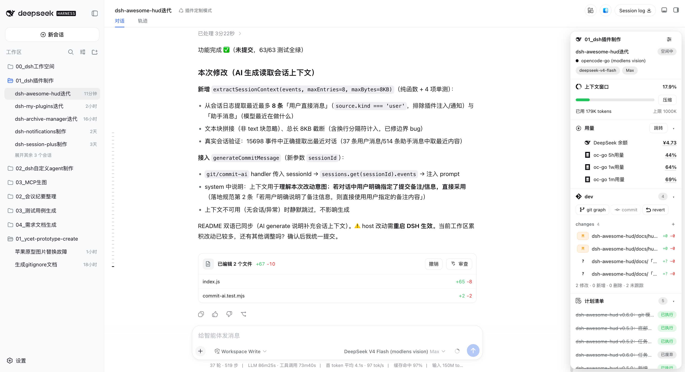

HUD在dsh中的效果（深色主题）

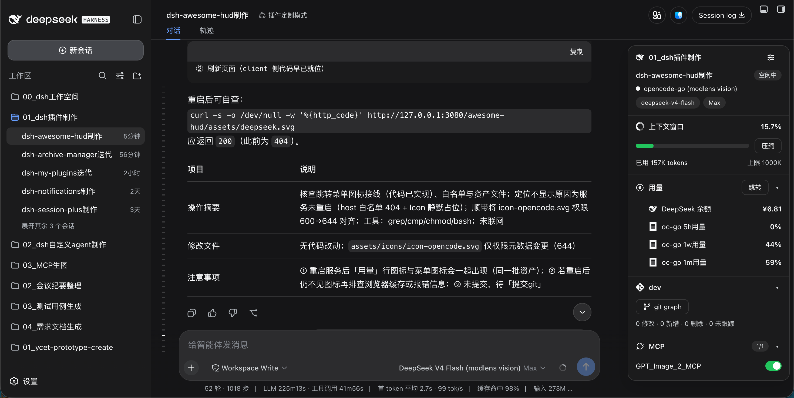

---

> [!NOTE]
> 一个 DSH Web 插件（`dsh.bundle.patch` 通道安装）。浏览页面右上角新增「HUD面板」按钮，点击开合悬浮面板；面板与官方右侧栏及 [dsh-better-sidebar](https://github.com/omdsh-dev/DSH-better-sidebar) 右侧栏互斥协作，互不遮挡、不额外挤占正文。

## 📑 目录

- [✨ 功能列表](#-功能列表)
- [🚀 快速开始](#-快速开始)
- [🧭 使用说明](#-使用说明)
- [🖼️ 界面截图](#️-界面截图)
- [⚙️ 兼容性](#️-兼容性)
- [🔧 技术栈](#-技术栈)
- [⬆️ 升级说明（v0.11.x → v0.15.3）](#️-升级说明v011x--v0153)
- [📄 许可证](#-许可证)

---

## ✨ 功能列表

| 模块       | 说明                                                                                                                                                                                                                                                                                                                                                                                                                                                                                                                          |
| ---------- | ----------------------------------------------------------------------------------------------------------------------------------------------------------------------------------------------------------------------------------------------------------------------------------------------------------------------------------------------------------------------------------------------------------------------------------------------------------------------------------------------------------------------------- |
| 会话       | 当前工作区名称、会话名称、会话状态（任务中/待审批/空闲中/待回答/等待子任务）、模型提供商/模型名/推理等级；会话名称右侧铅笔按钮可重命名（点击进入编辑态，输入框+取消/确认，确认后保存并自动更新会话列表标题）；右上角「HUD 设置」勾选展示模块                                                                                                                                                                                                                                                                                                                                                                                      |
| 上下文窗口 | 上下文占用进度条（0–40% 绿 / 40–90% 黄 / >90% 红）、底部展示「已用 n · 上限 n · 缓存命中 n%」（缓存命中率保留一位小数；数据不可用时显示 `—`）、一键「压缩」当前会话上下文                                                                                                                                                                                                                                                                                                                                                                      |
| 用量       | DeepSeek 余额、OpenCode Go 三个窗口用量百分比（oc-go 5h/1w/1m）与 Codex 剩余额度百分比（已订阅账号展示 5 小时/周两行；未订阅账号展示 `codex 免费额度` 单行，两类行互斥；`dsh-codex-subscription` 返回 gpt-reserve 额度时，追加展示同等样式的 `codex gpt-reserve额度` 行）；行首带对应图标并缩进，点击具体数值直达对应设置页；DeepSeek、OpenCode Go 与 Codex 按各自安装/登录状态独立展示                                                                                                                                                                                                                                                                                                                           |
| git        | 常驻展示（新建会话页与会话页均默认展示；工作区不是 git 仓库时标题栏右侧提供「初始化仓库」，点击即在该工作区执行 `git init`，建仓后按钮自动换成分支按钮）；当前分支（标题栏右侧分支按钮：下拉列表可切换已有分支、创建新分支并自动切换）、变更文件数量；变更文件按暂存区（staged）与未暂存区（changes）分组展示（组名带灰色计数，无文件的分组自动隐藏）；文件行点击可暂存/移除暂存/撤销；「commit」提交暂存区（手动输入或 AI 生成提交信息——按内置本地 git 提交规范 [YYMMDD] 项目名 vX.Y.Z：内容），「revert」撤销全部未暂存变更（已跟踪文件还原内容、未跟踪新建文件一并删除；破坏性操作均有二次确认与受影响文件清单）；「git graph」弹窗（全部引用提交分页展示：每页最多 80 条，滑到底部出现「加载更多」按钮逐页追加，直至全部历史；当前分支标签为蓝底白字，其他分支为灰底黑字；提交行右键菜单可复制短哈希/全哈希/提交标题、从此处创建分支、合并至当前分支，或执行 soft / mixed / hard reset；创建分支为原位输入 + 图标按钮，合并与 reset 为行内二次确认） |
| 子代理任务 | 当前会话全部后代子代理（按层级缩进）、执行中（黄）/已完成（绿）状态，点击在官方右侧栏打开子代理会话，保留主会话；仅在有子代理时展示                                                                                                                                                                                                                                                                                                                                                                                                                 |
| 任务       | 当前会话待办任务列表、已完成/待完成状态与计数（如`1/3`），随任务列表实时刷新；进行中任务显示旋转动画图标，底部展示「已完成/进行中/待处理」三态计数（含 0 恒显）；仅在有任务时展示                                                                                                                                                                                                                                                                                                                                           |
| 计划清单   | 当前会话通过 plan 模式（`exit_plan_mode`）产出的全部计划：待审批（黄）/已执行（绿）/已废弃（灰、划线淡色）三态标签，标题栏展示计划总数，点击行弹出计划全文弹窗，模块底部展示「已执行/待审批/已废弃」三态计数（含 0 恒显）；仅在有计划记录时展示                                                                                                                                                                                                                                                                             |
| MCP        | 接入的全部 MCP 服务及 dsh 全局启用状态；开关直接启停 dsh 全局的 MCP 服务（写入 profile`cordis.patch.yml`），切换后页面刷新                                                                                                                                                                                                                                                                                                                                                                                                  |
| 便笺       | 按**工作区共享**的便笺（同一工作区目录下所有会话共用一份内容，本地持久化）；输入框底部拖拽手柄可调整高度（实时持久化），5000 字上限与字符计数，右侧圆点指示内容存在；可一键添加便笺全文至对话输入框；输入框为空时「清空」按钮置灰，有内容时需二次确认后清空；折叠/展开状态持久化                                                                                                                                                                                                          |
| 待办       | 按**工作区共享**的待办清单（同一工作区目录下所有会话共用一份清单与顺序，本地持久化）；勾选完成/恢复、添加/删除、整行拖拽排序（拖动手柄位于行最左侧）、一键清空已完成（二次确认，空列表置灰）；底部展示完成计数；折叠/展开状态持久化                                                                                                                                                                                    |

**互斥协作**：HUD 面板与官方右侧栏、[dsh-better-sidebar](https://github.com/omdsh-dev/DSH-better-sidebar) 右侧栏互斥协作。右侧栏展开期间，HUD 面板**派生隐藏**——只是临时不可见，**不改写**该会话的展开记忆，正文也不会被额外推挤留白；关闭右侧栏后，面板按展开记忆自动恢复（除非此前手动收起过 HUD）。点击「HUD面板」按钮时若右侧栏已打开，则先自动收起侧栏再展示 HUD（若版本兼容性导致自动收起失败，面板保持隐藏，待右侧栏关闭后自动出现）。

## 🚀 快速开始

**方式一：从 GitHub 远程安装（推荐）**

```bash
# 1. 安装（要求本机 git 可访问 GitHub）
dsh plugin --profile web add github:Ycet/dsh-awesome-hud

# 2. 重启 DSH Web 服务并刷新页面
```

**方式二：从本地源码安装（开发）**

```bash
# 1. 安装（将 <absolute-path-to-plugin> 替换为本地源码目录绝对路径）
dsh plugin --profile web add "dsh-awesome-hud@link:<absolute-path-to-plugin>"

# 2. 重启 DSH Web 服务并刷新页面
```

安装完成后，聊天页右上角（「打开工作区」按钮左侧）出现「HUD面板」按钮，点击即可开合。

> [!NOTE]
> HUD 面板默认展开；**每个会话各自记住自己的开合状态**（按会话 id 存于 localStorage），在 A 会话收起不会影响 B 会话。**新建会话页（尚未开始的空白会话）例外**：该页每次进入都从收起状态开始（只改内存态、不写 localStorage，因此不影响任何会话的记忆），并在右上角提供独立的悬浮「HUD面板」按钮用于在该页展开（图片**大图预览**打开期间该按钮隐藏，避免浮在大图与预览关闭按钮之上）。模块可见性保存于 DSH profile 设置中，跨浏览器/设备随 profile 同步。

### 桌面端安装（macOS）

当前版本：**0.15.3**。先完全退出 DeepSeek Harness，再使用桌面应用自带的 CLI 安装；不要用旧 Web CLI 管理 `desktop` profile。

```bash
"/Applications/DeepSeek Harness.app/Contents/Resources/runtime/cli/bin/dsh" plugin --profile desktop add "dsh-awesome-hud@link:<absolute-path-to-plugin>"
```

重新打开应用后，在会话右上角点击「HUD面板」。Codex 额度需要另行安装并登录支持当前 DSH 版本的 `dsh-codex-subscription`；DeepSeek / OpenCode 数据来自 `dsh-account-usage`。

> [!NOTE]
> 便笺、待办、折叠和面板开合记忆保存在当前浏览器或桌面应用的 `localStorage`。安装插件不会自动搬运 Web 浏览器中的这些数据；模型与登录凭据由 DSH 管理。

## 🧭 使用说明

- **HUD 面板**：悬浮于聊天页右上角，宽度 300px，高度上限为输入框底部（留 8px 底距），内容超出时面板内部滚动（滚动条仅在滚动时显示，停止 2s 后渐隐）；面板可见时聊天内容与输入框自动向左让位，不会重叠；右侧栏展开期间面板隐藏且不推挤正文，关闭后恢复。
- **设置菜单**：「会话」模块右上角齿轮打开菜单，可勾选展示「上下文窗口 / 用量 / git / 子代理任务 / 任务 / 计划清单 / MCP」模块（用量仅在其可用时列出），底部「取消 / 确认」按钮丢弃或保存勾选；「会话」模块恒展示。用量可用时，菜单内额外提供「用量模块内容」分组，可分别开关 DeepSeek 余额、OpenCode Go 用量和 Codex 额度。
- **会话模块**：会话名称右侧铅笔按钮可重命名会话——点击进入编辑态（输入框 + 取消/确认图标按钮），Enter 提交、Esc 取消，输入为空时确认按钮置灰；确认后保存新名称，会话列表标题自动更新。
- **上下文窗口**：进度条颜色随占用率自动切换；底部按「已用 n · 上限 n · 缓存命中 n%」展示，缓存命中率固定保留一位小数（无可用统计时显示 `—`）；「压缩」在会话空闲时可用，运行中按钮禁用并提示原因。
- **用量模块**：位于「上下文窗口」模块下方。DeepSeek/OpenCode Go 复用 dsh-account-usage 插件路由，Codex 复用 dsh-codex-subscription 的浏览器 RPC；面板打开时立即加载、之后每 60 秒轮询；数据均缩进展示并带对应图标；模块支持折叠，默认展开（折叠状态经 localStorage 持久化）。
  - **DeepSeek 余额**：展示余额合计（充值 + 赠送），「跳转」按钮弹出选择菜单，可跳转 deepseek 开放平台或 opencode go 用量页；**点击具体余额数值**可直接打开设置面板「账户」分区的 deepseek 标签页；仅当已配置 `DEEPSEEK_PLATFORM_TOKEN` 时展示该行。
  - **OpenCode Go 用量**：三行分别展示 oc-go 5h / 1w / 1m 窗口用量**百分比**，**点击具体百分比数值**可直接打开设置面板「账户」分区的 opencode go 标签页；仅当已配置 OpenCode Go Key 且订阅有效（`/api/account-usage/opencode` 返回 `ok + keySource`）时展示。
  - **Codex 额度**：订阅账号展示 `codex 5h额度` 与 `codex 周额度` 两条**剩余额度整数百分比**；未订阅（免费）账号的 codex 额度只返回一个约 30 天的月度窗口，此时改为展示一条 `codex 免费额度` 行（取该窗口剩余百分比），**不再展示 5h / 周额度**——两类行互斥。订阅状态按**额度窗口形状**判定（出现 5h 或周窗口即视为已订阅），因为订阅插件的 RPC 不暴露套餐字段；月度窗口时长与预期不符时回退该额度首个可用窗口，保证有数据就不显示 `—`。三行均使用 ChatGPT 图标，**点击百分比数值**打开「设置：Codex 订阅」页面。仅当安装并登录 `dsh-codex-subscription` 时展示；已登录但额度请求暂时失败时**按上一次的展示模式**保留行并显示 `—`（订阅账号不会因此误显示为免费额度行），无法确认安装/登录状态时隐藏。
  - **gpt-reserve 额度**：`dsh-codex-subscription` 返回 `gpt-reserve` 额度（`/wham/usage` 的 `additional_rate_limits` → `rateLimits` 中 `id` 为 `base_model_inference`、`limit_name`/`name` 为 `gpt-reserve`；插件按 **id 或 name** 归一化匹配，忽略大小写、下划线、连字符与空格）时，在 5h / 周额度（未订阅时为免费额度）下方追加 `codex gpt-reserve额度` 行，样式、图标与交互与既有额度行完全一致（取其主窗口剩余百分比；额度带名称时显示为「codex gpt-reserve额度（名称）」）。该额度不存在时**不展示该行**；存在但窗口数据异常时保留行并显示 `—`。
  - **模块可见性与可配置内容**：DeepSeek、OpenCode Go 与 Codex 各自独立；仅已安装/配置/登录的数据源显示对应行，全部不可用时模块与设置项整体隐藏；展示内容可在「用量模块内容」分组中单独开关（host settings 持久化，随 profile 同步）。
- **git 模块**：常驻展示——新建会话页与会话页都默认展示，工作区不是 git 仓库时也展示（标题栏右侧提供「初始化仓库」按钮，位置与分支按钮相同；点击后在该工作区执行 `git init`，成功后模块切换为仓库态：按钮变为分支按钮，正文出现动作区与变更统计，并由随后的轮询保持刷新；已是仓库时该按钮不出现）。每 5 秒随面板打开自动刷新（写操作后立即刷新）；标题栏右侧分支按钮点击弹出下拉列表——可切换已有分支（当前分支高亮带勾标记；点击当前分支会提示「当前已在分支」而非静默关闭），或在输入框中输入新分支名点击「添加」创建并自动切换；「git graph」弹窗按每页最多 80 条分页展示当前仓库（全部引用）提交图（滑到列表底部出现「加载更多」按钮点击追加下一页，全部加载完后底部显示「已显示全部提交」提示）；分支标签中，当前分支为蓝底白字，其他分支为灰底黑字；HEAD 指向版本以放大的白色填充圆点 + 蓝色描边标记。提交行右键菜单可复制短哈希（前 7 位）/全哈希（40 位）/提交标题，并提供以下受保护操作：
  - **从此处创建分支**：点击后**原菜单项位置**展开为输入框 + 「取消」/「确认」图标按钮（输入框为空时确认按钮置灰）。输入合法分支名并点击确认后，以该提交为起点执行 `git checkout -b <名称> <提交>` 并切换到新分支：成功提示后菜单关闭、git 快照与提交图刷新，新分支标签随即显示为蓝底当前分支。分支名重复、或本地修改会阻止切换时给出提示（后者列出受影响文件）并**保留输入内容**，便于改名重试；不自动 stash、不强制切换。输入框内按 Enter 不触发创建，按 Escape 取消输入并恢复为原菜单项（再按一次关闭菜单）；Git 操作（merge / rebase / cherry-pick / revert）进行中时该项置灰。
  - **合并至当前分支**：先在原菜单项位置显示行内「确认？/取消」，确认后执行 `git merge --no-edit`；已包含提示「无需合并」、本地修改阻塞提示受影响文件、合并冲突自动 `git merge --abort` 回滚并列出冲突文件清单。
  - **reset(soft)-保留暂存**：仅可选择当前本地分支历史中、早于 HEAD 的提交；二次确认后以 `git reset --soft` 回退，所选提交之后的提交内容保留在暂存区。
  - **reset(mix)-取消暂存**：同样仅可回退至当前本地分支历史中的较早提交；二次确认后以 `git reset --mixed` 回退，所选提交之后的提交内容保留在工作区且不在暂存区。
  - **reset(hard)-撤回更改**：二次确认后以 `git reset --hard` 回退并丢弃所选提交之后的提交内容，以及已跟踪文件的未提交修改；未跟踪文件不会被删除。
  - reset 在未检出本地分支、Git 操作进行中、所选提交不在当前分支历史中或所选提交即为 HEAD 时不可用。变更文件按分组展示（状态字母按类型着色——修改 `M` 黄色、新增 `A` 蓝色、删除 `D` 红色、未跟踪 `?` 灰色，重命名 `R` / 复制 `C` 蓝色）：
  - **分组**：staged（暂存区）与 changes（未暂存区，含未跟踪）两组，组名右侧灰色数字为组内文件数，并提供一键按钮：changes 组「+」暂存全部未暂存文件、staged 组「-」取消暂存全部暂存文件；某组无文件时该组不展示
  - **文件行操作**：点击任一文件行弹出选项菜单——staged 组文件提供「remove from stage」（移出暂存区）；changes 组文件提供「add to stage」（暂存该文件）与「revert」（撤销该文件变更；未跟踪新建文件撤销 = 删除该文件，均带二次确认与受影响文件清单）
  - **commit**：按钮在暂存区无文件时置灰；点击弹出提交弹窗（展示待提交暂存文件数量 + 多行输入框 + AI generate + commit），输入为空时 commit 置灰；Enter 仅换行，需点击 commit 才会提交；提交范围仅为暂存区
  - **AI generate**：使用当前会话所选模型，结合暂存区全部 diff（超 16KB 截断）与当前会话最近对话上下文（用户直接消息与助手消息，供理解改动意图；若对话中用户明确指定了提交备注则直接采用），按内置本地 git 提交规范生成提交信息并填入输入框——格式 [YYMMDD] 开发项目名称 vX.Y.Z：修改内容（日期取系统当前时间；版本号依规范自动判断：破坏性变更→主版本、向后兼容新功能→次版本、修复/文档→修订号；项目名与当前版本取自工作区向上最近的 package.json）；生成后自动校验版本号是否已按规范递增，不达标时自动重试一次（附上一次输出与原因反馈），仍不达标则照常填入并提示核对
  - **revert**：按钮在无任何未暂存变更（含未跟踪）时置灰；点击后二次确认弹窗列出全部受影响文件（未跟踪文件带 `?` 前缀标识），确认后还原已跟踪文件的未暂存变更并删除未跟踪新建文件（暂存区不受影响）
- **子代理任务模块**：按层级缩进展示全部后代子代理；执行中状态徽章为**黄色**，已完成为绿色；点击条目在官方右侧栏打开对应子代理会话，保留当前主会话；嵌套子代理携带其直接父会话与会话模式。缺少侧栏接口时显示打开失败提示。
- **任务模块**：列表展示当前会话待办任务；进行中（in progress）任务行首为旋转动画图标（DeepSeek 官方同款，1s/圈，品牌蓝），已完成/待处理保持勾选与待办图标；模块底部展示「x 已完成 · x 进行中 · x 待处理」三态计数（含 0 恒显），标题栏保留「已完成/总数」计数。
- **计划清单模块**：位于「任务」模块下方，展示当前会话通过 plan 模式产出的全部计划清单（新→旧），仅在存在计划记录时展示；每 5 秒随面板打开自动刷新，状态由会话日志自动推导：
  - **待审批**（黄色标签）：计划刚产出、用户尚未审批；
  - **已执行**（绿色标签）：用户在计划审查中审批通过（`exit_plan_mode` 成功返回），进入执行阶段；后续退出 plan 模式不会改为废弃。此标签不代表所有步骤已经完成；
  - **已废弃**（灰色标签、文字划线变淡）：对应的审查调用失败（如拒审/要求修改/打断审查），或计划无审批结论但 plan 模式随后退出（如 `/plan off`）。兼容新版消息级错误标记与旧结果块；
  - 行主文字取计划首个 Markdown 标题，无标题时截取正文；点击任一行弹出计划全文弹窗（标题、状态、产出时间与正文，正文按轻量 Markdown 渲染，支持标题/列表/代码块/链接/引用与 GFM 表格）；模块底部展示「x 已执行 · x 待审批 · x 已废弃」三态计数（含 0 恒显）；模块可折叠，默认展开。
- **MCP 模块**：开关控制 dsh 全局的 MCP 服务启停；切换后页面自动刷新生效；模块默认展开，无任何 MCP 服务时仍展示空状态。
- **便笺模块**：按**工作区共享**的便笺——以会话所在工作区目录为键保存（同一工作区目录下的所有会话共用一份内容，含输入框高度），本地持久化；删除或归档其中任一/全部会话都不影响该工作区其它会话的内容，下次在同一工作区新建会话时内容依旧存在；输入框底部拖拽手柄可拖拽调整高度（实时持久化），5000 字上限与字符计数显示；右侧圆点指示便笺内容存在；可一键添加便笺全文至对话输入框（新建会话页会打开该工作区最近的会话并追加草稿）；输入框为空时「清空」按钮置灰，有内容时首次点击进入红色确认态，二次点击后清空（点击其他区域、Escape 或 2 秒超时会取消）；模块可折叠/展开（状态持久化）。未归属工作区（无 cwd）的会话降级为会话级隔离，不与其它会话共享。
- **待办模块**：按**工作区共享**的待办清单——以会话所在工作区目录为键保存（同一工作区目录下的所有会话共用同一份清单与顺序，本地持久化）；勾选完成/恢复、添加/删除项、整行拖拽排序（拖动手柄位于行最左侧勾选框之前）、一键清空已完成（二次确认弹窗，无已完成项时按钮置灰）；底部展示完成计数；模块可折叠/展开（状态持久化）。同一工作区多会话/多标签页同时编辑时按条目 id 归并，不会互相清空。
- **折叠状态**：各模块折叠/展开状态刷新页面后保持（localStorage）；「会话」模块图标使用 DSH favicon。
- **会话切换**：首帧读取目标会话的面板开合记忆、模块设置及上次成功数据。Git 按工作区共享，账号用量与 MCP 全局共享，计划与子代理按会话隔离；后台立即刷新，切走期间完成的查询仍保存到自己的缓存。首次访问且数据尚未读取时先显示「加载中…」，不伪造统计值；查询确认无数据或服务不可用后隐藏对应模块（git 常驻，不受此影响），空 MCP 仍可查看。会话摘要尚未到达时不会借用其他工作区的 Git、便笺或待办。
- **新建会话页**：右上角提供独立悬浮「HUD面板」按钮（该页没有会话页眉；Windows 普通窗口中入口位于原生标题栏下方，全屏时取消该偏移）。**图片大图预览打开时该按钮隐藏**——预览是铺满视口的模态浮层（`role="dialog"` + `aria-modal`，如 `dsh-codex-subscription` 的图片查看器），而 HUD 入口的层级远高于它，不隐藏就会浮在大图与右上角预览关闭按钮之上；预览关闭后按钮自动恢复，面板开合状态不受影响（判定只看浮层语义与视口覆盖率，不绑定第三方类名）。该页每次进入都从收起状态开始，点击按钮后展开；面板固定贴右侧、宽 300px，输入框与正文左移让位，按钮保持原位。官方右侧栏展开时，按钮移到侧栏左侧；右侧栏展开期间面板隐藏，关闭侧栏后恢复该页此前的展开状态（除非已手动收起 HUD）。新建页的 Git、便笺、待办和便笺发送目标使用同一最近工作区；MCP 作为全局模块独立刷新，无会话或工作区时也可查看和启停。只展示该页有数据源的模块（会话 / 用量 / git / 便笺 / 待办 / MCP；git 常驻，目标工作区不是仓库时提供「初始化仓库」）；尚无会话记录时重命名不可用。进入真实会话后加载该会话自己的开合记忆，标题栏原按钮接管入口。

## 🖼️ 界面截图

### 各模块预览

#### 「会话」模块

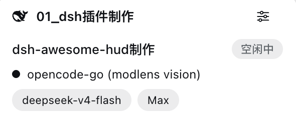

#### 「上下文窗口」模块

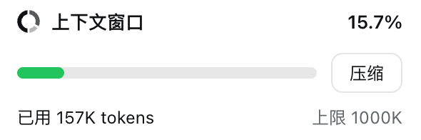

#### 「用量」模块

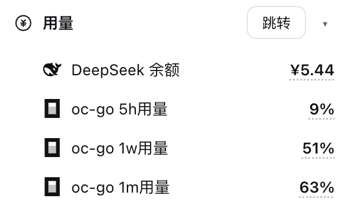

#### 「git变更」模块

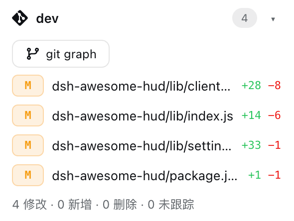

#### 「子代理任务」模块

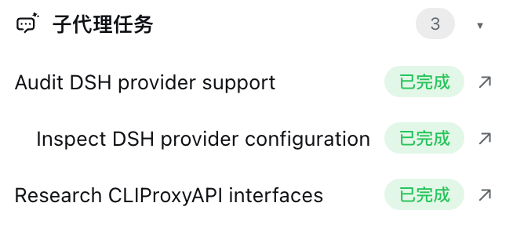

#### 「任务」模块

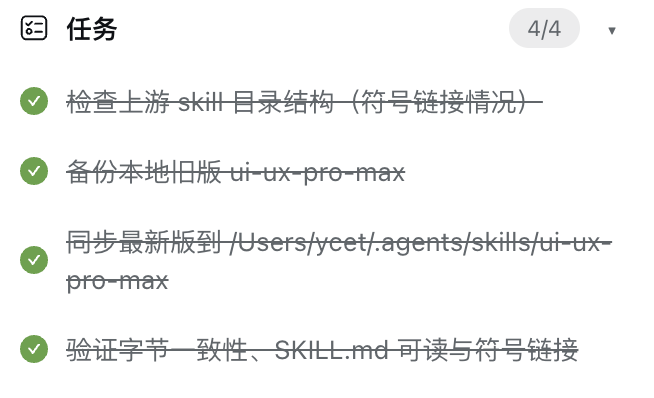

#### 「计划清单」模块

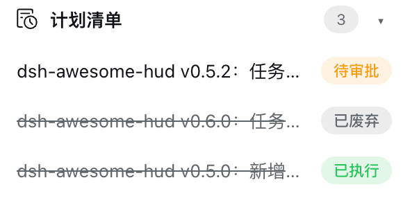

#### 「MCP」模块

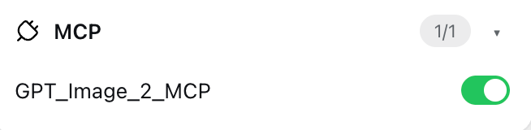

#### 「便笺」模块

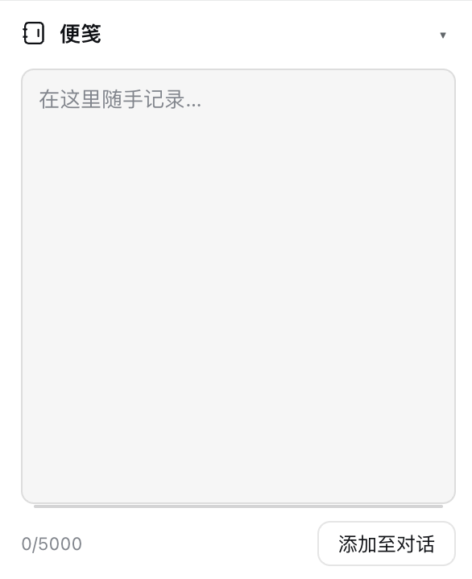

#### 「待办」模块

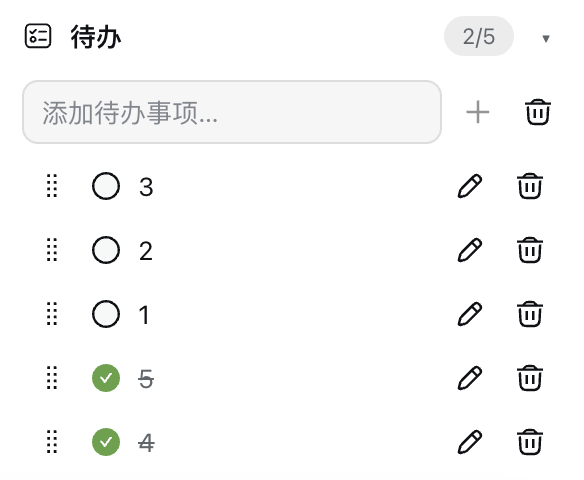

### 其他界面

#### HUD 设置菜单

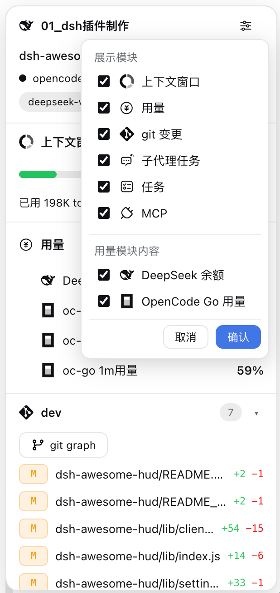

#### 「git graph」界面

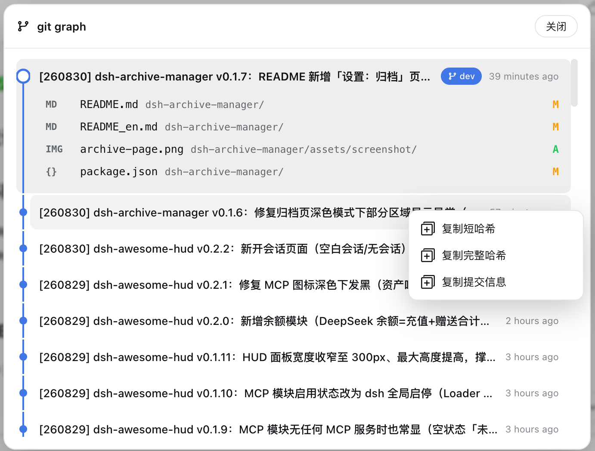

#### 「git commit」界面

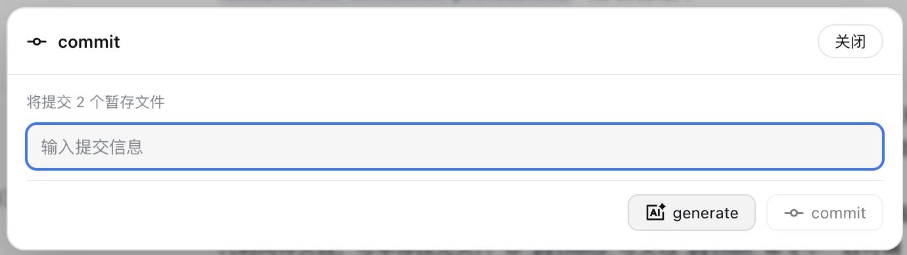

#### 「计划清单」界面

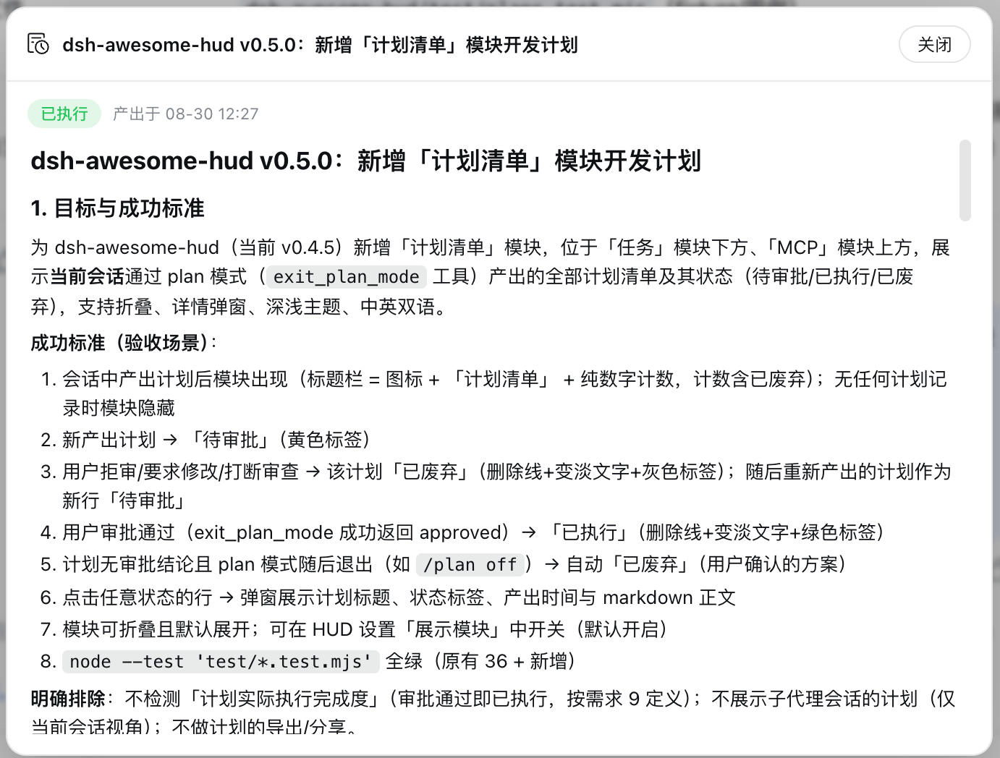

## ⚙️ 兼容性

桌面端测试环境、功能覆盖范围与复验方法见 [v0.14.7 桌面兼容性验收记录](docs/desktop-compatibility-0.14.7.md)。

会话切换回归测试使用官方桌面前端的 React 执行完整 HUD bundle，拦截所有网络请求。设置 `HUD_TEST_RUNTIME`（解包后的官方 DSH 运行时目录）、`HUD_TEST_PLAYWRIGHT`（Playwright 模块路径）和可选的 `HUD_TEST_BROWSER`（浏览器可执行文件路径），再运行 `node --test test/session-switch-runtime.test.mjs`；未配置时该组测试会明确跳过。真实 Git 与计划审批集成测试另需 `DSH_TEST_INSTALL_ROOT` 指向官方运行时目录，全部操作仅发生在临时夹具中。

| 项目               | 版本/说明                                                                                                                                     |
| ------------------ | --------------------------------------------------------------------------------------------------------------------------------------------- |
| DeepSeek Harness   | macOS 桌面端 `0.2.0-rc.2`；保留旧 Web 接口兜底，其他版本仍需验证                                                                     |
| dsh-client-ui-subagent | 子代理会话使用官方 `subagentchat` 资源在右侧栏打开；旧版不具备该接口时显示失败提示，不替换主会话 |
| dsh-plan-mode      | 计划清单数据源：会话日志`exit_plan_mode` 工具调用（`tool/call`/`tool/result`/`plan/mode` 事件）；上游审批语义变更时需复查状态推导     |
| dsh-better-sidebar | `0.16.1`（通过公开服务 `ctx.betterSidebar` 监听面板状态，与官方右侧栏共同参与 HUD 派生可见性；点击 HUD 按钮时依赖其折叠按钮 DOM 特征自动收起，失败时面板保持隐藏、待侧栏关闭后恢复，不影响 HUD 独立使用） |
| 平台               | macOS 已验证；Windows/Linux 仅理论兼容（git 命令行为一致）                                                                                    |
| 主题               | 跟随深浅主题（使用`--dsw-alias-*` 主题 token）                                                                                              |
| 语言               | 简体中文 / English，跟随 DSH locale                                                                                                           |
| 数据作用域         | 「便笺」「待办」按工作区目录共享（`localStorage`）；无 `cwd` 的会话降级为会话级隔离                                                          |
| 面板开合状态       | 按会话 id 独立持久化（`dsh-awesome-hud:open`，值为 `{ "会话 id": "1"|"0" }`）；新建会话页不持久化；可见性 = 展开记忆 ∩ 官方/better-sidebar 右侧栏均收起 |

## 🔧 技术栈

| 类别      | 内容                                                                                                                                                                            |
| --------- | ------------------------------------------------------------------------------------------------------------------------------------------------------------------------------- |
| Host 侧   | Node.js ESM、`ctx.webServer` 前缀路由、`ctx.settings`、`ctx.subagents`、`ctx.agents` / `ctx.commands`（压缩命令）、`ctx.subprocess`、`ctx.llm`（AI 生成提交信息）       |
| Client 侧 | 原生 JavaScript ModuleLoader bundle、React（`react.createElement`）、Cordis Slots（`conversation.session.header.utilities` / `shell.overlay`）、CSS 主题变量；不新增 slot，新建会话页入口复用 `shell.overlay` |
| 数据来源  | 客户端会话投影（`ctx.sessions.list` / `workspaces` / `modelDirectories`）+ 自有 host API（git / MCP / 子代理 / 计划清单 / 压缩）+ dsh-account-usage 余额/用量路由（复用） |
| 测试      | `node --test`（git 解析、MCP 解析、状态推导、计划清单推导、设置收敛、信任围栏；位于 `test/`）                                                                               |

## ⬆️ 升级说明（v0.11.x → v0.15.3）

**v0.15.3：修复右侧栏与 HUD 面板重叠及正文空白占位**：新建会话页先展开 HUD、再打开右侧栏、然后发送首条消息时，此前会同时出现「HUD 浮在右侧栏之上」与「正文右侧约 300px 空白」两个问题。根因是面板开合记忆按会话独立、无记录默认展开——作用域从新建页切到真实会话时直接拉起面板，没有与已展开的官方右侧栏对账；而面板布局又会给正文写 `margin-right` 推挤。现在 HUD 可见性改为**派生**：`可见 = 会话展开记忆 && 右侧栏未展开`，侧栏展开只临时隐藏面板、**不改写**展开记忆，关闭侧栏后自然恢复；推挤样式只在面板可见时应用，并经 layout effect 在同一提交内同步清理，侧栏展开瞬间也不会残留空白帧。新建会话页、切换会话与刷新首帧走同一套判定；手动收起过的 HUD 不会被侧栏开关重新拉起；点击「HUD面板」按钮仍优先收起右侧栏再展示面板。同步改写侧栏互斥、新建页切换会话与真实会话首帧的回归测试。

**v0.15.1：修复 Git 模块两处缺陷，并补齐全功能回归**：一是**冲突文件清单此前会在前端丢失**——host 路由的错误分支只回传 `error` 与 `code`、客户端 `call()` 也只复制 `code`，导致「切换分支失败：以下文件的本地变更会阻止切换：」后面是空的、合并冲突永远显示兜底文案「（无法列出冲突文件）」；现已把结构化错误里的 `files` 从 host 一路透传到提示文案。二是**游离 HEAD（`git checkout <提交>` 后的 detached 状态）下切换分支会被静默跳过**——`git/checkout` 的守卫在快照 `branch` 为 null 时跳过了真正的 checkout 却仍返回成功，界面上会误报「已切换」；现已改为只要目标分支与当前分支不同就执行 checkout。另外「点击菜单里的当前分支」不再静默关闭菜单，而是提示「当前已在分支「X」」。本次还新增了两套回归测试：`test/git-regression.test.mjs`（真实 git + 真实 host 路由，覆盖快照、暂存/取消暂存含跨 500 分批、提交与校验、AI 生成提交信息、撤销、分支创建/切换/合并、提交图分页、reset 三模式与资格校验、中文与空格文件名、越权与非法输入）与 `test/git-client-flow.test.mjs`（客户端点击链路：切换分支、初始化仓库、文件操作、错误透传）。

**v0.15.0：Git 模块常驻展示并支持一键初始化仓库**：新建会话页与会话页的「git」模块不再按「工作区是否 git 仓库」隐藏——工作区不是仓库时，模块照常展示，标题栏右侧（与分支按钮同位置）提供「初始化仓库」按钮，点击即在当前工作区执行 `git init`；成功后模块立即切换为仓库态（按钮变回分支按钮、正文出现 git graph / commit / revert 与变更统计），并沿用随后的 5 秒轮询。已是仓库时该按钮不显示；`git init` 失败时以提示条回传命令错误并在原按钮上恢复可点击。host 侧新增 `git/init` 接口（沿用会话 id 解析工作区、信任围栏与超时约束；已是仓库时幂等回传当前快照，不重复 init）。同一版本内还修好了「尚无提交的仓库」下的两处行为：取消暂存（单个与全部）改用 `git reset -q -- <路径>`（原先的 `git restore --staged` 需要 HEAD，在刚初始化的空仓库中会报 `fatal: could not resolve HEAD`）；「git graph」在无提交时按空历史返回并显示「当前仓库还没有任何提交」空态，不再把 `git log` 的原始报错当加载失败。补充命令顺序与幂等性、错误回传、标题栏按钮分流、空仓库取消暂存与空态渲染、以及真实 subprocess 建仓的回归测试。**

**v0.14.12：修复新建会话页打开大图预览时「HUD面板」悬浮按钮浮在预览之上的问题**：`dsh-codex-subscription` 的图片查看器是铺满视口的模态浮层（`role="dialog"` + `aria-modal`，`position: fixed; inset: 0`），而 HUD 入口所在的浮层层级远高于它，因此入口会压在大图与右上角预览关闭按钮之上。现按「模态浮层语义 + 视口覆盖率」判定：预览打开期间不渲染该悬浮入口，关闭后自动恢复（面板开合状态不受影响）；判定不绑定第三方类名，同时排除小尺寸弹窗、非浮层定位与隐藏浮层，HUD 自身的弹窗（无 `aria-modal`）不会误触发。补充检测逻辑、浮层开合监听与按 hooks 顺序真实渲染的回归测试。**

**v0.14.11：修复切换会话后 Git 等模块延迟出现，并让用量模块支持 Codex 免费额度**：共享快照订阅在首帧读取目标数据，按作用域合并未完成查询，切走后的结果仍缓存；Git 写操作后的新快照不会被旧查询覆盖。模块设置与保存队列跨面板挂载保留，模型目录及面板开合记忆同步切换；首次查询显示加载状态，摘要未就绪时避免借用其他工作区的数据。Git 独立只读查询并行，未跟踪文件行数统计最多四个并发进程。用量方面，未订阅（免费）账号的 codex 额度只返回一个约 30 天的月度窗口，此前 HUD 只取 5h / 周窗口，因此该额度既不展示、又留下两条 `—`。现按额度窗口形状判定订阅状态——出现 5h 或周窗口即展示原有 `codex 5h额度` / `codex 周额度` 两行，两者都没有时改为展示一条 `codex 免费额度` 行（取该额度窗口剩余百分比），两类行互斥；月度窗口时长与预期不符时回退该额度首个可用窗口，保证有数据就不显示 `—`。额度请求暂时失败时按上一次的展示模式保留行并把数值显示为 `—`，订阅账号不会误显示为免费额度行。补充真实 React 首帧、快速切换、离线、空数据和请求竞态回归测试，以及免费额度选择逻辑、浏览器与 Node 镜像一致性、降级保留模式与渲染结构回归测试。**

**v0.14.10：修复 Windows 新建会话页的 HUD 入口被原生标题栏遮挡，并兼容全屏切换。主视图明确无会话时不再回退到列表中的旧会话，侧栏恢复守卫共用同一判定。Git、便笺、待办和发送目标使用同一工作区，保留原有 Windows 路径存储键；MCP 独立加载与刷新，无会话或工作区时也可查看和启停。修复 Windows 路径标题与无工作区标题；尚无会话记录时禁用重命名。补充客户端数据流、异常请求及浏览器布局回归测试；Windows 原生桌面仍需实机验收。**

**v0.14.9：修复计划审批结果的新版消息配对与错误标记识别，避免审批通过后被退出模式误判为废弃，以及拒审后持续待审批；保留旧日志格式兼容，并修复缺少序号时的退出判断。子代理任务改为通过官方 `subagentchat` 资源在右侧栏打开，携带直接父会话与会话模式，保留主会话。补充状态、导航回归测试及官方桌面计划审批流程集成测试。**

**v0.14.8：修复输入法确认候选时误添加待办、误保存待办编辑、误重命名会话和误创建 Git 分支。所有文本输入及弹窗/菜单键盘处理统一识别输入法组合状态：选词中的 Enter / Escape 交给输入法；输入完成后再次按 Enter 才执行原有提交操作。Git 图中的分支输入仍只由确认按钮创建。便笺与提交信息输入中的 Escape 不再误关闭相关界面。补充输入法事件顺序与键盘回调回归测试。**

**v0.14.7：适配桌面端子代理会话导航、账号菜单中的设置跳转与模型快照订阅；OpenCode 跳转使用通用控制台地址。修复合并冲突漏检及空 MCP patch 写入；新建页便笺追加前自动打开目标会话。补充桌面接口行为测试与真实 subprocess 临时仓库测试。**

**v0.14.6：修复 HUD 面板展开后遮挡提示词导航的问题。**

**v0.14.5：调整「HUD面板」按钮样式与位置，并修复其在 DSH 插件管理页面也显示的问题。**

**v0.14.4：修复 HUD 入口与新版 DSH 的兼容问题**：会话页按钮位于右上角工具区，可正常开关面板；新建会话页恢复独立悬浮入口，面板仍默认隐藏。官方右侧边栏展开时，入口移至边栏左侧，不再遮挡边栏工具栏。

**v0.14.1：修复 git graph 右键菜单无法打开**：菜单初始状态缺少「从此处创建分支」输入行字段时会被误判为「已展开」并读取输入内容，抛出 `Cannot read properties of undefined (reading 'text')` 使整个右键菜单渲染失败。现已显式初始化该字段，并对读取统一做 `null` / `undefined` 归一化保护。

**v0.14.0：git graph 支持「从此处创建分支」**：提交行右键菜单在「合并至当前分支」下方新增该项。点击后原位展开输入框与「取消」/「确认」图标按钮，确认即基于该提交执行 `git checkout -b` 并跳转到新分支；输入为空时确认按钮置灰，重复分支名与本地修改阻塞均给出提示且保留输入内容，Enter 不触发创建、Escape 取消输入，Git 操作进行中时该项置灰。

**v0.13.4：便笺新增安全清空**：便笺操作区在「添加至对话」左侧增加「清空」按钮。输入框为空时按钮置灰；有内容时首次点击进入红色二次确认态，确认按钮以红色描边和文字显示，二次点击后清空并同步到同工作区会话。点击确认按钮外区域、按 Escape 或等待 2 秒会取消确认，不改变内容；localStorage 写入失败时保留原内容并提示。

**面板开合状态改为按会话独立**：旧版本把单一开关状态存在 `dsh-awesome-hud:open`，升级后该值会迁移为「首个进入的会话」的状态，其余会话各自默认展开并各自记忆。

**新建会话页新增悬浮入口**：面板位置与真实会话一致（固定贴页面右侧）；该页每次进入均为收起状态。

「便笺」「待办」由**会话级**改为**工作区级**。升级后首次在某工作区打开面板时，插件会做一次性的自动归并迁移：

- 便笺：取该工作区内候选会话中 `updatedAt` 最新的一份；
- 待办：按条目 id 去重合并（同 id 以先出现的为准），顺序保持稳定；
- 迁移结果写入工作区键，并记录迁移标记（`dsh-awesome-hud:workspace-migrated`），同一工作区只迁移一次；
- **旧的会话级键保留不删除**，回滚到旧版本后仍可读到迁移前数据。

如介意旧键占用的空间，可在确认迁移完成后于浏览器控制台执行 `localStorage.removeItem("dsh-awesome-hud:workspace-migrated")`，再删除 `dsh-awesome-hud:notes` / `dsh-awesome-hud:todos` 中「非工作区路径」的旧键（删除后无法再回滚迁移）。

## 📄 许可证

[MIT](LICENSE)
