# dsh-awesome-hud

[](README.md)
[](README_en.md)

[](LICENSE)
[](https://www.npmjs.com/package/dsh-awesome-hud)

<p align="center">
  
</p>

为 DeepSeek Harness Web / 桌面端聊天页打造的悬浮 HUD 面板：会话状态、上下文占用与一键压缩、git 变更、子代理、任务与 MCP 启停，一目了然。

HUD在dsh中的效果（浅色主题）

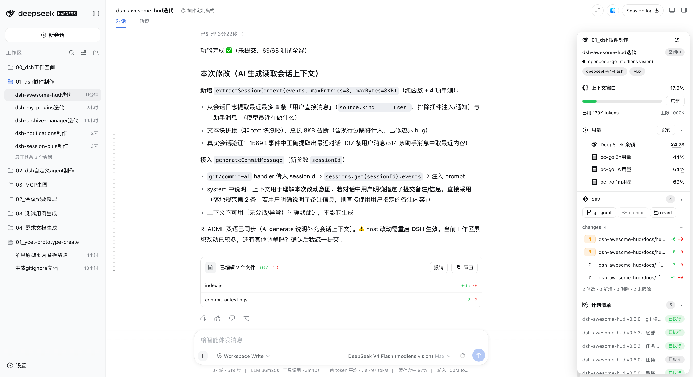

HUD在dsh中的效果（深色主题）

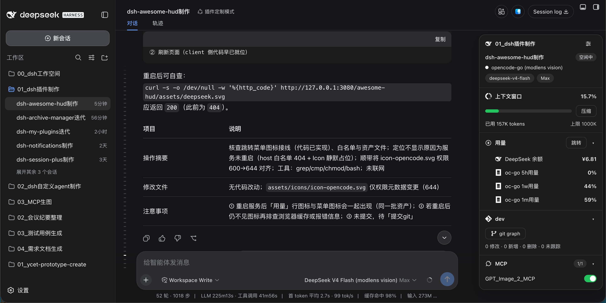

---

> [!NOTE]
> 一个 DSH Web 插件（`dsh.bundle.patch` 通道安装）。浏览页面右上角新增「HUD面板」按钮，点击开合悬浮面板；面板与官方右侧栏及 [dsh-better-sidebar](https://github.com/omdsh-dev/DSH-better-sidebar) 右侧栏互斥协作，互不遮挡、不额外挤占正文。

## 📑 目录

- [✨ 功能列表](#-功能列表)
- [🚀 快速开始](#-快速开始)
- [🧭 使用说明](#-使用说明)
- [🖼️ 界面截图](#️-界面截图)
- [⚙️ 兼容性](#️-兼容性)
- [🔧 技术栈](#-技术栈)
- [⬆️ 升级说明（v0.11.x → v0.19.1）](#️-升级说明v011x--v0191)
- [📄 许可证](#-许可证)

---

## ✨ 功能列表

| 模块       | 说明                                                                                                                                                                                                                                                                                                                                                                                                                                                                                                                          |
| ---------- | ----------------------------------------------------------------------------------------------------------------------------------------------------------------------------------------------------------------------------------------------------------------------------------------------------------------------------------------------------------------------------------------------------------------------------------------------------------------------------------------------------------------------------- |
| 会话       | 当前工作区名称、会话名称、会话状态（任务中/待审批/空闲中/待回答/等待子任务）、模型提供商/模型名/推理等级；工作区名称与会话名称均为悬浮变灰的可点击按钮——点击在鼠标位置打开操作菜单（工作区：重命名 / 在 Finder·资源管理器中显示 / 复制路径；会话：置顶或取消置顶 / 重命名 / 分支会话 / 复制会话 ID / 复制会话名称），选择重命名后名称原位变为输入框、失焦即提交（Enter 提交、Esc 取消，不再有取消/确认按钮），会话置顶后名称右侧显示小图钉；新建会话页不展示会话标题与状态；右上角「HUD 设置」打开左右分栏的设置弹窗（左栏模块启停与拖动排序，右栏「HUD面板通用设置 / 「上下文」模块设置 / 「用量」模块设置」卡片，顶部「使用说明」标签页提供内置上手指引）                                                                                                                                                                                                                                                                                                                                                                                      |
| 上下文     | 上下文占用进度条（默认单色：0–40% 绿 / 40–90% 黄 / >90% 红；悬浮时切换为分段样式并显示 breakdown 提示：System prompt / Tool definitions / Messages，分别使用石青/紫/蓝）；标题右侧展示「当前占用 / 最大上下文（占用率）」（如 `199K / 1M（19.9%）`），底部两行分别展示会话统计（轮/步 · tok/s）与 Token 用量（总量 · 缓存命中），悬浮两行显示完整统计/用量提示；一键「压缩」当前会话上下文；进度条常显分段、两行信息的显隐可在 HUD 设置中调整                                                                                                                                                                                                                                                                                                                                                                      |
| 用量       | DeepSeek 余额、OpenCode Go 三个窗口用量百分比（oc-go 5h/1w/1m）与 Codex 剩余额度百分比（已订阅账号展示 5 小时/周两行；未订阅账号展示 `codex 免费额度` 单行，两类行互斥；`dsh-codex-subscription` 返回 gpt-reserve 额度时，追加展示同等样式的 `codex gpt-reserve额度` 行）；行首带对应图标并缩进；「用量」模块恒定展示（可在 HUD 设置中关闭），模块头部的「跳转」按钮可在「用量」模块设置中关闭，DeepSeek 余额行始终展示（无数据时显示 `—`，点击仍打开对应设置页），OpenCode Go 与 Codex 行按各自安装/登录状态独立展示（无数据时整组不渲染，数值可点击打开对应设置页）                                                                                                                                                                                                                                                                                                                           |
| git        | 常驻展示（新建会话页与会话页均默认展示；工作区不是 git 仓库时标题栏右侧提供「初始化仓库」，点击即在该工作区执行 `git init`，建仓后按钮自动换成分支按钮）；当前分支（标题栏右侧分支按钮：下拉列表可切换已有分支、创建新分支并自动切换）、变更文件数量；变更文件按暂存区（staged）与未暂存区（changes）分组展示（组名带灰色计数，无文件的分组自动隐藏）；文件行左键打开右侧栏 diff、右键打开暂存/撤销菜单（悬停 0.5 秒显示完整路径）；「commit」提交暂存区（手动输入或 AI 生成提交信息——按内置本地 git 提交规范 [YYMMDD] 项目名 vX.Y.Z：内容），「revert」撤销全部未暂存变更（已跟踪文件还原内容、未跟踪新建文件与 intent-to-add 预登记文件一并删除；暂存区文件不受影响，无法删除的嵌套仓库/子模块目录会明确提示；破坏性操作均有二次确认与受影响文件清单）；「git graph」弹窗（全部引用提交分页展示：每页最多 80 条，滑到底部出现「加载更多」按钮逐页追加，直至全部历史；当前分支标签为蓝底白字，其他分支为灰底黑字；提交行悬停 0.5 秒显示完整提交信息，并在提交标题下方展示该提交的分支/标签；提交行右键菜单可复制短哈希/全哈希/提交标题、从此处创建分支、合并至当前分支，或执行 soft / mixed / hard reset；创建分支为原位输入 + 图标按钮，合并与 reset 为行内二次确认） |
| 产物       | 列出**当前会话所有轮次**改动过的指定格式文件（`html` / `md` / `pdf` / `docx` / `csv` / `xlsx` / `pptx` / `cd` / `clark` / `jpg` / `jpeg` / `png` / `gif` / `webp` / `svg`，共 16 种、大小写不敏感）：只列**工作区内且仍存在**的文件，按最后一次改动倒序，**最多展示 24 个**（超出时列表底部提示「仅展示最近改动的 24 个文件」）；每行显示文件名与目录，点击在**官方右侧栏**打开该文件内容（同一文件不会重复开 tab）；数据来自 DSH 官方 `workspaceChanges` 的每轮摘要，**只在本 Host 进程内有效**（重启 DSH 后旧轮次为空），纯 shell 命令产生的改动不在记录内；默认位于「git」下方，可在 HUD 设置中关停或拖动排序；新建会话页不展示（设置卡片里显示为只读），旧 profile 的模块顺序会自动把新模块插到「git」之后 |
| 子代理任务 | 当前会话全部后代子代理（按层级缩进）、执行中（黄）/已完成（绿）状态，点击在官方右侧栏打开子代理会话，保留主会话；仅在有子代理时展示                                                                                                                                                                                                                                                                                                                                                                                                                 |
| 任务       | 当前会话待办任务列表、已完成/待完成状态与计数（如`1/3`），随任务列表实时刷新；进行中任务显示旋转动画图标，底部展示「已完成/进行中/待处理」三态计数（含 0 恒显）；仅在有任务时展示                                                                                                                                                                                                                                                                                                                                           |
| 计划清单   | 当前会话通过 plan 模式（`exit_plan_mode`）产出的全部计划：待审批（黄）/已执行（绿）/已废弃（灰、划线淡色）三态标签，标题栏展示计划总数，点击行弹出计划全文弹窗，模块底部展示「已执行/待审批/已废弃」三态计数（含 0 恒显）；仅在有计划记录时展示                                                                                                                                                                                                                                                                             |
| MCP        | 接入的全部 MCP 服务及 dsh 全局启用状态；开关经 DSH 插件管理器直接启停 dsh 全局的 MCP 服务（按行写入 profile `cordis.patch.yml` 并完成热重载，即时生效、无需刷新页面、不影响其它服务）                                                                                                                                                                                                                                                                                                                                                                                                  |
| 便笺       | 按**工作区共享**的便笺（同一工作区目录下所有会话共用一份内容与图片，本地持久化，重启 DSH 后仍在）；输入框底部拖拽手柄可调整高度（实时持久化）；**不限制字数**，底部也不再显示字数；可直接**粘贴图片**（最多 20 张，缩略图在输入框上方横滑、点击看大图、悬浮移除）；「从聊天导入」先清空便笺里的文字与图片，再写入会话输入框的内容（便笺非空时先确认，非图片附件跳过并提示；输入框里没有文字或图片时按钮置灰）；「添加至聊天」先清空会话输入框里的文字与图片，再写入便笺内容（输入框非空时先确认，图片按便笺顺序一起加入）；有文字或图片时「清空」需二次确认，一次清掉文字与图片；折叠/展开状态持久化                                                                                                             |
| 待办       | 按**工作区共享**的待办清单（同一工作区目录下所有会话共用一份清单与顺序，本地持久化）；勾选完成/恢复、添加/删除、整行拖拽排序（拖动手柄位于行最左侧；拖动时其余条目实时让位，直观预览松手后的顺序）、一键清空已完成（二次确认，空列表置灰）；底部展示完成计数；折叠/展开状态持久化                                                                                                                                                                                    |

**互斥协作**：HUD 面板与官方右侧栏、[dsh-better-sidebar](https://github.com/omdsh-dev/DSH-better-sidebar) 右侧栏互斥协作。右侧栏展开期间，HUD 面板**派生隐藏**——只是临时不可见，**不改写**该会话的展开记忆，正文也不会被额外推挤留白；关闭右侧栏后，面板按展开记忆自动恢复（除非此前手动收起过 HUD）。点击「HUD面板」按钮时若右侧栏已打开，则先自动收起侧栏再展示 HUD（若版本兼容性导致自动收起失败，面板保持隐藏，待右侧栏关闭后自动出现）；新建会话页在右侧栏展开期间不显示该悬浮入口。面板配置为**左侧**时（见「HUD面板通用设置」），窄窗口下左侧会话列表的遮罩抽屉展开期间面板同样临时隐藏，关闭抽屉后自动恢复（仍不改写展开记忆）。

## 🚀 快速开始

**方式一：从 npm 安装（推荐，支持插件页一键更新）**

```bash
# 1. 安装（无需 git；本机需有 pnpm，dsh plugin 会调用它）
dsh plugin --profile web add dsh-awesome-hud@0.19.1

# 2. 重启 DSH Web 服务并刷新页面
```

> [!NOTE]
> 从 npm 安装的副本可以在插件页直接升级：打开「插件 → 已安装」，有新版本时卡片显示「可更新」，详情页提供「更新到」。从 GitHub tag 或 Release 压缩包安装的副本不支持页内更新，需要先卸载再重新安装。

**方式二：从 GitHub 远程安装（tag 固定；无 npm 账号时可用，不支持页内一键更新）**

```bash
# 1. 安装（锁定版本 tag，要求本机 git 可访问 GitHub）
dsh plugin --profile web add "github:Ycet/dsh-awesome-hud#v0.19.1"

# 2. 重启 DSH Web 服务并刷新页面
```

**方式三：从本地源码安装（开发）**

```bash
# 1. 安装（将 <absolute-path-to-plugin> 替换为本地源码目录绝对路径）
dsh plugin --profile web add "dsh-awesome-hud@link:<absolute-path-to-plugin>"

# 2. 重启 DSH Web 服务并刷新页面
```

**方式四：从 Release 资产安装（tarball，无需 git、无需 npm 账号）**

```bash
# 1. 安装（可直接用 Release 资产 URL，也可先下载 .tgz 再传本地路径）
dsh plugin --profile web add "https://github.com/Ycet/dsh-awesome-hud/releases/download/v0.19.1/dsh-awesome-hud-0.19.1.tgz"

# 2. 重启 DSH Web 服务并刷新页面
```

安装完成后，聊天页右上角（「打开工作区」按钮左侧）出现「HUD面板」按钮，点击即可开合。

> [!NOTE]
> HUD 面板默认展开；**每个会话各自记住自己的开合状态**（按会话 id 存于 localStorage），在 A 会话收起不会影响 B 会话。**新建会话页（尚未开始的空白会话）例外**：该页每次进入都从收起状态开始（只改内存态、不写 localStorage，因此不影响任何会话的记忆），并在右上角提供独立的悬浮「HUD面板」按钮用于在该页展开（图片**大图预览**打开期间该按钮隐藏，避免浮在大图与预览关闭按钮之上）。模块可见性保存于 DSH profile 设置中，跨浏览器/设备随 profile 同步。

### 桌面端安装（macOS）

当前版本：**0.19.1**。先完全退出 DeepSeek Harness，再使用桌面应用自带的 CLI 安装；不要用旧 Web CLI 管理 `desktop` profile。优先从 npm 安装（可在插件页一键更新），本地开发时再改用源码目录：

```bash
# 从 npm 安装（推荐）
"/Applications/DeepSeek Harness.app/Contents/Resources/runtime/cli/bin/dsh" plugin --profile desktop add dsh-awesome-hud@0.19.1

# 从本地源码安装（开发）
"/Applications/DeepSeek Harness.app/Contents/Resources/runtime/cli/bin/dsh" plugin --profile desktop add "dsh-awesome-hud@link:<absolute-path-to-plugin>"
```

重新打开应用后，在会话右上角点击「HUD面板」。Codex 额度需要另行安装并登录支持当前 DSH 版本的 `dsh-codex-subscription`；DeepSeek 余额优先来自 `dsh-account-usage`，未安装/未启用时回退 DSH 官方账户服务（需登录 DeepSeek 账号）；OpenCode Go 用量与设置页页签来自 `dsh-account-usage`。

> [!NOTE]
> 便笺文字、待办、折叠、面板设置和面板开合记忆保存在当前浏览器或桌面应用的 `localStorage`；**便笺图片**以原图存在同一来源的 **IndexedDB**（同样随重启保留、按工作区共享）。安装插件不会自动搬运 Web 浏览器中的这些数据；模型与登录凭据由 DSH 管理。

## 🧭 使用说明

- **HUD 面板**：宽度 300px，高度上限为输入框底部（留 8px 底距），内容超出时面板内部滚动（**不展示滚动条**）。面板为**常驻固定展示**（正文与输入框按侧位让位）。展开位置由「HUD面板通用设置 → HUD 面板展开位置」决定：**右侧**（默认）贴在窗口右侧，聊天内容与输入框自动向左让位；**左侧**时贴在会话区左缘（会话列表右侧，8px 间距），正文与输入框向右让位；两种侧位下页面滚动条都停在窗口最右缘，会话页右缘的「轮次导航」指示条仍停在正文右缘，面板都不会与正文重叠。右侧栏展开期间面板隐藏且不推挤正文，关闭后恢复。
- **设置弹窗**：「会话」模块右上角齿轮打开设置弹窗，顶部是**「HUD 设置」/「使用说明」两个标签**（选中项带品牌色下划线，可随时切换）；设置页为**左右分栏**：中间一条分割线，左栏是模块启停与排序，右栏是模块的具体设置。
  - **左栏**：勾选控制「上下文 / 用量 / git / 子代理任务 / 任务 / 计划清单 / MCP / 便笺 / 待办」的显隐（「会话」模块恒展示），每张卡片左侧有**拖动排序手柄**（按住拖动调整该模块在 HUD 面板中的顺序，全局生效；拖动时其余卡片实时让位预览，松手才落盘）。左栏不随右栏滚动；弹窗高度随窗口自适应并压缩卡片间距，保证 9 张模块卡片始终全部露出。**新建会话页不渲染的模块（上下文 / 子代理任务 / 任务 / 计划清单）在该页的设置里按真实状态展示、置灰不可点击**（悬浮显示原因），其开关请在会话页调整。
  - **右栏**：三个**卡片式分区**（内容过多时只滚动这一栏）。① **「HUD面板通用设置」**：HUD 面板展开位置（左侧 / 右侧）、新建会话页默认展示、聊天会话页默认展示（后两项只影响还没有开合记忆的页面/会话）。② **「「上下文」模块设置」**：始终显示分段进度条（默认关闭，关闭时只在悬浮进度条时显示分段）、显示「会话统计」、显示「Token 用量」、**上下文模块位置固定**（默认关闭；开启后 HUD 面板上下滚动时该模块与会话模块一样停住，仅当上下文排在模块排序首位时可开启，否则置灰并说明原因）。③ **「「用量」模块设置」**：DeepSeek 余额、OpenCode Go 用量、codex额度三行恒列出，未安装或未配置/未登录的项置灰并给出行内原因（DeepSeek 走内置官方余额源，恒可切换），另有**展示「跳转」按钮**开关（默认启用，关闭后「用量」模块不再渲染该按钮及其菜单）。
  - **控件与页脚**：右栏启停项使用 DSH 官方 `Switch` 样式（`@deepseek-ai/dsh-client-ui-primitives`，不可用时回退等价本地样式），「左侧/右侧」使用官方分段控件。底部左侧的**「恢复默认」**在当前设置与默认不同时激活，可把勾选、用量行、上下文设置、面板设置与排序一并恢复默认（仍需点「确认」落盘）。弹窗支持点击遮罩、右上角「关闭」、「取消」或 `Esc` 关闭（关闭等同取消，不保存改动）；确认后写入并关闭。打开时焦点进入弹窗，Tab 在弹窗内循环，关闭后回到齿轮按钮。
  - **使用说明页**：第二个标签是内置帮助页（「HUD 设置」标签用 `assets/icons/settings-outline.svg` 的描边齿轮，「使用说明」标签用 `assets/icons/hint.svg` 的提示图标）——左侧 240px 目录（与设置页左栏同宽，两个标签切换时分割线不跳位；点击跳到对应小节，右侧滚动时目录自动高亮），右侧 11 个模块分节卡片（目录项与小节标题只用文字，不再配图标）：HUD 面板、会话、上下文、用量、git、子代理任务、任务、计划清单、MCP、便笺、待办；每节按「展示 / 功能」分组列出简短要点——模块展示哪些信息、有哪些可操作功能（分功能点），「HUD 面板」一节另含「设置」分组讲设置弹窗内容；便笺一节含**图片 / 从聊天导入**要点。底部「恢复默认 / 取消 / 确认」在说明页同样常驻（无改动时「恢复默认」置灰）；切换标签不会丢失设置页未确认的改动，**弹窗高度也保持不变**——设置页在说明页下方保持挂载并提供高度基准，说明页以绝对定位覆盖在同一区域。
- **会话模块**：工作区名称与会话名称都是悬浮变灰的可点击按钮（两者的**悬浮 / 点击热区都是整行宽度**，只让出右侧的状态胶囊与齿轮按钮），点击后在**鼠标位置**打开菜单（菜单宽度 200px，贴近视口边缘时自动夹取到视口内；面板内部滚动或窗口缩放时菜单保持原位不跳动，点击外部、按 `Esc` 或再次点击标题即可关闭）。
  - **工作区菜单**（左上角工作区名）：**重命名工作区**（原位输入框，写入 DSH 工作区注册表，官方侧栏/选择器同步更新；与其它工作区同名时给出明确提示并退回原名）、**在 Finder 中显示**（macOS 为「在 Finder 中显示」，Windows 为「在资源管理器中显示」，其余平台为「在文件夹中显示」；原生打开由宿主执行，宿主不支持时该项置灰并提示原因）、**复制工作区路径**（复制项前有分割线，与上面两项分组）。
  - **会话菜单**（会话名称）：**置顶会话 / 取消置顶**（按当前状态切换文案与图标，置顶后名称右侧显示小图钉，效果与官方侧栏一致）、**重命名**、**分支会话**（与官方一致：创建后不跳转当前页，成功以 toast 提示；需要迁移源会话时提示先打开该会话）、**复制会话 ID**、**复制会话名称**。
  - **内联改名**：点击「重命名」后名称原位变为输入框并自动全选，**点击其他区域即提交**（也支持 Enter 提交、Esc 取消）；内容空白或未改动时不发请求，失败时退回原名并 toast 报错。新建会话页不展示会话标题与状态徽标，工作区菜单在该页同样可用（作用于推导出的目标工作区）。
- **上下文**：标题右侧按「当前占用 / 最大上下文（占用率）」展示，例如 `199K / 1M（19.9%）`；进度条默认单色（0–40% 绿 / 40–90% 黄 / >90% 红），鼠标悬浮时切换为三段式并弹出 breakdown 提示（System prompt 石青色、Tool definitions 紫色、Messages 蓝色，数值为估算 token）；底部两行分别是会话统计（轮数/步数 · tok/s）与 Token 用量（总量 · 缓存命中），悬浮时分别显示完整统计（模型用时、工具调用用时、首 token 平均、输出速度）和完整用量（缓存命中、未缓存输入、缓存读取、缓存写入、输出）。「压缩」在会话空闲时可用，运行中按钮禁用并提示原因；进度条常显分段、两行统计/用量的显隐可在 HUD 设置的「上下文」卡片中调整。
- **用量模块**：位于「上下文」模块下方，**恒定展示**（仍可在 HUD 设置中关闭）。DeepSeek 余额优先复用 dsh-account-usage 插件路由、未安装/未启用时回退 DSH 官方账户服务；Codex 复用 dsh-codex-subscription 的浏览器 RPC；面板打开时立即加载、之后每 60 秒轮询；数据均缩进展示并带对应图标；模块支持折叠，默认展开（折叠状态经 localStorage 持久化）。
  - **DeepSeek 余额**：展示余额合计（充值 + 赠送），「跳转」按钮弹出选择菜单，可跳转 deepseek 开放平台或 opencode go 用量页（可在「用量」模块设置中关闭该按钮，关闭后不再渲染按钮与菜单）；**点击具体余额数值**可直接打开设置面板并进入「账号与余额」页（官方页不可用（未登录/旧版）时回退到「账户」分区），有 dsh-account-usage 页签时切换到 deepseek 页签、没有页签时静默停留在官方账户页。该行**始终展示**：优先使用 dsh-account-usage（需配置 `DEEPSEEK_PLATFORM_TOKEN`），未安装/未启用时回退 DSH 官方账户服务（需登录 DeepSeek 账号）；无数据时数值显示 `—`，点击行为不变。
  - **OpenCode Go 用量**：三行分别展示 oc-go 5h / 1w / 1m 窗口用量**百分比**，**点击具体百分比数值**可直接打开设置面板并进入「账号与余额」页，切换到 opencode go 页签；仅当已配置 OpenCode Go Key 且订阅有效（`/api/account-usage/opencode` 返回 `ok + keySource`）时展示，无数据时整组不渲染（不可点击）。
  - **Codex 额度**：订阅账号展示 `codex 5h额度` 与 `codex 周额度` 两条**剩余额度整数百分比**；未订阅（免费）账号的 codex 额度只返回一个约 30 天的月度窗口，此时改为展示一条 `codex 免费额度` 行（取该窗口剩余百分比），**不再展示 5h / 周额度**——两类行互斥。订阅状态按**额度窗口形状**判定（出现 5h 或周窗口即视为已订阅），因为订阅插件的 RPC 不暴露套餐字段；月度窗口时长与预期不符时回退该额度首个可用窗口，保证有数据就不显示 `—`。三行均使用 ChatGPT 图标，**点击百分比数值**打开「设置：Codex 订阅」页面。仅当安装并登录 `dsh-codex-subscription` 时展示；已登录但额度请求暂时失败时**按上一次的展示模式**保留行并显示 `—`（订阅账号不会因此误显示为免费额度行），无法确认安装/登录状态时隐藏。
  - **gpt-reserve 额度**：`dsh-codex-subscription` 返回 `gpt-reserve` 额度（`/wham/usage` 的 `additional_rate_limits` → `rateLimits` 中 `id` 为 `base_model_inference`、`limit_name`/`name` 为 `gpt-reserve`；插件按 **id 或 name** 归一化匹配，忽略大小写、下划线、连字符与空格）时，在 5h / 周额度（未订阅时为免费额度）下方追加 `codex gpt-reserve额度` 行，样式、图标与交互与既有额度行完全一致（取其主窗口剩余百分比；额度带名称时显示为「codex gpt-reserve额度（名称）」）。该额度不存在时**不展示该行**；存在但窗口数据异常时保留行并显示 `—`。
  - **模块可见性与可配置内容**：模块恒定展示；DeepSeek 余额行始终展示（数据来自 dsh-account-usage 或官方账户兜底，无数据时显示 `—`），OpenCode Go 与 Codex 仅在其数据源可用时渲染对应行；全部无数据时模块内显示一行接入提示。展示内容可在「「用量」模块设置」卡片中单独开关，「跳转」按钮的显隐也在这里（host settings 持久化，随 profile 同步）。
- **git 模块**：常驻展示——新建会话页与会话页都默认展示，工作区不是 git 仓库时也展示（标题栏右侧提供「初始化仓库」按钮，位置与分支按钮相同；点击后在该工作区执行 `git init`，成功后模块切换为仓库态：按钮变为分支按钮，正文出现动作区与变更统计，并由随后的轮询保持刷新；已是仓库时该按钮不出现）。每 5 秒随面板打开自动刷新（写操作后立即刷新）；标题栏右侧分支按钮点击弹出下拉列表——可切换已有分支（当前分支高亮带勾标记；点击当前分支会提示「当前已在分支」而非静默关闭），或在输入框中输入新分支名点击「添加」创建并自动切换；「git graph」弹窗按每页最多 80 条分页展示当前仓库（全部引用）提交图（滑到列表底部出现「加载更多」按钮点击追加下一页，全部加载完后底部显示「已显示全部提交」提示）；分支标签中，当前分支为蓝底白字，其他分支为灰底黑字；HEAD 指向版本以放大的白色填充圆点 + 蓝色描边标记。提交行右键菜单可复制短哈希（前 7 位）/全哈希（40 位）/提交标题，并提供以下受保护操作：
  - **从此处创建分支**：点击后**原菜单项位置**展开为输入框 + 「取消」/「确认」图标按钮（输入框为空时确认按钮置灰）。输入合法分支名并点击确认后，以该提交为起点执行 `git checkout -b <名称> <提交>` 并切换到新分支：成功提示后菜单关闭、git 快照与提交图刷新，新分支标签随即显示为蓝底当前分支。分支名重复、或本地修改会阻止切换时给出提示（后者列出受影响文件）并**保留输入内容**，便于改名重试；不自动 stash、不强制切换。输入框内按 Enter 不触发创建，按 Escape 取消输入并恢复为原菜单项（再按一次关闭菜单）；Git 操作（merge / rebase / cherry-pick / revert）进行中时该项置灰。
  - **合并至当前分支**：先在原菜单项位置显示行内「确认？/取消」，确认后执行 `git merge --no-edit`；已包含提示「无需合并」、本地修改阻塞提示受影响文件、合并冲突自动 `git merge --abort` 回滚并列出冲突文件清单。
  - **reset(soft)-保留暂存**：仅可选择当前本地分支历史中、早于 HEAD 的提交；二次确认后以 `git reset --soft` 回退，所选提交之后的提交内容保留在暂存区。
  - **reset(mix)-取消暂存**：同样仅可回退至当前本地分支历史中的较早提交；二次确认后以 `git reset --mixed` 回退，所选提交之后的提交内容保留在工作区且不在暂存区。
  - **reset(hard)-撤回更改**：二次确认后以 `git reset --hard` 回退并丢弃所选提交之后的提交内容，以及已跟踪文件的未提交修改；未跟踪文件不会被删除。
  - reset 在未检出本地分支、Git 操作进行中、所选提交不在当前分支历史中或所选提交即为 HEAD 时不可用。变更文件按分组展示（状态字母按类型着色——修改 `M` 黄色、新增 `A` 蓝色、删除 `D` 红色、未跟踪 `?` 灰色，重命名 `R` / 复制 `C` 蓝色）：
  - **分组**：staged（暂存区）与 changes（未暂存区，含未跟踪）两组，组名右侧灰色数字为组内文件数，并提供一键按钮：changes 组「+」暂存全部未暂存文件、staged 组「-」取消暂存全部暂存文件；某组无文件时该组不展示
  - **文件行操作**：**左键**点击任一文件行在右侧栏打开该文件的 diff（优先官方「第 N 轮改动」review 页；该文件不在最新一轮、官方 review 不可用或右侧栏缺失时回退 better-sidebar 的工作树 diff tab）；**右键**（或键盘 Shift+F10 / 菜单键）弹出选项菜单——staged 组文件提供「remove from stage」（移出暂存区）；changes 组文件提供「add to stage」（暂存该文件）与「revert」（撤销该文件变更；未跟踪新建文件与 intent-to-add 预登记文件撤销 = 删除该文件，均带二次确认与受影响文件清单）。文件行悬停 0.5 秒后在鼠标位置显示完整路径提示
  - **commit**：按钮在暂存区无文件时置灰；点击弹出提交弹窗（展示待提交暂存文件数量 + 多行输入框 + AI generate + commit），输入为空时 commit 置灰；Enter 仅换行，需点击 commit 才会提交；提交范围仅为暂存区
  - **AI generate**：固定调用 DeepSeek 官方 DeepSeek Flash 系列模型（`deepseek-account` 路由的 `deepseek-flash`，`reasoningEffort: low`），不再使用当前会话所选模型；首次点击只进入「确认？」并在按钮左侧显示说明，第二次点击才生成（3 秒内未确认自动复位，点击按钮外或按 Escape 取消），生成时按钮禁用。生成时结合暂存区全部 diff（超 16KB 截断）与当前会话最近对话上下文（用户直接消息与助手消息，供理解改动意图；若对话中用户明确指定了提交备注则直接采用），按内置本地 git 提交规范生成提交信息并填入输入框——格式 [YYMMDD] 开发项目名称 vX.Y.Z：修改内容（日期取系统当前时间；版本号依规范自动判断：破坏性变更→主版本、向后兼容新功能→次版本、修复/文档→修订号；项目名与当前版本取自工作区向上最近的 package.json）；生成后自动校验版本号是否已按规范递增，不达标时自动重试一次（附上一次输出与原因反馈），仍不达标则照常填入并提示核对
  - **revert**：按钮在无任何未暂存变更（含未跟踪）时置灰；点击后二次确认弹窗列出全部受影响文件（未跟踪文件带 `?` 前缀标识），确认后还原已跟踪文件的未暂存变更并删除未跟踪新建文件与 intent-to-add 预登记文件；确认框与 staged 组会明确提示「暂存区文件不会被撤销」（如有需要请先移除暂存）；若存在无法删除的目录条目（嵌套仓库/子模块），会明确提示并跳过，不再静默当作成功
- **子代理任务模块**：按层级缩进展示全部后代子代理；执行中状态徽章为**黄色**，已完成为绿色；点击条目在官方右侧栏打开对应子代理会话，保留当前主会话；嵌套子代理携带其直接父会话与会话模式。缺少侧栏接口时显示打开失败提示。
- **任务模块**：列表展示当前会话待办任务；进行中（in progress）任务行首为旋转动画图标（DeepSeek 官方同款，1s/圈，品牌蓝），已完成/待处理保持勾选与待办图标；模块底部展示「x 已完成 · x 进行中 · x 待处理」三态计数（含 0 恒显），标题栏保留「已完成/总数」计数。
- **计划清单模块**：位于「任务」模块下方，展示当前会话通过 plan 模式产出的全部计划清单（新→旧），仅在存在计划记录时展示；每 5 秒随面板打开自动刷新，状态由会话日志自动推导：
  - **待审批**（黄色标签）：计划刚产出、用户尚未审批；
  - **已执行**（绿色标签）：用户在计划审查中审批通过（`exit_plan_mode` 返回批准结论），进入执行阶段；后续退出 plan 模式不会改为废弃。此标签不代表所有步骤已经完成；
  - **已废弃**（灰色标签、文字划线变淡）：审查未通过——包括拒审/要求修改/打断审查（错误结果）、在计划审查卡片上点「要求修改」（关闭审查、回到输入框；DSH 0.2.1-rc.5 起该操作以**成功结果** `{ approved: false }` 返回且计划模式仍生效，HUD 立即判为已废弃），以及计划无审批结论但 plan 模式随后退出（如 `/plan off`）。兼容新版消息级错误标记、旧结果块、结果文案与 plan 模式退出信号；
  - 行主文字取计划首个 Markdown 标题，无标题时截取正文；点击任一行弹出计划全文弹窗（标题、状态、产出时间与正文，正文按轻量 Markdown 渲染，支持标题/列表/代码块/链接/引用与 GFM 表格）；模块底部展示「x 已执行 · x 待审批 · x 已废弃」三态计数（含 0 恒显）；模块可折叠，默认展开。
- **MCP 模块**：开关控制 dsh 全局的 MCP 服务启停——经 DSH 官方插件管理器 `pluginManager.setPluginEnabled` 按行写入 profile `cordis.patch.yml` 并等待热重载完成，开关即时生效、无需刷新页面，只改目标服务、不改动其它插件配置；未启用 HMR 的 profile 会提示「重启后生效」；模块默认展开，无任何 MCP 服务时仍展示空状态。
- **便笺模块**：按**工作区共享**的便笺——以会话所在工作区目录为键保存（同一工作区目录下的所有会话共用一份内容与图片，含输入框高度），文字存 `localStorage`、图片以原图存 IndexedDB，重启 DSH 后依旧存在；删除或归档其中任一/全部会话都不影响该工作区其它会话的内容，下次在同一工作区新建会话时内容与图片依旧存在。输入框底部拖拽手柄可拖拽调整高度（实时持久化）；**不限制字数**，底部也不再显示字数与图片张数。**图片**：直接在输入框里粘贴（`image/*`，最多 20 张；字节上限沿用宿主的会话内附件校验），缩略图在输入框上方横向滚动，点击看大图（Esc / 遮罩 / 关闭按钮退出），鼠标悬浮缩略图右上角出现移除按钮（触屏常显）；「清空」或移除都会释放对应原图。**从聊天导入**（位于「添加至聊天」左侧）：先清空便笺里的文字与图片（旧原图一并释放并删除 IndexedDB 记录），再写入当前会话/新建会话页输入框里的文字与图片，便笺非空时先弹确认，非图片附件会跳过并提示；输入框内容不清除，输入框为空时按钮置灰、只提示且不清空便笺。**添加至聊天**：先清空会话输入框里的文字与图片（逐个移除并释放旧附件），再写入便笺文字并按便笺顺序加入图片；输入框非空时先确认，为空则直接写入，成功后焦点回到输入框；便笺内容保留；清空后写入失败不回滚（保持已清空 + 已写入部分并提示）。有文字或图片时「清空」可用：首次点击进入红色确认态，二次点击后同时清掉文字与图片（点击其他区域、Escape 或 2 秒超时会取消）。模块可折叠/展开（状态持久化）。未归属工作区（无 cwd）的会话降级为会话级隔离，不与其它会话共享。
- **待办模块**：按**工作区共享**的待办清单——以会话所在工作区目录为键保存（同一工作区目录下的所有会话共用同一份清单与顺序，本地持久化）；每条待办为**卡片式**（1px 描边 + 浅底 + 10px 圆角，与「HUD 设置」里的模块卡片同款，行距 6px），**编辑 / 删除按钮默认隐藏，鼠标悬浮该行时才出现，键盘聚焦（`:focus-visible`）也会显示**（两者改为**绝对定位浮层**：文字独占整行宽度，悬浮时浮层以行底色实底铺在行右端、左侧 16px 渐隐把文字淡出，既不会被挤窄、也不会重新换行；触屏等无 hover 环境按钮常显并给文字留出右侧避让；鼠标拖动后不会再滞留）；勾选完成/恢复、添加/删除项、整行拖拽排序（拖动手柄位于行最左侧勾选框之前，**手柄热区覆盖整行高度**，多行条目也能整列拖起；拖动时其余条目按真实行高实时让位，松手才保存顺序）、一键清空已完成（二次确认弹窗，无已完成项时按钮置灰）；底部展示完成计数；模块可折叠/展开（状态持久化）。同一工作区多会话/多标签页同时编辑时按条目 id 归并，不会互相清空。
- **折叠状态**：各模块折叠/展开状态刷新页面后保持（localStorage）；「会话」模块图标使用 DSH favicon。
- **新建会话页**：右上角提供独立悬浮「HUD面板」按钮（该页没有会话页眉；Windows 普通窗口中入口位于原生标题栏下方，全屏时取消该偏移）。该入口与聊天会话页保持同一顺序：始终排在右侧工具按钮簇左侧（装有 better-sidebar 时，其「底部面板」切换按钮排在入口右侧、两个页面的间距一致）——这让两个页面的入口位置看起来完全相同。**图片大图预览打开时该按钮隐藏**——预览是铺满视口的模态浮层（`role="dialog"` + `aria-modal`，如 `dsh-codex-subscription` 的图片查看器），而 HUD 入口的层级远高于它，不隐藏就会浮在大图与右上角预览关闭按钮之上；预览关闭后按钮自动恢复，面板开合状态不受影响（判定只看浮层语义与视口覆盖率，不绑定第三方类名）。该页每次进入都从收起状态开始，点击按钮后展开；面板固定贴右侧、宽 300px，输入框与正文左移让位，按钮保持原位。官方右侧栏（含 better-sidebar）展开期间，该悬浮入口与面板一并隐藏——入口不再移到侧栏左侧，也不再把展开态面板的位置写进定位；关闭侧栏后入口**立即出现在打开侧栏前的位置**，不会先闪到侧栏边缘，并回到该页此前的开合状态（除非已手动收起 HUD）。新建页的 Git、便笺、待办和便笺发送目标使用同一最近工作区；MCP 作为全局模块独立刷新，无会话或工作区时也可查看和启停。该页展示会话 / 用量 / git / 便笺 / 待办 / MCP 模块（git 常驻，目标工作区不是仓库时提供「初始化仓库」；「用量」模块恒定展示，DeepSeek 余额无数据时显示 `—`）；尚无会话记录时不展示会话标题与状态徽标（工作区标题菜单照常可用）。进入真实会话后加载该会话自己的开合记忆，标题栏原按钮接管入口。

## 🖼️ 界面截图

### 各模块预览

#### 「会话」模块

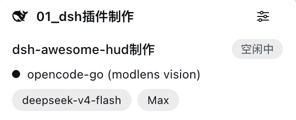

#### 「上下文」模块

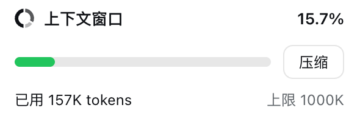

#### 「用量」模块

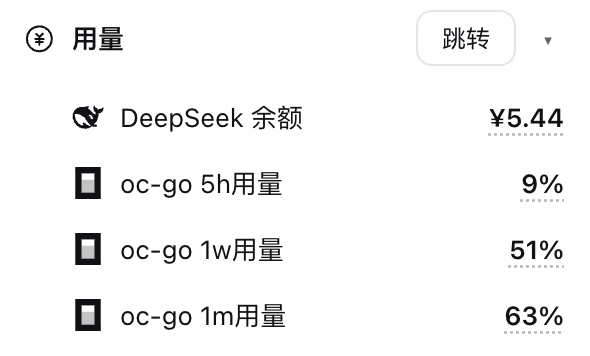

#### 「git变更」模块

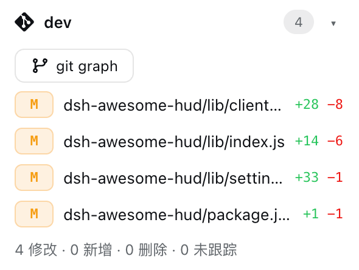

#### 「子代理任务」模块

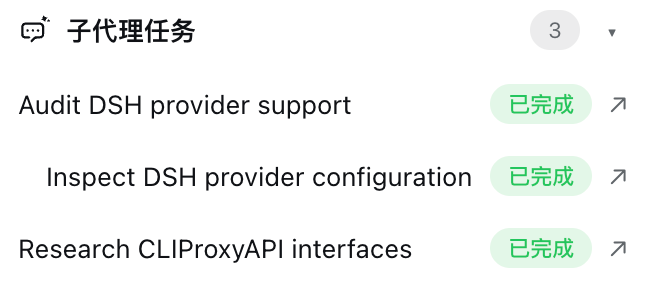

#### 「任务」模块

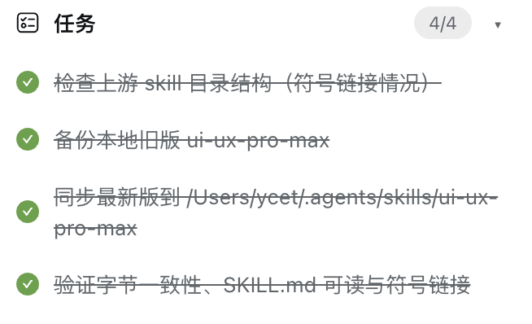

#### 「计划清单」模块

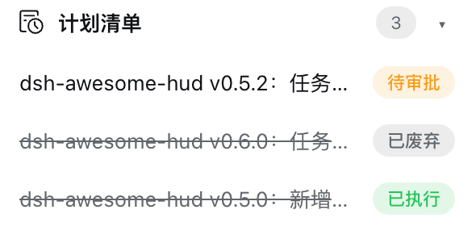

#### 「MCP」模块

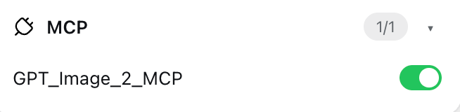

#### 「便笺」模块

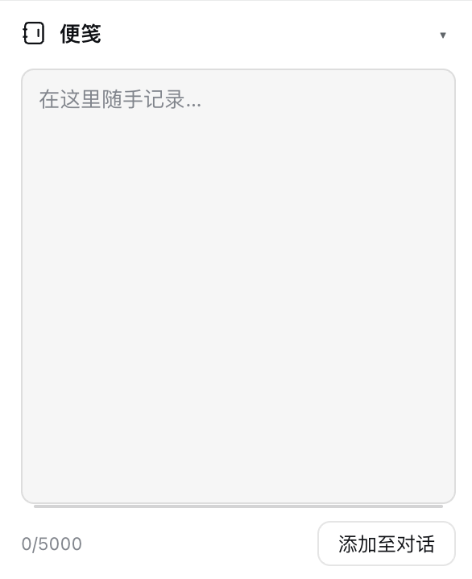

#### 「待办」模块

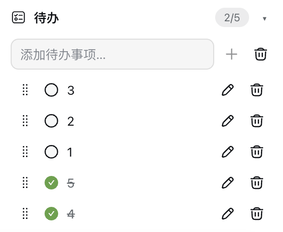

### 其他界面

#### hud设置界面

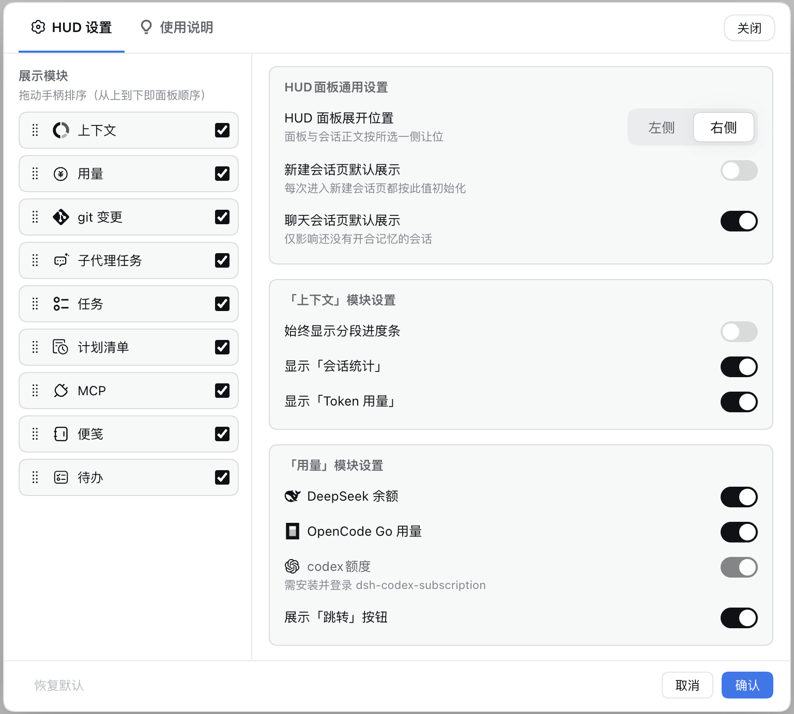

#### 「git graph」界面

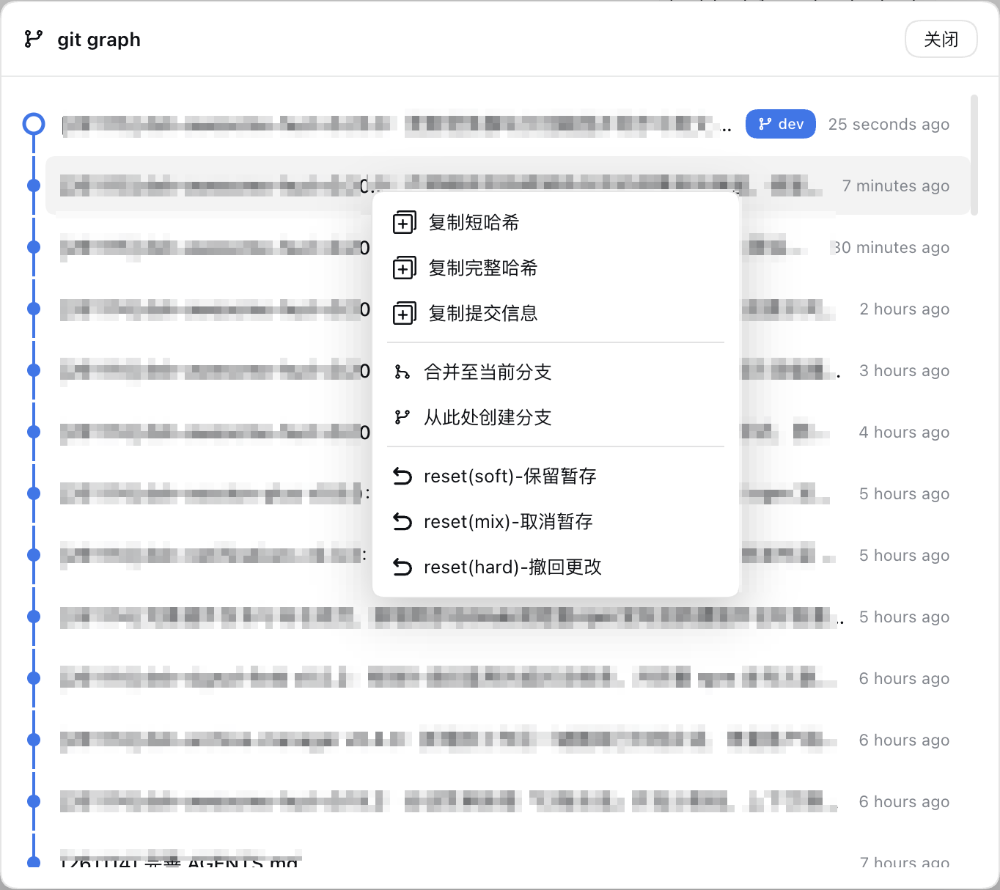

#### 「git commit」界面

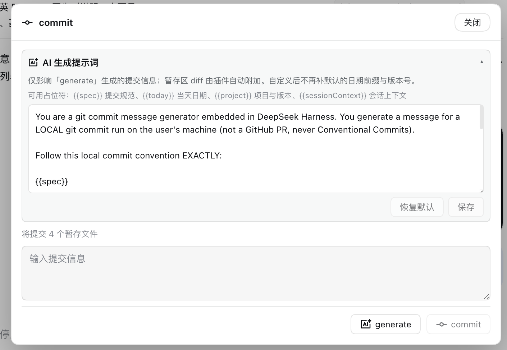

#### 「计划清单」界面

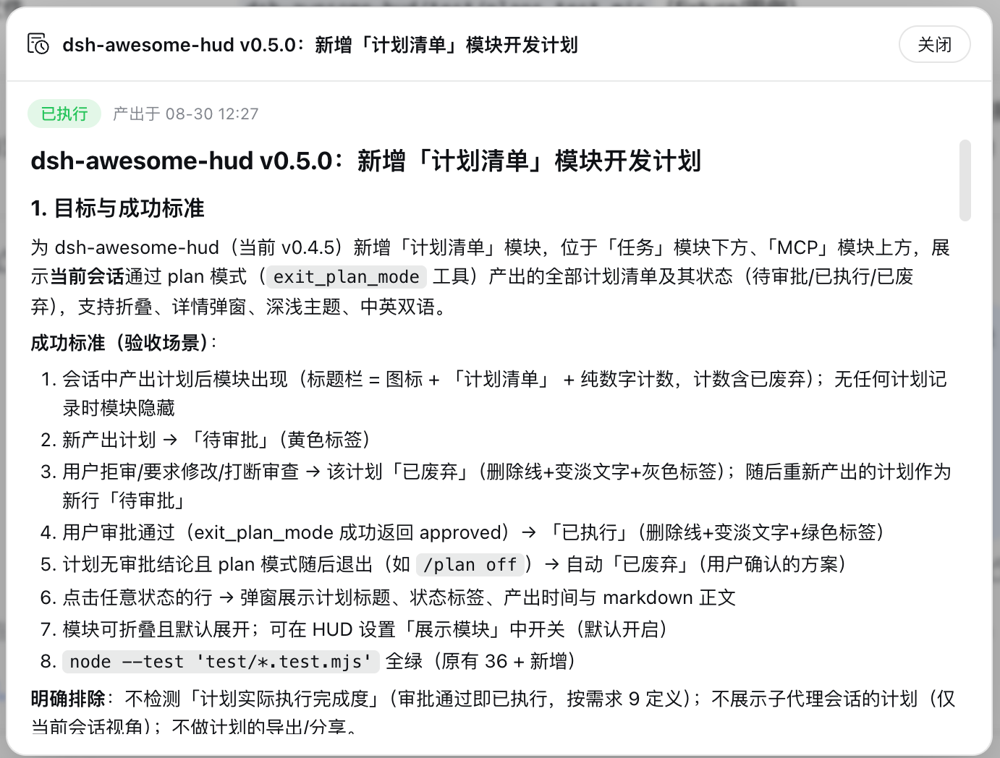

## ⚙️ 兼容性

桌面端测试环境、功能覆盖范围与复验方法见 [v0.14.7 桌面兼容性验收记录](docs/desktop-compatibility-0.14.7.md)。

| 项目               | 版本/说明                                                                                                                                     |
| ------------------ | --------------------------------------------------------------------------------------------------------------------------------------------- |
| DeepSeek Harness   | macOS 桌面端 `0.2.2-rc.2` 实测通过（`engines.dsh: >=0.2.1-rc.2`）；保留旧 Web 接口兜底，其他版本仍需验证                              |
| dsh-client-ui-subagent | 子代理会话使用官方 `subagentchat` 资源在右侧栏打开；旧版不具备该接口时显示失败提示，不替换主会话 |
| dsh-plan-mode      | 计划清单数据源：会话日志`exit_plan_mode` 工具调用（`tool/call`/`tool/result`/`plan/mode` 事件）；上游审批语义变更时需复查状态推导     |
| dsh-better-sidebar | `0.32.0`（通过公开服务 `ctx.betterSidebar` 监听面板状态，与官方右侧栏共同参与 HUD 派生可见性；点击 HUD 按钮时依赖其折叠按钮 DOM 特征自动收起，失败时面板保持隐藏、待侧栏关闭后恢复，不影响 HUD 独立使用；v0.17.0 起左键点击 git 变更文件优先打开官方「第 N 轮改动」review，官方 review 不可用时回退到 `ctx.betterSidebar.openTab` 的工作树 diff tab） |
| 平台               | macOS 已验证；Windows/Linux 仅理论兼容（git 命令行为一致）                                                                                    |
| 主题               | 跟随深浅主题（使用`--dsw-alias-*` 主题 token）                                                                                              |
| 语言               | 简体中文 / English，跟随 DSH locale                                                                                                           |
| 图标               | `package.json` 顶层 `icon`（包内相对路径 `icon.png`，448×448 PNG，原始字节 ≤256 KiB）；需 DSH 支持 manifest 图标，更旧版本回落默认图标       |
| 数据作用域         | 「便笺」「待办」按工作区目录共享（`localStorage`）；无 `cwd` 的会话降级为会话级隔离                                                          |
| 面板开合状态       | 按会话 id 独立持久化（`dsh-awesome-hud:open`，值为 `{ "会话 id": "1"|"0" }`）；新建会话页不持久化；可见性 = 展开记忆 ∩ 官方/better-sidebar 右侧栏均收起 |

## 🔧 技术栈

| 类别      | 内容                                                                                                                                                                            |
| --------- | ------------------------------------------------------------------------------------------------------------------------------------------------------------------------------- |
| Host 侧   | Node.js ESM、`ctx.webServer` 前缀路由、`ctx.settings`、`ctx.subagents`、`ctx.agents` / `ctx.commands`（压缩命令）、`ctx.subprocess`、`ctx.llm`（AI 生成提交信息）       |
| Client 侧 | 原生 JavaScript ModuleLoader bundle、React（`react.createElement`）、Cordis Slots（`conversation.session.header.utilities` / `shell.overlay`）、CSS 主题变量；不新增 slot，新建会话页入口复用 `shell.overlay` |
| 数据来源  | 客户端会话投影（`ctx.sessions.list` / `workspaces` / `modelDirectories`）+ 自有 host API（git / MCP / 子代理 / 计划清单 / 压缩）+ dsh-account-usage 余额/用量路由（复用，缺失时回退官方 `deepseekAccount`） |
| 测试      | `node --test`（git 解析、MCP 解析、状态推导、计划清单推导、设置收敛、信任围栏、git 文件动作；位于 `test/`）                                                                               |

## ⬆️ 升级说明（v0.11.x → v0.19.1）

**v0.19.1：新增「产物 / Outputs」模块**：① 面板新增第 10 个模块「产物」（英文 `Outputs`），**默认位于「git」下方**：汇总当前会话**所有轮次**改动过的文件（数据来自 DSH 官方 `workspaceChanges` 的每轮摘要），只保留**工作区内、仍存在、扩展名在白名单内**的条目——`html` / `md` / `pdf` / `docx` / `csv` / `xlsx` / `pptx` / `cd` / `clark` / `jpg` / `jpeg` / `png` / `gif` / `webp` / `svg`（大小写不敏感，共 16 种）。② 排序按**最后一次改动**倒序、同轮按路径字母序；**最多展示 24 个**，超出时列表底部提示「仅展示最近改动的 24 个文件」。③ 每行显示**文件名（主）+ 目录（灰字小字）**；点击在**官方右侧栏**打开该文件内容（地址按 DSH 的 `dsh-resource://file/session/<id>/<路径>` 语法逐段编码，因此同一文件不会重复开 tab）。④ 降级明确：旧 DSH 缺少 `workspaceChanges` 或 `sidebarRight` 时，模块显示「当前 DSH 不支持读取本会话改动」而不是报错；点击打开失败给 toast；「无改动记录」与「能力不可用」是**两种不同空态**。⑤ 刷新与其它模块一致：面板打开期间每 5 秒轮询、切会话立即重拉；折叠状态随 `localStorage` 持久化；新建会话页不展示该模块（设置卡片显示为只读）。⑥ 旧 profile 的顺序在归一化时会把新模块**插到 `git` 之后**，其它缺失键仍按原规则追加，不必手动重排。⑦ 新增 `test/outputs-module.test.mjs` 十条回归（白名单与大小写、跨轮次并集与去重、24 条截断与排序、存在性检查与次数上限、坏事件容错、地址编码、宿主 schema/命令白名单/图标资产、客户端接线与说明页第 12 节、组件渲染与两种空态、点击打开的成功与失败分支），并更新 `module-order`、`workspace-scope`、`settings-guide`、`settings-refresh`。中英文 README 与内置「使用说明」页同步更新。测试基线：497 tests / 494 pass / 0 fail / 3 skipped。

**v0.19.0：便笺模块支持图片与从聊天导入、取消字数上限，按钮固定两行**：① **便笺取消 5000 字上限**，底部也不再显示字数；输入框可直接**粘贴图片**（`image/*`，最多 20 张，字节上限沿用宿主的会话内附件校验）：缩略图在输入框上方横向滚动、点击看大图（Esc / 遮罩 / 关闭按钮退出）、悬浮右上角出现移除按钮；图片以**原图**写入 IndexedDB（按工作区键一条记录），文字仍存 `localStorage`，因此同一工作区共享、重启 DSH 后仍在；IndexedDB 不可用时降级为内存并提示。② 新增**「从聊天导入」**按钮（位于「添加至聊天」左侧）：**先清空便笺**里的文字与图片（旧原图一并释放并删除 IndexedDB 记录），**再写入**当前会话/新建会话页输入框里的文字与图片；便笺非空时先确认，非图片附件跳过并提示，输入框内容不清除；输入框里没有文字或图片时该按钮置灰，源为空时只提示、不清空便笺。③ **「添加至聊天」同为两段式**：**先清空会话输入框**（文字与全部旧图片，逐个 `removeAttachment` 并 `releaseDraftAttachments`，释放预览 URL 与上传），**再写入**便笺文字并按便笺顺序加入图片；输入框非空时先弹确认，为空则直接写入，成功后焦点回到输入框，便笺内容保留；清空后写入失败不回滚（保持已清空 + 已写入部分并提示）。④ 便笺按钮固定两行——「清空」独占上一行，「从聊天导入 / 添加至聊天」下一行各占一半宽度（中英文界面布局一致）；输入框里没有文字或图片时「从聊天导入」置灰。⑤ 便笺图片与便笺文字都会随 profile / 浏览器来源持久化。⑥ 新增 `test/note-images.test.mjs`、`test/note-transfer.test.mjs`、`test/note-overwrite.test.mjs`、`test/note-input-plain.test.mjs` 四组回归（便笺图片粘贴/上限/IndexedDB/降级/清空/灯箱、双向搬运「先清空再写入」的调用顺序与失败降级、便笺覆盖的两段式与存储失败分支、便笺输入框只收纯文本与图片），并更新 `panel-settings`、`settings-dialog-layout`、`settings-guide`、`settings-persistence`、`settings-refresh`、`note-clear`、`turn-navigation-layout`、`desktop-compat` 等相关用例。中英文 README 与「使用说明」页同步更新。测试基线：484 tests / 481 pass / 0 fail / 3 skipped。
**v0.18.7：待办文字铺满整行、标题热区、菜单细节与「上下文模块位置固定」**：① 待办条目的编辑 / 删除按钮此前即使隐藏也**保留约 60px 占位**（约占整行 1/4），多字待办被迫提前换行。现在两个按钮改为**绝对定位浮层**：文字独占整行宽度，悬浮 / 键盘聚焦时浮层出现在行右端，并以行底色实底铺满按钮区（底色抽成 `--hud-todo-bg` 变量，卡片与浮层严格同色），左侧再挂 16px 渐隐伪元素、让文字在按钮之前就淡出——先前只给容器一条 14px 渐变，淡出区正好落在第一个图标下方，看起来像文字压着按钮；文字不会被硬切、也不会因为悬浮而重新换行；拖动中的行不显示浮层；触屏等无 hover 环境按钮常显，同时给文字加 60px 右侧避让，避免常显按钮盖字。② **会话名称**的悬浮 / 点击热区从「只有文字宽」改为**整行宽度**（右侧 Running 状态胶囊、置顶图钉与工作区行的右侧齿轮仍占位，高度不变，超长标题照旧省略）；工作区名称本就是整行热区，补回归断言防止被改回。③ 英文界面会话菜单的「复制名称」项改为 **`Copy Session Name`**，与上一项 `Copy Session ID` 的大小写一致（中文「复制会话名称」不变，其余菜单项不动）。④ 工作区菜单在「在 Finder 中显示」与「复制工作区路径」之间补一条**分割线**（复用会话菜单同款 `.hud-git-menu-divider`：1px、12% 灰、左右内缩 4px），复制类操作自成一组的观感与英文会话菜单一致。⑤ 「HUD 设置 →「上下文」模块设置」新增**「上下文模块位置固定」**开关（默认关闭）：开启后在 HUD 面板上下滚动时，上下文模块与会话模块一样固定住——面板把上下文模块移出滚动容器、渲染在会话模块正下方（与会话模块同属固定头区，不依赖 sticky），滚动区只承载其余模块；固定区 `flex:none` 不参与收缩（否则面板内容撑满时会被压扁、统计行被裁掉），仅用 `max-height:55vh` + 内部滚动兜住矮窗口，矮窗口下不会把下方滚动区压没。为避免「开了没反应」，该开关**只在上下文是模块排序首位时可开启**（按设置弹窗里的排序与模块开关草稿实时判定：排在前面的模块被隐藏时会跳过；上下文自身被隐藏时给出「已隐藏，无需固定」），否则置灰并在行内说明原因；已存的值不会被改写，把排序拖回首位后自动生效。⑥ 「HUD 设置」左栏拖动排序：把模块拖到首位 / 末位时，若松手前指针已经滑出列表（甚至滑出弹窗），旧实现收不到 `drop`、模块会弹回原位；现在拖动期间在 document 捕获阶段接管 `dragover` / `drop`，落点按指针相对列表的位置钳制（列表上方 → 首位、下方 → 末位），并在 `dragend` 时用最后一次预览兜底提交；「恢复默认」改走独立的 `cancelDrag`，不会把拖动的半成品顺序写进草稿。⑦ 设置结构：`context.pinned` 写入既有 `context` 段（host schema、收敛函数与写侧白名单同步扩充），旧数据缺字段按 `false` 处理，升级后面板观感不变；`pinned` 关闭时面板 DOM 与 0.18.6 完全一致。新增 `test/context-pin.test.mjs` 十条回归（设置模型与 host schema、`contextPinState` 三种判定、弹窗置灰与草稿接线、固定区位置与滚动区去重、限高内滚样式、中英文案齐全、新建会话页不固定），并更新 `test/todo-item-card.test.mjs`（浮层 + 遮罩 + 触屏避让）、`test/session-title-menu.test.mjs`（整行热区与英文文案）、`test/workspace-title-menu.test.mjs`（复制项前分割线）、`test/status-settings.test.mjs`／`test/settings-persistence.test.mjs`／`test/settings-dialog-layout.test.mjs`（`pinned` 默认值与开关数量）。中英文 README 同步更新。测试基线：452 tests / 449 pass / 0 fail / 3 skipped。

**v0.18.6：待办悬浮按钮拖动后滞留、拖动手柄热区过小**：① 待办条目的编辑 / 删除按钮此前用 `:focus-within` 控制显隐——用鼠标抓住最左侧手柄拖动时，手柄在拖动期间获得了焦点，松手后焦点仍留在该行，于是鼠标已经移开按钮也不会消失（要等下一次点击别处才隐藏，看起来像「延迟一段时间」）。现在改为 `:has(:focus-visible)`：只有**键盘聚焦**才触发显示，鼠标拖动 / 点击完全交给悬浮样式，松手移开即刻隐藏；悬浮显示与无 hover 环境常显的规则不变。② 拖动手柄的可拖动热区从固定 24px 高扩展到**整行高度**（`align-self:stretch` + 上下等量负外边距与内边距，视觉不变），多行文本的待办也能在手柄这一列的任意高度直接拖起。③ 说明页「待办模块」的拖动要点同步注明热区覆盖整行；`test/todo-item-card.test.mjs` 增加热区断言并改为校验新选择器（同时反向断言不再出现 `:focus-within`）。中英文 README 同步更新。测试基线：438 tests / 435 pass / 0 fail / 3 skipped。

**v0.18.5：HUD 设置弹窗新增「使用说明」标签页**：① 弹窗顶部改为**两个标签**——「HUD 设置」与「使用说明」（选中项品牌色下划线，右上角「关闭」按钮不变；两个标签各带图标——「HUD 设置」用 `assets/icons/settings-outline.svg` 的描边齿轮、「使用说明」用 `assets/icons/hint.svg` 的提示图标，宿主资产白名单同步放行，升级后需重启 DSH 才会加载），两者随时可切换；每次打开都默认停在「HUD 设置」，未确认的设置草稿在切换标签后不会丢失，**弹窗高度也不会因为切到说明页而变化**。② 说明页采用**左目录 + 右内容**（左侧目录与右侧小节标题只用文字、不配图标）：左侧 240px 目录与设置页左栏同宽（切标签时分割线不跳位），点击跳到对应小节、右侧滚动时目录自动高亮；说明页按**模块分节**，共 11 节：HUD 面板、会话、上下文、用量、git、子代理任务、任务、计划清单、MCP、便笺、待办，每节内部按「展示 / 功能」分组（「HUD 面板」一节另含「设置」分组）、每个要点只写一两句：面板一节覆盖打开/关闭、左右位置、新建会话页差异与设置弹窗的三个卡片；其余每节先列模块展示的信息，再分功能点列出可操作项（含依赖与限制，例如用量行需要对应插件、工作区不是 git 仓库时提供「初始化仓库」、便笺与待办按工作区共享）；说明页与设置页共用同一个高度容器，切换标签时弹窗高度不变（窗口缩放时也与设置页同步）。③ 说明页是**纯客户端增量**，不改宿主、不改设置结构，也不发任何请求；底部「恢复默认 / 取消 / 确认」在说明页同样常驻（无改动时「恢复默认」置灰），点击遮罩、`Esc`、「关闭」与「取消」的关闭语义不变。④ 文案中英双语，与设置页共用同一份 i18n 字典，英文环境自动显示英文。新增 `test/settings-guide.test.mjs` 十二条回归（标签行与默认页、随时切换、11 节/分组与大纲一致，且只有面板一节带设置分组、说明页不渲染图标而标签带提示图标、草稿保留、切换标签弹窗高度不变、底部栏常驻、目录高亮纯函数边界、中英字典齐全、样式与接线、宿主资产白名单），并更新 `test/settings-dialog-layout.test.mjs` 的运行时与 `test/module-order.test.mjs` 的弹窗可达名断言。⑤ 待办条目改为**卡片式**（描边 + 浅底 + 10px 圆角，与 HUD 设置里的模块卡片同款，行距 6px），**编辑 / 删除按钮默认隐藏，悬浮或键盘聚焦该行时才出现**（隐藏时保留占位，避免文字在悬浮时重新换行；无 hover 环境始终显示），拖动兜底间距同步改为 6px 并新增 `test/todo-item-card.test.mjs` 三条回归。⑥ 顺带把「上下文」模块三行的垂直间距调匀：进度条行底部留白由 8px 收到 2px、两行统计/用量的行距由 1px 提到 3px，进度条、会话统计、Token 用量三行视觉间距都约 11px（原先「上大下小」），并在 `test/context-cache.test.mjs` 增加一条间距回归。中英文 README 同步更新。测试基线：437 tests / 434 pass / 0 fail / 3 skipped。

**v0.18.4：修复新建会话页的 HUD 设置把模块误显示为关闭**：① 「HUD 设置」左栏此前读取的是**按当前页面过滤后**的模块状态，而新建会话页本就不渲染「上下文 / 子代理任务 / 任务 / 计划清单」——于是这四项在该页的设置里显示成**未勾选**，此时点「确认」还会把它们的全局开关真的写成关闭（会话页里这些模块就消失了）。现在设置弹窗一律读取**真实保存的模块开关**，与所在页面无关。② 同时按你的要求：新建会话页不展示的那几个模块在左栏**保持真实状态（通常为启用）**、**置灰并不可点击**，悬浮显示原因「新建会话页不展示该模块，开关在会话页修改」，避免把「本页看不到」误当成「已关闭」，也不会在本页误改全局开关。③ 已确认过的真实关闭状态照原样显示（只置灰，不改值），模块顺序仍可拖动。新增回归：`test/settings-refresh.test.mjs` 断言新建会话页也会拿到完整模块开关并标明只读项、会话页无只读项；`test/settings-dialog-layout.test.mjs` 断言锁定卡片置灰不可点、保持启用状态、确认时原样提交。中英文 README 同步更新。测试基线：421 tests / 418 pass / 0 fail / 3 skipped。

**v0.18.3：修复面板重新挂载后设置回退**：① 面板在切页面（会话页 ↔ 新建会话页）、手动关开面板、开合官方右侧栏时都会**重新挂载**；旧实现把「页面加载时读到的那份设置」整页缓存并复用，重挂后会把这期间的改动回退掉——表现为「刚关掉的『跳转』按钮又出现」「面板位置从左侧回到右侧」。现在重挂时**每次都重新读取宿主设置**，只用「最近一次成功读/写」的快照渲染首帧（既不闪旧值，也不会回退）。② 同一份首帧种子也让模块勾选、上下文设置、模块顺序在重挂后立即保持最新，不再出现一帧旧状态。③ 对旧宿主（`usage` 里没有 `showJump`）做缺键兼容：重启宿主前也会保留本次运行内对「跳转」按钮的选择。④ 读取设置失败时不再把已确认的设置重置为默认值（保留最近一次成功快照）。新增 `test/settings-refresh.test.mjs` 五条回归（重挂后重新读取、写入后首帧即新值、宿主权威值覆盖、旧宿主缺键兼容、写入失败不污染快照），在旧实现上其中四条必失败。中英文 README 同步更新。测试基线：418 tests / 415 pass / 0 fail / 3 skipped。

**v0.18.2：HUD 设置左右分栏、面板可放左侧与用量跳转开关**：① 「HUD 设置」改为**左右分栏**——左栏是模块启停与拖动排序（列宽固定、不跟随滚动），右栏是模块的具体设置，中间以 1px 分割线分开；弹窗宽度放宽到 760px，高度随窗口自适应并压缩卡片间距，保证 9 张模块卡片全部露出，内容过多时只滚动右栏。② 右栏改为三个**卡片式分区**：「HUD面板通用设置」、「「上下文」模块设置」、「「用量」模块设置」，启停项统一改用 DSH 官方 `Switch` 样式（`@deepseek-ai/dsh-client-ui-primitives`，缺失时回退等价本地样式），「左侧/右侧」使用官方分段控件。③ 新增**HUD 面板展开位置**设置（单一全局项，默认右侧）：选左侧时面板贴会话区左缘 8px，正文与输入框**镜像向右让位**，滚动条仍在窗口最右缘，窄窗口下左侧会话列表的遮罩抽屉展开期间面板临时隐藏。④ 新增「新建会话页默认展示」「聊天会话页默认展示」两项，只影响还没有开合记忆的页面/会话，已有记忆永不覆盖。⑤ 「用量」设置新增**展示「跳转」按钮**（默认启用），并让三项用量数据恒列出——未安装 dsh-account-usage / dsh-codex-subscription 或未配置、未登录时对应项置灰并给出行内原因。⑥ 面板位置与默认开合在 localStorage 保留首帧镜像，宿主设置为权威值；旧宿主（无 `panel` 设置）时面板项仍可用但提示重启 DSH 后再持久化。中英文 README 同步更新。测试基线：413 tests / 410 pass / 0 fail / 3 skipped。

**v0.18.1：工作区/会话标题悬浮菜单与内联改名**：① 「会话」模块的**工作区名称**改为可交互区域：鼠标悬浮显示灰色背景，点击在鼠标位置打开菜单（重命名工作区、在 Finder/资源管理器中显示、复制工作区路径），菜单在面板滚动或窗口缩放时保持原位，点击外部或按 `Esc` 关闭。② **会话名称**同样改为悬浮可点击：菜单包含置顶/取消置顶（按当前状态切换文案与图标）、重命名、分支会话、复制会话 ID、复制会话名称；置顶后名称右侧显示小图钉，分支会话与官方一致不跳转当前页并以 toast 提示。③ 两处**重命名改为原位内联输入**：点击「重命名」后名称位置变为输入框并全选文本，**失焦即提交**（Enter 提交、Esc 取消，空白或未改动不发请求），不再展示取消/确认按钮；改名失败退回原名并提示，工作区改名会同步到官方侧栏（同名冲突给出明确提示）。④ 新建会话页**不再展示会话标题与状态徽标**，工作区标题菜单在该页照常可用。⑤ 图标使用 DSH 官方图标（`@deepseek-ai/dsh-client-ui-primitives`），不新增资产；能力缺失（未注册工作区、宿主不支持原生打开、客户端服务缺失）时菜单照常开、对应项置灰并给出原因。中英文 README 同步更新。测试基线：387 tests / 384 pass / 0 fail / 3 skipped。

**v0.18.0：上下文模块重做与上下文设置**：① 模块名改为「上下文」，标题右侧按「当前占用 / 最大上下文（占用率）」展示（如 `199K / 1M（19.9%）`）。② 进度条默认单色，悬浮时切换为 System prompt / Tool definitions / Messages 三段式并弹出 breakdown 提示（石青/紫/蓝）；进度条外层悬停判定区扩大到 18px，视觉仍为 8px。③ 底部改为「会话统计」「Token 用量」两行，使用 DSH 官方 gauge/database 图标（内联 SVG，不依赖新增 host 资产路由），悬浮分别显示完整统计/用量提示。④ HUD 设置新增「上下文设置」卡片：始终显示分段进度条、显示会话统计、显示 Token 用量；设置随 profile 持久化。中英文 README 同步更新。测试基线：364 tests / 361 pass / 0 fail / 3 skipped。

**v0.17.2：交互细节修复（提交信息确认、拖动预览与会话重命名）**：① **git commit 弹窗的「确认？」按钮图标现在与文字一起变红**：此前 `Icon` 组件把颜色写在内联样式里，覆盖了 `.hud-btn-ai-confirm .hud-icon{color:inherit}`，导致文字红、图标仍为默认色；现在给该图标传 `color: "inherit"`，确认态整体呈红色。② **HUD 设置弹窗与「待办」模块拖动时不再出现两个重叠的拖动项**：此前 `setDragImage` 把整张卡片/整行作为浏览器原生拖拽幽灵，幽灵跟随鼠标并与列表内的虚线占位叠加；现在用 1x1 透明 GIF 替换原生快照，只保留列表内的占位与让位动画，拖动语义不变。③ **「会话」模块重命名改为点击名称本身**：移除名称右侧铅笔按钮；鼠标悬浮名称时显示灰色背景，点击进入编辑态（输入框 + 取消/确认），Enter 提交、Esc 取消；空白页无会话时名称按钮禁用。中英文 README 同步更新。测试基线：357 tests / 354 pass / 0 fail / 3 skipped。

**v0.17.1：修复 OpenCode 路由下 AI 生成提交信息失败**：HUD git 模块的「generate」直接调用 `ctx.llm.stream`，但未传当前会话 `sessionId`；OpenCode 适配器依赖该字段注入 `x-opencode-session` 请求头，缺失时网关返回 `400 MissingSessionID`（普通对话请求由 agent loop 自动携带，故只有 HUD 的自定义生成调用受影响）。现在生成请求会携带会话 id，并新增回归断言校验 `llm.stream` 收到 `sessionId`。测试基线不变：351 tests / 348 pass / 0 fail / 3 skipped。

**v0.17.0：git 变更文件交互、HUD 滚动条与设置弹窗**：① **HUD 面板内部上下滑动时不再展示滚动条**：移除「滚动时显示、停止后渐隐」的 `data-scrolling` / `data-fading` 逻辑，面板 body 固定 `scrollbar-width:none`，WebKit 滚动条宽度与高度均为 0。② **文件行悬停 0.5 秒**后在鼠标位置显示该文件完整路径的 HUD 提示：自定义固定定位提示，不依赖原生 `title` 的不可控延时，也不会被 5 秒一次的 git 轮询重渲染打断；靠近视口底/右缘时自动翻转到上方、收窄宽度。git graph 提交记录的悬停提示也统一为 0.5 秒，并且在提交标题下方额外展示该提交的分支/标签（与提交行上的标签同一套数据与配色）。③ **左键点击变更文件**改为在右侧栏打开 diff：优先官方「第 N 轮改动」review 页（与交付物卡片同一页面），Host 新增 `git/changes-review` 路由从最新一条 `workspace/changes` 事件和 `workspaceChanges.summary` 中解析序号、轮号与文件下标，客户端用 `ctx.sidebarRight.openResource` 选中该文件；该文件不在最新一轮摘要、官方 review 不可用或右侧栏缺失时，回退到 better-sidebar 的工作树 diff tab（staged 组看暂存侧、changes 组看未暂存侧，未跟踪/预登记文件走全文件新增兜底）。**右键**（或键盘 Shift+F10 / 菜单键）仍打开原来的 `add to stage` / `revert` 选项菜单。回退需要安装并启用 `dsh-better-sidebar`；两条路径都不可用时给出中英文 toast。新增 `test/git-file-actions.test.mjs` 七项回归（滚动条、左右键、0.5 秒悬停提示、diff seed、缺失侧栏、失败提示、官方 review 坐标）。④ **「HUD 设置」由菜单改为弹窗**：会话模块右上角齿轮不再展开设置菜单，而是打开居中弹窗；选项与旧菜单完全一致（模块显隐、拖动排序、用量模块内容），但改为**每个模块一张卡片的单列列表**（从上到下即 HUD 面板顺序），「用量模块内容」单独一张卡片，底部「恢复默认 / 取消 / 确认」固定在弹窗外壳；拖动时通过 transform 实时预览排序结果（其余卡片让位滑动），松手后才写入草稿、拖到列表外则保持原顺序；弹窗经 portal 挂到 `body`，不受 HUD 面板滚动容器裁剪，支持遮罩点击、右上角「关闭」、「取消」与 `Esc` 关闭（均等同取消），打开时焦点进入弹窗、Tab 在弹窗内循环、关闭后焦点回到齿轮。`test/module-order.test.mjs` 的设置相关用例同步改为弹窗结构断言，并新增关闭方式、焦点循环与拖动预览落点/插入顺序断言。⑤ **「待办」拖动排序加入同样的排斥预览**：拖动手柄时其余待办条目按真实行高实时让位滑动，被拖动条目以半透明虚线占位显示在目标位置，松手前即可看到最终顺序；落盘当帧临时关闭过渡，避免二次回跳；拖到列表外松手保持原顺序，顺序未变化时不写入存储。新增 `test/todo-drag.test.mjs` 三项回归（可变行高落点、预览位移、客户端接线），git graph 悬停提示增加分支/标签的回归并入 `test/git-file-actions.test.mjs`。测试基线：351 tests / 348 pass / 0 fail / 3 skipped。

**v0.16.1：修复 DSH 0.2.2-rc.2 升级后的两处回归**：① **面板展开后正文/输入框不再左移、与面板重叠**。DSH 0.2.2-rc.2 在 `[data-conversation-scroll]` 与正文容器之间插入了新的包装层（实测为 `div.QwyHXq_layer` + `div[data-slot="conversation.hero.frame"]`），而 HUD 旧实现用 `scrollEl.parentElement` 当正文容器，于是「加 `margin-right: 300px` 让位」写到了包装层上——滚动容器的右缘补偿照常生效，但正文容器本身没有收窄，表现为正文与输入框都不左移、压在面板下方。现在改为向上找最近的 `[data-conversation-content]`：新版命中真正的正文容器（中间隔几层都不影响），旧版结果与原来一致（向后兼容），宿主若改名则退回 `parentElement` 保持既有行为；节点重建后的重新反查走同一函数。② **点击用量数字跳转「设置 → 账号与余额」不再误报失败**。这一版从三处收紧了这条跳转：**(a) 首选官方命令，绕开 DOM 菜单**——设置面板由官方的 `settings.open` 命令拥有，HUD 现在先通过 `ctx.shortcuts` 的注册表 `invoke("settings.open", …)` 直接打开设置（能力探测，宿主没有该内部入口时静默降级），不再依赖「账号按钮 → 菜单项」的异步挂载时序。**(b) 其次才走账号菜单，且遍历全部 `[role="menu"]`**——桌面端会话右键菜单、模型选择菜单也带该属性，旧实现 `document.querySelector('[role="menu"]')` 只取第一个，命中残留的会话菜单后找不到「设置」，等到超时便弹出截图里的「无法打开账户设置 (settings-menu)」；现在逐个菜单查找，并在点开账号菜单前先派发 Escape 清掉残留菜单。菜单项与分区文字统一做归一化（移除 aria-hidden 子树、零宽字符与内部连续空白，并从尾部剥离 ⌥⌘⇧⌃ 快捷键记号），避免「设置⌥⌘,」这类快捷键字形导致精确匹配失败。**(c) 旧 Web 兜底只认可访问名**——`aria-haspopup="dialog"` 的按钮在页面上有很多（上下文用量、统计药丸等），旧实现取第一个会点开无关浮层；现在只接受可访问名为「设置 / Settings」的按钮。另外若目标分区已处于激活态（`aria-current="true"`）则跳过点击，避免宿主把已打开的设置对话框关掉；等待超时的报错会带上「卡在哪一步」（settings-menu / settings-dialog / account-section / settings-trigger-missing），便于定位。新增 `test/desktop-compat.test.mjs` 两项回归（残留会话菜单存在时仍命中账号菜单；`settings.open` 命令路径与菜单兜底），以及 `test/layout-push.test.mjs` 两项正文容器回归（新版/旧版/改名三种形态）。

**v0.16.0：HUD 设置菜单支持模块拖动排序，并新增「恢复默认」与点击外部关闭**：① 设置菜单「展示模块」区域每项最左侧新增**拖动排序手柄**（复用「待办」模块的点阵拖动手柄图形与同一套 `draggable` + `dragover` / `drop` 交互），按住手柄上下拖动即可调整模块在 HUD 面板中的展示顺序；顺序是**全局设置**（写入 host settings 的 `order` 字段，跨会话、跨浏览器随 profile 同步），只影响先后、不影响可见性。面板渲染由原先写死的 JSX 顺序改为按 `order` 映射渲染（`MODULE_RENDERERS` 渲染表 + `normalizeModuleOrder`），读侧一律把顺序收敛成「完整排列」，因此残缺、含未知键或重复键的坏数据都不会让某个模块漏渲染；老版本设置没有该字段时自动回落为默认顺序。② 菜单底部左侧新增**「恢复默认」**按钮，当勾选、用量行或排序与默认不同时激活，点击把三者一并恢复默认（仍需点「确认」写入）。③ 除「取消」「确认」外，**点击菜单以外区域也会关闭菜单**（捕获阶段 `pointerdown` + 命中测试，不吞掉菜单内部点击；点齿轮按钮仍正常开合；拖动排序走 HTML5 drag 事件、不产生 pointerdown，不会误关闭）。改动涉及 host 侧 `lib/settings.js`（`DEFAULT_MODULE_ORDER` / `normalizeModuleOrder` / `sanitizeOrderPatch` / `isDefaultSettings`）与 `lib/index.js`（settings schema 的 `order` 字段、GET/POST 响应与进程内降级）。新增 `test/module-order.test.mjs` 十项回归（含 host 与客户端收敛规则一致性、渲染表覆盖全部模块键、面板 body 不再写死顺序）。

**v0.15.16：修复「轨迹」「统计」页面输入框与 HUD 面板重叠**：官方 `conversation` 组件对常规对话视图与「输入框浮层」视图采用了不同的排布——常规视图的输入框座位（`[data-composer-seat]`）是文档流内的 `position: sticky` 元素，宽度受滚动容器的 `padding-right` 约束，HUD 的让位天然生效；而「轨迹」「统计」等视图的根节点带 `data-conversation-composer-overlay`，宿主的规则把座位改成 `position: absolute; left: 0; right: var(--dsh-scrollbar-width); bottom: 0`。绝对定位元素按 **padding box** 解析，滚动容器的 `padding-right` 对它完全无效，于是座位宽度仍是「窗口宽 − 滚动条」，而 HUD 又把滚动容器的右缘补回窗口最右缘——输入框横跨到面板下方，右半截被面板压住。现在只在检测到该浮层视图时，给输入框座位补写 `margin-right: 300px`（绝对定位同时指定 left/right 时 margin 参与宽度计算）；**不覆写宿主自己的 `right`**，保留其滚动条补偿；常规对话视图（无该属性）一律不动，避免与 sticky 布局叠加造成双重收窄。切换「对话 / 轨迹 / 统计」页签时属性增删会触发重新对账，切回常规视图即撤销该收窄；沿用既有的「首次改写前原值 + 按归属还原」机制，收起面板后座位恢复宿主原值。新增 `test/layout-push.test.mjs` 的浮层/常规两种视图、写入幂等、切回撤销与宿主原值还原回归。

**v0.15.15：「用量」模块不再依赖 dsh-account-usage 才显示**：此前模块可见性由「DeepSeek / OpenCode / Codex 任一可用」决定，关闭或卸载 dsh-account-usage 后整块模块与设置项一起消失。现在模块恒定展示（仍可在 HUD 设置中关闭）；DeepSeek 余额行始终渲染——优先使用 dsh-account-usage 的余额路由，未安装/未启用（路由 404 或未配置 token）时回退到 DSH 官方账户服务（新增 host 路由 `usage/account`，30 秒缓存；需要已登录 DeepSeek 账号），无数据时显示 `—`；**点击余额数值始终打开「设置 → 账号与余额」**，未安装 dsh-account-usage 时页面没有注入的页签，跳转会静默停留在官方账户页而不再报错。OpenCode Go 三个窗口行只在 dsh-account-usage 数据可用时渲染（无数据时不显示、不可点击）；Codex 额度行行为不变。新增 host 余额归一/缓存测试，以及客户端渲染、兜底轮询、缺页签跳转回归。

**v0.15.14：适配「用量」模块跳转官方「账号与余额」设置页**：`dsh-account-usage` v0.3.0 起把 deepseek / opencode go 页签嵌进官方「账号与余额」（英文 Account）设置分区，不再单独注册「账户」分区；HUD 旧逻辑只精确匹配「账户」，点击余额/用量数字后等待超时，提示「无法打开账户设置」。现在分区匹配同时接受「账号与余额」/「账户」/「Account」，进入后按点击目标切换到 deepseek 或 opencode go 页签：点 DeepSeek 余额数字 → 账号与余额页的 deepseek 页签；点 oc-go 5h / 1w / 1m 百分比 → opencode go 页签。官方页面不可用（未登录/旧版 DSH）时仍回退到插件自带的「账户」分区；Codex 额度的跳转行为不变。补充 `test/desktop-compat.test.mjs` 的中英文分区、回退与优先级回归，并更新数值悬停提示文案。

**v0.15.13：HUD 面板展开时页面滚动条回到窗口最右缘**：此前让位只给会话正文容器加 `margin-right`，而滚动条是该容器内部滚动元素（`[data-conversation-scroll]`）自己的，于是被一起挤到 HUD 面板左缘（会话页与新建会话页都如此）。现在让位时同时把滚动容器向右补回面板宽度（`margin-right: -300px`）并用等量 `padding-right: 300px` 守住内容宽度：滚动条回到窗口最右缘、在面板右侧 8px 留白内可见，正文与输入框的位置、宽度不变；正文容器的既有变量与测量未改动，会话页右缘的「轮次导航」指示条仍按正文右缘定位（保持原位置）。滚动容器的补写同样纳入节点重建后的对账与「按归属还原」机制。补充 `test/layout-push.test.mjs` 的滚动容器写入/还原与位置回归。

**v0.15.12：补齐新建会话页关闭右侧栏瞬间悬浮入口闪位的回归测试与文档**：该修复的代码已随 v0.15.11 的提交进入（与并行的正文让位修复共用同一工作区）——入口在右侧栏展开期间隐藏，收起动画期间也不再采用「旧面板左缘」的测量值定位，因此关闭侧栏后入口直接回到打开前的位置。本版补充 `test/new-session-entry.test.mjs` 的行为回归（展开、关闭过渡全程保持原位，整个开合过程都不会把入口放到面板位置）与源码结构断言，并在「新建会话页」「互斥协作」说明中写明入口恢复行为。

**v0.15.11：修复打开再关闭右侧栏后会话正文右侧残留一条没有内容的空白带**：面板为给正文让位会写四条内联属性（`margin-right` 与 `--dsh-awesome-hud-column-width`、`--dsh-chat-content-width`、`--dsh-composer-card-max-width`）。此前这四条在**挂载瞬间读「当前值」当原值**，只要有一次卸载没跑完（宿主重建会话正文节点、右侧栏开合动画中途重新挂载），快照就会把插件自己写进去的 `300px` 认成原值，此后每次卸载都写回 `300px`，表现为正文一直偏左、右侧留一条空白带，只有手动收起 HUD 面板才恢复。现在原值改由模块级 `WeakMap` 只在**首次改写前**记录一次并跨挂载保留，卸载时只还原「当前值仍等于我们写入值」的属性，宿主或其它插件改过的一律不动；同时补两处触发：DOM 变动（debounce 到一帧）时重新反查正文节点并补写预留，避免宿主重建节点后预留凭空消失；挂载后 350ms / 900ms 各复查一次，避免在右侧栏收起动画尚未结束时把偏窄的测量值当成最终值。推挤公式、只收窄正文容器等既有边界不变。新增 `test/layout-push.test.mjs` 四条回归。

**v0.15.10：新建会话页在右侧栏展开时不再展示「HUD面板」悬浮入口**：此前右侧栏展开时，该页的悬浮入口会左移到侧栏左缘并呈「已收起」外观；现在任意右侧栏（官方右侧栏或 better-sidebar）展开期间直接不渲染该入口，与「侧栏展开时 HUD 派生隐藏」保持一致，避免按钮悬在侧栏边缘造成误点；关闭侧栏后入口自动恢复，并保持该页此前的开合记忆。会话页页眉按钮、面板定位与其余模块逻辑不变。补充侧栏互斥行为与源码结构回归测试。

**v0.15.9：信任围栏改由官方 `connection` 服务判定**：HUD host 侧 `isTrustedRequest` 此前读 `ctx.get("webRuntime")?.trustedHosts`，而 DSH 从未提供过 `webRuntime` 服务——非回环 Host 下受信列表永远取不到，表现为用 `--host` + `--trusted-host` 远程访问时，HUD 的 `/api/*` 路由一律 403（本地回环不受影响，所以长期未被发现）。现在优先调用官方 Host `connection` 服务的 `requestRejection(request)`（一次判完回环 / 绑定地址 / `trustedHosts` / `sec-fetch-site` / Origin，并要求请求携带已认证的浏览器 Peer），服务缺失时退回本地判定，受信来源改为 `connection.trustedHosts` 或 `webStartup.trustedHosts`。另补 `engines.dsh: >=0.2.1-rc.2`，让 DSH 0.2.2 的插件兼容性门禁对本事生效。新增 `test/trust.test.mjs` 两条回归（官方判定优先、回退读官方受信来源）。


**v0.15.8：修复 MCP 模块启停的状态回退与误改其他服务**：此前 HUD 自行用「托管块」整段重写 profile 的 `cordis.patch.yml`，且写盘后不等宿主重载，导致两类问题：① 开关点击后宿主 loader 仍是旧状态，页面 5 秒轮询把开关回滚成切换前；② DSH 的设置持久化用 yaml 文档在文件末尾（`# <<<` 注释之前）追加新行，这些行被夹进托管块内部，旧写入逻辑整段重建时会连同删除——实测一次切换就删掉了 `dsh-connect-workbuddy` 约 16 KB 配置，多个待生效状态累积后还会出现「点 A、B 也跟着变」。现在启停改为委托 DSH 官方插件管理器 `pluginManager.setPluginEnabled`：按行编辑 YAML（保留注释、与设置持久化共用 `package.json` 文件锁）、返回前完成 HMR reconcile，HUD 再依据重读的 loader 快照返回权威状态；旧托管块的两行注释标记在首次启停时自动清理（只删注释、保留块内全部行）。客户端轮询增加启停序号守卫，丢弃切换前发出的旧响应，避免旧状态晚到覆盖新开关。补充 `test/mcp-toggle.test.mjs` 的 host 回归、`test/mcp.test.mjs` 标记清理用例与客户端旧轮询回滚回归，并更新桌面端集成测试；host 侧改动需重启 DeepSeek Harness 生效。

**v0.15.7：修复计划清单在「要求修改」后误显示「已执行」**：DSH 0.2.1-rc.5 起，计划审查卡片上的「要求修改」只是关闭评审、回到输入框，`exit_plan_mode` 不再抛错，而是以**成功结果** `{ approved: false }` 返回、计划模式仍然生效。HUD 此前把「有结果且非错误」一律当作审批通过，导致该计划在「计划清单」模块里显示为绿色「已执行」。现在成功结果还要按文案区分：含 `Plan approved` 判为审批通过；含 `dismissed the plan review` 判为关闭审查（已废弃）。若后续版本改词导致文案无法识别，则用「该结果之后、下一次审查调用之前是否退出 plan 模式」兜底；旧日志没有 `plan/mode` 事件时沿用原有口径。拒审/要求修改的错误结果、无审批结论后 `/plan off` 的自动废弃等既有判定不变。补充 `test/plans.test.mjs` 五项回归，并更新 `test/plan-runtime.test.mjs` 的真实 DSH 运行时用例（设置 `DSH_TEST_INSTALL_ROOT` 后运行）。

**v0.15.6：修正新建会话页 HUD 入口与聊天会话页位置不一致**：新建页的悬浮入口此前固定紧贴右侧栏展开按钮左侧 8px；装有 better-sidebar 时，它在该页把「底部面板」切换按钮以兜底形式放到同一位置，槽位被 HUD 占用后兜底按钮退到 HUD 左侧，顺序变成「底部面板按钮 → HUD → 右侧栏按钮」，与聊天页「HUD → 底部面板按钮 → 右侧栏按钮」相反。现在计算入口位置时识别同排的兜底按钮（`[data-dsh-dock-fallback]`）并预留它的宽度与间距，让新建页入口稳定排在右侧按钮簇最左侧，两页的按钮顺序与间距一致；未安装 better-sidebar 或该页渲染了会话页眉时行为不变。同时修正了本次问题的两个触发场景：首帧定位改到 layout 阶段（绘制前校正），并在兜底按钮挂载前就按 better-sidebar 服务是否激活预留同尺寸槽位（挂载后再用真实宽度校正）——刚进入新建页、以及打开再关闭右侧栏后，入口与该按钮都不再短暂重叠。补充 `test/new-session-entry.test.mjs` 的位置预留回归测试。

**v0.15.5：修复 revert 的两类静默问题并补全提示**：① `git add -N` 预登记（intent-to-add，porcelain 显示为 ` A`）的新文件，此前被当成已跟踪文件执行 `git restore`，导致工作区文件内容被清空且文件保留——现在先 `git reset` 取消预登记，再按未跟踪文件删除，并回归验证文件确实消失；② 未跟踪目录条目（嵌套仓库/子模块，porcelain 形如 `?? dir/`）此前 `git clean -f` 删不掉却仍返回成功、提示「已撤销」——现在改用 `git clean -fd` 并校验撤销结果，全部无法撤销时返回明确错误，部分成功时跳过这些条目并把清单回传给界面显示警告；③ 提示语补全：revert 全部确认框会说明「暂存区中的 N 个文件不会被撤销」，staged 组展示常驻说明「已暂存文件不会被 revert 撤销」，结果提示区分「已撤销 + 暂存保留」，单文件确认对 intent-to-add 与「暂存区已有内容」给出专门文案。暂存区文件不在 revert 范围内的既有边界保持不变，host 快照新增 `intentToAdd` 标记供界面区分。新增 `test/git-revert-safety.test.mjs` 真实 git 回归与客户端确认/提示链路测试。

**v0.15.4：更换插件管理页图标**：DSH 插件管理页中本插件的卡片图标与「包含的组件」行图标（此前为默认图标）替换为鲸鱼 HUD 图标，来源为 `00_assets/plugin-icons/dsh-awesome-hud/whale-hud-icon-mcp-1k.png`，按 DSH 图标规范无损缩放为 448×448 PNG（约 210 KB，≤256 KiB 上限，白色圆角底 + 透明外角），并在 `package.json` 中以顶层 `icon` 声明；README 顶部同步展示 96px 图标，中英文文档与版本号更新为 0.15.4。HUD 面板内部图标、host 代码与数据行为均未改动。

**v0.15.3：修复右侧栏与 HUD 面板重叠及正文空白占位**：新建会话页先展开 HUD、再打开右侧栏、然后发送首条消息时，此前会同时出现「HUD 浮在右侧栏之上」与「正文右侧约 300px 空白」两个问题。根因是面板开合记忆按会话独立、无记录默认展开——作用域从新建页切到真实会话时直接拉起面板，没有与已展开的官方右侧栏对账；而面板布局又会给正文写 `margin-right` 推挤。现在 HUD 可见性改为**派生**：`可见 = 会话展开记忆 && 右侧栏未展开`，侧栏展开只临时隐藏面板、**不改写**展开记忆，关闭侧栏后自然恢复；推挤样式只在面板可见时应用，并经 layout effect 在同一提交内同步清理，侧栏展开瞬间也不会残留空白帧。新建会话页、切换会话与刷新首帧走同一套判定；手动收起过的 HUD 不会被侧栏开关重新拉起；点击「HUD面板」按钮仍优先收起右侧栏再展示面板。同步改写侧栏互斥、新建页切换会话与真实会话首帧的回归测试。

**v0.15.1：修复 Git 模块两处缺陷，并补齐全功能回归**：一是**冲突文件清单此前会在前端丢失**——host 路由的错误分支只回传 `error` 与 `code`、客户端 `call()` 也只复制 `code`，导致「切换分支失败：以下文件的本地变更会阻止切换：」后面是空的、合并冲突永远显示兜底文案「（无法列出冲突文件）」；现已把结构化错误里的 `files` 从 host 一路透传到提示文案。二是**游离 HEAD（`git checkout <提交>` 后的 detached 状态）下切换分支会被静默跳过**——`git/checkout` 的守卫在快照 `branch` 为 null 时跳过了真正的 checkout 却仍返回成功，界面上会误报「已切换」；现已改为只要目标分支与当前分支不同就执行 checkout。另外「点击菜单里的当前分支」不再静默关闭菜单，而是提示「当前已在分支「X」」。本次还新增了两套回归测试：`test/git-regression.test.mjs`（真实 git + 真实 host 路由，覆盖快照、暂存/取消暂存含跨 500 分批、提交与校验、AI 生成提交信息、撤销、分支创建/切换/合并、提交图分页、reset 三模式与资格校验、中文与空格文件名、越权与非法输入）与 `test/git-client-flow.test.mjs`（客户端点击链路：切换分支、初始化仓库、文件操作、错误透传）。

**v0.15.0：Git 模块常驻展示并支持一键初始化仓库**：新建会话页与会话页的「git」模块不再按「工作区是否 git 仓库」隐藏——工作区不是仓库时，模块照常展示，标题栏右侧（与分支按钮同位置）提供「初始化仓库」按钮，点击即在当前工作区执行 `git init`；成功后模块立即切换为仓库态（按钮变回分支按钮、正文出现 git graph / commit / revert 与变更统计），并沿用随后的 5 秒轮询。已是仓库时该按钮不显示；`git init` 失败时以提示条回传命令错误并在原按钮上恢复可点击。host 侧新增 `git/init` 接口（沿用会话 id 解析工作区、信任围栏与超时约束；已是仓库时幂等回传当前快照，不重复 init）。同一版本内还修好了「尚无提交的仓库」下的两处行为：取消暂存（单个与全部）改用 `git reset -q -- <路径>`（原先的 `git restore --staged` 需要 HEAD，在刚初始化的空仓库中会报 `fatal: could not resolve HEAD`）；「git graph」在无提交时按空历史返回并显示「当前仓库还没有任何提交」空态，不再把 `git log` 的原始报错当加载失败。补充命令顺序与幂等性、错误回传、标题栏按钮分流、空仓库取消暂存与空态渲染、以及真实 subprocess 建仓的回归测试。**

**v0.14.12：修复新建会话页打开大图预览时「HUD面板」悬浮按钮浮在预览之上的问题**：`dsh-codex-subscription` 的图片查看器是铺满视口的模态浮层（`role="dialog"` + `aria-modal`，`position: fixed; inset: 0`），而 HUD 入口所在的浮层层级远高于它，因此入口会压在大图与右上角预览关闭按钮之上。现按「模态浮层语义 + 视口覆盖率」判定：预览打开期间不渲染该悬浮入口，关闭后自动恢复（面板开合状态不受影响）；判定不绑定第三方类名，同时排除小尺寸弹窗、非浮层定位与隐藏浮层，HUD 自身的弹窗（无 `aria-modal`）不会误触发。补充检测逻辑、浮层开合监听与按 hooks 顺序真实渲染的回归测试。**

**v0.14.11：用量模块支持 Codex 免费额度**：未订阅（免费）账号的 codex 额度只返回一个约 30 天的月度窗口，此前 HUD 只取 5h / 周窗口，因此该额度既不展示、又留下两条 `—`。现按额度窗口形状判定订阅状态——出现 5h 或周窗口即展示原有 `codex 5h额度` / `codex 周额度` 两行，两者都没有时改为展示一条 `codex 免费额度` 行（取该额度窗口剩余百分比），两类行互斥；月度窗口时长与预期不符时回退该额度首个可用窗口，保证有数据就不显示 `—`。额度请求暂时失败时按上一次的展示模式保留行并把数值显示为 `—`，订阅账号不会误显示为免费额度行。补充免费额度选择逻辑、浏览器与 Node 镜像一致性、降级保留模式与渲染结构回归测试。**

**v0.14.10：修复 Windows 新建会话页的 HUD 入口被原生标题栏遮挡，并兼容全屏切换。主视图明确无会话时不再回退到列表中的旧会话，侧栏恢复守卫共用同一判定。Git、便笺、待办和发送目标使用同一工作区，保留原有 Windows 路径存储键；MCP 独立加载与刷新，无会话或工作区时也可查看和启停。修复 Windows 路径标题与无工作区标题；尚无会话记录时禁用重命名。补充客户端数据流、异常请求及浏览器布局回归测试；Windows 原生桌面仍需实机验收。**

**v0.14.9：修复计划审批结果的新版消息配对与错误标记识别，避免审批通过后被退出模式误判为废弃，以及拒审后持续待审批；保留旧日志格式兼容，并修复缺少序号时的退出判断。子代理任务改为通过官方 `subagentchat` 资源在右侧栏打开，携带直接父会话与会话模式，保留主会话。补充状态、导航回归测试及官方桌面计划审批流程集成测试。**

**v0.14.8：修复输入法确认候选时误添加待办、误保存待办编辑、误重命名会话和误创建 Git 分支。所有文本输入及弹窗/菜单键盘处理统一识别输入法组合状态：选词中的 Enter / Escape 交给输入法；输入完成后再次按 Enter 才执行原有提交操作。Git 图中的分支输入仍只由确认按钮创建。便笺与提交信息输入中的 Escape 不再误关闭相关界面。补充输入法事件顺序与键盘回调回归测试。**

**v0.14.7：适配桌面端子代理会话导航、账号菜单中的设置跳转与模型快照订阅；OpenCode 跳转使用通用控制台地址。修复合并冲突漏检及空 MCP patch 写入；新建页便笺追加前自动打开目标会话。补充桌面接口行为测试与真实 subprocess 临时仓库测试。**

**v0.14.6：修复 HUD 面板展开后遮挡提示词导航的问题。**

**v0.14.5：调整「HUD面板」按钮样式与位置，并修复其在 DSH 插件管理页面也显示的问题。**

**v0.14.4：修复 HUD 入口与新版 DSH 的兼容问题**：会话页按钮位于右上角工具区，可正常开关面板；新建会话页恢复独立悬浮入口，面板仍默认隐藏。官方右侧边栏展开时，入口移至边栏左侧，不再遮挡边栏工具栏。

**v0.14.1：修复 git graph 右键菜单无法打开**：菜单初始状态缺少「从此处创建分支」输入行字段时会被误判为「已展开」并读取输入内容，抛出 `Cannot read properties of undefined (reading 'text')` 使整个右键菜单渲染失败。现已显式初始化该字段，并对读取统一做 `null` / `undefined` 归一化保护。

**v0.14.0：git graph 支持「从此处创建分支」**：提交行右键菜单在「合并至当前分支」下方新增该项。点击后原位展开输入框与「取消」/「确认」图标按钮，确认即基于该提交执行 `git checkout -b` 并跳转到新分支；输入为空时确认按钮置灰，重复分支名与本地修改阻塞均给出提示且保留输入内容，Enter 不触发创建、Escape 取消输入，Git 操作进行中时该项置灰。

**v0.13.4：便笺新增安全清空**：便笺操作区在「添加至对话」左侧增加「清空」按钮。输入框为空时按钮置灰；有内容时首次点击进入红色二次确认态，确认按钮以红色描边和文字显示，二次点击后清空并同步到同工作区会话。点击确认按钮外区域、按 Escape 或等待 2 秒会取消确认，不改变内容；localStorage 写入失败时保留原内容并提示。

**面板开合状态改为按会话独立**：旧版本把单一开关状态存在 `dsh-awesome-hud:open`，升级后该值会迁移为「首个进入的会话」的状态，其余会话各自默认展开并各自记忆。

**新建会话页新增悬浮入口**：面板位置与真实会话一致（固定贴页面右侧）；该页每次进入均为收起状态。

「便笺」「待办」由**会话级**改为**工作区级**。升级后首次在某工作区打开面板时，插件会做一次性的自动归并迁移：

- 便笺：取该工作区内候选会话中 `updatedAt` 最新的一份；
- 待办：按条目 id 去重合并（同 id 以先出现的为准），顺序保持稳定；
- 迁移结果写入工作区键，并记录迁移标记（`dsh-awesome-hud:workspace-migrated`），同一工作区只迁移一次；
- **旧的会话级键保留不删除**，回滚到旧版本后仍可读到迁移前数据。

如介意旧键占用的空间，可在确认迁移完成后于浏览器控制台执行 `localStorage.removeItem("dsh-awesome-hud:workspace-migrated")`，再删除 `dsh-awesome-hud:notes` / `dsh-awesome-hud:todos` 中「非工作区路径」的旧键（删除后无法再回滚迁移）。

## 📄 许可证

[MIT](LICENSE)
