<p align="center">
  
</p>

<p align="center">
  <a href="LICENSE"></a>
  <a href="https://www.npmjs.com/package/dsh-awesome-hud"></a>
  <a href="https://www.npmjs.com/package/dsh-awesome-hud"></a>
</p>

<p align="center">
  <a href="README.md"></a>
  <a href="README_en.md"></a>
</p>

# dsh-awesome-hud

A floating HUD panel for DeepSeek Harness Web and desktop chat pages: session state, context usage with one-click compaction, Git changes, subagents, tasks and MCP switches in one place.

> Click “HUD panel” at the top right of a chat page to open the panel. It shares space with the official right sidebar and [dsh-better-sidebar](https://github.com/omdsh-dev/DSH-better-sidebar): while a sidebar is open the panel steps aside, so nothing is covered and the chat body is not squeezed twice.

---

## 📑 Table of Contents

Click to jump to a section.

- [🖼️ Panel preview](#️-panel-preview)
- [✨ Feature overview](#-feature-overview)
- [🧩 Modules and pages](#-modules-and-pages)
- [⚙️ HUD settings and panel behaviour](#️-hud-settings-and-panel-behaviour)
- [🚀 Quick Start](#-quick-start)
- [⚙️ Compatibility](#️-compatibility)
- [🔧 Tech Stack](#-tech-stack)
- [🧪 Development and tests](#-development-and-tests)
- [🔗 Related plugins](#-related-plugins)
- [⬆️ Upgrade Notes (v0.11.x → v0.21.7)](#️-upgrade-notes-v011x--v0217)
- [📄 License](#-license)

---

## 🖼️ HUD Panel

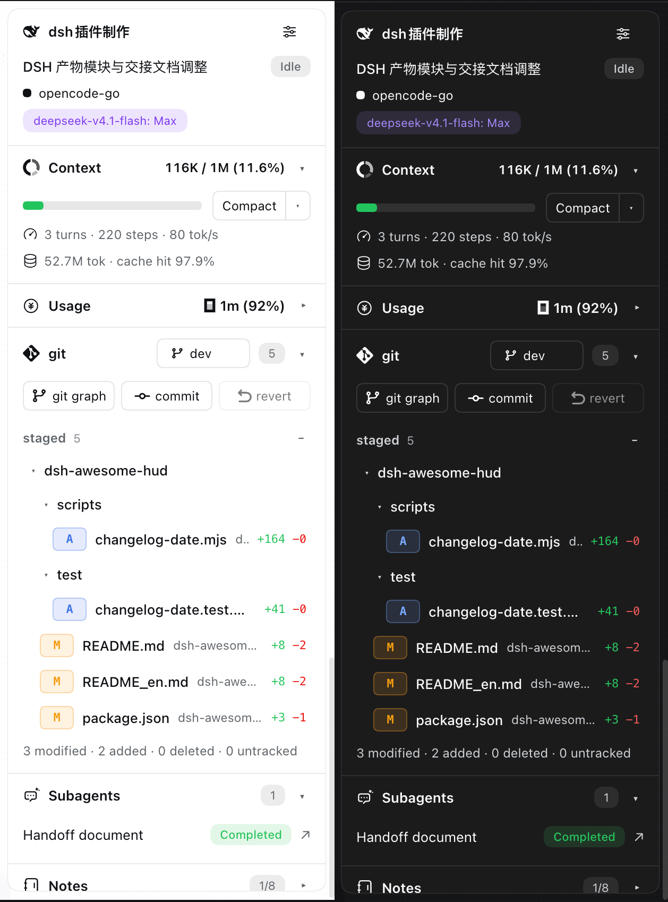

---

## ✨ Feature overview

| Module | What you see and what you can do |
| --- | --- |
| Session | Workspace and session names, run state, one chip for model and reasoning level; menus for rename, pin, branch, archive and copy. |
| Context | Fill ratio and a seven-category bar, session stats and token usage; one-click compaction, or a subagent that writes a handoff document. |
| Usage | DeepSeek balance, OpenCode Go quota and Codex quota; one of them can show in the title while folded. |
| Outputs | Documents, sheets, slides and images this session and its subagents wrote, delivered files and AI-generated images; click to preview, right click to add to chat or copy a path. |
| Git | Branch and change count, staged and unstaged groups, diff, add to chat, reveal and copy from a right click, commit with AI message, git graph. |
| Tasks | The session task list and states, refreshed as the tasks change. |
| Subagent tasks | Subagents of the current session with their states; open one in the right sidebar. |
| Plan list | Plans from plan mode with three states; click a row to read the full plan. |
| Notes | Notes shared by workspace, with images, drag ordering, and import or send to the chat input. |
| To-do | To-do list shared by workspace: check, edit, drag and clear completed items. |
| MCP | Connected MCP servers with global on and off switches. |

The panel also offers **module folding and pinning**, **card and sidebar panel styles**, **left and right panel sides**, and a **built-in usage guide page and changelog page**.

---

## 🧩 Modules and pages

### Session module

Shows the workspace name, the session name, the session state, and one chip with the model name and reasoning level (the chip color follows the level). Both names are clickable and open a menu at the pointer:

- **Workspace menu**: rename, show in the file manager, copy path;
- **Session menu**: pin or unpin, rename, branch session, copy session ID, copy session name, archive session;
- **Rename**: the name turns into an input in place; Enter saves, Esc cancels and a click elsewhere also saves.


### Context module

The title shows the current fill, the limit and the ratio; the bar color shows the fill ratio. The two lines below hold the session stats (turns, steps, tok/s) and the token usage (total, cache hits). A hover on the bar switches it to seven segments with their share: system prompt, tool definitions, user messages, injected content, skill injections, assistant messages and tool results. The unused part of the window stays grey, and a hover on the lines shows the full details.

- **Compact**: available while the session is idle, greyed while a task runs;
- **Handoff**: the menu to the right of “Compact” starts a subagent that writes a handoff document into `docs/handoff/` of the workspace; progress shows in the Subagent tasks module.

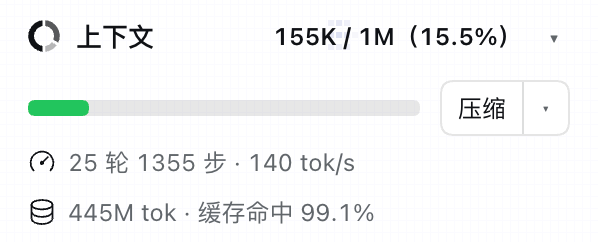

### Usage module

- **DeepSeek balance**: always shown, a dash when there is no data;
- **OpenCode usage**: the usage percents of the three OpenCode Go windows;
- **Codex quota**: the 5-hour and weekly quota for a subscription, the free quota otherwise;
- **Jump**: a click on the balance or a percent opens the matching settings page;
- **Folded info**: while folded, the title can show the balance or one quota, chosen in settings.

The first three lines come from two related plugins: [dsh-account-usage](https://github.com/Ycet/dsh-account-usage) (balance and OpenCode usage) and [dsh-codex-subscription](https://github.com/WSL043/dsh-codex-subscription) (Codex quota). Without them the matching line is hidden and the setting is greyed with a reason.

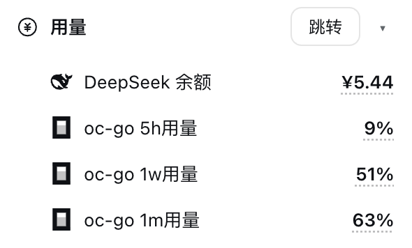

### Outputs module

Lists the documents, sheets, slides and images this session and its subagents **wrote with `write` / `edit`**, the files this session **delivered with the official `present` tool**, and images **generated by gpt_imagegen**: newest first, up to 10 files, with three shown first and the rest opened on click, and the module hidden while there are no outputs. Only these durable records count, so the list survives a DSH restart and never includes files another session or you changed by hand (files produced directly by shell commands no longer appear). A delivered path must stay inside the session workspace, because the sidebar preview resolves against it. A subagent contributes only the `write` / `edit` records in its own log (a fork subagent does not repeat the history it inherited), mapped into the main workspace, so files outside it — a worktree, for example — are not listed. **A branched session** keeps the outputs from before the branch: DSH records no source for a fork, so the plugin identifies the source session from the `owner` fields of the inherited `job` events and checks it against the boundary event, then reuses that session's subagent outputs.

- **Hover path**: a 0.5-second hover on a file row shows the full relative path;
- **Open**: a click opens the file content in the right sidebar;
- **Context menu**: add to chat (an `@` reference in the chat input), show in folder, copy the file name, the relative path or the absolute path.

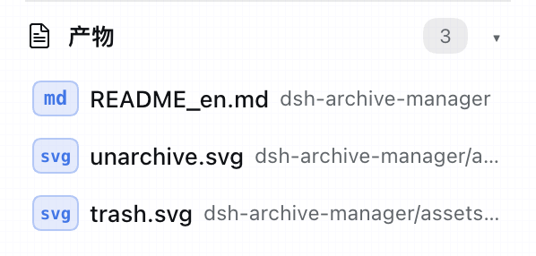

### Git module

The title shows the current branch and the number of changed files. Files come in a staged group and an unstaged group with counts, in list or file-tree view: the state letter, the file name, the grey relative directory and the `+added / -removed` counts.

- **Branch button**: switch to an existing branch or create a new one;
- **Init repository**: outside a repository the button reads this; a click makes the repository and writes a `.gitignore`;
- **Hover actions**: staged files can leave the index; unstaged files can be reverted or staged (a folder row applies this to its whole subtree);
- **Context menu**: stage, revert and add to the `.gitignore` in the repository root sit at the top, followed by add to chat, show in folder, and copy name / relative path / absolute path (the same icons the Outputs module uses);
- **Diff**: a left click opens the diff in the right sidebar;
- **Add to chat**: a right click on a file writes it into the chat input as an `@` reference, in both the staged and the unstaged group; a deleted file, a file outside the workspace, or a page without a chat input greys it out;
- **Reveal and copy**: show in folder, and copy the name / relative path / absolute path, exactly like the Outputs module;
- **No clipped menu**: the menu clamps to the viewport from its real item count, flips up near the bottom edge, and scrolls when it is taller than the viewport;
- **Revert**: reverts every unstaged change (untracked files are deleted too) and asks for confirmation first.

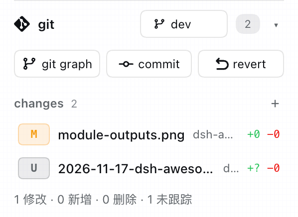

#### Graph page

The “git graph” button opens the commit list, loaded page by page (80 commits per page, more when you reach the bottom). The current branch is a blue chip and other branches are grey. A right click on a commit copies the short or full hash or the subject, creates a branch from it, merges it into the current branch, or runs a soft, mixed or hard reset.

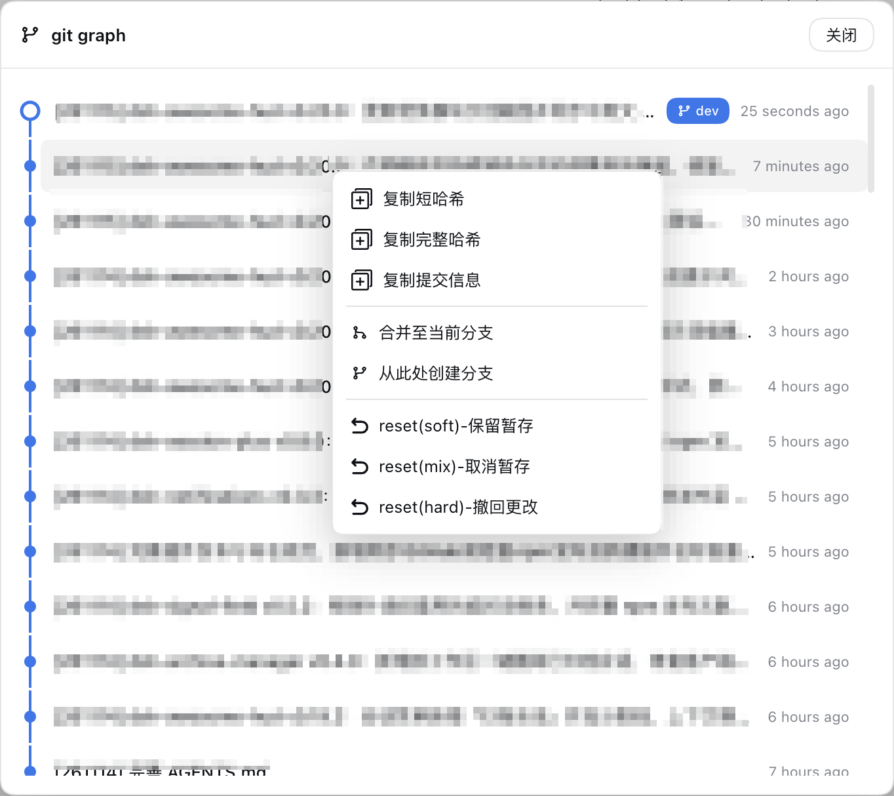

#### Commit page

“commit” commits the staged files; “AI generate” writes a commit message from the prompt plus the staged changes. The default prompt holds the date and version rules and can be edited and saved from the top of the dialog. With nothing staged the button still opens the dialog, where commit and AI generate stay disabled.

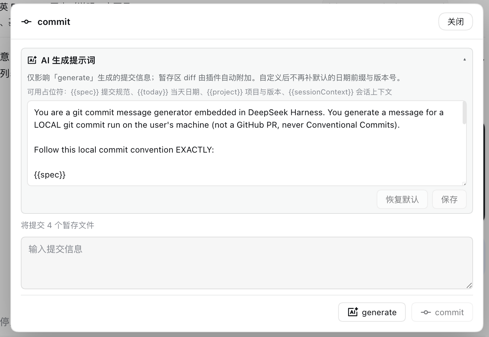

### Tasks module

Shows the task list and states: a running task has a rotating icon, completed tasks stay at the bottom and open on click. The bottom line gives the done, running and pending counts, and the list refreshes as the tasks change. The module stays hidden without tasks.

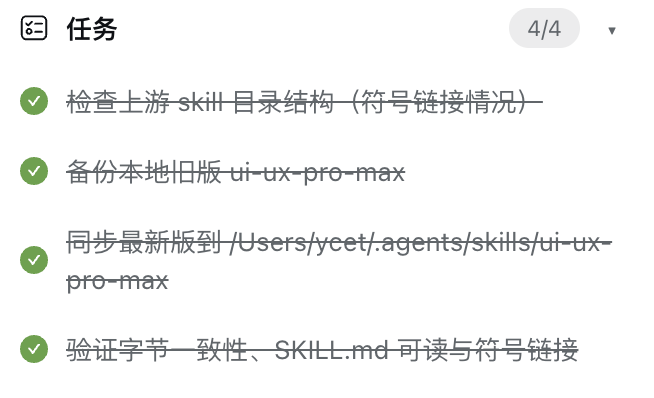

### Subagent tasks module

Shows every subagent of the current session, indented by level: a running one is yellow and a finished one is green, and three show first when there are more. A click opens that subagent session in the right sidebar while the main session stays open. The module stays hidden without subagents.

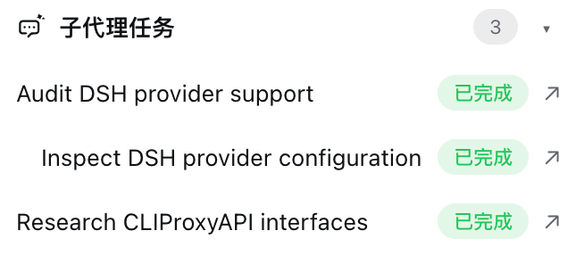

### Plan list module

Shows the plans from plan mode: yellow for pending approval, green for executed and grey with a strikethrough for discarded, with the counts of the three states below and three rows first when there are more. A click on any row shows the full plan, rendered as Markdown.

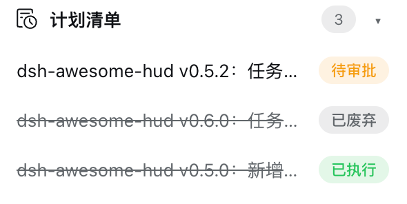

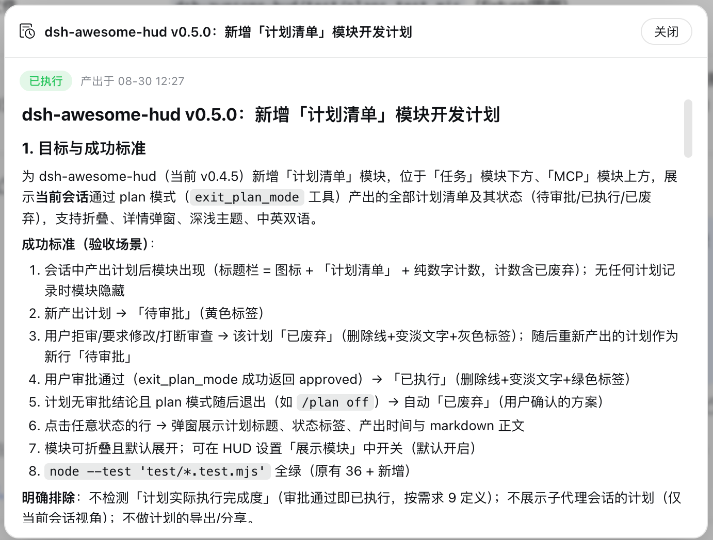

### Notes module

Notes are shared per workspace (all sessions in one workspace directory use one set), and each note saves its own title and text: no text limit and up to 20 images.

- **List**: the note list shows every note; a click opens the editor and a hover shows the delete button;
- **Order**: drag the handle at the left of a note bar to change the order;
- **New note**: “Add note” starts an empty note in the editor; “Create from chat” starts a note from the input text and images;
- **Delete**: the button turns into cancel and confirm, and a confirm deletes; “Delete all” asks for a confirmation too;
- **Editor**: opens inside the module by default and the back button returns to the list; the title can change (an empty title is numbered), images paste in and reorder by drag, and the bottom handle sets the height shared by all notes;
- **With the chat**: “Import” clears the note first and writes the input content; “Send to chat” clears the input first and writes the note, adding images in note order; “Clear” asks for a confirmation;
- **Dialog editing**: turn it on in settings and a click on a note bar edits it in a dialog while the module stays a list.

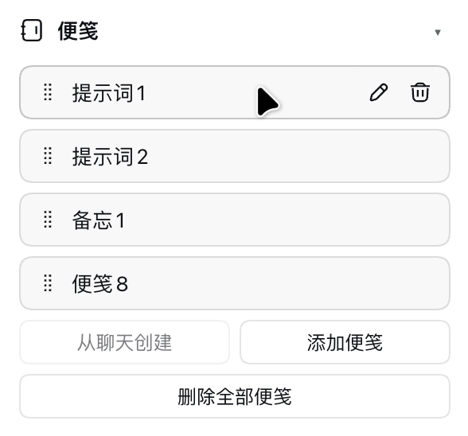

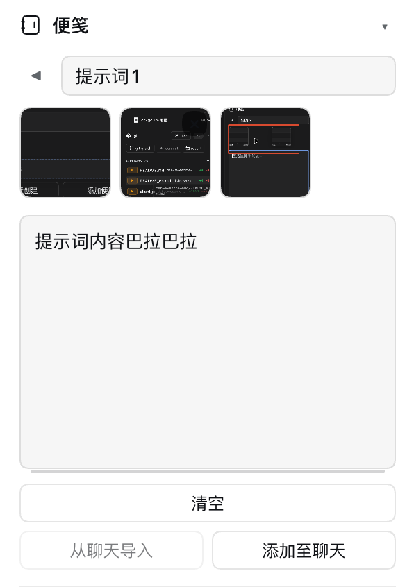

### To-do module

A to-do list shared per workspace: a check marks an item done and a second click restores it; type in the input and press Enter to add an item; a click on the item text edits it and a delete asks first; drag the handle at the left of a row to change the order; “Clear completed” asks for a confirmation. The title shows the done count and completed items stay below, ready to open.

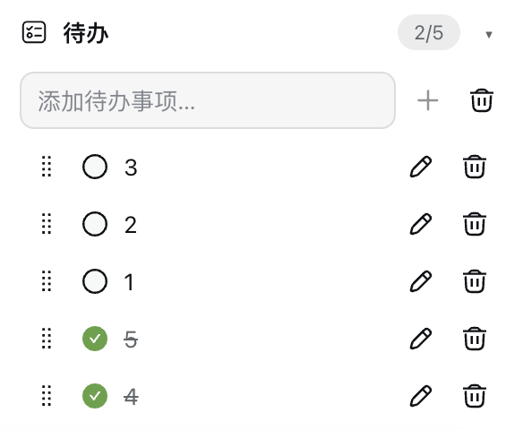

### MCP module

Lists the connected MCP servers and their global on and off state. A click starts or stops a server without a page refresh, and only the target server changes; some setups need a DSH restart.

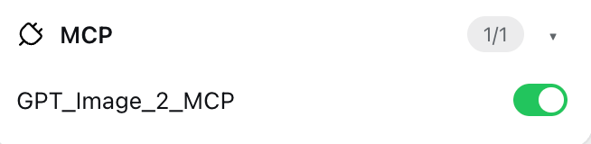

---

## ⚙️ HUD settings and panel behaviour

Click the gear at the top right of the Session module to open the settings dialog. The dialog has three tabs: **“HUD settings”**, **“Usage guide”** and **“Changelog”** (the guide is the built-in manual with a heading and one-line entries per topic; the changelog groups the changes by version, and its version list marks the current version as Current).

- **Left pane**: tick modules to show or hide them, drag a handle to set the panel order, and a pin on each card pins that module (one at a time);
- **Right pane**: five cards — HUD panel general settings (panel style: card or sidebar, card by default; panel side: left or right; the two default open states), Context, Usage, Git changes and Notes;
- **Save**: “Save settings” turns active after a change; closing the dialog or Esc discards; “Reset to defaults” opens its menu at the pointer;
- **Disabled rows**: an unavailable setting is greyed and its hint turns red to give the reason.

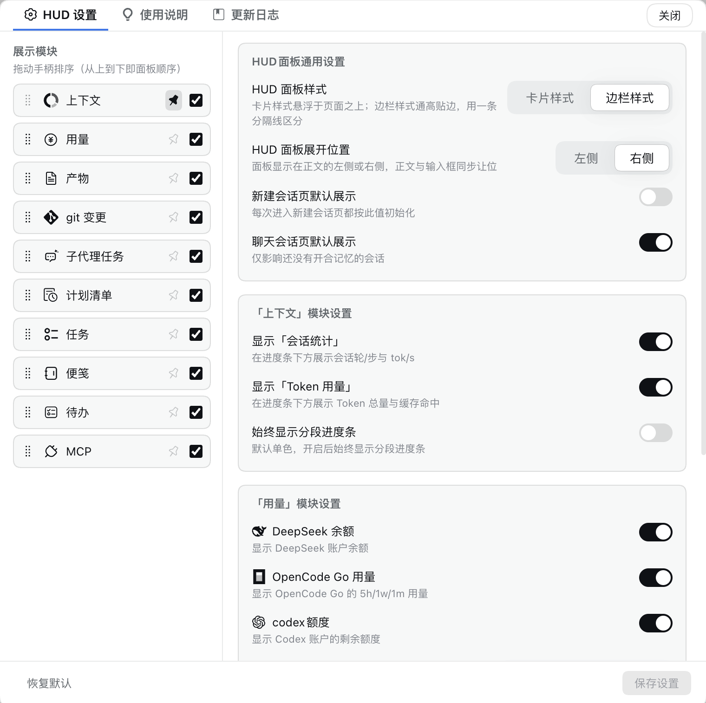

Panel behaviour:

- **Open state**: saved per session; the blank session page starts collapsed and the default can be changed in settings;
- **Fold**: a click on a module title folds or unfolds it; Session and Context never fold and the folded state is saved per session;
- **Pin**: a pinned module stays right below Session, up to 40vh, scrolls inside that zone and keeps its sticky title;
- **Sidebar**: the panel hides while the right sidebar is open and returns when the sidebar closes.

---

## 🚀 Quick Start

**Option 1: install from npm (recommended; the plugin page can update it)**

```bash
# 1. Install (no git required; pnpm must be on PATH for `dsh plugin`)
dsh plugin --profile web add dsh-awesome-hud@0.21.7

# 2. Restart the DSH Web service and refresh the page
```

> [!NOTE]
> A copy installed from npm can be updated from the plugin page: open “Plugins → Installed”, a new version shows “Update available” and the detail page offers “Update to”. Copies installed from a GitHub tag or a Release tarball cannot update in place; uninstall and install again.

**Option 2: install from GitHub (pinned tag; useful without an npm account, no in-place update)**

```bash
# 1. Install (pinned to a release tag; requires git access to GitHub)
dsh plugin --profile web add "github:Ycet/dsh-awesome-hud#v0.21.7"

# 2. Restart the DSH Web service and refresh the page
```

**Option 3: install from local source (development)**

```bash
# 1. Install (replace <absolute-path-to-plugin> with your local source directory)
dsh plugin --profile web add "dsh-awesome-hud@link:<absolute-path-to-plugin>"

# 2. Restart the DSH Web service and refresh the page
```

**Option 4: install from the Release asset (tarball; no git and no npm account needed)**

```bash
# 1. Install (use the Release asset URL directly, or pass a downloaded .tgz path)
dsh plugin --profile web add "https://github.com/Ycet/dsh-awesome-hud/releases/download/v0.21.7/dsh-awesome-hud-0.21.7.tgz"

# 2. Restart the DSH Web service and refresh the page
```

After the install a “HUD panel” button appears at the top right of a chat page (left of the workspace button). **Each session remembers its own open state**; the blank session page is the exception — it starts collapsed every time and offers its own floating button at the top right.

### Desktop install (macOS)

Quit DeepSeek Harness completely, then use the CLI that ships with the desktop app; do not manage the `desktop` profile with an older Web CLI:

```bash
# From npm (recommended)
"/Applications/DeepSeek Harness.app/Contents/Resources/runtime/cli/bin/dsh" plugin --profile desktop add dsh-awesome-hud@0.21.7

# From local source (development)
"/Applications/DeepSeek Harness.app/Contents/Resources/runtime/cli/bin/dsh" plugin --profile desktop add "dsh-awesome-hud@link:<absolute-path-to-plugin>"
```

### Where the data lives

Note text, to-dos, folds, panel settings and the open state live in the `localStorage` of the current browser or desktop app; **note images** are stored as originals in the **IndexedDB** of the same origin. Installing the plugin does not carry this data over from a Web browser, and the model and login credentials stay with DSH.

---

## ⚙️ Compatibility

| Item | Version / note |
| --- | --- |
| DeepSeek Harness | `engines.dsh: >=0.2.1-rc.2`; verified on the macOS desktop app `0.2.2-rc.2` and later, with a fallback for older Web interfaces |
| Platform | Verified on macOS; Windows and Linux rely on the same git command behaviour |
| Theme | Follows the light and dark theme (`--dsw-alias-*` tokens) |
| Language | Simplified Chinese and English, following the DSH locale |
| Icon | The top-level `icon` field in `package.json` (packaged `icon.png`, 448×448, ≤256 KiB) |
| Data scope | Notes and to-dos are shared per workspace directory, with a per-session fallback when a session has no `cwd`; folds and the open state are per session |
| Subagent sessions | Open in the right sidebar through the official `subagentchat` resource; without that interface the panel shows a failure hint and keeps the main session |
| Plan list source | The `exit_plan_mode` calls in the session log (`tool/call` / `tool/result` / `plan/mode`); review the state derivation if the approval semantics change upstream |
| Related plugins | [dsh-account-usage](https://github.com/Ycet/dsh-account-usage), [dsh-codex-subscription](https://github.com/WSL043/dsh-codex-subscription), [dsh-better-sidebar](https://github.com/omdsh-dev/DSH-better-sidebar) (cooperating since `0.32.0`) |

The desktop compatibility review is recorded in [docs/desktop-compatibility-0.14.7.md](docs/desktop-compatibility-0.14.7.md).

---

## 🔧 Tech Stack

| Item | Content |
| --- | --- |
| Host | Node.js ESM, `ctx.webServer` prefix routes, `ctx.settings`, `ctx.subagents` / `ctx.agents`, `ctx.commands` (compaction), `ctx.subprocess`, `ctx.llm` (AI commit messages) |
| Client | ModuleLoader bundle, React (`react.createElement`), Cordis slots (`conversation.session.header.utilities` / `shell.overlay`), CSS theme variables; no new slot |
| Data | Session projections (`sessions` / `workspaces` / `modelDirectories`) plus the plugin's own host API (git, MCP, subagents, plans, compaction, handoff) and the dsh-account-usage routes (with a fallback to the official account service) |
| Tests | `node --test` (git parsing, MCP, state derivation, plan derivation, settings normalisation, the trust fence, UI wiring and more, in `test/`) |

---

## 🧪 Development and tests

```bash
# Syntax check
node --check lib/index.js && node --check lib/client.js

# Full suite (checks and aligns the changelog date of the newest version first)
npm test

# Check only / fix the newest version date by hand
npm run changelog:date -- --check
npm run changelog:date
```

`scripts/changelog-date.mjs` guards the date of the newest changelog entry: while that version has uncommitted changes in `lib/client.js`, `lib/index.js` or `package.json` the date is the file write date, and on a clean tree it is the last commit date of those files. A mismatch is corrected to the modification date, released versions keep their own dates, and the check is skipped while `package.json` has a version without a changelog entry. The `pretest` hook aligns it before `npm test`.

Current baseline: **748 tests / 745 passed / 0 failed / 3 skipped**.

```
dsh-awesome-hud/
├── lib/index.js      # Host: routes, git / MCP / subagents / compaction / handoff / settings I/O
├── lib/settings.js   # Settings model and normalisation (order, pin, panel, notes, git)
├── lib/client.js     # Client: panel, modules, settings dialog, guide page, changelog page
├── assets/icons/     # Panel and menu icons (served by the host asset route)
├── cordis.patch.yml  # Plugin declaration and default configuration
└── test/             # node --test regressions
```

---

## 🔗 Related plugins

| Plugin | Role |
| --- | --- |
| [dsh-account-usage](https://github.com/Ycet/dsh-account-usage) | Supplies the DeepSeek balance and OpenCode Go usage (with a fallback to the official DSH account service) |
| [dsh-codex-subscription](https://github.com/WSL043/dsh-codex-subscription) | Supplies the Codex quota (5-hour, weekly and free) |
| [dsh-better-sidebar](https://github.com/omdsh-dev/DSH-better-sidebar) | Sidebar cooperation: the panel and the sidebar take turns, and a Git file diff can fall back to its worktree tab |

---

## ⬆️ Upgrade Notes (v0.11.x → v0.21.7)

<details>
<summary>Open the per-version notes</summary>

**v0.21.7: The context figures match the official density.** (1) The detail figures no longer freeze: the host cache keyed only on the surface `contentGeneration`, which rises on a replace or a projection and stays put on a plain append, so the seven figures stopped at the first snapshot (skill injections at 142K, assistant and tool results stuck at zero). The cache key now covers the generation, the node count and the last node, and each node is priced once by sequence, so an append invalidates the figures and only new nodes are priced. (2) The estimate now follows the official `dsh-token-meter/src/estimate.ts` line by line: a reasoning block prices as a text block, tool-call arguments count by string length, and a system message counts as plain text density plus role framing. On a real session replay the seven figures add up to the official `messageTokens` exactly (40682 = 40682), and the system prompt matches too (2501 = 2501). (3) Images generated by gpt_imagegen join the outputs module: the MCP's `generate_image` / `edit_image` calls only return a task id, and the image path lands in the `## result` JSON block of the completed `get_image_task` text. The host now scans `tool/result` events, resolves the tool name through the `callId`, and parses `filePath` / `filePaths`; absolute paths normalize against the session workspace, images outside it or already deleted are dropped, and the records share dedupe, ordering and limits with the `write` / `present` evidence. (4) The Git module no longer spins forever when the panel is served from a LAN address (issue #3): the trust fence prefers the official `connection.admit` (DSH removed `requestRejection` in 0.2.3-alpha.1) and the local fallback now accepts the listener bind address like the official `isBindAddressAuthority`, so a self-hosted LAN bind is no longer refused with 403. (5) A git poll that keeps failing (two consecutive beats with no snapshot) ends in an error state with a retry control instead of an eternal spinner; the first failed beat stays on the loading state and heals itself, and a missing session (stale client snapshots after a host restart, just-archived sessions) counts as transient via the 404 `missing-session` code. (6) Drag-reorder can no longer push a pinned module below the top: the drag preview, the saved order and the panel render all keep the pinned module first, and a stale order from an older release is corrected the next time the panel opens. Baseline: 776 tests / 773 pass / 0 fail / 3 skipped.

**v0.21.6: The Git change-file menu matches the outputs menu.** (1) Both the staged and the unstaged group put “Add to chat” in a file's right-click menu. A click writes the file into the chat input as an official `@` reference, through the same logic the outputs module uses: the same reference shape, the same success and failure messages, and the same focus hand-back. (2) A change path comes from `git status --porcelain` and stays relative to the repository root, while an official `@` reference resolves against the session workspace. The snapshot now carries `prefix` (`git rev-parse --show-prefix`), so a session in a subfolder converts the path before the reference goes in. (3) Folder rows get the same “Add to chat”, reveal and three copy items, since an official `@` reference also accepts a folder; revealing a folder goes through the workspace directory route, so a subfolder outside the session workspace still opens. The same menu also offers “Show in folder” and copies the name, the relative path and the absolute path, with the same folder and copy icons the outputs menu uses, now bundled with the plugin and shared by the git graph copy menu and every “show in folder” item. The absolute path needs the repository root, so the snapshot also carries `root` (`git rev-parse --show-toplevel`, realpath on macOS); without it the item greys out with a reason. (4) The menu now lists the git actions (stage, revert, ignore) first, then a divider and the chat and locate actions, then a divider and the copy actions. (5) The menu no longer gets clipped: it clamps to the viewport from its real item and divider count, renders through a portal on `body` instead of inside the HUD panel scroll box, and scrolls when it is taller than the viewport. (6) A file outside the workspace reports that it cannot be referenced, and a deleted file (`D`) or a page without a chat input greys the matching item out with a reason. (7) The context bar hover now splits into seven categories: system prompt, tool definitions, user messages, injected content, skill injections, assistant messages and tool results, each with its estimate and share, while the unused part of the window stays grey. The first two come from the official `contextBreakdown`; the host adds a `context/breakdown` route that scans the session surface and estimates the other five with the official density, then scales them to the official `messageTokens` so the five always add up to the official message total. Without the route the bar falls back to the three segments. The git and context sections of the guide are updated. New cases cover the seven-category estimate, the scaling remainder, the fallback, the menu order and disabled states, and the clamp and portal wiring. Baseline: 761 tests / 758 pass / 0 fail / 3 skipped.

**v0.21.5: the outputs list covers the files this session delivers.** The files the official `present` tool declares (`files[].path`, absolute or workspace-relative) now join the outputs list. They share the same workspace normalization, extension allow-list, de-duplication and ordering as `write` / `edit`, and the evidence stays the durable `tool/call` event, so a restart rebuilds the list. A delivered path outside the workspace is not listed, because the sidebar file preview resolves against the session workspace. Baseline: 748 tests / 745 passed / 0 failed / 3 skipped.

**v0.21.4: the MCP switches match the settings pane, and git diff targeting is fixed.** ① Each row of the MCP module now uses the same switch component as the settings pane instead of the custom green pill: the official `Switch` renders when available, and the local fallback keeps the same geometry and theme tokens, with the brand color for the on track and the theme foreground for the thumb, sized 36×20 instead of 30×18. Clicking still disables that row, refreshes the whole module from the returned snapshot, and drops late answers from older polls. ② The old custom switch styles and their `data-on` state are gone, so the panel keeps one switch style. A new `test/mcp-switch.test.mjs` covers the shared component, the disabled state, the official-first path and the removed styles. ③ **Fixed a left click on a git change row opening the wrong diff**: the old basename fallback matched a same-named file in another directory, so `dsh-awesome-hud/package.json` could open `dsh-archive-manager/package.json`. Matching now uses the exact path or a path-boundary suffix from the repository root to the session cwd. The official turn review is also looked up turn by turn instead of only the latest one, so a file changed in an earlier turn opens its official diff instead of always falling back to dsh-better-sidebar; when that extension is absent, official DSH has no working-tree diff page either, so the clicked file opens in the official file preview instead of a red toast. ④ **Outputs list only what this session and its subagents wrote**: the per-turn change summary is gone, because it is a whole-repository working-tree diff between the turn start and end, so files another session or you changed in the same window were counted as this session's products (session `b086d5e7` showed READMEs from two other plugins). The only evidence now is the durable `write` / `edit` call, which survives a restart; the trade-off is that files produced directly by shell commands no longer appear automatically. Baseline: 745 tests / 742 passed / 0 failed / 3 skipped.

**v0.21.3: subagent outputs and the Current mark in the version list.** ① The Outputs module now covers **this session and its subagents**: documents, sheets, slides and images written by a subagent appear in the list too. The evidence is the durable `write` / `edit` records in the subagent log (rebuilt after a DSH restart, and still without a workspace scan), and every path is mapped into the main workspace, so a subagent running in a worktree or another directory contributes nothing outside it. Main-session and subagent entries share one newest-first order, a path appears once, and the 10-file cap and the existence-check budget are shared after the merge. A corrupt subagent log, a missing subagents service or a failed read only drops that part, and the main-session outputs still load. ② **A branched session keeps its outputs**: DSH records no source for a fork, yet the branch log starts with a verbatim copy of the source events. The plugin ranks the `owner` session ids found in that prefix and accepts one only when the last inherited event matches by time and type, so the branch reuses the source session subagent outputs (for example the handoff document) and, while the source session is still alive, its per-turn changes. When the check fails it lists only this session, rather than guess. ③ The version list on the left of the Changelog page now shows a **Current** mark next to the current version number, reusing the badge style of the version cards on the right; the mark gets one step more contrast while its row is highlighted, so it never blends into the row. ④ Subagent ids also come from the durable `subagent/catalog` events in the session log, so direct subagent outputs still appear when the subagents service is down; the guide sections for the HUD panel and the Outputs module are reworded. New outputs cases cover the merge, dedupe, cross-workspace mapping, the shared cap and stat budget, the cold-read lease, the degraded path and the fork source check. Baseline: 736 tests / 733 passed / 0 failed / 3 skipped.

**v0.21.2: merged reasoning chip, per-session folding, subagent and outputs attribution fixes.** ① The session module merges the model name and the reasoning level into **one chip** (for example `deepseek-v4.1-flash:Max`): the lowest enabled level is grey, the highest purple, other levels and the default blue, `Default` shows when no level is stored, and a model without reasoning levels shows a grey name only. ② Every HUD module keeps its collapsed/expanded state **per session** in localStorage (`dsh-awesome-hud:folds:v2`, newest 200 sessions kept, the old global key is cleared without migration): the new-session page and a freshly created session expand Context, Tasks, Subagents, Plans and Outputs and fold Usage, git, Notes, To-do and MCP. Changes made on the new-session page are held in memory and carried into the session created there, and re-entering the page restores the defaults. ③ Fixed the stuck row actions in the git change tree: visibility now follows hover and keyboard focus (`:has(:focus-visible)`) instead of `:focus-within`, so a mouse click never pins the buttons while Tab focus still reveals them. ④ A subagent task now opens as a tab in the **current right-sidebar pane** instead of a new pane, and an already open subagent is revealed. ⑤ Outputs are strictly session-scoped: DSH per-turn summaries plus the paths this session's `write` / `edit` calls produced, rebuilt from durable events after a restart. The workspace scan is gone, so other sessions and your own manual edits never appear; files produced only by shell commands are no longer collected. ⑥ Guide sections for the HUD panel, the Context module and git are updated, four new test files cover the chip, hover rule, subagent placement and per-session folding, and the outputs cases now assert session attribution. ⑦ **Initializing a repository creates or completes `.gitignore`**: a missing file gets the common template used by "add to .gitignore", an existing file only receives the missing common entries and keeps its rules and line endings, and **a failed write never fails the repository setup** (the API reports `gitignore.mode=failed` and the panel shows a red notice); the already-a-repository branch never touches the file. The Git module also lays itself out **as soon as a session page opens**: until the snapshot arrives the title row keeps no branch or init button and the body reports that it is loading, so switching sessions no longer delays the whole module. ⑧ **Handoff in the Context module**: "Compact" becomes a split button (text half, a 1px divider, then a drop-down arrow). The text half still compacts; the arrow half opens a rounded menu below the button and **Handoff** starts a **fork subagent** in this session (same model, seeded with the completed turns) that writes a handoff document to `docs/handoff/`, using a built-in prompt (your wording plus one closing line to write in the session language). The subagent runs with `delivery=caller`, so it finishes silently and posts nothing back to the main session, and the Subagents module shows its progress. A missing live agent, a missing fork provider, or a concurrency or depth limit answers 404, 503 or 409 with readable copy, and both halves are disabled while the session runs. ⑨ **Any module can be pinned**: every card in the left column of the HUD settings gains a pin button between its name and checkbox (official DSH pin and unpin icons). Pinning moves the module first and keeps it just below the session module in the panel: at most **40vh**, scrolling inside, with its title sticky. Only one module can be pinned at a time (other pins grey out), and the pinned card keeps the first slot and cannot be dragged. A pin cancelled before saving returns the module to its earlier position; a pin cancelled after saving leaves the module first and freely draggable. Hiding the pinned module cancels the pin, and "Reset to defaults" clears it. The old "pin the context module in place" setting is gone, and a previously enabled option migrates to a pinned Context module. Three new test files cover pinning, handoff and `.gitignore` on init, and the former `test/context-pin` is rewritten as the general pinning suite. ⑩ **AI commit messages no longer read the session context**: the only inputs are the prompt saved in the commit dialog and the staged diff, while the project name and version still come from `package.json`; the default prompt loses its conversation paragraphs, a note “specified in the conversation” is no longer a basis either, and `{{sessionContext}}` is removed from the placeholder list (a leftover `{{sessionContext}}` in an old custom prompt is still replaced with an empty string, so the token never reaches the model). The placeholder hint, the prompt hint, the generate confirmation hint and the guide’s git section are reworded, and `sessionId` still rides along as routing metadata while the host no longer reads session events. New cases assert that the generate function never touches the sessions service or the context extractor and that an old placeholder is cleared. Baseline: 727 tests / 724 passed / 0 failed / 3 skipped.

**v0.21.1: note dialog and image-drag fixes, Git commit and ignore improvements.** ① The note editor dialog (plus the note confirmation, HUD settings and git graph dialogs) now closes only when the press and the release both land on the backdrop: dragging a text selection out of the title or content input and releasing outside no longer closes it (the old code only compared the click target, and the browser dispatches such a click to the common ancestor of press and release, which is the backdrop). ② Reordering note images settles in place on release — the frame that applies the new order adds `data-settling` to the thumbnail strip so the transform transition is off, and both the dragged image and the images that made room stay where the drag preview put them, with no left-right jitter; the make-room animation during the drag is unchanged. ③ The "commit" button is no longer disabled when the workspace has no changed files: it opens the commit dialog, where "AI generate" and "commit" are greyed out and the staged-count line becomes "Nothing is staged for commit", so you can still read, edit and save the AI prompt (the prompt section stays collapsed by default). ④ AI commit messages now **reuse the project's current version**: the default prompt contains the YYMMDD date rule and "take the current version recorded in the version file, do not bump it" in its own text, so both can be edited in the dialog; after generation the host pins the date prefix to today and corrects the version to the project's current version (a self-invented bump is pulled back, and the old "version not incremented" retry and warning are gone); a saved custom prompt is fully authoritative (no date prefix, no version correction); `{{today}}`, `{{project}}`, `{{spec}}` and `{{sessionContext}}` are still injected, but for a custom prompt `{{project}}` and `{{sessionContext}}` only carry facts and context (the old values injected "the version MUST be strictly greater" and "notes must still follow strictly increasing version rules", which overrode the user's own version rule) and the host appends "this prompt is the only source of the rules; on conflict the later statement wins" so rules appended at the end really take effect; the default path keeps its original injection text. The commit dialog also closes on a backdrop click now — with the same safe rule as the other dialogs, so dragging a text selection out of the dialog and releasing does not close it. ⑤ The git graph / commit / revert buttons now split the module content width into equal thirds (aligned with the notes button row), and the branch button is a fixed 88px that truncates long branch names instead of resizing. ⑥ The context menu of a changed file and of a folder row in the tree gains "add to .gitignore" (icon `assets/icons/ignore.svg`): it writes to the repository-root `.gitignore`, creating it from a general template when missing (`.DS_Store`, `Thumbs.db`, `desktop.ini`, `.codegraph`, `node_modules/`, npm/yarn debug logs), anchors file rules as `/path` and folder rules as `/path/`, and never writes an equivalent rule twice; it only appends rules and never touches the index (no `git rm --cached`), so tracked or staged files keep being tracked and get an extra hint. The folder menu also gains "add to stage" / "revert" / "remove from stage". ⑦ The untracked status badge changes from a borderless bare "?" to the same outlined "U" pill as the other statuses — the old `data-kind="?"` CSS attribute selector was invalid, so its styling never applied. ⑧ The guide's git section gains the U letter, the .gitignore entry and the always-openable commit dialog, and the prompt item is reworded; the changelog page gains this version. New tests: `test/note-dialog-dismiss.test.mjs`, `test/note-image-settle.test.mjs`, `test/git-commit-empty.test.mjs`, `test/git-layout.test.mjs`, `test/gitignore.test.mjs` and `test/git-ignore-ui.test.mjs`, plus updates to the git menu, status badge, settings-dialog close, guide and changelog cases. Baseline: 673 tests / 670 pass / 0 fail / 3 skipped.

**v0.21.0: note dialog editing, scoped resets, a changelog limit and the official dropdown style.** ① HUD settings → Notes gains an **“Edit note content in a dialog”** switch (off by default). When it is on, clicking a note bar (the whole bar except the drag handle and the delete button) edits the note in a dialog while the Notes module stays a list, and “Add note” and “Create from chat” open the dialog too. The dialog matches the inline editor (editable title, image strip, fixed-height text area, Clear / Import from chat / Add to chat); close it with the top-right button or an outside click, and changes still save as you type. The dialog closes with the HUD panel or a workspace switch. ② **“Reset to defaults”** now opens a three-item menu at the pointer: reset all settings, reset module switches and order (left pane), and reset module feature settings (right pane: HUD panel general settings plus the context, usage, Git changes and notes module settings). An item whose scope is already at its defaults is greyed out; resets only change the draft and still need “Save settings” (note and to-do content and the Git commit AI prompt are untouched). ③ The changelog page shows the newest 20 versions at most, older records are removed from the data source, and tests enforce the cap and the first entry. ④ “Folded usage display” moves from a native select to a dropdown that matches the official DSH menu: a 36px trigger, the official material surface and radius, 34px items, a check mark on the selected item, and greyed, non-selectable unavailable options; the menu is rendered by the plugin itself so it always stacks above the settings dialog, with the official tokens and metrics. ⑤ Settings: the `note` section gains `popupEdit` (default false, whitelisted and normalized, no profile migration), and an old Host that is not restarted shows the “restart DSH” hint. New tests: `test/note-popup.test.mjs`, `test/settings-reset-menu.test.mjs` and `test/settings-dropdown.test.mjs`, plus updated settings, notes, changelog and guide cases. ⑥ Git changed files gain hover actions (stage, unstage, revert, with a mask) and matching minus/plus icons in the context menu; a new Git changes settings card adds a folder tree view with folder-level batch actions (the choice is persisted in the profile and kept across panel remounts and restarts); the staged hint text is removed. ⑦ Output file rows gain a blue extension tag; the context menu adds add-to-chat, show-in-folder and copy name / relative path / absolute path. ⑧ Module titles stick below the fixed conversation/context area while scrolling and disappear once the module is fully scrolled out; module dividers remain in both panel styles. ⑨ The changelog shows each version date in the TOC and card header. ⑩ Settings gain a `git` section with `view` (default list); an old Host shows the “restart DSH” hint. Added `test/git-tree.test.mjs`, `test/git-batch.test.mjs`, `test/outputs-host.test.mjs` and `test/settings-git.test.mjs`, and expanded the outputs, changelog and settings cases. Fixes: ① the folded-usage dropdown now renders above the settings dialog, and ② create-from-chat keeps the composer images in both the dialog and the inline editor. Baseline: 640 tests / 637 pass / 0 fail / 3 skipped.

**v0.20.1: leaner interactions, folded usage display and settings polish.** ① Todo items now commit the last preview on release: dragging to the first/last position and releasing outside the todo module (even over the chat body) still applies, the drop target keeps updating outside the list, and Esc cancels back to the original order. ② The same "release commits the last preview, Esc cancels" semantics apply to note-bar dragging and the settings module reorder. ③ In Sidebar style, the composer on the Trajectory/Statistics tabs is no longer narrowed twice: the sidebar style no longer adds the extra 300px seat margin (the seat already ends at the divider), for both sides, so the spacing matches Card style. ④ The Notes module header now shows a "current/limit" count (e.g. 3/5), hidden when there are no notes and updated live. ⑤ Todo items and note bars lost their edit buttons: click the todo text or the note title to edit. ⑥ A single delete is now an inline two-step action for both modules: the delete button turns into cancel (X) and confirm (red check) buttons, and the item is removed only after you confirm; clicking outside or pressing Esc cancels. ⑦ Automatic note numbering now follows "the largest “Note n” number in the current list plus one", so deleting the largest reuses that number (with Note 8 in the list a new note is Note 9; after deleting Note 8 it is Note 3). ⑧ A note limit below some workspaces' current counts now saves normally: existing notes stay, but those workspaces cannot create more. ⑨ The Usage module's "Jump" button and its setting are gone; a new **folded usage display** dropdown (None (default) / DeepSeek balance / OpenCode Go 5-hour / weekly / monthly quota / Codex 5-hour / weekly quota) shows an icon, an optional label and a bold parenthesized value next to the title when folded; unavailable options are disabled and Codex falls back to the free quota. ⑩ The settings dialog lost its Cancel button, and the disabled Save button now looks clearly different from the enabled one. ⑪ The Git commit AI generation now uses three sources — the prompt, the staged changes and the recent turns of the current session — weighted as “prompt = staged changes > session context”. The context is extracted by turn (the latest 3 turns) and only helps to read intent; it no longer claims priority over the diff. A note the user explicitly specified is still used as the 修改内容, but no longer bypasses the date-prefix or version checks. ⑫ A new **Changelog** page (see "Usage guide → Changelog page" above): a client constant plus zh/en dictionary keys, display-only, with no requests. Its icon ships as the host asset `assets/icons/changelog.svg` and is added to the asset allowlist, while an older host that has not restarted falls back to the same SVG inlined in the client, so the icon appears right after a refresh. ⑬ Every **greyed setting** in HUD settings now states its reason in **red** (the error color), while available rows keep the secondary grey; the two usage reasons now distinguish "install and enable the plugin" from "enabled but not configured or not signed in", and the Codex path carries a new `missing` flag. ⑭ Without `dsh-account-usage` the OpenCode Go quota rows do not render, and without `dsh-codex-subscription` the Codex quota rows do not render; the matching settings are greyed out and cannot be clicked. ⑮ The guide's "Settings" group gained the Changelog entry and the red-reason bullet, and the card count is corrected to four. Added `test/changelog-page.test.mjs` and `test/changelog-ste.test.mjs`, and updated `settings-guide`, `settings-dialog-layout`, `usage-visibility` and `codex-transport`. Baseline: 580 tests / 577 pass / 0 fail / 3 skipped.

**v0.20.0: new "HUD panel style" (Card / Sidebar, Card by default).** ① In "HUD settings → HUD panel general settings", a new **HUD panel style** row sits directly **above** "HUD panel side" and switches between **Card** and **Sidebar** with the official segmented control; the default is **Card**, so upgrading leaves the look of 0.19.2 untouched (no profile migration). ② **Card** keeps the original design: floating rounded card, 8px gap to the window edge, height capped at the composer's bottom edge, page scrollbar at the window's right edge. ③ **Sidebar** no longer uses the rounded card to separate itself from the page: the panel becomes **full height and flush** (top at the conversation header's bottom edge — on the new-session page it starts right under the top-right button row, leaving no gap; bottom at the window bottom, no outer margin), transparent, square and without an outer stroke, and only one 1px divider (`--dsw-alias-border-l2`, theme-aware) is drawn on the side facing the conversation body. Dividers between modules keep the existing light color but are **inset 14px on both sides** instead of running edge to edge; module content, interactions and the 300px width are unchanged. ④ In Sidebar style the body and composer still make room for 300px, but the scroll container is no longer padded back to the window's right edge — the page scrollbar now sits at the content edge, right next to the divider, so it is not covered by the flush panel. Switching back to Card restores the old behavior. ⑤ The style applies immediately on Confirm and is written to the profile settings (`panel.style`), surviving refreshes and restarts; an older host (no `style` in its response) keeps the browser mirror, so a user choice is never reset to the default. ⑥ The in-app "Usage guide" gained a panel-style bullet and matching sentence updates, and both READMEs are updated (no new screenshots). ⑦ Added `test/panel-style.test.mjs` covering schema defaults, normalization/allow-list, mirror and older-host compatibility, both styles' geometry (including the top edge on the new-session page), scrollbar compensation, CSS variants, settings-row order and guide copy. ⑧ Fixed the top edge of Sidebar style on the new-session page: with no session header there, the panel used to inherit the Card style's 52px baseline, which left a visible gap above it; it now starts at the bottom edge of the top-right button row (the row that holds the floating "HUD panel" entry), so there is no gap and the entry is not covered. ⑨ Outputs module file rows are now indented to align with the module title, and hovering a row for 0.5 seconds shows the file's full relative path at the pointer in the same tooltip style as git changed-file rows. ⑩ git module changed-file rows now match the Outputs module: the status letter stays at the far left, the file name comes first with the gray relative folder after it, and the `+added / -deleted` counts stay at the far right (an empty folder keeps a flexible spacer so the counts stay right-aligned). ⑪ The Git commit dialog gained a collapsed-by-default **AI prompt** section at the top: it shows the built-in default prompt, can be edited and saved, and the next **generate** then uses the saved prompt; **Restore default** removes the custom prompt. The host fills the `{{spec}}`, `{{today}}`, `{{project}}` and `{{sessionContext}}` placeholders, and the staged diff is still appended automatically. A custom prompt replaces the built-in instructions and skips the automatic date-prefix and version checks (the default prompt keeps them); every instruction now lives in the editable template and the user message only carries the diff. The prompt is stored in the profile settings (`commitPrompt`) and survives restarts; an older host keeps it for the current run only. Added `test/commit-prompt.test.mjs` covering template rendering, normalization, the schema default, the generation wiring and the dialog interactions (collapse, prefill, save, restore, failure). ⑫ The Notes module became **multiple notes**: the note list (drag to reorder, hover edit/delete, empty state), two action rows (Create from chat / Add note / Delete all notes), and the note editor (back / editable title / drag-reordered images / one shared height / Clear / Import from chat / Add to chat). An old single note migrates to “Note 1”. HUD settings gained a **Notes card** (count limit 5–20, default 5, number stepper); creating at the limit only shows a toast, and lowering the limit below the note count of any workspace rejects the whole settings save and a toast names that workspace. ⑬ The Outputs module data source was extended: in addition to DSH's per-turn `workspaceChanges` summaries, a **workspace scan** collects files with the 16 extensions by last-modified time, so **terminal-command changes** (python / npm / compilers…) also appear; filtering starts from the session's creation time, so the list **survives a DSH restart** (no in-process cache). The HUD settings "Confirm" button was fixed: it now reads **"Save settings"** and stays **greyed out until something changes in this dialog**; the note-limit validation now runs only when the limit itself changed (previously any save was blocked by existing note counts, so the dialog neither saved nor closed). The Context and Usage settings rows gained short hints; dragged note bars and images now move to the drop slot as a placeholder, an image drag no longer opens the lightbox, and the note overwrite confirmations (Add to chat / Import from chat) use the red danger button. Baseline: 562 tests / 559 pass / 0 fail / 3 skipped.

**v0.19.2: fixed the Outputs module ordering, hid it when empty, moved it above git, and made the commit-generate hint red.** ① Symptom: after dragging Outputs away from `git` in the left column of the HUD settings dialog and confirming, the draft order inside the dialog was correct, but the panel still showed Outputs right below `git`, so the new order looked like it never applied. ② Cause: to keep old profiles from appending new modules at the end, v0.19.1 ran an anchor pass (`outputs` right after `git`) at the end of `normalizeModuleOrder` on both the host and the client; because that pass ran on **every** read and write, a manual position was pulled back on save, on read and again at render time. ③ Fix: the anchor now only fills in keys that are **missing** from a saved order — a missing key is inserted right after its anchor, while a key already present in the saved order keeps its position. The host `applyModuleAnchors` became the internal `insertAtAnchor` (no longer exported) and the client function was updated the same way. ④ Compatibility: old profiles without `outputs` still get it right after `git`, while dragging Outputs to the first, middle or last position is preserved, and normalization stays idempotent. ⑤ The confirmation hint on the Git commit page (it uses the official Flash model instead of the current session model) changed from grey secondary text to red (`--dsw-alias-state-error-primary`, adapted to light and dark themes), matching the red “Confirm?” button. ⑥ Added one regression to `test/module-order.test.mjs` (three positions preserved, `sanitizeOrderPatch` on write, `normalizeSettings` on read, old-profile migration still anchored, client matching the host) plus the red-hint assertion in `test/git-client-flow.test.mjs`. ⑦ The Outputs module now **hides completely when the list is empty** (like Subagents, Tasks and Plan list) and appears once there are matching files; its default position moved from below `git` to **above `git`**, old migration still inserts it before `git`, and it can still be dragged anywhere in HUD settings (profiles that already saved an order keep it; press Reset to defaults in the settings dialog to adopt the new default order). ⑧ The Outputs, Plan list and Subagents modules share one collapse interaction: three rows show first, a “Show n more …” link appears under the third row, and after the last row a “Collapse” link returns to three. ⑨ The per-refresh cap dropped from 24 to **10** (`OUTPUT_LIMIT` on the host and the client default), and the footer hint follows the new cap. ⑩ The Tasks and Todo modules move completed entries to the bottom and keep them collapsed: “Show completed tasks” / “Show completed items” opens them and a “Collapse” link closes them again; tasks keep their relative order (earliest completion first) and todo dragging only reorders the open items while completed items stay grouped at the end. ⑪ In the Context settings card, “Always show segmented bar” moved above “Pin the context module in place”, so the card now reads session stats → token usage → segmented bar → pin. ⑫ The session name menu gained “Archive session” at the bottom (runs the official `uiWorkspace.archiveSession`), separated from the copy actions by a divider; the item is disabled with a reason when the session is already archived or the capability is missing. ⑬ The Context module can be folded: click the header or its arrow to fold it down to the title and occupancy and click again to expand; the folded state shares the same `localStorage` record as the other modules and also works while the module is pinned in place. Baseline: 499 tests / 496 pass / 0 fail / 3 skipped.

**v0.19.1: the new Outputs module.** ① The panel gains a tenth module, **Outputs**, **below `git` by default**. It collects the files this session changed **across all its turns** from DSH's per-turn `workspaceChanges` summaries and keeps only entries that are **inside the workspace, still exist, and match the format whitelist**: `html` / `md` / `pdf` / `docx` / `csv` / `xlsx` / `pptx` / `cd` / `clark` / `jpg` / `jpeg` / `png` / `gif` / `webp` / `svg` (16 extensions, case-insensitive). ② Rows are ordered by **the last change**, newest first, and alphabetically within one turn; **at most 24** are shown, with a footer hint once the cap applies. ③ Each row shows the **file name** and its **directory**; clicking opens the file content in the **official right sidebar** (the address follows DSH's `dsh-resource://file/session/<id>/<path>` grammar and is encoded per segment, so the same file never opens twice). ④ Degradation is explicit: without `workspaceChanges` or `sidebarRight` the module shows “This DSH cannot list the changes of this session” instead of failing, a failed open shows a toast, and “no changes yet” and “capability unavailable” are **two different empty states**. ⑤ Refresh matches the other modules: a 5-second poll while the panel is open, an immediate refetch on session switch, and the folded state persisted in `localStorage`; the new-session page does not show the module (its settings card reads as read-only there). ⑥ Existing profiles get the new module **right after `git`** during order normalization; other missing keys are still appended as before, so no manual reorder is needed. ⑦ Added `test/outputs-module.test.mjs` with ten regressions (whitelist and case handling, cross-turn union and dedupe, the 24-row cap and ordering, existence checks and their cap, malformed-event tolerance, address encoding, host schema/command whitelist/icon asset, client wiring and the new guide section, component rendering and both empty states, and the click-open success and failure paths), and updated `module-order`, `workspace-scope`, `settings-guide` and `settings-refresh`. Both READMEs and the in-app guide are updated. Baseline: 497 tests / 494 pass / 0 fail / 3 skipped.

**v0.19.0: note images and import-from-chat, no more length limit, and always two-row note buttons.** ① **The 5,000-character note limit is gone** and the footer no longer shows a count. **Paste images** straight into the note input (`image/*`, at most 20; byte limits stay with the host's composer attachment validation): thumbnails scroll horizontally above the input, a click opens the full size (Escape, backdrop or the close button exits), and hovering reveals a remove button. Images are stored as **originals in IndexedDB** (one record per workspace key) while the text stays in `localStorage`, so a workspace shares them and DSH restarts keep them; when IndexedDB is unavailable they fall back to memory with a notice. ② **Import from chat** (left of Add to chat) **clears the note first** — text and images, releasing the stored originals and deleting the IndexedDB record — and **then writes** the composer's text and images (asking first when the note is not empty, skipping non-image attachments with a notice, leaving the composer untouched; the button stays disabled while the composer holds no text or image, and an empty composer only shows a notice without clearing the note). ③ **Add to chat is the same two-phase flow**: it **clears the composer first** (text plus every existing image, removing and releasing each draft attachment) and **then writes** the note's text and images in order. It asks first when the composer is not empty, writes directly when it is empty, and returns focus to the composer; the note itself is kept, and a write failure after the clear is not rolled back (the composer keeps what was written plus a notice). ④ The note buttons always use two rows — Clear on its own upper row and the other two splitting the lower row in half — in both languages, and **Import from chat stays disabled while the composer holds no text or image**. ⑤ Note images and note text persist with the profile / browser origin. ⑥ Added four regression suites — `test/note-images.test.mjs`, `test/note-transfer.test.mjs`, `test/note-overwrite.test.mjs` and `test/note-input-plain.test.mjs` (note image paste/limit/IndexedDB/fallback/clear/lightbox, the clear-then-write call order of both transfer directions and their failure paths, the two-phase note overwrite and its storage-failure branch, and the plain note input (text and images only)) — and updated the `panel-settings`, `settings-dialog-layout`, `settings-guide`, `settings-persistence`, `settings-refresh`, `note-clear`, `turn-navigation-layout` and `desktop-compat` cases. Both READMEs and the in-app guide are updated. Baseline: 484 tests / 481 pass / 0 fail / 3 skipped.
**v0.18.7: full-width to-do text, wider title hot areas, menu polish and a pinned Context module.** ① A todo row's edit / delete buttons used to reserve about 60px (roughly a quarter of the row) even while hidden, so longer items wrapped early. They are now an **absolutely positioned overlay**: the text owns the full row width, and on hover or keyboard focus the overlay covers the right end with the row background as a solid fill (extracted into a `--hud-todo-bg` variable so card and overlay match exactly), while a 16px gradient pseudo-element fades the text out just before the buttons — the earlier single 14px gradient put the fade zone right under the first icon, which looked like text sitting on top of it; the text is never cut hard and never reflows on hover; rows being dragged hide the overlay, and hover-less environments such as touch keep the buttons visible while the text reserves 60px on the right so they never cover it. ② The **session name's** hover / click hot area now spans the **whole row** instead of just the text (the Running chip, the pin mark and the workspace row's gear still take their own space; the height is unchanged and long titles still ellipsize). The workspace name already spanned the row, so a regression assertion now locks it in. ③ In the English UI the session menu's copy item reads **`Copy Session Name`**, matching `Copy Session ID` above it (the Chinese copy is unchanged and no other menu item moved). ④ The workspace menu now puts a **divider** between "Show in Finder" and "Copy workspace path" (reusing the same `.hud-git-menu-divider` as the session menu: 1px, 12% grey, inset 4px), so the copy action reads as its own group. ⑤ "HUD settings → Context module settings" gains a **pin the context module in place** switch (off by default): with it on, the Context module stays put while the HUD panel scrolls, just like the Session module — the panel moves it out of the scroll container and renders it directly below the Session module (both live in the fixed header area, no sticky positioning involved), while the scroll area only carries the remaining modules; the fixed area uses `flex:none` so it is never shrunk (otherwise a full panel compressed it and cut off the stats rows) and only caps itself at `max-height: 55vh` with internal scrolling, so a short window never squeezes the scrolling area away. To avoid a switch that appears to do nothing, it can only be turned on **while Context is first in the module order** (judged live from the dialog's order and module drafts: hidden modules ahead of it are skipped, and hiding Context itself reports "already hidden"), otherwise it is greyed out with an inline reason; a previously stored value is never rewritten and takes effect again once the order is dragged back. ⑥ Reordering modules in the HUD settings left pane: dragging a module to the first or last slot used to snap back when the pointer had already left the list (or even the dialog) before release, because the list never received the `drop`; while dragging, `dragover` / `drop` are now captured on `document` and the slot is clamped by the pointer position (above the list → first, below → last), with a `dragend` fallback committing the last preview. "Reset to defaults" uses a separate `cancelDrag`, so a half-finished drag is never written into the draft. ⑦ The setting lives in the existing `context` section (`context.pinned`, mirrored in the host schema, normaliser and write allowlist); data without the field falls back to `false`, so the panel looks exactly as before after upgrading, and with `pinned` off the panel DOM is identical to 0.18.6. Added ten regressions in `test/context-pin.test.mjs` (settings model and host schema, the three `contextPinState` outcomes, greyed-out row and draft wiring, fixed-area placement and scroll-area de-duplication, capped-height internal scrolling, zh/en copy, blank session page never pinning), and updated `test/todo-item-card.test.mjs` (overlay + mask + touch fallback), `test/session-title-menu.test.mjs` (full-row hot area and English copy), `test/workspace-title-menu.test.mjs` (divider before the copy item), `test/status-settings.test.mjs` / `test/settings-persistence.test.mjs` / `test/settings-dialog-layout.test.mjs` (`pinned` defaults and switch count). Both READMEs are updated. Baseline: 452 tests / 449 pass / 0 fail / 3 skipped.

**v0.18.6: stuck todo action buttons after dragging, and a taller drag hit area.** ① The Todo rows' edit / delete buttons used `:focus-within` to control visibility — grabbing the drag handle with the mouse focuses it, and that focus stayed on the row after the drop, so the buttons kept showing even after the pointer left (until the next click elsewhere, which looked like a delayed hide). The rule is now `:has(:focus-visible)`: only **keyboard focus** reveals the buttons, while mouse dragging / clicking is handled purely by the hover style, so they disappear the moment the pointer leaves; the hover rule and the always-visible rule for hover-less environments are unchanged. ② The drag handle's hit area now spans the **full row height** (`align-self: stretch` plus matching negative vertical margins and padding, with no visual change), so multi-line items can be grabbed anywhere along that column. ③ The guide's Todo drag bullet mentions the full-height hit area, and `test/todo-item-card.test.mjs` gained a hit-area assertion and now checks the new selector (asserting `:focus-within` is gone). Both READMEs are updated. Baseline: 438 tests / 435 pass / 0 fail / 3 skipped.

**v0.18.5: a "Usage guide" tab in the HUD settings dialog.** ① The dialog header now holds **two tabs** — "HUD settings" and "Usage guide" (the active one gets the brand underline, the top-right "Close" button is unchanged; both tabs carry an icon — the outline gear from `assets/icons/settings-outline.svg` for "HUD settings" and the hint icon from `assets/icons/hint.svg` for "Usage guide" — and the host asset allowlist now serves both, so DSH must be restarted after upgrading for them to load) — and you can switch between them at any time. Every open still starts on "HUD settings", and unconfirmed settings edits survive tab switches while the **dialog height never changes** when switching to the guide. ② The guide uses a **left table of contents plus right content** (both the contents entries and the section titles are text-only, with no icons): the 240px left column matches the settings pane width (so the divider does not jump when switching tabs), entries jump to their section, and the current entry highlights while the right side scrolls. The guide is organised **one section per module** (11 in total): HUD panel, Session, Context, Usage, Git, Subagents, Tasks, Plan list, MCP, Notes, To-do. Inside each section the bullets are grouped as "Shows / Features" (the HUD panel section adds "Settings") and stay to a sentence or two: the panel section covers opening/closing, the left/right side, the new-session page differences and the three settings cards; the other sections first list what the module displays, then one bullet per available action (including dependencies and limits such as usage rows needing their plugins, a workspace that is not a git repository showing "init repo", and notes/to-dos being shared per workspace), while only the panel section carries a settings group. The guide shares one height container with the settings page, so the dialog keeps its height when switching tabs (and follows the settings page on window resize). ③ The guide is a **client-only addition**: no host change, no settings-schema change and no requests. The "Reset to defaults" / "Cancel" / "Confirm" footer is still there on the guide page (Reset is greyed out when nothing changed), and backdrop click, `Esc`, Close and Cancel keep their existing meaning. ④ All copy is bilingual and shares the settings i18n dictionaries, so English environments show English automatically. Added twelve regressions in `test/settings-guide.test.mjs` (tab row and default page, switching at any time, contents matching the outline, no icons inside the guide while the tab carries the hint icon, draft preservation, unchanged dialog height across tabs, persistent footer, TOC-highlight helper boundaries, zh/en key coverage, styles and wiring, host asset allowlist), and updated the runtime in `test/settings-dialog-layout.test.mjs` plus the dialog accessible-name assertion in `test/module-order.test.mjs`. ⑤ Todo items are now **cards** (1px border, subtle background, 10px radius — the same style as the module cards in HUD settings, 6px apart), and the **edit / delete buttons are hidden until you hover or keyboard-focus the row** (they keep their space while hidden so the text does not reflow; they stay visible without hover support); the drag fallback gap moved to 6px and three regressions were added in `test/todo-item-card.test.mjs`. ⑥ The vertical rhythm inside the Context module is even now: the progress-bar row's bottom padding drops from 8px to 2px and the gap between the stats and token-usage lines goes from 1px to 3px, so the bar, the session stats and the token usage sit roughly 11px apart instead of unevenly; a spacing regression was added to `test/context-cache.test.mjs`. Both READMEs are updated. Baseline: 437 tests / 434 pass / 0 fail / 3 skipped.

**v0.18.4: fix the HUD settings mis-reporting module toggles on the new-session page.** ① The left pane used to read the **page-filtered** module state; the new-session page does not render Context / Subagents / Tasks / Plan list, so those four appeared **unchecked** there — and clicking Confirm would actually write them off globally (making them disappear from chat sessions too). The dialog now always reads the **stored** module switches, independent of the page it opens on. ② As requested, the modules this page does not render now **keep their real state (usually enabled)** while being **greyed out and non-clickable**, with a tooltip explaining that the toggle lives in chat sessions — so “not rendered here” can no longer be mistaken for “turned off”, and the global switches cannot be changed from this page by accident. ③ A genuinely disabled module still shows as off (greyed, value untouched), and drag-to-reorder keeps working. Added regressions: `test/settings-refresh.test.mjs` asserts the new-session page receives the full module switches and marks the read-only items while chat sessions mark none; `test/settings-dialog-layout.test.mjs` asserts locked cards are greyed, keep their enabled state and submit unchanged values on confirm. Both READMEs are updated. Baseline: 421 tests / 418 pass / 0 fail / 3 skipped.

**v0.18.3: fix settings reverting when the panel remounts.** ① The panel **remounts** when you switch pages (chat ↔ new-session page), close/reopen it, or open/close the official right sidebar. The old implementation cached the settings it read at page load and reused that snapshot for the whole page, so any change made in between was reverted on remount — the “Jump” button that had just been turned off came back, and the panel side jumped from left back to right. It now **refetches host settings on every mount** and only uses the “last successful read/write” snapshot to paint the first frame, so nothing flashes back and nothing reverts. ② The same first-frame seed keeps module toggles, context settings and module order current after a remount instead of showing one stale frame. ③ Against an older host whose `usage` has no `showJump`, the missing key keeps the in-session choice until the host is restarted. ④ A failed settings read no longer resets confirmed settings to defaults (the last successful snapshot is kept). Added five regressions in `test/settings-refresh.test.mjs` (refetch on remount, new values on the first frame after a write, host as the authority, old-host missing-key compatibility, a failed write not polluting the snapshot); four of them fail on the old implementation. Both READMEs are updated. Baseline: 418 tests / 415 pass / 0 fail / 3 skipped.

**v0.18.2: two-pane HUD settings, a left-side panel and the usage jump switch.** ① HUD settings now uses **two panes**: the left pane holds module toggles and drag ordering (fixed width, no scrolling), the right pane holds each module's own settings, separated by a 1px divider. The dialog widened to 760px, follows the window height, compacts card spacing so all nine module cards stay visible, and only the right pane scrolls. ② The right pane is split into three **card sections** — "HUD panel general settings", "Context module settings" and "Usage module settings" — and every toggle now uses the official DSH `Switch` style (`@deepseek-ai/dsh-client-ui-primitives`, with an equivalent local fallback), while left/right uses the official segmented control. ③ A new **HUD panel side** setting (one global value, right by default): choosing left anchors the panel 8px inside the conversation area's left edge and mirrors the reserved layout to the right, keeps the page scrollbar on the window's right edge, and temporarily hides the panel while the left session-list drawer is open in narrow windows. ④ Two new defaults — "show on the new-session page" and "show in chat sessions" — only fill in pages/sessions that have no remembered open state; remembered state always wins. ⑤ Usage settings gained **show the "Jump" button** (on by default), and the three usage rows are now always listed: a row is disabled with an inline reason when `dsh-account-usage` / `dsh-codex-subscription` is missing, unconfigured or signed out. ⑥ The panel side and both defaults keep a first-frame mirror in `localStorage` while host settings stay authoritative; against an older host (no `panel` section) the new settings still work for the session but a restart is suggested before they persist. Both READMEs are updated. Baseline: 413 tests / 410 pass / 0 fail / 3 skipped.

**v0.18.1: workspace/session title menus and inline renaming.** ① The Session module's **workspace name** becomes interactive: hovering shows a gray background and clicking opens a menu at the pointer (rename workspace, show in Finder/File Explorer, copy workspace path). The menu keeps its position while the panel scrolls or the window resizes, and closes on an outside click or `Esc`. ② The **session name** becomes clickable in the same way: its menu offers pin/unpin (label and icon follow the current state), rename, fork session, copy session ID and copy session name. A pinned session shows a small pin to the right of its name, and forking keeps the current page (matching the official behavior) with a toast confirmation. ③ Both renames are now **inline**: choosing Rename turns the name into a focused, fully selected input, **committing on blur** (Enter commits, Esc cancels, blank or unchanged input sends no request) and the cancel/confirm buttons are gone. A failed rename restores the previous name with an error toast, and workspace renames propagate to the official sidebar (duplicate names report a clear conflict). ④ The blank/新建 session page **no longer shows the session title or state chip**, while the workspace menu keeps working there. ⑤ Icons come from the official DSH icon package (`@deepseek-ai/dsh-client-ui-primitives`) with no new assets; when a capability is missing (unregistered workspace, no native desktop open, missing client service) the menu still opens and the affected item is disabled with a reason. Both READMEs are updated. Baseline: 387 tests / 384 pass / 0 fail / 3 skipped.

**v0.18.0: Context module redesign and context settings.** ① The module is renamed to "Context", and its header now shows "current / maximum (percentage)" such as `199K / 1M (19.9%)`. ② The bar stays single-colored by default and switches on hover to the System prompt / Tool definitions / Messages segmented style with a breakdown tooltip (slate/purple/blue); the hover hit area is now 18px tall while the visible bar remains 8px. ③ The footer is replaced by "Session stats" and "Token usage" lines using the official DSH gauge/database icons (inline SVG, so no new host asset route is required); hovering each line shows the full stats/usage tooltip. ④ The HUD settings dialog gains a "Context settings" card for always-on segments, session stats visibility, and token usage visibility, persisted with the profile. Both READMEs are updated. Baseline: 364 tests / 361 pass / 0 fail / 3 skipped.

**v0.17.2: interaction fixes for commit confirmation, drag previews and session renaming.** ① **The "Confirm?" button's icon in the git commit dialog now turns red with the text.** The `Icon` component previously set its color as an inline style, overriding `.hud-btn-ai-confirm .hud-icon{color:inherit}`, so the label was red while the icon kept the default color; the icon now receives `color: "inherit"`, making the whole confirmation state red. ② **Dragging in the HUD settings dialog and the To-do module no longer shows two overlapping dragged items.** `setDragImage` used the whole card/row as the browser's native drag ghost, which followed the pointer and overlapped the dashed placeholder already rendered in the list. A 1x1 transparent GIF now replaces the native snapshot, leaving only the in-list placeholder and repulsion animation; drag semantics are unchanged. ③ **Session renaming now clicks the name itself.** The pencil button to the right of the name is gone; hovering the name shows a gray background, and clicking enters edit mode (input + cancel/confirm), with Enter to submit and Esc to cancel; the name button is disabled on a blank page without a session. Both READMEs are updated. Baseline: 357 tests / 354 pass / 0 fail / 3 skipped.

**v0.17.1: fix AI commit-message generation on OpenCode routes.** The HUD git module's "generate" calls `ctx.llm.stream` directly but did not pass the current session's `sessionId`. The OpenCode adapter uses that field to add the `x-opencode-session` request header; without it the gateway returns `400 MissingSessionID`. Ordinary chat requests already carry the field through the agent loop, so only the HUD's custom generation call was affected. The generation request now includes the session id, and a regression assertion checks that `llm.stream` receives `sessionId`. Baseline unchanged: 351 tests / 348 pass / 0 fail / 3 skipped.

**v0.17.0: git change interactions, HUD scrollbar and settings dialog.** ① **The HUD panel body no longer shows a scrollbar while scrolling.** The "show while scrolling, fade after stop" logic (`data-scrolling` / `data-fading`) is gone; the body keeps `scrollbar-width:none`, and the WebKit scrollbar has zero width and height. ② **Hovering a file row for half a second** now shows a HUD tooltip with the full path at the pointer: fixed positioning, independent of the native `title` delay and unaffected by the 5-second git poll re-render; near the bottom or right viewport edge it flips above the pointer and shrinks its max width. The git graph commit-hover tooltip now uses the same half-second delay and additionally lists that commit's branch/tag labels below the subject (same data and colors as the labels on the commit row). ③ **A left-click on a change** now opens a diff in the right sidebar: it prefers the official "turn N changes" review page (the same page the deliverables card opens). A new Host route `git/changes-review` resolves the sequence, turn and file index from the latest `workspace/changes` event and `workspaceChanges.summary`, and the client selects the file with `ctx.sidebarRight.openResource`. When the file is absent from the latest turn, the official review is unavailable or the right sidebar is missing, it falls back to better-sidebar's worktree diff tab (the staged group shows the staged side, the changes group the unstaged side, and untracked / intent-to-add files use the full-file addition fallback). **Right-click** (or Shift+F10 / the context-menu key) still opens the original `add to stage` / `revert` menu. The fallback requires `dsh-better-sidebar`; if neither path is available a localized toast appears. Added seven regressions in `test/git-file-actions.test.mjs` (scrollbar, left/right click, half-second tooltip, diff seed, missing sidebar, failure toast, official review coordinates). ④ **The HUD settings menu became a dialog.** The gear at the top-right of the Session module no longer opens a menu; it opens a centered dialog. The options are identical (module visibility, drag-to-reorder, usage module content), but they are laid out as a **single-column list with one card per module** (top to bottom matches the HUD panel order), with a separate "Usage module content" card and a fixed "Reset to defaults / Cancel / Confirm" footer. While dragging, cards slide to preview the resulting order, and the order is committed only on drop (dropping outside the list keeps the original order). The dialog is portaled to `body`, so it is not clipped by the HUD panel's scroll container. It closes via the backdrop, the top-right "Close" button, Cancel, or `Esc` (all equivalent to Cancel); focus enters the dialog on open, Tab cycles inside it, and focus returns to the gear on close. The settings tests in `test/module-order.test.mjs` now assert the dialog structure, plus close methods, the focus cycle and the drag-preview slot/insertion math. ⑤ **To-do drag reordering gained the same repulsion preview**: while dragging the handle, the other to-do items slide out of the way using their real row heights, and the dragged row is shown as a translucent dashed placeholder at the destination so the final order is visible before release. Transitions are disabled for the commit frame to avoid a second jump; dropping outside the list keeps the original order, and an unchanged order is not persisted. Added three regressions in `test/todo-drag.test.mjs` (variable-height drop index, preview offsets, client wiring), and the git graph tooltip refs regression lives in `test/git-file-actions.test.mjs`. Baseline: 351 tests / 348 pass / 0 fail / 3 skipped.

**v0.16.1: fixes two regressions introduced by the DSH 0.2.2-rc.2 upgrade.** ① **The body and composer no longer shift left once the panel opens, overlapping it.** DSH 0.2.2-rc.2 inserted new wrapper layers between `[data-conversation-scroll]` and the conversation body (observed as `div.QwyHXq_layer` + `div[data-slot="conversation.hero.frame"]`), while the HUD still treated `scrollEl.parentElement` as the body — so the reservation (`margin-right: 300px`) landed on a wrapper: the scroll container's right-edge compensation still applied, but the body itself was never narrowed, leaving the content and composer underneath the panel. The HUD now walks up to the nearest `[data-conversation-content]`: the new layout hits the real body (however many wrappers sit in between), the old layout behaves exactly as before, and a renamed host attribute falls back to `parentElement` instead of disabling the reservation entirely. Reconciliation after host node rebuilds uses the same resolver. ② **Clicking a usage figure no longer reports a false failure when opening Settings → Account & balance.** This release tightens the jump in three places. **(a) Prefer the official command over DOM menus** — the settings panel is owned by the official `settings.open` command; the HUD now first calls it through the `ctx.shortcuts` registry's `invoke("settings.open", …)` (capability-probed, silently falling back when a host lacks that internal entry point), so it no longer depends on the async mount timing of "account button → menu item". **(b) Otherwise use the account menu, scanning every `[role="menu"]`** — Desktop session context menus and model menus also carry that role. The old `document.querySelector('[role="menu"]')` took only the first one, hit a stale session menu, never found "Settings", and timed out with the "cannot open account settings (settings-menu)" toast from the screenshot. The HUD now searches each menu and dispatches Escape to dismiss stale menus before opening the account one. Menu and section labels are normalized (aria-hidden subtrees, zero-width characters and collapsed whitespace removed; a trailing ⌥⌘⇧⌃ shortcut stripped) so glyphs such as "设置⌥⌘," cannot break an exact match. **(c) The legacy Web fallback matches by accessible name only** — many buttons carry `aria-haspopup="dialog"` (context meter, stats pills, …), and taking the first one opened an unrelated popover; only an accessible name of "设置 / Settings" is accepted. If the target section is already active (`aria-current="true"`) the click is skipped, so the host cannot close the settings dialog that is already open; timeout errors now name the step that stalled (settings-menu / settings-dialog / account-section / settings-trigger-missing). Added two regressions in `test/desktop-compat.test.mjs` (a stale session menu still resolves to the account menu; both the `settings.open` command path and the menu fallback) and kept the two body-resolver regressions in `test/layout-push.test.mjs`.

**v0.16.0: the HUD settings menu now supports drag-to-reorder, plus "Reset to defaults" and click-outside-to-close.** ① Every row in the "Modules" group starts with a **drag handle** (reusing the To-do module's dot-grid handle graphic and the same `draggable` + `dragover` / `drop` interaction); press and drag it up or down to change the order in which modules appear in the HUD panel. The order is a **global setting** (stored in the host settings `order` field, shared across sessions and synced with the profile through the browser) and affects ordering only, never visibility. Panel rendering changed from a hard-coded JSX order to an `order`-driven mapping (`MODULE_RENDERERS` table plus `normalizeModuleOrder`); the read side always tightens the order into a complete permutation, so truncated data, unknown keys or duplicates can never make a module disappear. Settings written by older versions lack the field and fall back to the default order.

② A **"Reset to defaults"** button at the bottom left becomes enabled when the checkboxes, usage rows or order differ from the defaults and restores all three together (Confirm is still required to save).

③ Besides Cancel and Confirm, **clicking outside the menu also closes it** (capture-phase `pointerdown` plus hit testing, without swallowing clicks inside the menu; the gear button still toggles normally; drag-to-reorder uses HTML5 drag events and emits no pointerdown, so it never closes the menu).

The change touches `lib/settings.js` (`DEFAULT_MODULE_ORDER` / `normalizeModuleOrder` / `sanitizeOrderPatch` / `isDefaultSettings`) and `lib/index.js` (the settings schema `order` field, the GET/POST responses and the in-process fallback). Added ten regressions in `test/module-order.test.mjs`, including host/client normalization agreement, render-table coverage of every module key, and the panel body no longer hard-coding the order.

**v0.15.16: fixed the composer overlapping the HUD panel on the Trajectory and Stats pages.** The official `conversation` component lays out the composer differently for the regular chat view and for "composer overlay" views. In the chat view the composer seat (`[data-composer-seat]`) is a `position: sticky` element in normal flow, so the HUD's reservation — implemented by giving the scroll container a `padding-right` — constrains it as expected. Trajectory and Stats, however, render a root node carrying `data-conversation-composer-overlay`, and the host rule switches that seat to `position: absolute; left: 0; right: var(--dsh-scrollbar-width); bottom: 0`. Absolutely positioned boxes resolve against the **padding box**, so the scroll container's `padding-right` has no effect on it: the seat stayed as wide as "window minus scrollbar", while the HUD had also pulled the scroll container's right edge back out to the window edge — so the composer spanned underneath the panel and its right half was covered. The seat now gets `margin-right: 300px` only while that overlay view is detected (for an absolutely positioned box with both left and right set, margins take part in the width calculation); the host's own `right` is **not** overwritten, preserving its scrollbar compensation, and the regular chat view (no such attribute) is never touched, so the sticky layout is not narrowed twice. Switching between the Chat / Trajectory / Stats tabs adds or removes the attribute and triggers a re-check, which drops the reservation when returning to the regular view; the existing "original value before the first write, restored by ownership" mechanism restores the host value when the panel is closed. Added `test/layout-push.test.mjs` regressions for both views, write idempotency, reverting on tab switch, and restoring the host's own value.

**v0.15.15: the Usage module no longer requires dsh-account-usage to appear.** Previously the module's visibility depended on "DeepSeek / OpenCode / Codex at least one available", so disabling or uninstalling dsh-account-usage removed the whole module and its settings row. The module is now always rendered (it can still be hidden in the HUD settings), and the DeepSeek balance row is always present: it prefers the dsh-account-usage balance route and falls back to the official DSH account service (a new host route `usage/account`, cached for 30s; requires a signed-in DeepSeek account) when that plugin is missing or disabled (404 / no token), reading `—` when no data is available. **Clicking the balance figure always opens Settings → Account & balance**; without dsh-account-usage the injected tabs are absent, so the jump silently stays on the official account page instead of failing. The three OpenCode Go window rows render only while dsh-account-usage data is available (hidden and non-clickable otherwise); Codex quota rows are unchanged. Added host balance normalization/cache tests plus client rendering, fallback polling and missing-tab navigation regressions.

**v0.15.14: adapted the Usage module's settings jump to the official Account & balance page.** Since `dsh-account-usage` v0.3.0, the plugin embeds its deepseek / opencode go tabs into the official Account & balance settings section instead of registering a separate "Account" section; the HUD used to match only "账户" exactly, so clicking a balance/usage figure timed out and reported "cannot open account settings". Section matching now accepts "账号与余额", "账户" and "Account"; after opening it clicks the deepseek or opencode go tab as requested: the DeepSeek balance figure opens the deepseek tab, and the oc-go 5h / 1w / 1m percentages open the opencode go tab. When the official page is unavailable (signed out / older DSH) the plugin's own Account section is still used; Codex quota navigation is unchanged. Added regressions in `test/desktop-compat.test.mjs` for the Chinese/English section labels, the fallback and label precedence, and updated the value tooltips.

**v0.15.13: the page scrollbar returns to the window's right edge while the HUD panel is open.** The layout reservation only added `margin-right` to the conversation body, but the scrollbar belongs to the scroll element inside it (`[data-conversation-scroll]`), so it was dragged to the panel's left edge on both the session page and the blank-session page. The reservation now also pushes the scroll container back to the right by the panel width (`margin-right: -300px`) with an equal `padding-right: 300px` to keep the content width: the scrollbar returns to the window's right edge and stays visible in the 8px gap right of the panel, while the body and composer keep their position and width. The body's existing variables and measurements are untouched, so the turn-navigation indicator at the session page's right edge keeps its position. The scroll-container writes participate in the same node-rebuild reconcile and ownership-checked restore as the body writes. Added write/restore and position regressions in `test/layout-push.test.mjs`.

**v0.15.12: added the regression tests and documentation for the floating entry flash on the blank session page when the right sidebar closes.** The code fix landed with the v0.15.11 commit (it shared the working tree with the parallel blank-band fix): the entry is hidden while a right sidebar is expanded and no longer positions itself from the stale panel edge measured during the closing animation, so it returns straight to its pre-open position once the sidebar closes. This version adds the behavioural regressions in `test/new-session-entry.test.mjs` (the entry keeps its position through the whole open/close cycle and never takes the expanded panel's position) plus source-shape assertions, and documents the restore behaviour in the blank-session-page and mutual-exclusion sections.

**v0.15.11: fixed a blank band left on the right of the conversation body after opening and then closing the right sidebar.** The panel reserves room for the conversation by writing four inline properties (`margin-right` plus `--dsh-awesome-hud-column-width`, `--dsh-chat-content-width` and `--dsh-composer-card-max-width`). They used to take the **value present at mount time** as the original, so a single incomplete unmount (the host rebuilding the conversation body, or the panel remounting mid-transition while the sidebar animates) made the snapshot record the plugin's own `300px` as the original — after which every unmount wrote `300px` back, leaving the conversation pushed left with an empty band on the right that only collapsed by hiding the HUD panel manually. Originals now come from a module-level `WeakMap` recorded **once, before the first write**, and survive remounts; the cleanup restores a property only when its current value still equals the value the plugin wrote, so host or third-party changes are never overwritten. Two extra triggers were added: a DOM-change reconcile (debounced to one frame) re-resolves the body node and re-applies the reservation so it cannot vanish when the host rebuilds it, and two post-mount re-checks (350 ms / 900 ms) keep a narrow measurement taken mid-animation from becoming final. The reservation formula and the "only narrow the body" boundary are unchanged. Added four regressions in `test/layout-push.test.mjs`.

**v0.15.10: the blank session page no longer shows its floating "HUD panel" entry while a right sidebar is expanded.** Previously that entry moved to the sidebar's left edge and looked collapsed; now any right sidebar (the official one or dsh-better-sidebar) hides the entry entirely, matching the derived-hidden HUD panel, so the button no longer hovers at the sidebar edge where it could be mis-clicked. Closing the sidebar restores the entry and the page's previous open state. The session-header button, panel positioning and other modules are unchanged. Added regressions for the sidebar mutual exclusion and the source shape.

**v0.15.9: the trust fence now delegates to the official `connection` service.** The HUD host side previously read `ctx.get("webRuntime")?.trustedHosts`, but DSH has never provided a `webRuntime` service, so a trusted-host list could never be resolved for a non-loopback host: with `--host` + `--trusted-host` remote access every HUD `/api/*` route answered 403 (loopback was unaffected, which is why it went unnoticed). The check now calls the official host `connection` service's `requestRejection(request)`, which validates loopback / bind address / `trustedHosts` / `sec-fetch-site` / Origin and requires an authenticated browser Peer in one pass, and falls back to the local check (reading `connection.trustedHosts`, then `webStartup.trustedHosts`) when the service is absent. `engines.dsh: >=0.2.1-rc.2` is now declared so DSH 0.2.2's plugin compatibility gate applies, with two new `test/trust.test.mjs` regressions.


**v0.15.8: fixed MCP switch state rollback and collateral changes to other servers.** The HUD used to rewrite the profile `cordis.patch.yml` itself with a "managed block" and never waited for the host to reload it, which caused two failures: (1) the Loader still held the old state after a click, so the page's 5-second poll reverted the switch; (2) DSH settings persistence appends new rows at the end of the YAML document (before the trailing `# <<<` comment), so those rows landed inside the managed block and the old whole-block rewrite deleted them — a single toggle removed roughly 16 KB of `dsh-connect-workbuddy` configuration, and accumulated pending states made "toggling A also changed B". Toggling now delegates to the official DSH plugin manager (`pluginManager.setPluginEnabled`): it edits the YAML row by row (comment-preserving, sharing the `package.json` file lock with settings persistence), completes the HMR reconcile before returning, and the HUD returns the authoritative snapshot re-read from the Loader. The legacy managed-block marker comments are cleaned up on the first toggle (comments only; every row inside is kept). The client poll gained a toggle sequence guard so a response started before the click can no longer overwrite the new switch state. Added host regressions in `test/mcp-toggle.test.mjs`, marker-cleanup cases in `test/mcp.test.mjs`, a stale-poll client regression, and updated the desktop integration test. Host-side changes take effect after restarting DeepSeek Harness.

**v0.15.7: the plan list no longer shows "Approved" after "Request changes".** Since DSH 0.2.1-rc.5, the plan review card's "Request changes" button only closes the review and returns to the composer: `exit_plan_mode` no longer throws, it returns a **successful** `{ approved: false }` result while plan mode stays active. The HUD used to treat every successful result as approval, so that plan showed as a green "Approved" in the Plan list module. Successful results are now split by their wording: `Plan approved` means approved, while `dismissed the plan review` means the review was closed and the plan is discarded. If a later version changes the wording, the HUD falls back to whether plan mode exited between that result and the next review call; older logs without `plan/mode` events keep the previous behaviour. Existing classifications — failing results for rejection/requested changes, and automatic discarding after `/plan off` with no approval outcome — are unchanged. Added five regressions in `test/plans.test.mjs` and updated the real-runtime case in `test/plan-runtime.test.mjs` (run it with `DSH_TEST_INSTALL_ROOT`).

**v0.15.6: the new-session page's HUD entry now matches the chat page position.** The blank-page floating entry used to sit exactly 8px left of the right-sidebar expand button. With better-sidebar installed, that plugin portals its bottom-panel toggle into the same slot on the blank page; once the HUD took the slot, the toggle retreated to its left, producing the order "bottom-panel toggle → HUD → right-sidebar button" instead of the chat page's "HUD → bottom-panel toggle → right-sidebar button". The floating entry now detects that fallback toggle (`[data-dsh-dock-fallback]`) in the same row and reserves its width plus the standard gap, so it always sits at the left end of the top-right control cluster and both pages share the same order and spacing. Two overlap cases are fixed as well: positioning now runs in a layout effect (corrected before the first paint), and while the fallback toggle is not mounted yet the entry reserves the same-width slot as soon as better-sidebar is active, correcting with the real width once the toggle renders — so the two buttons no longer overlap briefly when the new-session page is first shown or after opening and closing the right sidebar. Nothing changes when better-sidebar is absent or the page renders the session header. Added position-reservation regression tests in `test/new-session-entry.test.mjs`.

**v0.15.5: two silent revert problems fixed, with clearer prompts.** ① Files registered through `git add -N` (intent-to-add, porcelain ` A`) were treated as tracked and went through `git restore`, which emptied the working-tree file while keeping it — they are now removed from the index with `git reset` first, then deleted like untracked files, and the result is verified. ② Untracked directory entries (nested repositories/submodules, porcelain `?? dir/`) were reported as successfully reverted even though `git clean -f` cannot delete them — they are now handled with `git clean -fd` and verified; an all-skipped operation returns an explicit error, while a partially successful one returns the skipped list so the UI can warn. ③ Prompts are clearer: the revert-all confirmation states "N staged file(s) will NOT be discarded", the staged group carries a persistent note, the result toast separates "reverted" from "staged kept", and per-file confirmations explain intent-to-add and staged content. The existing boundary that staged files are out of revert scope is unchanged, and the host snapshot now exposes an `intentToAdd` flag. Added `test/git-revert-safety.test.mjs` (real git) and client confirmation/toast path tests.

**v0.15.4: replaced the plugin manager icon.** The card icon and the "included components" row icon for this plugin in the DSH plugin manager (previously the default artwork) now use the whale HUD artwork from `00_assets/plugin-icons/dsh-awesome-hud/whale-hud-icon-mcp-1k.png`, losslessly scaled to a 448×448 PNG (~210 KB, under the 256 KiB limit, white rounded tile with transparent corners) and declared through the top-level `icon` field in `package.json`. The README now shows a 96px icon under the title, and both READMEs plus the package version are updated to 0.15.4. HUD panel icons, host code, and data behavior are unchanged.

**v0.15.3: fixed the right sidebar overlapping the HUD panel and the blank body placeholder.** On the blank session page, expanding the HUD first, then opening the right sidebar, then sending the first message used to produce both "HUD floating above the right sidebar" and "~300px of blank space right of the body". The cause: the panel's open memory is per session and defaults to open, so the scope switch from the blank page to a real session pulled the panel up without reconciling against the already-expanded official right sidebar; the panel's layout also wrote a `margin-right` push on the body. HUD visibility is now **derived**: `visible = session open memory && right sidebar collapsed`. Expanding a sidebar only temporarily hides the panel and **never rewrites** the open memory, so closing the sidebar restores it naturally; the push styles are applied only while the panel is visible and are now applied/cleaned inside a layout effect in the same commit, so no blank frame is left behind when a sidebar opens. Blank page, session switches and the refresh first frame all share the same rule; a HUD the user explicitly collapsed is never reopened by sidebar toggles; the "HUD panel" button still collapses the right sidebar first, then shows the panel. Sidebar mutual-exclusion and blank-page/new-session regression tests were rewritten accordingly.

**v0.15.1: two Git module defects fixed, plus a full regression suite.** First, **conflict file lists were lost on the way to the UI** — the host route's error branch forwarded only `error` and `code`, and the client's `call()` copied only `code`, so "Failed to switch branch: local changes in these files block the switch:" ended up empty and merge conflicts always showed the fallback "（no conflict files listed）". The structured `files` array is now carried from the host all the way into the toast text. Second, **switching branches from a detached HEAD (after `git checkout <commit>`) was silently skipped** — the `git/checkout` guard skipped the actual checkout whenever the snapshot's `branch` was null while still reporting success, so the UI claimed it had switched. The checkout now runs whenever the target differs from the current branch. Clicking the current branch in the menu no longer closes silently either — it reports "Already on branch "X"". This release also adds two regression suites: `test/git-regression.test.mjs` (real git through the real host routes: snapshots, stage/unstage including 500-file batching, commit and validation, AI message generation, revert, branch create/switch/merge, graph pagination, all three reset modes with eligibility, non-ASCII filenames, trust and input guards) and `test/git-client-flow.test.mjs` (client click paths: branch switching, repo initialization, file actions, error payload pass-through).

**v0.15.0: the git module is always shown and can initialize a repository in one click.** On both the blank session page and session pages the "git" module no longer hides itself when the workspace is not a git repository — it renders as usual and the title bar (same spot as the branch button) offers an "init repo" button that runs `git init` in the current workspace. On success the module switches to repository mode immediately (the button becomes the branch button again and the body gains the git graph / commit / revert actions plus the change summary), and the regular 5-second polling continues. The button never appears once a repository exists; a failed `git init` reports the command error as a toast and leaves the button clickable. The host half gained a `git/init` endpoint (same workspace resolution from the session id, trust fence and timeout rules; idempotent — an existing repository returns the current snapshot without re-running init). The same version also fixes two behaviors in a repository **without any commits**: unstaging (single file and unstage-all) now uses `git reset -q -- <paths>` because the former `git restore --staged` requires HEAD and failed with `fatal: could not resolve HEAD` in a freshly initialized repository; and "git graph" now returns an empty history and shows a "This repository has no commits yet" empty state instead of surfacing the raw `git log` error as a load failure. Added regressions for command order and idempotence, error reporting, title-bar button routing, unstaging in an unborn repository, the empty state, and a real-subprocess repository creation.**

**v0.14.12: fixed the "HUD panel" floating button on the blank session page floating above an opened image preview.** The `dsh-codex-subscription` image viewer is a viewport-filling modal overlay (`role="dialog"` + `aria-modal`, `position: fixed; inset: 0`) while the HUD entry's stacking layer sits far above it, so the entry covered the image and the preview's top-right close button. The entry is now judged by modal semantics plus viewport coverage: it is not rendered while the preview is open and returns as soon as the preview closes (the panel's open state is untouched). The check never binds to a third-party class name, and small dialogs, non-overlay positioning and hidden overlays are all excluded, so the HUD's own popups (which carry no `aria-modal`) never trigger it. Added regressions for the detector, the overlay open/close subscription, and a real render pass that follows hook order.**

**v0.14.11: the Usage module now shows the Codex free quota.** An account without a subscription receives only a single ~30-day monthly window; the HUD previously read just the 5h/weekly windows, so that quota was neither displayed nor replaced — leaving two `—` rows. The subscription state is now inferred from the shape of the quota windows: a 5h or weekly window keeps the existing `Codex 5h quota` / `Codex weekly quota` rows, while an account with neither gets a single `Codex free quota` row (that window's remaining percentage). The two forms are mutually exclusive; if the monthly window's duration differs from the expected one, the limit's first usable window is used as a fallback so that `—` only appears when there is no data at all. Temporary quota failures keep the rows in the mode shown before the failure and blank the figures to `—`, so a subscribed account never flips to the free-quota row. Added regressions for free-quota selection, browser/node mirror parity, mode retention on failure, and the row structure.**

**v0.14.10: fixed the Windows blank-session HUD entry overlapping the native caption, including fullscreen layout. An explicitly empty main-view binding no longer falls back to the list’s previous session; sidebar restoration uses the same page check. Git, notes, todos and the note-send target share one workspace while preserving existing Windows storage keys. MCP loads and polls independently, including pages with no session or workspace, and can be toggled there. Fixed Windows directory labels and the no-workspace label; rename is disabled until a session record exists. Added client data-flow, request-failure and browser-layout regressions. Native Windows desktop verification is still required.**

**v0.14.9: fixed pairing and error detection for modern plan-review result messages, preventing approved plans from being discarded on plan-mode exit and rejected plans from staying pending. Legacy result formats remain supported; mode exits also work when event sequence numbers are absent. Subagent tasks now open as official `subagentchat` resources in the right sidebar, preserving their direct parent and session mode while keeping the main conversation. Added status/navigation regressions and an integration test through the official desktop plan-review workflow.**

**v0.14.8: fixed IME confirmation accidentally adding or saving todos, renaming sessions, or creating Git branches. Text inputs and dialog/menu keyboard handlers now respect composition state: Enter and Escape belong to the IME during candidate selection; a separate Enter after composition performs the existing submit action. The Git graph branch input still requires its confirmation button. Escape during composition in notes or commit messages no longer dismisses the related UI. Added regression tests for IME event ordering and keyboard callbacks.**

**v0.14.7: adapted subagent navigation, settings navigation through the desktop account menu, and live model snapshots. OpenCode links now use the shared console URL. Fixed merge conflict detection and empty MCP patch writes; notes open an unbound target session before appending its draft. Added desktop interface behavior tests and a temporary Git repository test using the real subprocess provider.**

**v0.14.6: fixed the HUD panel covering prompt navigation when expanded.**

**v0.14.5: adjusted the "HUD panel" button's style and position, and stopped it appearing on the DSH plugin management page.**

**v0.14.4: restored the HUD entry on current DSH versions**: the session-page button sits in the top-right utilities and opens or closes the panel. The new-session page again has its own floating button, with the panel hidden by default. When the official right sidebar is expanded, the button moves left of it instead of covering its toolbar.

**v0.14.1: fixed the git graph context menu failing to open**: when the menu's initial state lacked the branch-create input field, it was mistaken for "expanded" and reading its content threw `Cannot read properties of undefined (reading 'text')`, which broke the entire context menu. The field is now initialized explicitly and every read is normalized against `null` / `undefined`.

**v0.14.0: "Create branch here" in the git graph**: the commit-row context menu gained this entry right below "Merge into current branch". Clicking it expands in place into a text input with "Cancel" / "Confirm" icon buttons; confirming creates and switches to a branch at that commit via `git checkout -b`. The confirm button is disabled while the input is empty, duplicate names and local-change blocks show a toast while keeping the typed name, Enter never submits, Escape cancels the input, and the entry stays disabled while another Git operation is in progress.

**v0.13.4: safe note clearing**: the Notes action row now includes a Clear button to the left of Add to chat. It is disabled when the note is empty; with content, the first click enters a red confirmation state and the second click clears the workspace-shared note. Clicking elsewhere, pressing Escape or waiting 2 seconds cancels the confirmation without changing content. If localStorage cannot be written, the original note remains and an error toast is shown.

**The panel's open/closed state is now per session.** Older versions kept a single flag in `dsh-awesome-hud:open`; after the upgrade that value migrates to the first session you enter, while every other session starts expanded and keeps its own memory.

**The blank session page gained a floating entry point**, with the panel in the same position as in a real session (fixed to the right edge); that page always starts collapsed.

Notes and Todo moved from **session scope** to **workspace scope**. The first time the panel opens in a workspace after the upgrade, the plugin performs a one-time automatic merge migration:

- Notes: the entry with the newest `updatedAt` among the workspace's candidate sessions wins;
- Todo: merged by item id (first occurrence wins for duplicate ids), with a stable order;
- The merged result is written under the workspace key and marked in `dsh-awesome-hud:workspace-migrated`, so each workspace migrates only once;
- **The old per-session keys are kept**, so rolling back to the previous version still finds the pre-migration data.

If you want to reclaim the space, once you are satisfied with the migration run `localStorage.removeItem("dsh-awesome-hud:workspace-migrated")` in the browser console and then delete the non-workspace-path keys of `dsh-awesome-hud:notes` / `dsh-awesome-hud:todos` (after that the rollback path is gone).

</details>

---

## 📄 License

[MIT](LICENSE)
