# dsh-awesome-hud

[](README.md)
[](README_en.md)

[](LICENSE)

<p align="center">
  
</p>

A floating HUD for DeepSeek Harness Web and desktop: session state, context, git, subagents, tasks, and MCP controls.

HUD in DSH (light theme)

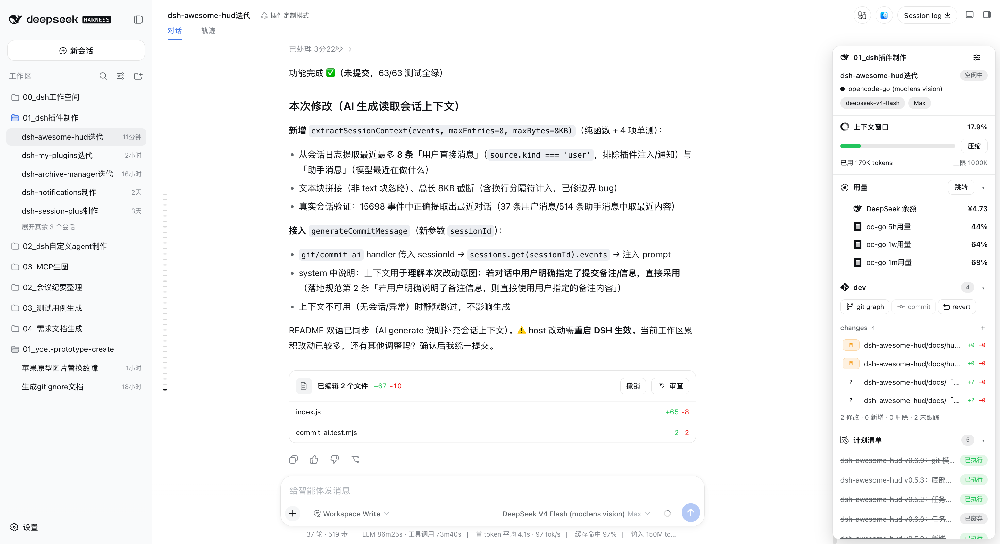

HUD in DSH (dark theme)

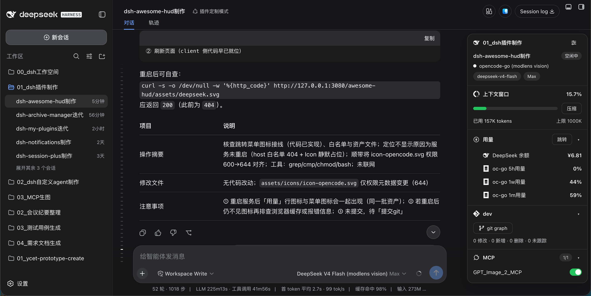

---

> [!NOTE]
> A DSH Web plugin installed through the `dsh.bundle.patch` channel. A new "HUD panel" button appears at the top-right of the chat page; the floating panel cooperates with the official right sidebar and the [dsh-better-sidebar](https://github.com/omdsh-dev/DSH-better-sidebar) right sidebar so they never overlap and the body is never padded with extra blank space.

## 📑 Table of Contents

- [✨ Features](#-features)
- [🚀 Quick Start](#-quick-start)
- [🧭 Usage](#-usage)
- [🖼️ Screenshots](#️-screenshots)
- [⚙️ Compatibility](#️-compatibility)
- [🔧 Tech Stack](#-tech-stack)
- [⬆️ Upgrade Notes (v0.11.x → v0.15.15)](#️-upgrade-notes-v011x--v01515)
- [📄 License](#-license)

---

## ✨ Features

| Module         | Description                                                                                                                                                                                                                                                                                                                                                                                                                                                                                                                                                                                                                                                                                                                                                                                  |
| -------------- | -------------------------------------------------------------------------------------------------------------------------------------------------------------------------------------------------------------------------------------------------------------------------------------------------------------------------------------------------------------------------------------------------------------------------------------------------------------------------------------------------------------------------------------------------------------------------------------------------------------------------------------------------------------------------------------------------------------------------------------------------------------------------------------------- |
| Session        | Current workspace name, session name, session state (Running / Awaiting approval / Idle / Awaiting answer / Waiting for subagents), model provider, model, reasoning effort; a pencil button to the right of the session name allows renaming (click to enter edit mode with input + cancel/confirm, confirm saves and auto-updates the session list title); the gear at its top-right opens HUD settings                                                                                                                                                                                                                                                                                                                                                                                                                                                                                                                                                                    |
| Context window | Context occupancy bar (0–40% green / 40–90% yellow / >90% red), footer with “n used · n limit · n% cache hit” (cache-hit rate is shown to one decimal place; `—` when unavailable), and one-click "Compact" for the current session                                                                                                                                                                                                                                                                                                                                                                                                                                                                                                                                                 |
| Usage          | DeepSeek balance, OpenCode Go percentage usage for the 5h/1w/1m windows, and Codex remaining-quota percentages (subscribed accounts get the 5-hour/weekly rows; accounts without a subscription get a single `Codex free quota` row, mutually exclusive with those two; plus a `Codex gpt-reserve quota` row in the same style whenever `dsh-codex-subscription` reports a gpt-reserve quota), led by matching icons and indented; the Usage module is always rendered (it can be hidden in the HUD settings), the DeepSeek balance row is always shown (`—` and still clickable when no data is available), and the OpenCode Go / Codex rows render independently according to installation/sign-in state (the whole group is hidden with no data, and figures open the matching settings page when clickable)                                                                                                                                                                                                                                                                                                                                                                                                                                                                                                                    |
| git            | Always shown (on both the blank session page and session pages; when the workspace is not a git repository the title bar offers "init repo" at the right, which runs `git init` in that workspace and then swaps itself for the branch button); current branch (branch button at the right of the git title bar: a dropdown to switch existing branches — current branch highlighted with a check — or type a new name and click "Add" to create and auto-switch), changed-file counts; changed files grouped into staged / changes (group names with gray counts, empty groups hidden); clicking a file row stages / unstages / reverts it; the "commit" button commits the staged area (manual input or an AI-generated message that follows the built-in local git convention [YYMMDD] project vX.Y.Z: summary) and "revert" discards all unstaged changes (tracked files are restored; untracked new files and intent-to-add files are deleted; staged files are NOT discarded and the UI says so; directory entries that cannot be deleted, such as nested repositories/submodules, are reported explicitly; destructive actions all require a confirmation dialog listing affected files); the "git graph" popup (commits across all refs shown in pages of up to 80 each, with a "Load more" button at the bottom of the list appending the next page until the full history is loaded; the current branch uses a blue-filled white label and other branches use gray-filled black labels); right-clicking a commit row opens a menu — copy short hash (7 chars) / full hash (40 chars) / commit subject, create a branch here, merge into the current branch, or soft / mixed / hard reset, with an inline input plus icon buttons for branch creation and an inline second confirmation for merge and reset |
| Subagents      | All descendant subagents of the session (indented by depth) with running (yellow) / done (green) states; clicking an entry opens the subagent conversation in the official right sidebar while keeping the main conversation; shown only when subagents exist                                                                                                                                                                                                                                                                                                                                                                                                                                                                                                                                                                                                       |
| Tasks          | To-do list of the current session with done/pending states and a counter (e.g.`1/3`), refreshing live; in-progress tasks show a spinning animated icon and the bottom row shows the completed / in progress / pending counts (all three shown even at zero); shown only when tasks exist                                                                                                                                                                                                                                                                                                                                                                                                                                                                                                   |
| Plan list      | Every plan produced by plan mode (`exit_plan_mode`) in the current session, with three-state badges — pending review (yellow) / approved (green) / discarded (gray, struck-through dimmed text) — the header shows the total count, clicking a row opens the full plan, and the bottom row shows the approved / pending review / discarded counts (all three shown even at zero); shown only when plans exist                                                                                                                                                                                                                                                                                                                                                                            |
| MCP            | All connected MCP servers with their DSH-global enabled state; the switch toggles DSH-global MCP servers through the DSH plugin manager (row-level edits in the profile `cordis.patch.yml` plus a hot reload: effective immediately, no page refresh, and no effect on other servers)                                                                                                                                                                                                                                                                                                                                                                                                                                                                                                                                                                                                    |

| Notes         | **Workspace-shared** notepad (all sessions under the same workspace directory share one note, persisted locally); a drag handle at the bottom of the input adjusts height (persisted in real time), 5000-char limit with a live counter, a side dot indicates content exists; one-click adds the full note text to the conversation composer; the Clear button is disabled when empty and requires a second confirmation click when content exists; collapsible/expandable (state persisted)                                                                                                                                                                                                                                                                                                                                                                                                        |
| Todo          | **Workspace-shared** to-do list (all sessions under the same workspace directory share one list and its order, persisted locally); check/uncheck complete, add/delete items, drag-to-reorder whole rows (drag handle at the far left before the checkbox), one-click clear completed (confirmation dialog, button disabled when no completed items); bottom shows completion count; collapsible/expandable (state persisted)                                                                                                                                                                                                                                                                                                              |

**Mutual exclusion**: the HUD panel cooperates with the official right sidebar and the [dsh-better-sidebar](https://github.com/omdsh-dev/DSH-better-sidebar) right sidebar. While a right sidebar is expanded the HUD is **derived hidden** — it is only temporarily invisible, its per-session open memory is **not rewritten**, and the body is never padded with extra blank space; closing the sidebar restores the panel automatically (unless the user had explicitly collapsed the HUD). Clicking the "HUD panel" button while the sidebar is open collapses the sidebar first, then shows the HUD (if auto-close fails due to version compatibility the panel stays hidden until the sidebar is closed, then appears); the blank session page does not show its floating entry while a right sidebar is expanded.

## 🚀 Quick Start

**Option 1: install from GitHub remotely (recommended)**

```bash
# 1. Install (pinned to a release tag; requires git access to GitHub)
dsh plugin --profile web add "github:Ycet/dsh-awesome-hud#v0.15.15"

# 2. Restart the DSH Web service and refresh the page
```

**Option 2: install from local source (development)**

```bash
# 1. Install (replace <absolute-path-to-plugin> with your local source directory)
dsh plugin --profile web add "dsh-awesome-hud@link:<absolute-path-to-plugin>"

# 2. Restart the DSH Web service and refresh the page
```

**Option 3: install from a Release asset (tarball; no git, no npm account)**

```bash
# 1. Install (use the Release asset URL directly, or pass a downloaded .tgz path)
dsh plugin --profile web add "https://github.com/Ycet/dsh-awesome-hud/releases/download/v0.15.15/dsh-awesome-hud-0.15.15.tgz"

# 2. Restart the DSH Web service and refresh the page
```

After installation, a "HUD panel" button appears at the top-right of the chat page (left of the "Open workspace" button); click it to toggle the panel.

> [!NOTE]
> The HUD panel is expanded by default, and **each session remembers its own open/closed state** (stored per session id in localStorage): collapsing it in session A never affects session B. **The blank/new-session page is the exception**: it always starts collapsed (in-memory only — nothing is written to localStorage, so no session's memory is touched) and offers its own floating "HUD panel" button in the top-right for opening it on that page (that button is hidden while an image is opened in the **full-screen preview**, so it never floats above the image or the preview's close button; it also keeps the chat page's order and spacing — always to the left of the top-right utility cluster, so with better-sidebar installed its bottom-panel toggle follows the HUD entry). Module visibility is stored in the DSH profile settings and syncs across browsers/devices with the profile.

### Desktop installation (macOS)

Current version: **0.15.15**. Fully quit DeepSeek Harness, then install with the CLI bundled with the desktop app. Use that CLI when managing the `desktop` profile.

```bash
"/Applications/DeepSeek Harness.app/Contents/Resources/runtime/cli/bin/dsh" plugin --profile desktop add "dsh-awesome-hud@link:<absolute-path-to-plugin>"
```

Reopen the app and click the HUD button in the conversation header. Codex quotas require an installed, signed-in `dsh-codex-subscription` version compatible with your DSH runtime. The DeepSeek balance prefers `dsh-account-usage` and falls back to the DSH official account service (requires a DeepSeek sign-in) when that plugin is missing or disabled; OpenCode Go usage and the settings tabs come from `dsh-account-usage`.

> [!NOTE]
> Notes, todos, folds and panel visibility are stored in the current browser or desktop app's `localStorage`. Installing the plugin does not copy these records from your Web browser. DSH manages model settings and credentials.

## 🧭 Usage

- **HUD panel**: floats at the top-right of the chat page, 300px wide; its height is capped at the composer's bottom edge (with an 8px bottom margin) and scrolls internally when content overflows (the scrollbar appears only while scrolling and fades out 2s after scrolling stops); while the panel is visible the chat content and the composer automatically shift left so nothing overlaps; the page scrollbar stays at the window's right edge (it is no longer dragged to the panel's left edge by the body shift), and the turn-navigation indicator on the session page stays at the body's right edge; while a right sidebar is expanded the panel is hidden and the body is not padded, and it returns once the sidebar closes.
- **Settings menu**: the gear at the top-right of the Session module opens a menu to toggle "Context window / Usage / git / Subagents / Tasks / Plan list / MCP" modules ("Usage" is always listed and can be toggled as a whole), with "Cancel / Confirm" buttons at the bottom; the Session module is always shown. When any data source is available, the menu also shows a "Usage module content" group to independently show/hide the DeepSeek balance, OpenCode Go usage, and Codex quota row groups.
- **Session module**: a pencil button to the right of the session name allows renaming — click to enter edit mode (input + cancel/confirm icon buttons), Enter to submit, Esc to cancel, confirm is disabled while the input is empty; on confirm the new name is saved and the session list title auto-updates.
- **Context window**: the bar color switches automatically with occupancy; its footer reads “n used · n limit · n% cache hit”, with the cache-hit rate fixed to one decimal place (`—` when no statistic is available); "Compact" is available while the session is idle and disabled with a reason while it runs.
- **Usage module**: sits below the Context window module and is **always rendered** (it can still be hidden in the HUD settings). The DeepSeek balance prefers the dsh-account-usage routes and falls back to the DSH official account service when that plugin is missing or disabled; Codex uses the dsh-codex-subscription browser RPC; loads immediately when the panel opens and polls every 60 seconds; rows are indented and led by their matching icons; the module is collapsible and expanded by default (fold state persists in localStorage).
  - **DeepSeek balance**: shows the total (top-up + granted); the "Open" button pops up a menu to jump to the deepseek open platform or the opencode go usage page; **clicking the balance figure** opens the settings dialog on the official Account & balance page (it falls back to the plugin's Account section when the official page is unavailable, e.g. signed out or an older DSH) with the deepseek tab selected when dsh-account-usage has injected it, and silently stays on the official account page otherwise. This row is **always shown**: it prefers dsh-account-usage (requires `DEEPSEEK_PLATFORM_TOKEN`) and falls back to the DSH official account service (requires a DeepSeek sign-in) when that plugin is missing or disabled; without data the figure reads `—` and the click behavior is unchanged.
  - **OpenCode Go usage**: three rows showing the **percentage** of the oc-go 5h / 1w / 1m windows; **clicking a percentage** opens the settings dialog on the official Account & balance page with the opencode go tab selected; shown only with a configured OpenCode Go Key and an active subscription (the `/api/account-usage/opencode` route returns `ok + keySource`) — the whole group is hidden (and not clickable) when there is no data.
  - **Codex quota**: subscribed accounts get two rows, `Codex 5h quota` and `Codex weekly quota`, showing **integer remaining percentages**; an account without a subscription receives only a single ~30-day monthly window, so a `Codex free quota` row (that window's remaining percentage) is shown instead and the 5h/weekly rows are **not rendered** — the two forms are mutually exclusive. The subscription state is inferred from the **shape of the quota windows** (a 5h or weekly window means subscribed), because the subscription plugin's RPC exposes no plan field; if the monthly window's duration differs from the expected one, the limit's first usable window is used as a fallback so that `—` only appears when there is no data at all. All rows use the ChatGPT icon and **clicking a percentage** opens the "Codex subscription" settings page. Rows appear only when `dsh-codex-subscription` is installed and signed in; after a confirmed sign-in, temporary quota failures keep the rows visible as `—` **in the mode shown before the failure** (a subscribed account never flips to the free-quota row), while an unavailable sign-in state hides them.
  - **gpt-reserve quota**: when `dsh-codex-subscription` reports a gpt-reserve quota (the `additional_rate_limits` entry of `/wham/usage` whose `id` is `base_model_inference` and whose `limit_name`/`name` is `gpt-reserve`; the plugin matches **either id or name**, normalized across case, underscores, hyphens and spaces), a `Codex gpt-reserve quota` row is appended below the 5h/weekly rows (below the free-quota row when not subscribed) with the **exact same style, icon and interaction** as the existing quota rows (its primary window's remaining percentage; a named quota renders as `Codex gpt-reserve quota (name)`). When the quota is absent the row is **not rendered**; when it exists but its window data is malformed the row stays with `—`.
  - **Module visibility & configurability**: the module is always rendered. The DeepSeek balance row is always shown (data comes from dsh-account-usage or the official-account fallback, `—` when unavailable); OpenCode Go and Codex rows render only when their data source is available, and a one-line setup hint appears inside the module when no data source is available. The displayed content can be toggled independently in the "Usage module content" group (persisted in host settings, synced with the profile).
- **git module**: always shown — on both the blank session page and session pages, including workspaces that are not a git repository (the title bar then offers an "init repo" button in the same spot as the branch button; clicking it runs `git init` in that workspace and the module switches to repository mode — the button becomes the branch button and the body gains the action row and change summary, kept fresh by the regular polling; the button never appears once a repository exists). Refreshes every 5 seconds while the panel is open (immediately after write operations); the branch button at the right of the title bar opens a dropdown — switch existing branches (current branch highlighted with a check; clicking the current branch reports "Already on branch" instead of closing silently) or type a new name and click "Add" to create and auto-switch; the "git graph" popup shows commits across all refs in pages of up to 80 per page — scrolling to the bottom reveals a "Load more" button that appends the next page, until the full history is loaded (an "All commits loaded" hint then appears at the end of the list); the current-branch label is blue with white text and other branch labels are gray with black text; the HEAD commit is marked with an enlarged white-filled, blue-stroked dot. Right-clicking a commit row opens a menu to copy the short hash (7 chars) / full hash (40 chars) / commit subject, plus these protected operations:
  - **Create branch here**: the menu item is replaced in place with a text input plus "Cancel" / "Confirm" icon buttons (the confirm button is disabled while the input is empty). Confirming runs `git checkout -b <name> <commit>`, creating the branch at that commit and switching to it; on success the menu closes, the git snapshot and the commit graph refresh, and the new branch label immediately shows as the blue current branch. A duplicate branch name, or local changes that block the switch (affected files are listed), shows a toast and **keeps the typed name** so it can be corrected and retried — nothing is stashed and no forced checkout is performed. Pressing Enter never submits, Escape cancels the input and restores the plain menu item (a second Escape closes the menu), and the item stays disabled while another Git operation (merge / rebase / cherry-pick / revert) is in progress.
  - **Merge into current branch**: the menu item is first replaced in place with inline “Confirm? / Cancel” controls; confirmation runs `git merge --no-edit`. Already-up-to-date, local-changes block, and conflict auto-abort with a file list are all handled with friendly toasts.
  - **reset (soft) — keep staged**: available only for a commit before HEAD in the currently checked-out local branch history. After secondary confirmation, `git reset --soft` rolls back to it and keeps the contents of later commits staged.
  - **reset (mixed) — unstage changes**: under the same branch-history restriction, secondary confirmation runs `git reset --mixed`, keeping the contents of later commits in the working tree but unstaged.
  - **reset (hard) — discard changes**: after secondary confirmation, `git reset --hard` rolls back to the selected commit and discards the contents of later commits plus uncommitted changes to tracked files; untracked files are retained.
  - Reset is unavailable with no checked-out local branch, while another Git operation is in progress, when the selected commit is outside the current branch history, or when it is already HEAD. Changed files are grouped and shown with status letters colored by type — modified `M` yellow, added `A` blue, deleted `D` red, untracked `?` gray (renamed `R` / copied `C` blue):
  - **Groups**: `staged` and `changes` (includes untracked) with a gray per-file count next to each group name plus one-click buttons: "+" on changes stages every unstaged file, "-" on staged unstages every staged file; a group hides when it has no files
  - **File row actions**: clicking any file row opens an action menu — staged files offer "remove from stage"; changes files offer "add to stage" and "revert" (reverting an untracked new file or an intent-to-add file deletes it; every destructive action requires a confirmation dialog listing affected files)
  - **commit**: disabled while nothing is staged; opens a dialog with the number of staged files to commit, a multi-line input, AI generate and commit buttons; commit is disabled while the input is empty; Enter inserts a newline, and only the commit button submits; only the staged area is committed
  - **AI generate**: uses the model selected in the current session with the full staged diff (truncated over 16 KB) and the recent conversation context of the current session (direct user messages and assistant replies — a commit note explicitly specified by the user in the conversation is used verbatim), generating the message per the built-in local git commit convention — `[YYMMDD] project-name vX.Y.Z: summary` (date = current system time; version bumped strictly by the rules: breaking change → major, backward-compatible feature → minor, fix/docs → patch; project name and current version come from the nearest package.json above the workspace); afterwards the result is validated — the version must be strictly greater than the current one, otherwise it regenerates once (with the previous output and the failure reason as feedback) and, if it still fails, fills the message in anyway and warns you to verify it
  - **revert**: disabled when there are no unstaged changes (including untracked); the confirmation dialog lists every affected file (untracked files prefixed with `?`); after confirmation, unstaged changes of tracked files are reverted and untracked new files plus intent-to-add files are deleted; the dialog and the staged group explicitly state that staged files are NOT discarded (unstage them first if you want to discard them); directory entries that cannot be deleted (nested repositories/submodules) are skipped with an explicit warning instead of being reported as successfully reverted
- **Subagents module**: lists every descendant subagent indented by depth; running entries show a **yellow** badge and done entries green; clicking an entry opens the corresponding subagent conversation in the official right sidebar while keeping the main conversation. Nested entries carry their direct parent and session mode. A missing sidebar API produces a visible failure message.
- **Tasks module**: lists the current session's pending tasks; in-progress tasks show the official DSH spinning ring icon (1s/rev, brand blue), while completed/pending keep the check and to-do icons; the bottom of the module shows "x completed · x in progress · x pending" counts (all three always shown, including zeros), and the header keeps the "completed/total" counter.
- **Plan list module**: sits below the Tasks module and lists every plan produced by plan mode in the current session (newest first); it appears only when plans exist and refreshes every 5 seconds while the panel is open. States are derived automatically from the session log:
  - **Pending review** (yellow badge): the plan was just produced and the user has not approved it yet;
  - **Approved** (green badge): the user approved it in the plan review (an approving `exit_plan_mode` result), entering the execution stage. A later plan-mode exit does not discard it; this badge does not mean every step has finished;
  - **Discarded** (gray badge, struck-through dimmed text): the review did not pass — a failing result (rejection / requested changes / aborted review), the user clicking "Request changes" on the plan review card (which closes the review and returns to the composer; since DSH 0.2.1-rc.5 that path returns a **successful** `{ approved: false }` result while plan mode stays active, so the HUD reports it as discarded right away), or the plan receiving no approval outcome while plan mode was later exited (e.g. `/plan off`). Message-level error flags, legacy result blocks, result wording and plan-mode exit signals are all supported;
  - The row label is the plan's first Markdown heading, falling back to an excerpt of the body; clicking any row opens a modal with the plan's title, state, creation time and body (lightweight Markdown rendering: headings, lists, code blocks, links, quotes and GFM tables). The bottom of the module shows "x approved · x pending review · x discarded" counts (all three always shown, including zeros). The module is collapsible and expanded by default.
- **MCP module**: toggles DSH-global MCP server state through the official DSH plugin manager (`pluginManager.setPluginEnabled`), which edits the profile `cordis.patch.yml` row by row and waits for the hot reload to finish, so the switch takes effect immediately without a page refresh, touches only the target server and never rewrites other plugins' configuration; profiles without HMR report "takes effect after a restart"; the module is expanded by default and stays visible with an empty state when no MCP server exists.
- **Notes module**: a **workspace-shared** notepad — keyed by the session's workspace directory, so every session under that directory shares one note (including the input height), persisted locally; deleting or archiving any/all sessions never affects the note, and a new session created later in the same workspace still finds it; the drag handle at the bottom of the input adjusts height (persisted in real time), with a 5000-char limit and a live counter; a side dot indicates the note has content; one-click adds the full note text to the conversation composer (on a blank session page it targets the workspace's most recent session); the Clear button is disabled when empty, and the first click with content enters a red confirmation state; a second click clears the note, while clicking elsewhere, pressing Escape or waiting 2 seconds cancels; the module is collapsible/expandable (state persisted). Sessions with no workspace (`cwd`) fall back to session-local isolation instead of sharing.
- **Todo module**: a **workspace-shared** to-do list — keyed by the session's workspace directory, so every session under it shares one list and its order (persisted locally); check/uncheck complete, add/delete items, drag-to-reorder whole rows (drag handle at the far left before the checkbox), one-click clear completed (confirmation dialog, button disabled when no completed items); the bottom shows a completion count; the module is collapsible/expandable (state persisted). Concurrent edits from several sessions/tabs in the same workspace are merged by item id instead of overwriting each other.
- **Fold state**: each module's collapsed/expanded state survives page refreshes (localStorage); the Session module uses the DSH favicon.
- **Blank session page**: its own floating "HUD panel" button appears in the top-right (the page has no conversation header; on Windows it sits below the native caption, with that offset removed in fullscreen). **That button is hidden while the full-screen image preview is open** — the preview is a viewport-filling modal overlay (`role="dialog"` + `aria-modal`, e.g. the `dsh-codex-subscription` image viewer) while the HUD entry lives far above it in the stacking order, so without hiding it the entry floats above the image and the preview's top-right close button; closing the preview restores the button, and the panel's open state is untouched (the check only reads modal semantics plus viewport coverage, never a third-party class name). Each entry starts collapsed. Opening the panel reserves 300px on the right for the fixed panel and shifts the body and composer left; the button stays in place. While the official right sidebar (including dsh-better-sidebar) is expanded, both the floating entry and the panel are hidden — the entry no longer moves left of the sidebar and no longer takes the expanded panel's position as its own; once the sidebar closes the entry appears **immediately at its pre-open position** instead of flashing at the sidebar edge, and the page restores its previous open state (unless the HUD was explicitly collapsed). Git, notes, todos and the note-send target use the same recent workspace. Global MCP data loads and polls independently and can be viewed or toggled even without any session or workspace. The page renders the Session / Usage / Git / Notes / Todo / MCP modules (Git is always present and offers "init repo" when the target workspace is not a repository; the Usage module is always rendered and its DeepSeek balance shows `—` when no data is available); rename is disabled until a session record exists. Entering a real session restores its own open/closed memory, and the header button takes over.

## 🖼️ Screenshots

### Module Previews

#### Session module

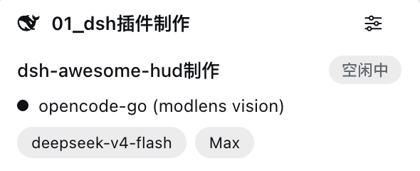

#### Context window module

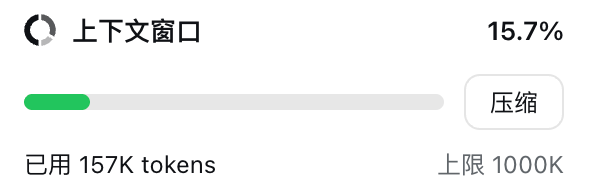

#### Usage module

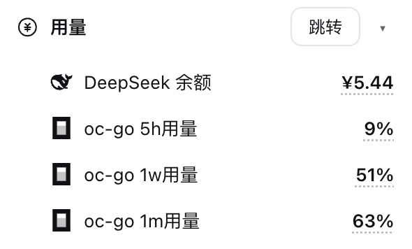

#### git changes module

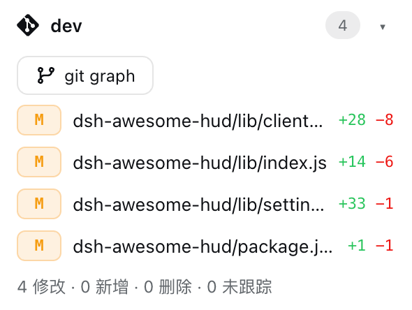

#### Subagents module

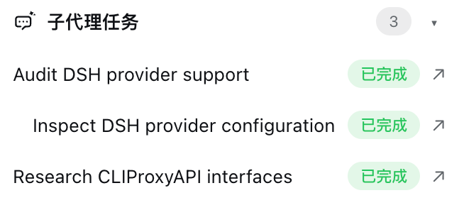

#### Tasks module

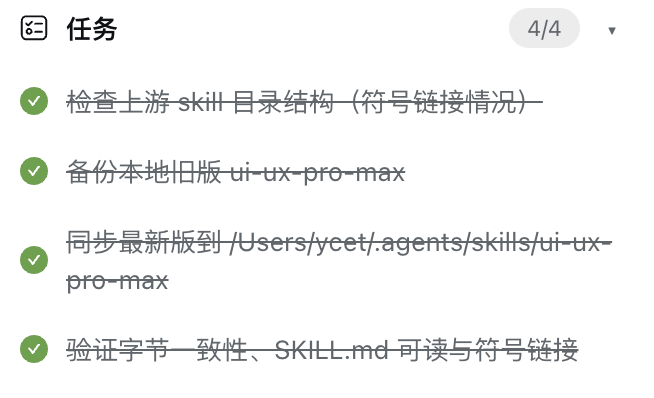

#### Plan list module

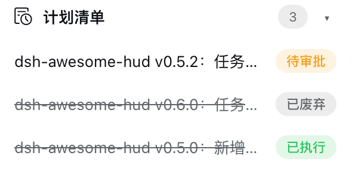

#### MCP module

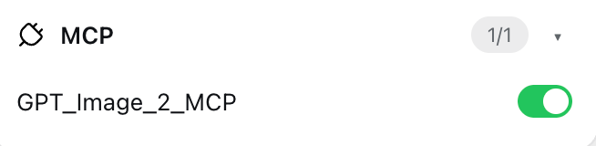

#### Notes module

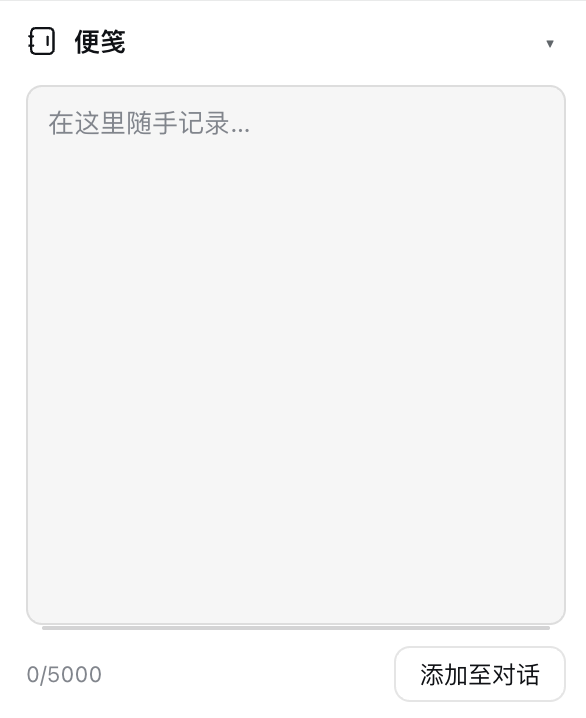

#### Todo module

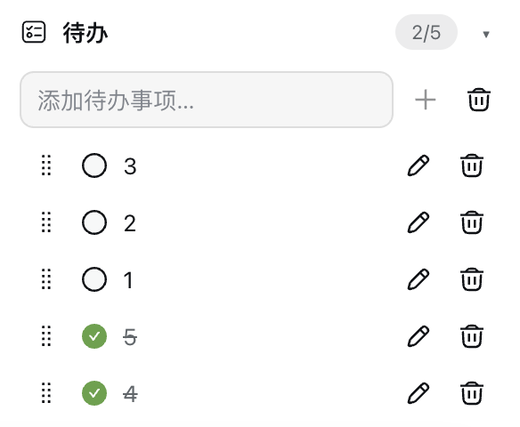

### Other interfaces

#### HUD Settings

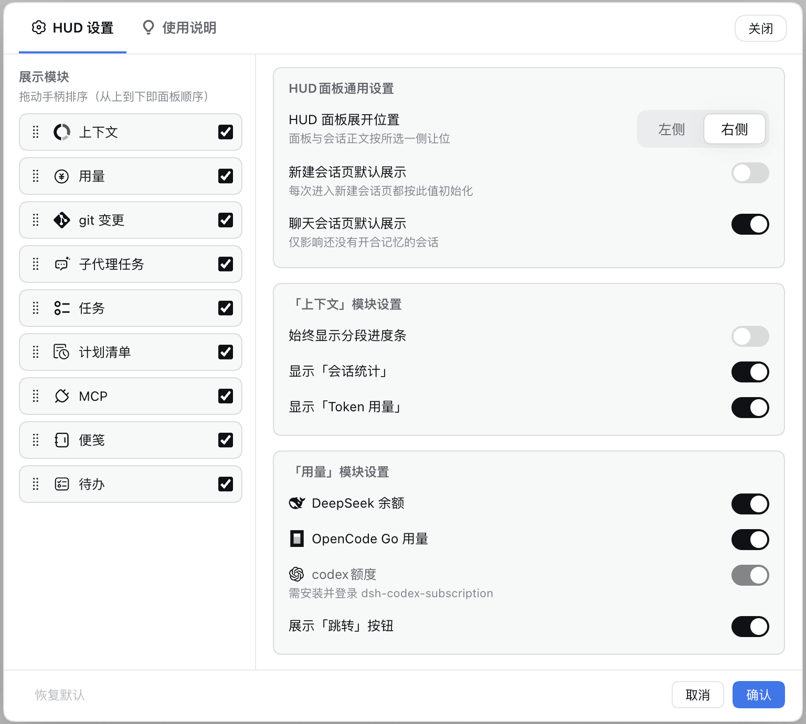

#### git graph interface

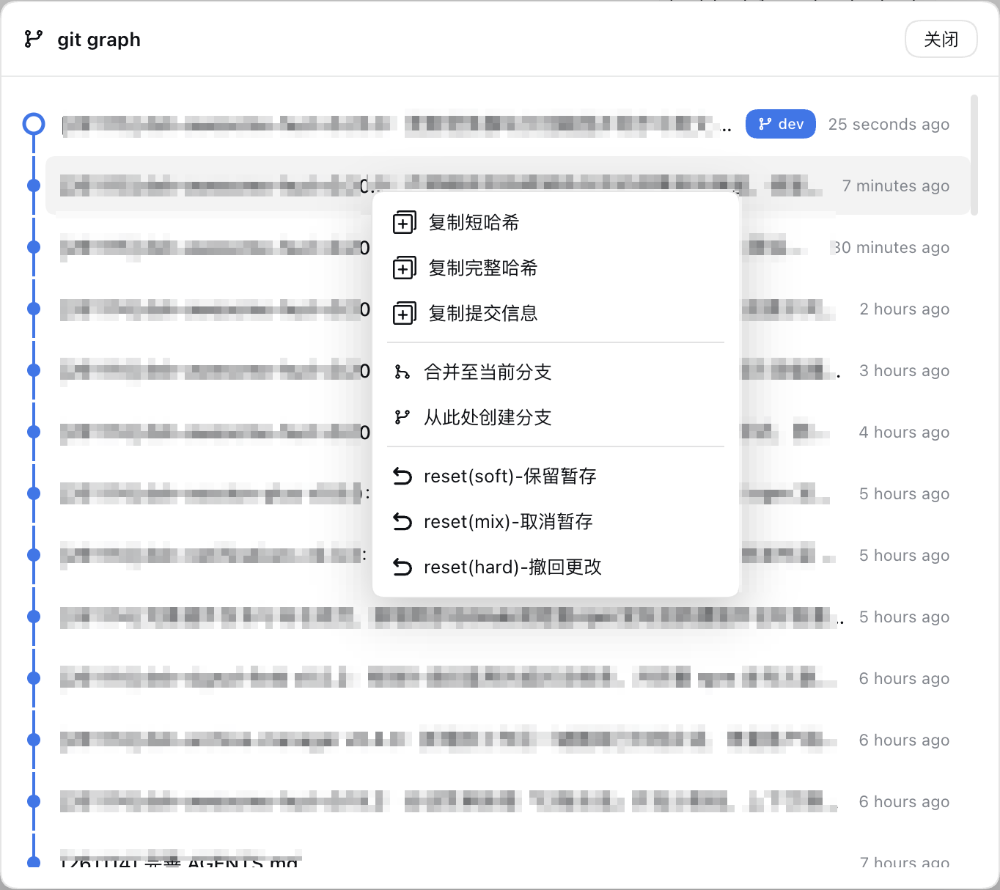

#### git commit interface

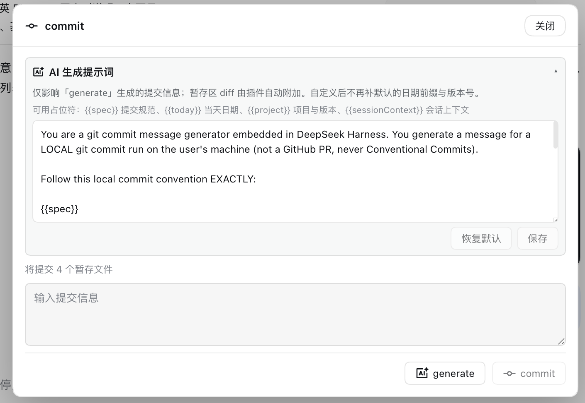

#### Plan content interface

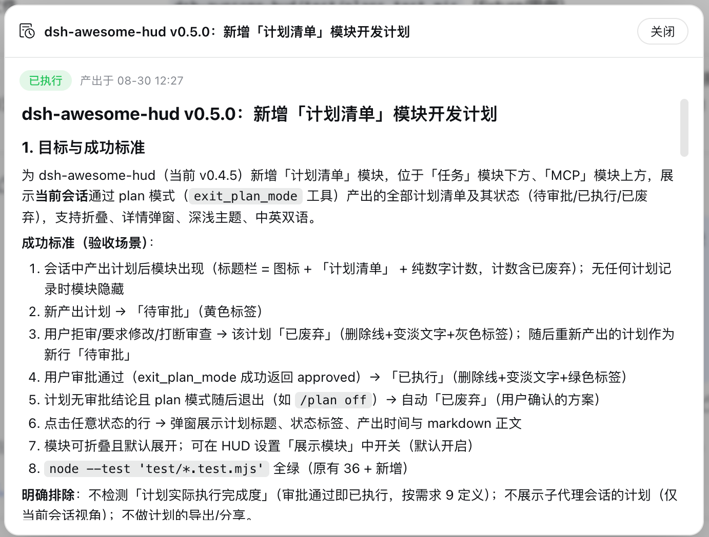

## ⚙️ Compatibility

See the [v0.14.7 desktop verification record (Chinese)](docs/desktop-compatibility-0.14.7.md) for the tested environment, coverage, and reproduction steps.

| Item               | Version / Notes                                                                                                                                                                                                           |
| ------------------ | ------------------------------------------------------------------------------------------------------------------------------------------------------------------------------------------------------------------------- |
| DeepSeek Harness | macOS desktop `0.2.0-rc.2`; legacy Web API fallbacks remain available; other versions require verification |
| dsh-client-ui-subagent | Subagent conversations open as official `subagentchat` resources in the right sidebar. Versions without this API show a failure message and keep the main conversation |
| dsh-plan-mode      | Data source of the Plan list:`exit_plan_mode` tool calls in the session log (`tool/call` / `tool/result` / `plan/mode` events); re-check the state derivation if the upstream review semantics change             |
| dsh-better-sidebar | `0.16.1` (listens to the panel state through the public `ctx.betterSidebar` service and participates with the official right sidebar in the HUD's derived visibility; collapsing it from the HUD button relies on its collapse button's DOM marker, and if that fails the panel stays hidden until the sidebar closes — the HUD works standalone regardless) |
| Platform           | macOS verified; Windows/Linux theoretically compatible (identical git command behavior)                                                                                                                                   |
| Theme              | Follows light/dark themes (uses`--dsw-alias-*` theme tokens)                                                                                                                                                            |
| Language           | Simplified Chinese / English, follows the DSH locale                                                                                                                                                                      |
| Icon               | Top-level `icon` in `package.json` (in-package relative path `icon.png`, 448×448 PNG, raw bytes ≤256 KiB); requires DSH support for manifest icons, older versions fall back to the default artwork                          |
| Data scope         | Notes and Todo are shared per workspace directory (`localStorage`); sessions without a `cwd` fall back to session-local isolation                                                                                        |
| Panel open state   | Persisted per session id in `dsh-awesome-hud:open` (a `{ "session id": "1"|"0" }` map); the blank session page never persists it; visibility = open memory ∩ both official and better-sidebar right sidebars collapsed |

## 🔧 Tech Stack

| Category     | Content                                                                                                                                                                                                         |
| ------------ | --------------------------------------------------------------------------------------------------------------------------------------------------------------------------------------------------------------- |
| Host         | Node.js ESM, `ctx.webServer` prefix routes, `ctx.settings`, `ctx.subagents`, `ctx.agents` / `ctx.commands` (compaction), `ctx.subprocess`, `ctx.llm` (AI commit messages)                                 |
| Client       | Native JavaScript ModuleLoader bundle, React (`react.createElement`), Cordis Slots (`conversation.session.header.utilities` / `shell.overlay`), CSS theme variables; no new slot — the blank-session entry reuses `shell.overlay` |
| Data sources | Client-side session projection (`ctx.sessions.list` / `workspaces` / `modelDirectories`) + own host APIs (git / MCP / subagents / plan list / compaction) + reused dsh-account-usage balance/usage routes (falls back to the official `deepseekAccount` service when missing) |
| Tests        | `node --test` (git parsing, MCP parsing, status derivation, plan-list derivation, settings normalization, trust fence; in `test/`)                                                                          |

## ⬆️ Upgrade Notes (v0.11.x → v0.15.15)

**v0.15.15: the Usage module no longer requires dsh-account-usage to appear.** Previously the module's visibility depended on "DeepSeek / OpenCode / Codex at least one available", so disabling or uninstalling dsh-account-usage removed the whole module and its settings row. The module is now always rendered (it can still be hidden in the HUD settings), and the DeepSeek balance row is always present: it prefers the dsh-account-usage balance route and falls back to the official DSH account service (a new host route `usage/account`, cached for 30s; requires a signed-in DeepSeek account) when that plugin is missing or disabled (404 / no token), reading `—` when no data is available. **Clicking the balance figure always opens Settings → Account & balance**; without dsh-account-usage the injected tabs are absent, so the jump silently stays on the official account page instead of failing. The three OpenCode Go window rows render only while dsh-account-usage data is available (hidden and non-clickable otherwise); Codex quota rows are unchanged. Added host balance normalization/cache tests plus client rendering, fallback polling and missing-tab navigation regressions.

**v0.15.14: adapted the Usage module's settings jump to the official Account & balance page.** Since `dsh-account-usage` v0.3.0, the plugin embeds its deepseek / opencode go tabs into the official Account & balance settings section instead of registering a separate "Account" section; the HUD used to match only "账户" exactly, so clicking a balance/usage figure timed out and reported "cannot open account settings". Section matching now accepts "账号与余额", "账户" and "Account"; after opening it clicks the deepseek or opencode go tab as requested: the DeepSeek balance figure opens the deepseek tab, and the oc-go 5h / 1w / 1m percentages open the opencode go tab. When the official page is unavailable (signed out / older DSH) the plugin's own Account section is still used; Codex quota navigation is unchanged. Added regressions in `test/desktop-compat.test.mjs` for the Chinese/English section labels, the fallback and label precedence, and updated the value tooltips.

**v0.15.13: the page scrollbar returns to the window's right edge while the HUD panel is open.** The layout reservation only added `margin-right` to the conversation body, but the scrollbar belongs to the scroll element inside it (`[data-conversation-scroll]`), so it was dragged to the panel's left edge on both the session page and the blank-session page. The reservation now also pushes the scroll container back to the right by the panel width (`margin-right: -300px`) with an equal `padding-right: 300px` to keep the content width: the scrollbar returns to the window's right edge and stays visible in the 8px gap right of the panel, while the body and composer keep their position and width. The body's existing variables and measurements are untouched, so the turn-navigation indicator at the session page's right edge keeps its position. The scroll-container writes participate in the same node-rebuild reconcile and ownership-checked restore as the body writes. Added write/restore and position regressions in `test/layout-push.test.mjs`.

**v0.15.12: added the regression tests and documentation for the floating entry flash on the blank session page when the right sidebar closes.** The code fix landed with the v0.15.11 commit (it shared the working tree with the parallel blank-band fix): the entry is hidden while a right sidebar is expanded and no longer positions itself from the stale panel edge measured during the closing animation, so it returns straight to its pre-open position once the sidebar closes. This version adds the behavioural regressions in `test/new-session-entry.test.mjs` (the entry keeps its position through the whole open/close cycle and never takes the expanded panel's position) plus source-shape assertions, and documents the restore behaviour in the blank-session-page and mutual-exclusion sections.

**v0.15.11: fixed a blank band left on the right of the conversation body after opening and then closing the right sidebar.** The panel reserves room for the conversation by writing four inline properties (`margin-right` plus `--dsh-awesome-hud-column-width`, `--dsh-chat-content-width` and `--dsh-composer-card-max-width`). They used to take the **value present at mount time** as the original, so a single incomplete unmount (the host rebuilding the conversation body, or the panel remounting mid-transition while the sidebar animates) made the snapshot record the plugin's own `300px` as the original — after which every unmount wrote `300px` back, leaving the conversation pushed left with an empty band on the right that only collapsed by hiding the HUD panel manually. Originals now come from a module-level `WeakMap` recorded **once, before the first write**, and survive remounts; the cleanup restores a property only when its current value still equals the value the plugin wrote, so host or third-party changes are never overwritten. Two extra triggers were added: a DOM-change reconcile (debounced to one frame) re-resolves the body node and re-applies the reservation so it cannot vanish when the host rebuilds it, and two post-mount re-checks (350 ms / 900 ms) keep a narrow measurement taken mid-animation from becoming final. The reservation formula and the "only narrow the body" boundary are unchanged. Added four regressions in `test/layout-push.test.mjs`.

**v0.15.10: the blank session page no longer shows its floating "HUD panel" entry while a right sidebar is expanded.** Previously that entry moved to the sidebar's left edge and looked collapsed; now any right sidebar (the official one or dsh-better-sidebar) hides the entry entirely, matching the derived-hidden HUD panel, so the button no longer hovers at the sidebar edge where it could be mis-clicked. Closing the sidebar restores the entry and the page's previous open state. The session-header button, panel positioning and other modules are unchanged. Added regressions for the sidebar mutual exclusion and the source shape.

**v0.15.9: the trust fence now delegates to the official `connection` service.** The HUD host side previously read `ctx.get("webRuntime")?.trustedHosts`, but DSH has never provided a `webRuntime` service, so a trusted-host list could never be resolved for a non-loopback host: with `--host` + `--trusted-host` remote access every HUD `/api/*` route answered 403 (loopback was unaffected, which is why it went unnoticed). The check now calls the official host `connection` service's `requestRejection(request)`, which validates loopback / bind address / `trustedHosts` / `sec-fetch-site` / Origin and requires an authenticated browser Peer in one pass, and falls back to the local check (reading `connection.trustedHosts`, then `webStartup.trustedHosts`) when the service is absent. `engines.dsh: >=0.2.1-rc.2` is now declared so DSH 0.2.2's plugin compatibility gate applies, with two new `test/trust.test.mjs` regressions.


**v0.15.8: fixed MCP switch state rollback and collateral changes to other servers.** The HUD used to rewrite the profile `cordis.patch.yml` itself with a "managed block" and never waited for the host to reload it, which caused two failures: (1) the Loader still held the old state after a click, so the page's 5-second poll reverted the switch; (2) DSH settings persistence appends new rows at the end of the YAML document (before the trailing `# <<<` comment), so those rows landed inside the managed block and the old whole-block rewrite deleted them — a single toggle removed roughly 16 KB of `dsh-connect-workbuddy` configuration, and accumulated pending states made "toggling A also changed B". Toggling now delegates to the official DSH plugin manager (`pluginManager.setPluginEnabled`): it edits the YAML row by row (comment-preserving, sharing the `package.json` file lock with settings persistence), completes the HMR reconcile before returning, and the HUD returns the authoritative snapshot re-read from the Loader. The legacy managed-block marker comments are cleaned up on the first toggle (comments only; every row inside is kept). The client poll gained a toggle sequence guard so a response started before the click can no longer overwrite the new switch state. Added host regressions in `test/mcp-toggle.test.mjs`, marker-cleanup cases in `test/mcp.test.mjs`, a stale-poll client regression, and updated the desktop integration test. Host-side changes take effect after restarting DeepSeek Harness.

**v0.15.7: the plan list no longer shows "Approved" after "Request changes".** Since DSH 0.2.1-rc.5, the plan review card's "Request changes" button only closes the review and returns to the composer: `exit_plan_mode` no longer throws, it returns a **successful** `{ approved: false }` result while plan mode stays active. The HUD used to treat every successful result as approval, so that plan showed as a green "Approved" in the Plan list module. Successful results are now split by their wording: `Plan approved` means approved, while `dismissed the plan review` means the review was closed and the plan is discarded. If a later version changes the wording, the HUD falls back to whether plan mode exited between that result and the next review call; older logs without `plan/mode` events keep the previous behaviour. Existing classifications — failing results for rejection/requested changes, and automatic discarding after `/plan off` with no approval outcome — are unchanged. Added five regressions in `test/plans.test.mjs` and updated the real-runtime case in `test/plan-runtime.test.mjs` (run it with `DSH_TEST_INSTALL_ROOT`).

**v0.15.6: the new-session page's HUD entry now matches the chat page position.** The blank-page floating entry used to sit exactly 8px left of the right-sidebar expand button. With better-sidebar installed, that plugin portals its bottom-panel toggle into the same slot on the blank page; once the HUD took the slot, the toggle retreated to its left, producing the order "bottom-panel toggle → HUD → right-sidebar button" instead of the chat page's "HUD → bottom-panel toggle → right-sidebar button". The floating entry now detects that fallback toggle (`[data-dsh-dock-fallback]`) in the same row and reserves its width plus the standard gap, so it always sits at the left end of the top-right control cluster and both pages share the same order and spacing. Two overlap cases are fixed as well: positioning now runs in a layout effect (corrected before the first paint), and while the fallback toggle is not mounted yet the entry reserves the same-width slot as soon as better-sidebar is active, correcting with the real width once the toggle renders — so the two buttons no longer overlap briefly when the new-session page is first shown or after opening and closing the right sidebar. Nothing changes when better-sidebar is absent or the page renders the session header. Added position-reservation regression tests in `test/new-session-entry.test.mjs`.

**v0.15.5: two silent revert problems fixed, with clearer prompts.** ① Files registered through `git add -N` (intent-to-add, porcelain ` A`) were treated as tracked and went through `git restore`, which emptied the working-tree file while keeping it — they are now removed from the index with `git reset` first, then deleted like untracked files, and the result is verified. ② Untracked directory entries (nested repositories/submodules, porcelain `?? dir/`) were reported as successfully reverted even though `git clean -f` cannot delete them — they are now handled with `git clean -fd` and verified; an all-skipped operation returns an explicit error, while a partially successful one returns the skipped list so the UI can warn. ③ Prompts are clearer: the revert-all confirmation states "N staged file(s) will NOT be discarded", the staged group carries a persistent note, the result toast separates "reverted" from "staged kept", and per-file confirmations explain intent-to-add and staged content. The existing boundary that staged files are out of revert scope is unchanged, and the host snapshot now exposes an `intentToAdd` flag. Added `test/git-revert-safety.test.mjs` (real git) and client confirmation/toast path tests.

**v0.15.4: replaced the plugin manager icon.** The card icon and the "included components" row icon for this plugin in the DSH plugin manager (previously the default artwork) now use the whale HUD artwork from `00_assets/plugin-icons/dsh-awesome-hud/whale-hud-icon-mcp-1k.png`, losslessly scaled to a 448×448 PNG (~210 KB, under the 256 KiB limit, white rounded tile with transparent corners) and declared through the top-level `icon` field in `package.json`. The README now shows a 96px icon under the title, and both READMEs plus the package version are updated to 0.15.4. HUD panel icons, host code, and data behavior are unchanged.

**v0.15.3: fixed the right sidebar overlapping the HUD panel and the blank body placeholder.** On the blank session page, expanding the HUD first, then opening the right sidebar, then sending the first message used to produce both "HUD floating above the right sidebar" and "~300px of blank space right of the body". The cause: the panel's open memory is per session and defaults to open, so the scope switch from the blank page to a real session pulled the panel up without reconciling against the already-expanded official right sidebar; the panel's layout also wrote a `margin-right` push on the body. HUD visibility is now **derived**: `visible = session open memory && right sidebar collapsed`. Expanding a sidebar only temporarily hides the panel and **never rewrites** the open memory, so closing the sidebar restores it naturally; the push styles are applied only while the panel is visible and are now applied/cleaned inside a layout effect in the same commit, so no blank frame is left behind when a sidebar opens. Blank page, session switches and the refresh first frame all share the same rule; a HUD the user explicitly collapsed is never reopened by sidebar toggles; the "HUD panel" button still collapses the right sidebar first, then shows the panel. Sidebar mutual-exclusion and blank-page/new-session regression tests were rewritten accordingly.

**v0.15.1: two Git module defects fixed, plus a full regression suite.** First, **conflict file lists were lost on the way to the UI** — the host route's error branch forwarded only `error` and `code`, and the client's `call()` copied only `code`, so "Failed to switch branch: local changes in these files block the switch:" ended up empty and merge conflicts always showed the fallback "（no conflict files listed）". The structured `files` array is now carried from the host all the way into the toast text. Second, **switching branches from a detached HEAD (after `git checkout <commit>`) was silently skipped** — the `git/checkout` guard skipped the actual checkout whenever the snapshot's `branch` was null while still reporting success, so the UI claimed it had switched. The checkout now runs whenever the target differs from the current branch. Clicking the current branch in the menu no longer closes silently either — it reports "Already on branch "X"". This release also adds two regression suites: `test/git-regression.test.mjs` (real git through the real host routes: snapshots, stage/unstage including 500-file batching, commit and validation, AI message generation, revert, branch create/switch/merge, graph pagination, all three reset modes with eligibility, non-ASCII filenames, trust and input guards) and `test/git-client-flow.test.mjs` (client click paths: branch switching, repo initialization, file actions, error payload pass-through).

**v0.15.0: the git module is always shown and can initialize a repository in one click.** On both the blank session page and session pages the "git" module no longer hides itself when the workspace is not a git repository — it renders as usual and the title bar (same spot as the branch button) offers an "init repo" button that runs `git init` in the current workspace. On success the module switches to repository mode immediately (the button becomes the branch button again and the body gains the git graph / commit / revert actions plus the change summary), and the regular 5-second polling continues. The button never appears once a repository exists; a failed `git init` reports the command error as a toast and leaves the button clickable. The host half gained a `git/init` endpoint (same workspace resolution from the session id, trust fence and timeout rules; idempotent — an existing repository returns the current snapshot without re-running init). The same version also fixes two behaviors in a repository **without any commits**: unstaging (single file and unstage-all) now uses `git reset -q -- <paths>` because the former `git restore --staged` requires HEAD and failed with `fatal: could not resolve HEAD` in a freshly initialized repository; and "git graph" now returns an empty history and shows a "This repository has no commits yet" empty state instead of surfacing the raw `git log` error as a load failure. Added regressions for command order and idempotence, error reporting, title-bar button routing, unstaging in an unborn repository, the empty state, and a real-subprocess repository creation.**

**v0.14.12: fixed the "HUD panel" floating button on the blank session page floating above an opened image preview.** The `dsh-codex-subscription` image viewer is a viewport-filling modal overlay (`role="dialog"` + `aria-modal`, `position: fixed; inset: 0`) while the HUD entry's stacking layer sits far above it, so the entry covered the image and the preview's top-right close button. The entry is now judged by modal semantics plus viewport coverage: it is not rendered while the preview is open and returns as soon as the preview closes (the panel's open state is untouched). The check never binds to a third-party class name, and small dialogs, non-overlay positioning and hidden overlays are all excluded, so the HUD's own popups (which carry no `aria-modal`) never trigger it. Added regressions for the detector, the overlay open/close subscription, and a real render pass that follows hook order.**

**v0.14.11: the Usage module now shows the Codex free quota.** An account without a subscription receives only a single ~30-day monthly window; the HUD previously read just the 5h/weekly windows, so that quota was neither displayed nor replaced — leaving two `—` rows. The subscription state is now inferred from the shape of the quota windows: a 5h or weekly window keeps the existing `Codex 5h quota` / `Codex weekly quota` rows, while an account with neither gets a single `Codex free quota` row (that window's remaining percentage). The two forms are mutually exclusive; if the monthly window's duration differs from the expected one, the limit's first usable window is used as a fallback so that `—` only appears when there is no data at all. Temporary quota failures keep the rows in the mode shown before the failure and blank the figures to `—`, so a subscribed account never flips to the free-quota row. Added regressions for free-quota selection, browser/node mirror parity, mode retention on failure, and the row structure.**

**v0.14.10: fixed the Windows blank-session HUD entry overlapping the native caption, including fullscreen layout. An explicitly empty main-view binding no longer falls back to the list’s previous session; sidebar restoration uses the same page check. Git, notes, todos and the note-send target share one workspace while preserving existing Windows storage keys. MCP loads and polls independently, including pages with no session or workspace, and can be toggled there. Fixed Windows directory labels and the no-workspace label; rename is disabled until a session record exists. Added client data-flow, request-failure and browser-layout regressions. Native Windows desktop verification is still required.**

**v0.14.9: fixed pairing and error detection for modern plan-review result messages, preventing approved plans from being discarded on plan-mode exit and rejected plans from staying pending. Legacy result formats remain supported; mode exits also work when event sequence numbers are absent. Subagent tasks now open as official `subagentchat` resources in the right sidebar, preserving their direct parent and session mode while keeping the main conversation. Added status/navigation regressions and an integration test through the official desktop plan-review workflow.**

**v0.14.8: fixed IME confirmation accidentally adding or saving todos, renaming sessions, or creating Git branches. Text inputs and dialog/menu keyboard handlers now respect composition state: Enter and Escape belong to the IME during candidate selection; a separate Enter after composition performs the existing submit action. The Git graph branch input still requires its confirmation button. Escape during composition in notes or commit messages no longer dismisses the related UI. Added regression tests for IME event ordering and keyboard callbacks.**

**v0.14.7: adapted subagent navigation, settings navigation through the desktop account menu, and live model snapshots. OpenCode links now use the shared console URL. Fixed merge conflict detection and empty MCP patch writes; notes open an unbound target session before appending its draft. Added desktop interface behavior tests and a temporary Git repository test using the real subprocess provider.**

**v0.14.6: fixed the HUD panel covering prompt navigation when expanded.**

**v0.14.5: adjusted the "HUD panel" button's style and position, and stopped it appearing on the DSH plugin management page.**

**v0.14.4: restored the HUD entry on current DSH versions**: the session-page button sits in the top-right utilities and opens or closes the panel. The new-session page again has its own floating button, with the panel hidden by default. When the official right sidebar is expanded, the button moves left of it instead of covering its toolbar.

**v0.14.1: fixed the git graph context menu failing to open**: when the menu's initial state lacked the branch-create input field, it was mistaken for "expanded" and reading its content threw `Cannot read properties of undefined (reading 'text')`, which broke the entire context menu. The field is now initialized explicitly and every read is normalized against `null` / `undefined`.

**v0.14.0: "Create branch here" in the git graph**: the commit-row context menu gained this entry right below "Merge into current branch". Clicking it expands in place into a text input with "Cancel" / "Confirm" icon buttons; confirming creates and switches to a branch at that commit via `git checkout -b`. The confirm button is disabled while the input is empty, duplicate names and local-change blocks show a toast while keeping the typed name, Enter never submits, Escape cancels the input, and the entry stays disabled while another Git operation is in progress.

**v0.13.4: safe note clearing**: the Notes action row now includes a Clear button to the left of Add to chat. It is disabled when the note is empty; with content, the first click enters a red confirmation state and the second click clears the workspace-shared note. Clicking elsewhere, pressing Escape or waiting 2 seconds cancels the confirmation without changing content. If localStorage cannot be written, the original note remains and an error toast is shown.

**The panel's open/closed state is now per session.** Older versions kept a single flag in `dsh-awesome-hud:open`; after the upgrade that value migrates to the first session you enter, while every other session starts expanded and keeps its own memory.

**The blank session page gained a floating entry point**, with the panel in the same position as in a real session (fixed to the right edge); that page always starts collapsed.

Notes and Todo moved from **session scope** to **workspace scope**. The first time the panel opens in a workspace after the upgrade, the plugin performs a one-time automatic merge migration:

- Notes: the entry with the newest `updatedAt` among the workspace's candidate sessions wins;
- Todo: merged by item id (first occurrence wins for duplicate ids), with a stable order;
- The merged result is written under the workspace key and marked in `dsh-awesome-hud:workspace-migrated`, so each workspace migrates only once;
- **The old per-session keys are kept**, so rolling back to the previous version still finds the pre-migration data.

If you want to reclaim the space, once you are satisfied with the migration run `localStorage.removeItem("dsh-awesome-hud:workspace-migrated")` in the browser console and then delete the non-workspace-path keys of `dsh-awesome-hud:notes` / `dsh-awesome-hud:todos` (after that the rollback path is gone).

## 📄 License

[MIT](LICENSE)
